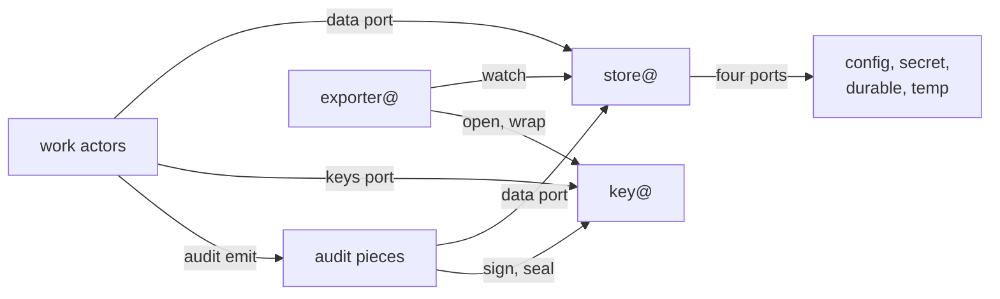
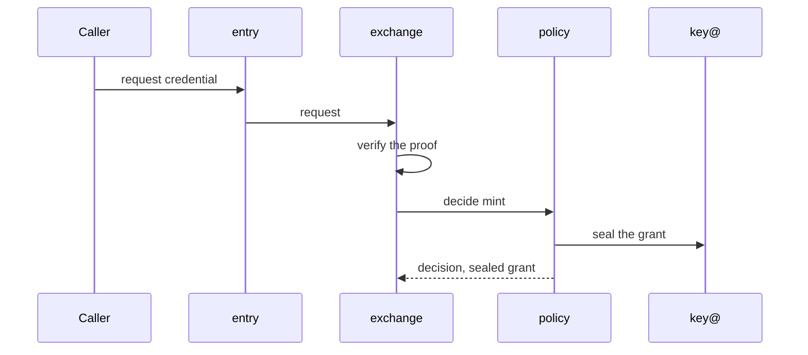
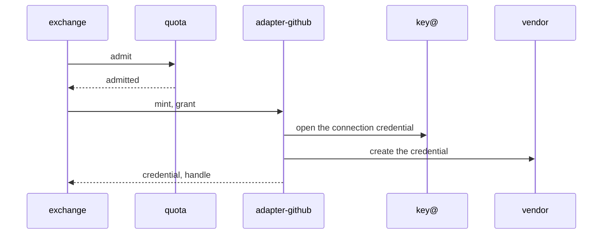
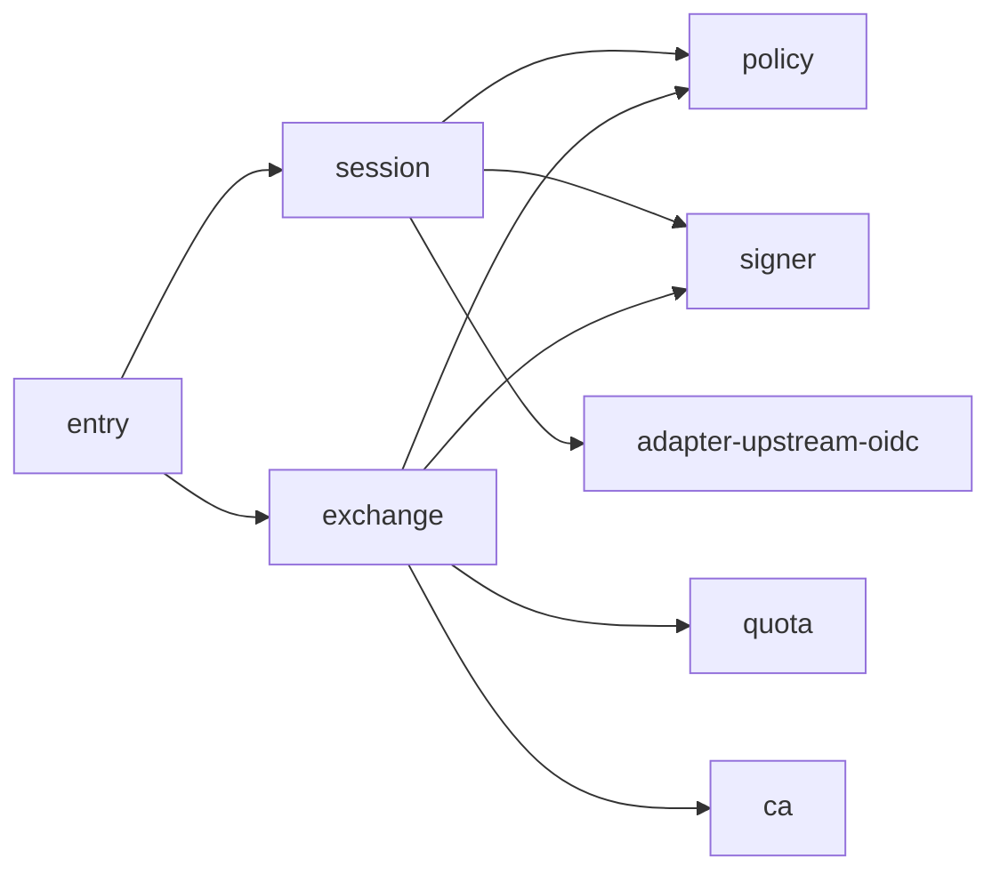
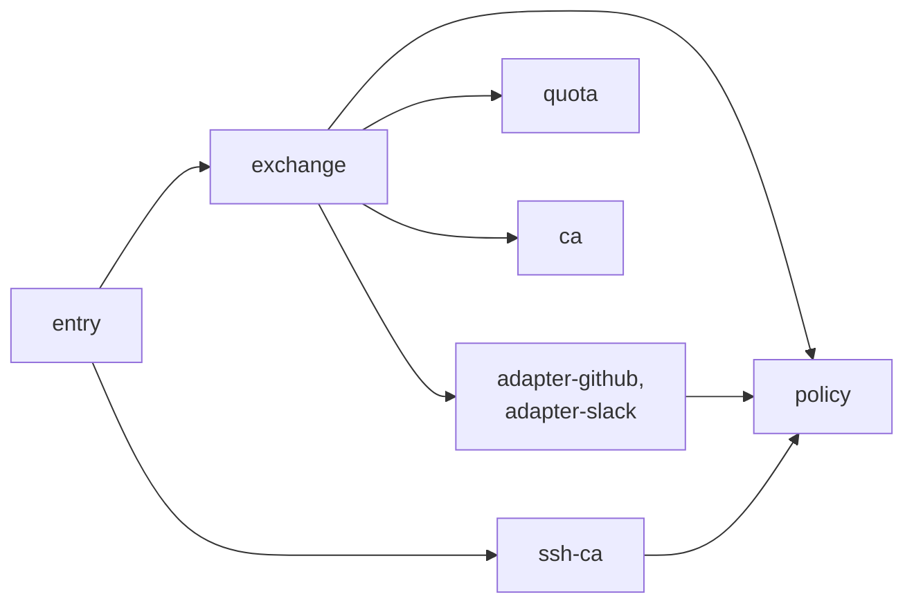
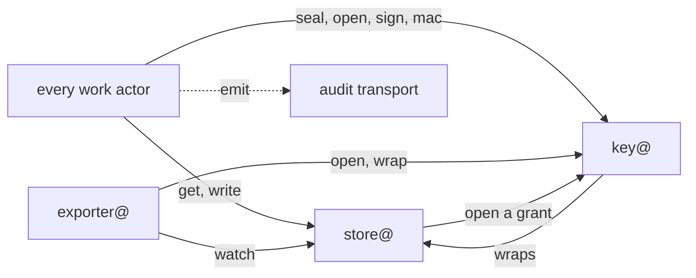
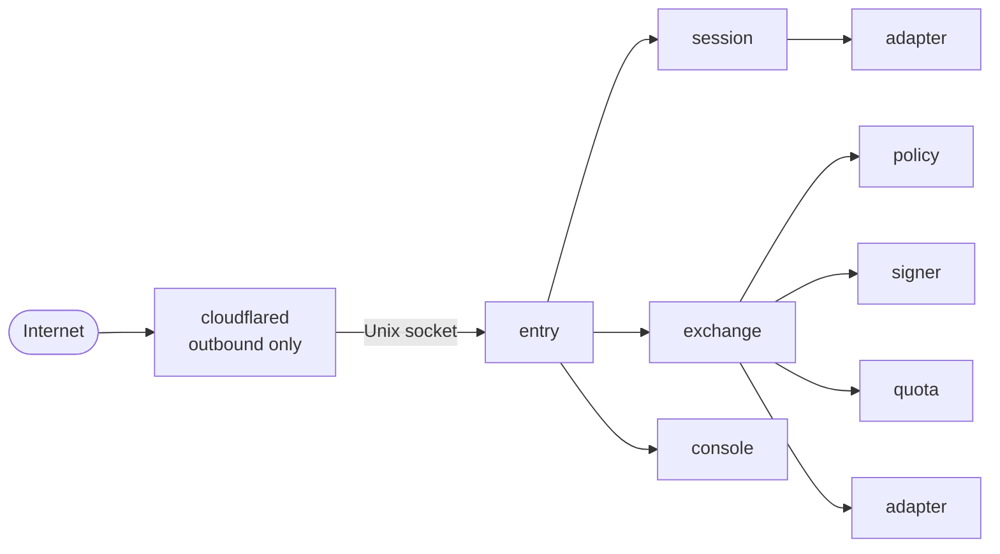
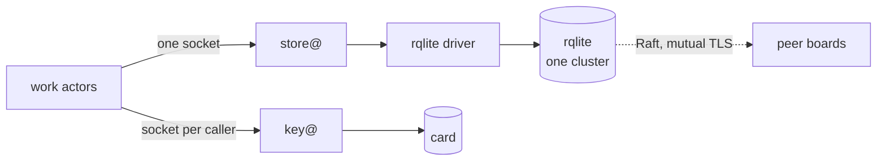
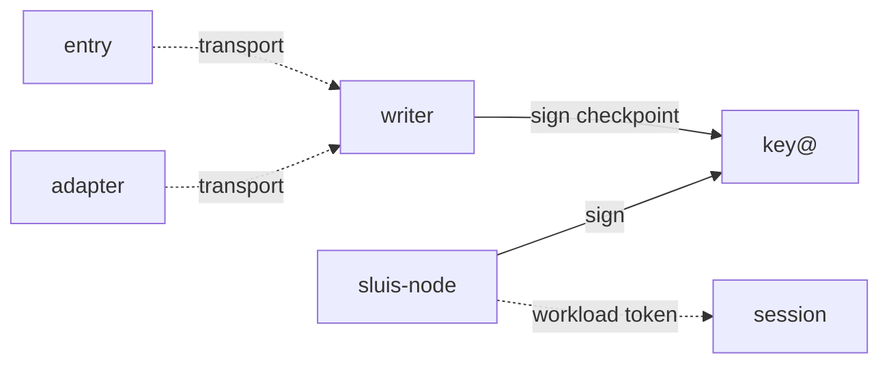

At the second zoom level the [black box](/architecture/#the-black-box) is split into **actors**: each has one responsibility, a ConnectRPC contract, a short list of actors it may call, and a family that says what it may hold. At the third level the actors become **units**, each with one identity. This page lists what exists: the families, what each actor holds and calls, the ports, the call graph, who writes which kinds, and how the units are packaged and placed on each installation. What an actor is, how instances are named and which ports a work actor has are decided in [0002](/decisions/0002-families-of-actors/); the words are on [Families](/concepts/families/); the enforcement on each installation is on [Deployment and listeners](/architecture/deployment/).

Every contract is Protobuf served over ConnectRPC, even when caller and callee share a unit. In-process calls use an in-memory transport, so moving an actor into its own unit changes configuration, not code ([0002](/decisions/0002-families-of-actors/#contracts)).

## The four families

Every actor belongs to one family, and a port is never shared between two families ([0002](/decisions/0002-families-of-actors/#the-four-families)). The [actor registry](/reference/actors/) lists every actor with its language, placement, key purposes and governing records.

| Family | Actors | Holds at rest | Its ports |
| ------ | ------ | ------------- | --------- |
| **Work** | `entry`, `session`, `console`, `exchange`, `policy`, `signer`, `ca`, `ssh-ca`, `quota` and the adapters `adapter-<vendor>` | **Nothing**: no storage, key or audit credential | A data port to store@, a keys port to key@, an audit emit port, and the ports of its job: a listener (`entry` only), a provider API (adapters), outbound fetch |
| **Data** | `store@`, `exporter@` | The credentials of the storage ports, and of the export destinations | Four ports downward for store@, one per storage class; a destination port for exporter@ |
| **Keys** | `key@` | The card PIN, or the permission to use the cloud key service | A port to its card or key service |
| **Audit** | The emitter library, the transport, `writer`, `witness`, `indexer`, `reader` | The write credential of the audit blob, and of the index, in the pieces that need one | The audit's own ports: blob, transport and index; a data port and a keys port |



The **credential holders** are exactly store@, exporter@, key@ and the audit pieces that hold a credential: the writer, the witness, the indexer and the reader. No work actor is one ([0002](/decisions/0002-families-of-actors/#credential-holders)). Platform pieces are not actors of any family: the edge connector, the host's card service, the engine processes and the node agent `sluis-node`.

### The foundation and the modules

The data and keys families are the **foundation**: store@, exporter@ and key@ run in every installation, and their binaries do not change with what runs above them. The rest comes in **modules**, each a set of actors that brings its own kinds and key purposes into the registries ([0002](/decisions/0002-families-of-actors/#the-foundation-and-the-modules)).

| Module | Actors | Brings |
| ------ | ------ | ------ |
| **Identity** | The work actors other than `quota`: `entry`, `session`, `console`, `exchange`, `policy`, `signer`, `ca`, `ssh-ca` and the adapters | Sign-in, sessions, token exchange, certificates, integrations and the console |
| **Audit** | The audit pieces | The audit log, the usage stream and Search |
| **Quota** | `quota` | The allowance of each tenant ([0039](/decisions/0039-quota-allowance/)) |

An installation runs the foundation and the modules it needs. A module is a grouping, not a fifth family: each actor stays in one of the four. The foundation with the audit module only is "audit alone": it also runs the work actors that its front and its access check need, `entry`, `policy` and `exchange` for the tenant push ([0028](/decisions/0028-audit-pieces/#audit-alone)).

## Actors

Each actor runs as `<actor>@<boundary>` ([0002](/decisions/0002-families-of-actors/#names)). "Calls" are edges of the call graph beyond the three ports every actor has; "key purposes" are what it asks key@ for. The call graph is default deny.

### Work actors

| Actor | Responsibility | Calls | Called by | Key purposes |
| ----- | -------------- | ----- | --------- | ------------ |
| `entry` | Parses each request, validates it against closed parameter lists and routes it. Holds nothing and has no outbound network | `session`, `exchange`, `console`, `ssh-ca`, `quota`; an adapter only to route a push notification | The edge connector | `mac`, `pseudonym` |
| `session` | Sign-in, session chains, the session cookie and step-up | `policy`, `signer`, `exchange`, `adapter-upstream-oidc` | `entry`, `console` | `cookie`, `data`, `mac`, `pseudonym` |
| `console` | The operator API. Checks delegation and routes each write to the owner of the kind | `session`, `exchange`, `policy`, `quota`, `reader`, the adapters | `entry` | `data` (open), `pseudonym` |
| `exchange` | Token exchange, enrolment, the front of the signing API, the verifiers of proofs, and the owner of what a tenant has configured | `policy`, `quota`, `signer`, `ca`, the adapters | `entry`, `session`, `console` | `enrolment`, `data`, `pseudonym` |
| `signer` | Signs tokens under a signing policy, and artifacts for a grant `policy` sealed. Checks the issuer, the audience, the lifetime and the algorithm | Nothing | `session`, `exchange` | `token-signing` and its exceptions, `release-signing`, `grant` (open), `data` (open), `pseudonym` |
| `policy` | The decision point: a declared Cedar policy maps facts to grants, and key@ seals them. No state of its own, no outbound network | Nothing | `session`, `console`, `exchange`, `ssh-ca`, `quota`, the adapters, `exporter@`, the `writer`, the `indexer` and the `reader` | `grant` (seal), `pseudonym` |
| `ca` | The X.509 authority and its issuance log | Nothing | `exchange` | `x509-intermediate`, `grant` (open), `data`, `mac`, `pseudonym` |
| `ssh-ca` | The SSH authority, for user and host certificates | `policy` | `entry` | `ssh-user`, `ssh-host`, `data`, `pseudonym` |
| `quota` | The allowance of a tenant: counts down with a conditional update and refuses at zero | `policy` | `entry`, `exchange`, `console` | `pseudonym` |
| `adapter-<vendor>` | The work actor of an integration: `adapter-upstream-oidc`, `adapter-github`, `adapter-slack`. Serves one vendor and opens each tenant's connection credential at key@ for each call | `policy` | `session` (upstream), `exchange`, `console`, `entry` (a push) | `data` (open), `grant`, `mac`, `pseudonym` |

`signer` is not a pure signing oracle. `policy` maps facts to grants with a declared Cedar policy ([0007](/decisions/0007-policy-and-sealed-grants/)). A compromised `entry` reaches only the sockets it routes to, and each receiver checks the request again. A compromised work actor holds no credential at rest: it yields what it is using at that moment and nothing it could replay later ([principle 16](/principles/#16-few-credential-holders)). A compromised adapter reaches its own vendor and the connections that its callers brought grants for.

### Holders

| Holder | Credential at rest | What it does | Writes |
| ------ | ------------------ | ------------ | ------ |
| `store@` | The engine login of the durable and temp ports, access to the config source and the secret source, and the restore identity | Serves the one store service, checks every call against the kind registry, loads and verifies signed config, and never seals or opens a value ([0005](/decisions/0005-the-store/)) | `MaintenanceMode`; the restore command writes back what it restores |
| `exporter@` | The credentials of its export destinations, and a write-only credential for the backup bucket | Watches the exportable kinds and writes them out; runs the backup job and opens nothing it backs up ([0009](/decisions/0009-export/), [0010](/decisions/0010-backup-and-recovery/)) | `ExportCursor` |
| `key@` | The card PIN, or the permission to use the cloud key service | Offers Seal, Open, Sign and Mac; keeps opened data keys in memory with a time to live per entry ([0006](/decisions/0006-keys-and-sealing/)) | `DataKeyWrap`, `KeyCertificate`, and on boards `PinReleaseRequest` and `PinRelease` |
| `writer` | Write access to its log in the audit blob | Seals the records it takes from the transport into the audit log and the usage log, and has key@ sign each checkpoint ([0029](/decisions/0029-the-audit-log/)) | Its log, in the blob |
| `witness` | Read and write access to its cosignatures in the blob | Cosigns each checkpoint that is consistent with the last one it cosigned; optional everywhere | Its cosignatures, in the blob |
| `indexer` | Read access to the blob, write access to the index | Follows each log by signed checkpoint and applies the entries to the search index | The index |
| `reader` | Read access to the blob and the index | Answers audit queries filtered by the caller's grant, and records each read | Nothing; every read is audited |

key@ is the one holder of keys, so a flaw in a work actor never reaches a key. It serves each caller on a socket of its own, and on a board it has exclusive access to the card ([0006](/decisions/0006-keys-and-sealing/#exclusive-card-access)). A flaw in store@ yields ciphertext, hashes, plain values and the values of secret sources, but no plaintext of a sealed value ([0005](/decisions/0005-the-store/#secret-sources)). The audit pieces are described in [Audit](/concepts/audit/); their placement is in [The audit installation](#the-audit-installation).

### Platform pieces

| Piece | What it is | Where |
| ----- | ---------- | ----- |
| The edge connector | Key-less: `cloudflared` on boards, the pinned Lambda Web Adapter on Lambda, an edge relay container on Kubernetes | The edge of `entry` |
| The card service | The host's smart-card service; it talks to key@ alone | Boards, and the local installation with an opt-in card |
| The engines | rqlite on boards and local, DynamoDB on AWS; reached only through store@'s drivers | Each installation ([0005](/decisions/0005-the-store/#engines)) |
| `sluis-node` | The node agent: issues each local actor a short-lived workload token from its uid, and asks key@ to sign it. Holds no key credential | Boards ([0022](/decisions/0022-workload-identity-and-host-enrolment/)) |

## Integration contracts

All integrations share one base contract, `Integration` (describe itself, probe health), and implement one or more of the contracts listed on [Integrations](/integrations/): `Upstream`, `FactsSource`, `CredentialMinter`, `Provisioner` and `Notifier` ([0025](/decisions/0025-integrations/#the-contracts)). An adapter implements them for one vendor. Rules shared by the contracts:

- **Opaque references.** Core never parses an identifier an integration returns. Subjects and groups are `{namespace, id}` pairs; policy matches only on the namespace and on named attributes.
- **Attributes, not vendor structs.** Everything vendor-shaped travels as namespaced attributes (`github.repository`, `k8s.namespace`), declared with their types when the adapter describes itself, so a policy file is validated at load without core knowing the vendor.
- **A closed error model.** `UNAVAILABLE`, `UPSTREAM_REJECTED`, `INVALID`, `NOT_FOUND`, `RATE_LIMITED`, `UNSUPPORTED`, `STALE`. No vendor error text crosses the boundary ([0025](/decisions/0025-integrations/#what-an-integration-may-return)).
- **Freshness is part of every fact.** A fact carries `as_of`, `max_age` and whether it is authoritative. "I could not ask" is not "gone".
- **The same protobuf on every transport.** A Unix socket with peer credentials on boards, a Lambda invoke on AWS, in-cluster gRPC on Kubernetes ([0003](/decisions/0003-units-transports-and-fusion/#transports)).

Systems that sluis serves but never calls (databases, hosts, cert-manager, GitOps controllers, MCP, SSH certificate login) are **client profiles**, a client entry plus a resource profile, not integrations ([0021](/decisions/0021-clients/)).

### Integrations return facts, or carry out authorized effects

A credential minter and a provisioner are effectors by nature, so two conditions keep them from deciding anything:

1. **Core decides, the adapter executes.** An adapter receives a **grant** that `policy` decided and key@ sealed: the decision, the policy digest and the hash of the scope ([0007](/decisions/0007-policy-and-sealed-grants/#sealed-grants)). It refuses a scope the grant does not cover and cannot lengthen the lifetime. A provisioner reconciles to a desired state that a directory adapter wrote as data from `policy`'s answer; for a pass that no caller started it asks `policy` for a grant of its own ([0025](/decisions/0025-integrations/#how-core-authorises-an-effect)).
2. **Business limits live in core.** Caller caps, mint rates and which group may hold which role are policy or quota, checked before the adapter is called. An adapter enforces only technical limits: the vendor's API rate and maximum lifetime.

The mint flow, in two steps. Step 1: `exchange` verifies the proof and asks `policy`.



The decision carries the scope bound, the lifetime cap and the sealed grant.

Step 2: `exchange` admits the operation and the adapter mints.



Quota admits idempotently by request id. The adapter receives the kind, the scope, the lifetime, the operation id and the grant, and returns the credential, its expiry and a handle. Every step is an audit fact, and the mint fact never holds the secret.

## Ports

A port is the narrowest interface that every driver can honour and every user needs. A work actor sees three ports of the same shape on every installation; the drivers sit behind the holders' ports and are private to their owner ([0002](/decisions/0002-families-of-actors/#ports-of-a-work-actor)).

| Port | Of | Operations | Notes |
| ---- | -- | ---------- | ----- |
| **Data** | Every work actor and audit piece | `get`, `list`, `create`, `update` (with `if_version`), `delete`, `apply`, `watch` | One generic store service on the wire, used through typed clients. The store applies the rule of the actor and the kind, and a grant sealed for the tenant on every tenant-scoped write ([0005](/decisions/0005-the-store/#the-store-api)) |
| **Keys** | Every work actor and audit piece | `Seal`, `Open`, `Sign`, `Mac` | The caller names a key purpose, never a key id or a slot. key@ checks the caller, its rule for the purpose and the grant on every Seal and Open ([0006](/decisions/0006-keys-and-sealing/#seal-and-open)) |
| **Audit emit** | Every actor | Hand a record to the emitter | The record reaches the transport; a request returns once its record is durable there ([0028](/decisions/0028-audit-pieces/#transport)) |
| **Listener** | `entry` | Accept a request | The one port that faces the edge ([Listeners](/architecture/deployment/#listeners)) |
| **Provider API**, **fetch** | Adapters; `session` and `exchange` | An outbound call to a vendor or an issuer | Limited to the hosts of the actor's egress classes in the registry |
| **Config source** | store@ | `Read`, `Capabilities` (`watch`: `none`, `notify` or `poll`) and, for `notify` drivers, a `Watch` stream | Read-only; drivers `file` and `appconfig` |
| **Secret source** | store@ | `Read` | Read-only; a systemd credential on boards and local, AWS SSM elsewhere |
| **Durable**, **temp** | store@ | `Get`, `Query` (by prefix), `Transact`, `TailLog` | Drivers `rqlite` and `dynamodb`; the two ports may share an engine |
| **Destination** | exporter@ | A write to a destination | One driver per destination type |
| **Key store** | key@ | Sign, wrap, unwrap, public key | Drivers for a YubiKey PIV card, AWS KMS and, in development, software |
| **Blob**, **transport**, **index** | The audit pieces | Conditional write, deliver, search | Audit's own ports ([0028](/decisions/0028-audit-pieces/#four-pieces)) |

### The data port

Configuration, secrets and data all reach an actor as kinds through the data port. An actor has no configuration loader, no secret source and no storage driver of its own, and never sees a driver. The typed client is `store.Client[T Kind]` in Go and `Store<K: Kind>` in Rust ([0005](/decisions/0005-the-store/#typed-clients)). A watch streams the changes of a kind from a resume point; on Lambda nothing is pushed and a reader re-reads with an ETag ([0005](/decisions/0005-the-store/#watch-and-the-resume-point)). The wire contract, the item keys and the sealed envelope are on [Store API](/reference/store-api/).

### The keys port

The keys port binds a **key purpose** to a key and refuses a key too weak for it when the configuration loads; the code refuses a software key in production ([0006](/decisions/0006-keys-and-sealing/#floors-in-code)). Each boundary has its own keys, and a purpose an installation does not enable has none ([0006](/decisions/0006-keys-and-sealing/#key-purposes)).

- **Authority keys sign in place.** The baseline of a boundary on AWS is one symmetric key and five asymmetric keys: token signing, the X.509 intermediate of a trust domain, the SSH user CA and the SSH host CA (P-384), and the audit log (P-256) ([0006](/decisions/0006-keys-and-sealing/#keys-per-boundary-on-aws)). On a board the same purposes sit in separate card slots ([the slot plan](/decisions/0006-keys-and-sealing/#the-slot-plan)). [Keys](/reference/keys/) lists every purpose with its algorithm, its key type, its slot and the actor that uses it.
- **Data keys seal values.** Each tenant has four data keys (`data`, `pseudonym`, `pairwise`, `evidence`) and each boundary has `grant`, `cookie`, `chain`, `mac` and its own `data`. key@ generates them in software and keeps only their wraps, `DataKeyWrap`, and opens a data key once per cache entry ([0006](/decisions/0006-keys-and-sealing/#data-keys)).
- **The port signs bytes or digests;** JWT shaping lives in `signer`. ES384 (P-384) is the default, and the cloud-federation keys and the FAPI 2.0 algorithms are the named exceptions, each a key of its own ([0006](/decisions/0006-keys-and-sealing/#named-exceptions)).

A YubiKey 5 Nano signs P-384 in about 147 ms, about 7 signatures a second per card and about 21 for three boards (measured 2026-10-31, firmware 5.8.0; [Board capacity](/runtimes/bare-metal/#board-capacity)). Opening a data key is an ECDH of about 143 ms on a card (median on two boards' cards, measured 2026-11-03), paid once while the key stays in key@'s cache ([0006](/decisions/0006-keys-and-sealing/#the-cache)).

## The call graph

The tables under [Actors](#actors) list the graph's edges; the views below draw them. A solid arrow is a synchronous ConnectRPC call; a dashed arrow is asynchronous. The graph is declared once in the actor registry and compiled into every binary, where one interceptor refuses a caller that is not listed (**default deny**). Each transport enforces it a second time: socket groups and sandboxes on boards, invoke resource policies on Lambda, NetworkPolicies on Kubernetes ([0003](/decisions/0003-units-transports-and-fusion/#the-call-graph)). The [identity explorer](/architecture/identity-explorer/) draws it per installation. Every actor also calls store@ and key@ through its ports; those edges are left out of the views below, apart from View 4.

### View 1: sign-in and exchange



### View 2: minting and certificates



### View 3: the console

`console` calls `session`, `exchange` and `policy` for a person's grants and for the writes they own, `quota` to route the push of an operator's correction of an allowance ([0039](/decisions/0039-quota-allowance/#the-push)), the adapters whose connect flows it starts, and the `reader` of the audit front. It writes only `Switch` and `LogLevelOverride` itself ([0027](/decisions/0027-the-console/#writes)).

### View 4: the holders



store@ asks key@ to open the grant on every tenant-scoped write, and key@ reads and writes its own `DataKeyWrap` items through store@ ([0005](/decisions/0005-the-store/#rules)).

### View 5: the audit

Every actor emits to the `writer` on the transport. The writer asks key@ to sign each checkpoint, the witness co-signs, the indexer follows the log by checkpoint, and the reader answers the console from the index. The [audit explorer](/architecture/audit-explorer/) draws it.

Rules the graph encodes:

- **Core calls adapters, never the reverse.** An adapter's results travel through the data port, the audit transport and the reply to its caller. A flow that looks circular, such as console to adapter to provider to webhook to adapter, is a flow over time with the pending state kept in a temp kind.
- **An adapter calls only `policy`,** and adapters never call each other ([0025](/decisions/0025-integrations/#the-rule)).
- **Only the audit transport is written by everyone,** and asynchronously.
- **The decision point has no outgoing edge.** `policy` reads its effective policy set through the data port and nothing else.

## One writer per kind

Every kind has exactly one writer. Others read through the store, under the rules of the kind registry, which the store applies with the caller's identity from the transport ([0004](/decisions/0004-the-data-model/#one-writer-per-kind)). The generated [Rules](/reference/rules/) page lists every actor × kind × verb, and [Kinds](/reference/kinds/) lists every writer.

| Writer | Kinds it writes (examples) |
| ------ | -------------------------- |
| Infrastructure as code | Config and secret kinds of the installation: `Boundary`, `KeyPlan`, `Tunables`, `Upstream`, `AuditLog`, `BackupPlan`, `ExportDestination`, `BreakGlassPasskey`, and the secrets such as `UpstreamSecret` |
| The publishing pipeline | Reviewed, signed config: `Policy`, `RegulatedPartyPolicy`, `GrantVocabulary`, `ExchangeTrust`, `PkiProfile`, `AuditCatalogue` |
| `session` | Everything about people: `Person`, `UpstreamLink`, `StaffPasskey`; and the temp state of sign-in: `AuthCode`, `SessionChain`, `ClientDocument` |
| `exchange` | What a tenant has configured: `Tenant`, `TenantClient`, `ClientSecret`, `ClientSecretExport`, `PolicyLink`, `PredefinedPolicyLink`; and enrolment: `EnrolmentToken`, `PendingEnrolment` |
| An adapter | What its flow makes: `GitHubApp` and `GitHubInstallation` (`adapter-github`), `SlackConnection` (`adapter-slack`), `EntraConnection` (`adapter-upstream-oidc`); the connections `DirectoryConnection`, `MinterConnection` and `MinterTarget`; and the directory facts |
| `key@` | `DataKeyWrap`, `KeyCertificate`, `PinReleaseRequest`, `PinRelease` |
| `ca`, `ssh-ca` | `IssuedCertificate`, `Revocation`, `Crl`, `TrustBundle`; `IssuedSshCertificate`, `SshRevocation`, `Krl` |
| `signer`, `quota`, `entry` | `SigningRing`, `OpenPgpBinding`; `Allowance`, `AdmitRecord`, `SpentPush`; `RateWindow` |
| `console` | Exactly two: `Switch`, `LogLevelOverride` |
| `store@`, `exporter@` | `MaintenanceMode`; `ExportCursor` |

There are two exceptions. The restore command of store@ writes back the kinds it restores. And the **declared self-scoped kinds**, `Lease`, `ReplayGuard` and `SpentGrant`, have an id that starts with the writing actor's name; the store lets each actor write only ids under its own name. An adapter writes ids under its own name only, so `adapter-github` and `adapter-slack` never write each other's items. The certificate kinds need one note: the issuance log of `ca` is a C2SP static-ct-api log of every certificate, witnessed like the audit log, and serials are random 128-bit values, so no serial ledger is kept ([0023](/decisions/0023-certificate-authorities/#issuance-log-and-revocation)).

## The fusion rule

An installation may run several work actors in one unit to fit a small machine. Fusion is an explicit installation choice, never the default ([0003](/decisions/0003-units-transports-and-fusion/#fusion)):

- **A holder is never fused with a work actor,** and key@ is never fused with `entry`.
- **The store applies the union of the members' rules to a fused unit.** Fusing never grants something no member was allowed, and the configuration check prints the union.
- **`entry` is never fused with an actor that signs:** `signer`, `ca` or `ssh-ca`. `ca` and `ssh-ca` stay separate units on every installation.
- **Small work actors that hold nothing and have no listener,** such as `quota`, may share a unit on a 2 GB board. So may `console` and `entry`, at the price of widening the one unit reachable from outside.

A generated check runs for every installation and fails the build for a unit that breaks the rule. On Lambda there is no in-process store: no function links store@ into a work actor, and the latency spike showed that none is needed ([0003](/decisions/0003-units-transports-and-fusion/#fusion)).

## Packaging

Every actor and every driver ships as its own executable, in one language ([Source layout](#source-layout)). The packaging follows the runtime ([0013](/decisions/0013-release-train-packaging-and-distribution/#packaging-per-runtime)):

| Runtime | Packaging |
| ------- | --------- |
| bare-metal | `.deb` and `.rpm` packages split by holder, module and driver, with systemd template units; a tarball |
| serverless | A zip per executable and a function per actor instance; a holder's drivers are extensions of its function |
| kubernetes | One OCI image per process with the packages' binaries byte for byte, and one Helm chart; a holder's drivers are native sidecar containers |

On a host the executables live under `/usr/libexec/sluis/`, in the same layout in a package, a tarball and an image:

```text
/usr/libexec/sluis/
  actors/         entry  session  console  exchange  signer  policy  ca  ssh-ca  quota
                  adapter-<vendor>  store  key  exporter  writer  witness  indexer  reader
  drivers/<owner>/<driver>   the drivers of store, key, exporter and the audit pieces
  node/           sluis-node
  vendor/         third-party binaries that sluis starts, such as rqlite
```

The packages follow the foundation and the modules: `sluis-store`, `sluis-key` and `sluis-exporter`; `sluis-identity` and `sluis-console`; `sluis-audit-writer` and `sluis-audit-search`; `sluis-quota`. A host that runs the foundation with the audit module only installs no work actor of the identity module. The executable a unit starts is the only code in that process, so an actor cannot contain another actor's code. The artifacts are on [Packages](/distribution/packages/). There is no development build: local is an installation, not a build.

## Units on each installation

The same actors run on every installation. What changes is who starts them, what they can rely on, and how they reach each other.

| | boards and local | lambda | kubernetes |
| --- | --- | --- | --- |
| **Unit** | A systemd unit and a Unix user per actor; in local, a container with a pinned uid | A function per actor and per holder | A pod per actor and per holder, each with a service account |
| **Calls between units** | Unix sockets; no actor is called from another node | Lambda invoke, authorised by a resource policy | In-cluster gRPC with a projected service-account token whose audience the callee checks, behind a NetworkPolicy (mutual TLS between callers is later work) |
| **A holder's drivers** | Separate systemd services whose socket only the owner opens | Extensions in the holder's function | Native sidecar containers in the holder's pod |
| **Identity to the platform** | `sluis-node` issues a workload token per actor; only holders' drivers use cloud credentials | The function's role; only the holders' roles reach storage, keys, destinations or the audit blob | A projected token, mounted only into the driver container |
| **Key store** | A card per node behind key@, software in local | AWS KMS behind key@ | AWS KMS behind key@ |
| **Exactly-one actors** | A lease in the temp class | A lease; the writer is fenced by create-if-absent on the blob | A lease in the temp class |
| **Tested installation** | local, boards | lambda | kubernetes |

### Boards

A board runs every actor as its own user, in its own instance of a systemd template unit, `sluis-<actor>@<boundary>`. Every call is a Unix-socket call allowed by the call graph, and the only port a board opens to another board is rqlite's Raft port. The node is drawn in three steps.

#### Step 1: the request path



Only the edge connector reaches `entry`, on its Unix socket; `entry` has no network ([Listeners](/architecture/deployment/#listeners)).

#### Step 2: data and keys



Every work actor reaches data at store@ and keys at key@; none holds an engine login or a PIN. One rqlite cluster serves the installation, and any board serves any request because every board holds the data and the temp data is replicated too ([0005](/decisions/0005-the-store/#engines)).

#### Step 3: audit emits and the node agent



Dashed lines to `writer` are asynchronous emits. On three boards each node's `writer` drains its own spool and keeps its own log, and the other nodes are its peer witnesses through the audit blob ([0029](/decisions/0029-the-audit-log/#witnesses)), so no lease is needed to elect a writer between nodes. The audit pieces run on the same nodes, each with its own drivers ([0011](/decisions/0011-runtimes-and-installations/#installations)). The local installation is the same layout on one node, as containers.

### Lambda

On Lambda the same actors are separate functions with no `sluis-node` and no host card service: the KMS key policy names key@'s role alone, and each function's role is its identity. A work function's role may only invoke other functions and send to the audit transport. The transport is an SQS queue. The audit writer runs with a reserved concurrency of 1 on a standard SQS queue; its correctness comes from the write-once fence on the bucket, not from the limit. The index is `postgres` in the `aurora` mode, which the indexer and the reader reach through RDS Proxy with IAM authentication ([0028](/decisions/0028-audit-pieces/#provisioning-modes)). Every store read and key open is an invoke, which the latency spike found fast enough ([0037](/decisions/0037-capacity-is-measured-before-it-is-promised/#the-warm-sign-in-on-lambda)). See [Serverless](/runtimes/serverless/).

### Kubernetes

Each actor and each holder runs in a pod of its own, with its drivers as native sidecars. A projected service-account token is mounted only into the driver container, and a work pod has no cloud identity. The edge is a key-less relay container in `entry`'s pod. Cells keep most calls on one node, and each adapter pod has its own egress policy to its vendor ([0011](/decisions/0011-runtimes-and-installations/#kubernetes), [Kubernetes](/runtimes/kubernetes/)).

## The audit installation

Audit is the emitter library and four pieces, the writer, the witness, the indexer and the reader, joined by the transport ([Audit](/concepts/audit/), [0028](/decisions/0028-audit-pieces/#four-pieces)). Each emitting unit is a project with its own bucket, writer and log keys ([0029](/decisions/0029-the-audit-log/#projects)). Pieces combined in one installation, even with sluis, keep their own drivers, and the defence-in-depth layers stay per actor.

| Part | Placement |
| ---- | --------- |
| Transport | Per installation: direct, or a queue. The default is a spool on boards, SQS on Lambda and NATS JetStream on Kubernetes; direct mode falls back to a local spool, so it needs a disk |
| Writer and blob | Exactly one writer per log; a cluster keeps one log per node. A production log needs a compliance lock, or a weaker mode plus a witness ([0029](/decisions/0029-the-audit-log/#lock-modes)) |
| Witness | Optional everywhere; `sluis config check` warns when there is none |
| Search | The indexer, the index and the reader; with a `sqlite` index on a cluster the reader runs on the indexer's node |

Every audit installation, also one combined with sluis, has a front of its own: a slim `entry` on its own host, the `reader` as its API, and its own `session` and `console`, the same executables as sluis's ([0028](/decisions/0028-audit-pieces/#the-audit-front)). The [audit explorer](/architecture/audit-explorer/) draws these boxes for each tested installation.

## Source layout

### Languages

**One executable, one language.** Go is the default; Rust is used at the unauthenticated edge, in the trusted base, in the holders, in the cloud drivers and on the smallest boards. The rules and the reasoning are in [0012](/decisions/0012-the-language-follows-the-executable/); this table follows its [per-actor table](/decisions/0012-the-language-follows-the-executable/#per-actor-table).

| Component | Language | Why |
|---|---|---|
| `entry` (slim), the Kubernetes edge relay | Rust | The unauthenticated edge |
| `store@`, `exporter@`, `sluis-node`, `sluis-host` | Rust | The holders and the trusted base: they hold credentials and parse no unauthenticated input |
| `key@` | Go with `piv-go` | The one exception in the trusted base: `piv-go` holds the card exclusively |
| `policy` | Rust | Cedar's engine is the `cedar-policy` crate |
| `signer`, `console`, `ssh-ca`, `quota`, `indexer`, `reader` | Rust | They run on the smallest boards and need no Go-only library; `console` moves to Go if spike S1 shows that Connect for Rust lacks the server streaming it needs |
| `session`, `exchange`, `ca`, `writer`, `witness` | Go | The embeddable OpenID Connect provider, the proof verifiers and HPKE, the X.509 CA and its issuance log, the C2SP log writer and witness |
| The adapters (`adapter-github`, `adapter-slack`, `adapter-upstream-oidc`, and every further `adapter-<vendor>`) | Go | The vendor SDKs and the OpenID Connect client |
| Drivers of the engine and the local sources (`rqlite`, `file`, the credential source, `spool`, the `fs` blob, the `sqlite` index) | Rust | They run on the smallest boards |
| The AWS drivers (`dynamodb`, `appconfig`, SSM, `aws-kms`, `sqs`, the `s3-compatible` blob) | Rust | One AWS SDK language |
| `cloud-cloudflare`, `nats-jetstream`, the `postgres` index, witness drivers, the OpenBao and Kubernetes destinations | Go | The vendor library, and the default |
| The `sluis` CLI, the cert-manager issuer | Go | Not resident on a board |
| The console's single-page application | TypeScript | |

Every Rust choice is [gated by its spike](/decisions/0012-the-language-follows-the-executable/#the-spikes-are-gates): S1 and S10 for every Rust component, both passed on 2026-11-01, and S3 for `entry` as well, which holds the row with two checks still open. A gate does not stop work: the component is built against its contract meanwhile, and when a spike fails, the fallback for that component is chosen from the candidates in 0012.

Tokens are standard JWS and JWT, so any language verifies them against the published key set. An actor can move between languages because every contract is ConnectRPC and every driver is out of process: the language is chosen per executable, and the contracts do not change. The command-line tool is one Go `sluis` binary with subcommands for operators and for users.

### Shared kits

Parallel implementations of the same small kits, one per language, keep the languages interchangeable. Each is checked by the same conformance suite ([0012](/decisions/0012-the-language-follows-the-executable/#the-rules)).

| Kit | What it is |
| --- | ---------- |
| ConnectRPC over Unix sockets | A server and client that read peer credentials (`SO_PEERCRED`) on every call and expose them to the call-graph interceptor |
| The typed store client | `store.Client[T Kind]` in Go and `Store<K: Kind>` in Rust, generated from the kind's message |
| Schema validation | protovalidate in Go, hand-written checks of the same rules in Rust, and the generated JSON Schema checked before decoding ([0004](/decisions/0004-the-data-model/#schemas-are-protobuf)) |
| CLI conventions | `config check`, `config explain`, `doctor`, and a uniform `--help` |
| Conformance suite | Shared vectors and behavioural tests that every kit and driver must pass, whatever its language |

### The repository tree

```text
proto/          ConnectRPC contracts and the kind messages
kits/
  go/  rust/  ts/  conformance/
actors/<actor>/
drivers/<owner>/<driver>/
node/agent/
cli/sluis/
host/sluis-host/
console/
deploy/
  packages/  helm/  lambda/  iac/
tests/
  installations/  tutorials/
docs/  site/
```

| Directory | Holds |
| --------- | ----- |
| `proto/` | The contracts every other directory implements or calls, and the messages of the kinds. A contract change is reviewed here first |
| `kits/` | The shared kits above, one directory per language, plus the conformance suite |
| `actors/`, `drivers/` | One directory per actor, and per driver under its owner, matching the layout under `/usr/libexec/sluis/` that the [packages](#packaging) install |
| `node/agent/` | The node agent (`sluis-node`) |
| `cli/sluis/` | The one `sluis` binary |
| `host/sluis-host/` | The SSH host service ([SSH](/integrations/infrastructure-access/#ssh)) |
| `console/` | The TypeScript console |
| `deploy/` | Packaging for each artifact: `.deb` and `.rpm` packages, Helm charts, Lambda archives, infrastructure as code |
| `tests/installations/`, `tests/tutorials/` | Integration tests on the four tested installations, and the tutorials as tests |
| `docs/`, `site/` | This documentation, the three registries under `docs/architecture/` and the site that builds them |

One version covers the whole repository. See [Packages](/distribution/packages/) for what is built from the tree. Operating system images for the single-board computers are built in a separate public repository, not here ([#881](https://github.com/truvity/sluis/issues/881)).

## Integration invariants

The structure above is kept by tests that run in CI, cheap to write because the call graph, the registries and the import tree are data.

| Invariant | What fails |
| --------- | ---------- |
| Core packages import no vendor package | A core actor that names GitHub, Slack or a cloud |
| No edge from an adapter to a work actor other than `policy` | An adapter that calls back into core |
| No adapter imports another adapter | Two adapters sharing code by import |
| Policy matchers carry no vendor fields | A policy schema that knows a vendor. Matchers are `{type, namespace, attributes}` |
| Only the wiring package imports drivers | An actor that links a driver directly instead of using its port |
| An authority key has exactly one user actor | A key policy that names two actors |
| No work actor holds a credential at rest, and no unit holds a holder with a work actor | A fusion or a registry row that breaks [the fusion rule](#the-fusion-rule) |
| Each driver passes the port's conformance suite | A driver that diverges from the port contract |
| The deny matrix ([Deployment](/architecture/deployment/#the-deny-matrix)) | A generated policy that is too wide |
| Each of the two checks holds with the other switched off | A check that passes only because the other caught the case |
| The drift test: generated rules, grant checks, policy documents, units, sockets and service accounts agree with the registries | A hand edit, or a generator change that missed one output |

Next: [Deployment and listeners](/architecture/deployment/) shows how each installation enforces these boundaries.
