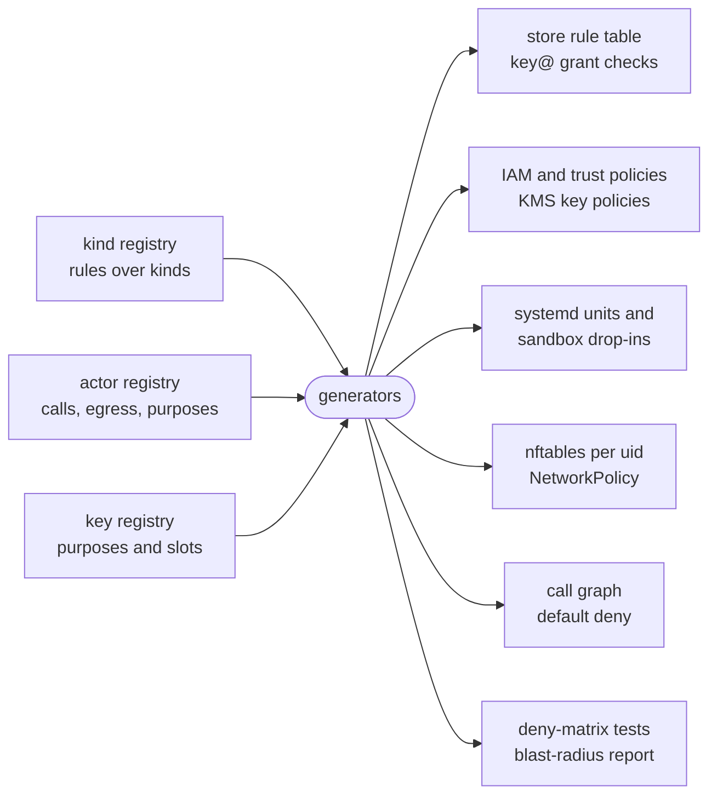
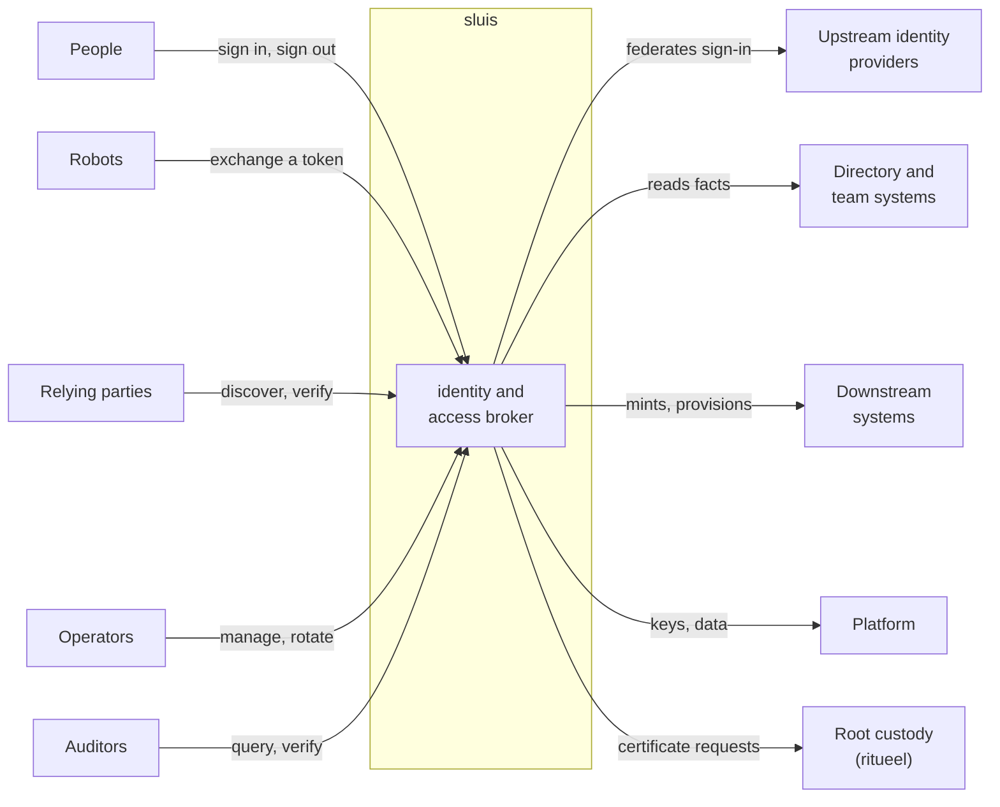
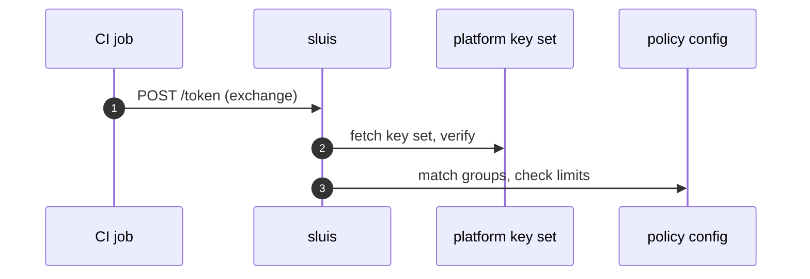
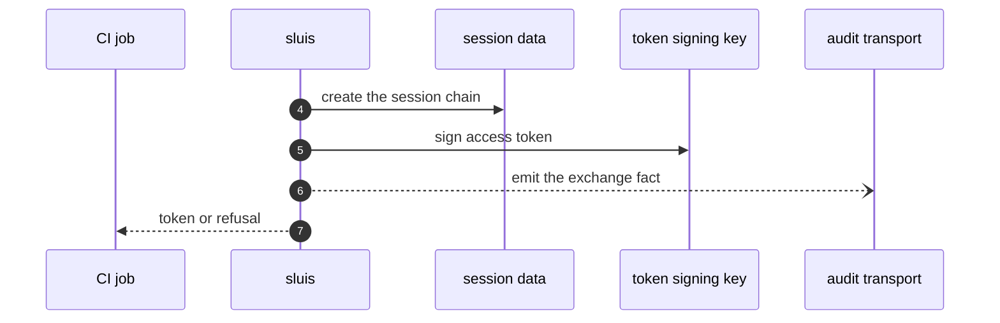

The architecture of sluis is described at three zoom levels ([0002](/decisions/0002-families-of-actors/#three-zoom-levels)). Each level answers one question, and the output of one level is the input of the next.

| Level | Question | What it produces | Where |
| ----- | -------- | ---------------- | ----- |
| **L1, the black box** | What does sluis do, for whom, and which resources does it touch to do it? | The use cases, the external API, and the resources each use case touches | [This page](#the-black-box) |
| **L2, the components** | Which actor owns each operation, through which contract and which of its ports? | Actors in four families, their ports, the call graph and one writer per kind | [Components and units](/architecture/components/) |
| **L3, the units** | What runs where, with which credentials, and what enforces that on each installation? | The units, the holders and their drivers, the packaging, the enforcement and the listeners of each installation | [Components and units](/architecture/components/#units-on-each-installation), [Deployment and listeners](/architecture/deployment/) |

## The registries are the spine

Two registries state the rules, and a third lists the keys.

| Registry | It states | Page |
| -------- | --------- | ---- |
| The **kind registry** | Every kind of data, its storage class, treatment and profile, its one writer, and the rules over it: which actor may get, list, create, update, delete or watch it ([0004](/decisions/0004-the-data-model/#kinds)) | [Kinds](/reference/kinds/), [Rules](/reference/rules/) |
| The **actor registry** | Every actor, its family, language and placement, the actors it calls, the hosts it may reach and the key purposes it uses ([0002](/decisions/0002-families-of-actors/#registries-generate-the-enforcement)) | [Actors](/reference/actors/) |
| The **key registry** | Every key purpose, its algorithm, its key type on AWS, its card slot on a board and the actor that uses it ([0006](/decisions/0006-keys-and-sealing/#key-purposes)) | [Keys](/reference/keys/) |

Nothing that enforces least privilege is written by hand. The registries generate it, for every installation:

Three consequences follow:

- **A change in permissions is a change in a registry.** A pull request that adds a use case says which actor owns each step and which rows of the registries change. The blast-radius report of every actor is checked in, so a reviewer sees what the change grants.
- **The same actors run on every installation.** An installation may fuse several work actors into one unit, but the unit then holds the union of their rules and never a holder ([the fusion rule](/architecture/components/#the-fusion-rule)). Boards, Lambda and Kubernetes differ in the mechanism that enforces the registries, not in the actors ([0003](/decisions/0003-units-transports-and-fusion/#transports)).
- **Enforcement is tested, not assumed.** The deny matrix is generated from the same data: for every pair of actors, actor X is denied actor Y's kinds, keys and sockets, and a test proves it.

## Ground rules

- **Every contract is Protobuf served over ConnectRPC,** even when caller and callee share a process ([0002](/decisions/0002-families-of-actors/#contracts)). The contracts are in `proto/`.
- **A work actor holds no storage, key or audit credential at rest.** It reaches data at store@, keys at key@ and the audit transport through its ports ([0002](/decisions/0002-families-of-actors/#work-actors)).
- **Integrations return facts, or carry out effects that core has already authorised. They never decide.** An adapter receives a grant that `policy` decided and key@ sealed, and opens a tenant's connection credential at key@ for each call. Caps and rate limits live in core ([0025](/decisions/0025-integrations/#the-rule)).
- **Core calls adapters, and an adapter calls only `policy`.**
- **Drivers are separate binaries, private to their owner,** and the platform starts them. There are no Go `.so` plugins and no WebAssembly ([0005](/decisions/0005-the-store/#drivers)).

## Pages

| Page | Level | What it covers |
| ---- | ----- | -------------- |
| This page | L1 | Who uses sluis, the external API surface, and the use case by resource matrix |
| [Components and units](/architecture/components/) | L2, L3 | The four families, the foundation and the modules, the ports, the call graph, one writer per kind, the fusion rule, packaging, the units on each installation and the source layout |
| [Deployment and listeners](/architecture/deployment/) | L3 | What enforces the registries on each installation, what accepts connections and where, and the residual risk |
| [Identity explorer](/architecture/identity-explorer/) | L1 to L3 | An interactive view of the identity module on the shared foundation: the actors and their calls |
| [Audit explorer](/architecture/audit-explorer/) | L2 | An interactive view of the audit module on the shared foundation: the audit pipeline |

Related: [Concepts](/concepts/) explains the vocabulary ([families](/concepts/families/), [data](/concepts/data/), [keys](/concepts/keys/)), [Integrations](/integrations/) the integration model, and [Runtimes](/runtimes/) where sluis runs. To try sluis rather than read about it, follow the [single-node install](/tutorials/single-node-install/).

## The black box

At the first zoom level sluis is one box. This section says who talks to it, what they can call, and which resources it touches to answer. How the box is split into actors is on [Components and units](/architecture/components/).

### Who uses sluis

| Party | What they do with sluis |
| ----- | ----------------------- |
| **People** | From a browser or a CLI, sign in through an upstream identity provider, refresh, list and revoke their sessions, and sign out. Device login for headless machines is postponed ([#855](https://github.com/truvity/sluis/issues/855)) |
| **Robots** | CI jobs, workloads and services present a platform token (a GitHub Actions token, a Kubernetes ServiceAccount token, an AWS web-identity token) and exchange it for an access token, a downstream credential, or a certificate |
| **Relying parties** | Apps and cloud APIs read discovery and the key set, then verify tokens offline with any standard JOSE library. sluis needs no client library |
| **Operators** | Through the console and the CLI, connect integrations, manage clients and secrets, and request and install the certificates of the intermediates (`sluis key request`, `install`, `status`). Backup is a job of exporter@; a restore is the operator's command `sluis restore` ([0010](/decisions/0010-backup-and-recovery/#restore)) |
| **Auditors** | Auditors and independent verifiers query the audit trail and verify it without trusting sluis's index or data |
| **Upstream identity providers** | Workspace directories and generic OpenID Connect authenticate people. sluis federates sign-in and never stores a password for a person |
| **Directory and team systems** | The source of facts: who is in which group or team. sluis reads and reconciles them, and policy maps the facts to grants |
| **Downstream systems** | Cloud APIs, GitHub and chat workspaces receive the credentials sluis mints and the desired state it provisions |
| **Platform** | A cloud key service or a card, an engine, a blob, a transport and the sources of config and secrets hold keys, data, objects and messages |
| **Root custody** | [ritueel](https://ritueel.id) holds the roots offline, certifies sluis's intermediates and publishes the root list. sluis holds intermediates only and never generates a root ([0024](/decisions/0024-root-custody-and-the-signing-api/#sluis-holds-no-root)) |

### The external API surface

Five kinds of caller identity reach the box, and these are all it has to verify: a person's session cookie, a person's bearer (the access token of a live sign-in), a workload's platform token, a confidential client's secret, and a product service's X.509-SVID over mutual TLS for the allowance push ([0039](/decisions/0039-quota-allowance/#the-push)). Only discovery and the key set are public.

#### OIDC and OAuth endpoints

Served at the root of the public host, for example `https://sluis.example.com`.

| Endpoint | Method and path | Caller |
| -------- | --------------- | ------ |
| Discovery | `GET /.well-known/openid-configuration`, `GET /.well-known/oauth-authorization-server` | Anyone. Public, CORS-open, no credentials |
| Key set | `GET /keys` | Anyone. Public |
| Authorization | `GET /authorize` (PKCE `S256` only, `response_mode=query` or `form_post` ([0017](/decisions/0017-identity-and-sign-in/)), `resource`, `prompt`) | A browser |
| Sign-in | `GET /login`, `GET /login/<provider>/start`, `GET /authorize/callback` | A browser, bound to the request by a `__Host-` cookie |
| Token | `POST /token` with `authorization_code` or `refresh_token` | A client, public with PKCE or confidential with a secret. Refresh tokens are single use |
| UserInfo | `GET\|POST /userinfo` | A bearer of a live sign-in |
| Revocation | `POST /revoke` (RFC 7009) | The client the token was issued to |
| Sign-out | `GET\|POST /end_session`, `GET /signed-out`; back-channel logout to relying parties | A browser; the relying party |
| Recovery | `POST /login/recovery`, a passkey assertion | An operator, when no upstream can vouch: see [Break-glass recovery](/security/break-glass/) |
| Agent consent | `POST /login/agent-consent` | A signed-in person authorising an agent session ([0018](/decisions/0018-sessions/#agent-sessions)) |

#### Token exchange and mint

Both are `POST /token` with `grant_type=urn:ietf:params:oauth:grant-type:token-exchange` (RFC 8693). The `subject_token` is a GitHub Actions token, a Kubernetes ServiceAccount token from any known cluster, an AWS web-identity token, a token from a peer sluis, or the access token of a live sign-in presented by a client that is allowed to re-audience it. The `actor_token` is refused.

| Result | Selected by | Notes |
| ------ | ----------- | ----- |
| An access token for another audience | `audience` | Never an ID token. A refusal looks like an unknown audience; the reason is only in the audit record |
| A GitHub installation token | `requested_token_type=urn:sluis:params:oauth:token-type:github-installation-token`, `audience=github-app:<id>`, `repositories`, `scope` | The first grant that covers the whole request wins. Grants are never added together |
| A cloud API token or object-store credential | `requested_token_type=urn:sluis:params:oauth:token-type:cloudflare-token`, `audience=cloudflare:<preset>`, `lifetime` | Caps and rate limits are checked in core before the adapter is asked |
| Cloud credentials for a person or robot | `audience` naming a cloud role | The cloud accepts a short-lived token that sluis signed, and returns its own credentials |

`GET /.access/grants` answers "what do I hold" for a bearer of a live sign-in; `Explain` answers "why".

#### Console API

Connect services (JSON or protobuf over HTTP) under the console mount, package `sluis.console.v2alpha1` until v2.0.0 ([Contracts and errors](/reference/contracts/#packages-and-files)), served by the `console` actor through `entry`. Console calls use the same-origin HttpOnly session cookie, and the browser holds no token. A workload may call them with its own platform token; some services also accept a CLI bearer. The roles are `viewer` and `operator`, scoped to a tenant or to all ([0027](/decisions/0027-the-console/#roles)). The console checks the operator's delegation and routes each write to the actor that owns the kind, and the write is audited under the signed-in person's name ([0002](/decisions/0002-families-of-actors/#the-console)). The single-page application is a separate artifact on the same origin ([The console's static host](/architecture/deployment/#the-consoles-static-host)).

The services are `SessionService` (list and revoke sessions), `AccessService` (`WhoAmI`, `Explain`, the effective policy, recovery status, group search), `BackupService` (status and history, read-only), and one service per adapter (connect, reconnect, probe, refresh, disconnect; for a minter, list, rotate and revoke what it minted).

Browser redirect routes under `/connect/<integration>/` complete the provider flows.

#### Audit read

The audit trail is served by the audit installation's own front: its own `entry` on a sibling host (`sluis-audit.example.com`), the `reader` as its API, and its own `session` and `console`. A sluis console reaches it with an exchanged token of at most five minutes, bound to the console's certificate ([0028](/decisions/0028-audit-pieces/#the-audit-front)). Independent verification does not call sluis: an auditor fetches the sealed batches, the log's public key and any witness co-signatures from the bucket, and checks the chain.

#### Operator and automation

| Surface | Crosses the boundary as |
| ------- | ----------------------- |
| `sluis` CLI, login, token, exchange, credential helpers for kubeconfig and cloud SDKs | The endpoints above, with results cached under the user's config directory |
| `sluis config check`, `sluis config explain` | Offline by default, with no call to sluis. With `--live` they read the durable kinds through the console API, with an operator's credentials |
| `sluis restore`, `doctor` | On the host. `restore` runs as store@ under its own restore identity ([0010](/decisions/0010-backup-and-recovery/#restore)) |
| Scheduled work (directory refresh, reconcile passes, rotation, backup) | Events from a timer, a queue or a platform scheduler, not user API. A job that must run once takes a lease ([0005](/decisions/0005-the-store/#leases)) |

#### Second factor

sluis runs a **generic WebAuthn relying party**: a passkey is the fast sign-in path and counts as phishing-resistant multi-factor authentication. A full sign-in at the upstream provider, with its own multi-factor authentication, is still required at an interval that policy sets and for high-privilege grants, requested by RFC 9470 step-up ([0017](/decisions/0017-identity-and-sign-in/#step-up)). Until passkeys ship ([#885](https://github.com/truvity/sluis/issues/885)), sluis takes the upstream provider's multi-factor result as a fact.

#### Added in v2

These operations are new in v2; their paths and RPC names are fixed when each is built:

- device login (RFC 8628), postponed ([#855](https://github.com/truvity/sluis/issues/855)): `POST /device_authorization`, `GET /device` and the `device_code` grant, with a verification page that needs a session with upstream MFA;
- certificates for workloads, people and hosts: a Connect call for cert-manager's external-issuer library, and `sluis pki` and `sluis ssh` ([0023](/decisions/0023-certificate-authorities/));
- static publication: public `GET` of CA certificates, CRLs, trust bundles, SSH CA keys and the key revocation list, exported by exporter@ ([0009](/decisions/0009-export/#what-is-exportable));
- quota: the product's push of an allowance and the admit call for metered operations ([0039](/decisions/0039-quota-allowance/#the-push));
- the signing API: `SigningService.SignDetached`, a Connect call served by `exchange` through `entry`, for a caller with a CI identity token ([0024](/decisions/0024-root-custody-and-the-signing-api/#the-signing-api)).

### Resources each use case touches

A use case touches the resources of four ports, and every call crosses a holder:

- **Keys** at key@: `seal`, `open`, `sign` and `mac` ([0006](/decisions/0006-keys-and-sealing/#seal-and-open)).
- **Config and secret kinds,** read-only through store@: signed documents and the values of a secret source.
- **Durable and temp kinds,** read and written through store@, with the verbs `get`, `list`, `create`, `update`, `apply` and `delete`.
- **External** systems, reached by an adapter or by a verifier of `exchange`: `fetch` (an external read) and `call` (an external write).

Every use case also emits an audit fact through the audit emit port, which the matrix does not repeat. `r` marks an operation on the request path (the caller waits); `b` marks one in the background.

| Use case | Keys at key@ | Config, secret | Durable | Temp | External |
| -------- | ------------ | -------------- | ------- | ---- | -------- |
| Sign in through an upstream | open r, seal r, sign r | get r | get, create, update r | get, create, update, delete r | fetch r |
| Device login (postponed) | open r, seal r, sign r | get r | get r | get, create, update r | fetch r |
| Refresh, UserInfo, revoke, sign out, sessions | open r, sign r, mac r | get r | get r | get, list, update, delete r | call b |
| Agent sessions and resources | open r, sign r | get r | get r | create, get r | fetch r |
| Recovery sign-in | open r, sign r | get r | get r | create, get r | call r |
| Token exchange from a platform token | sign r, mac r | get r | get r | create, get r | fetch r |
| Mint a downstream credential | open r, seal r | get r | get r | create r | call r |
| Issue certificates | sign r, open r | get r | create r | | |
| Refresh directory facts, reconcile teams and channels | open b, mac b | get b | get b | create, delete b | fetch, call b |
| Connect a system | seal r, open r | get r | create, update r | create, get, delete r | call r |
| Resolve grants, answer "what do I hold" | seal r | get r | get r | get r | |
| Deliver policy and configuration | | get b | | | |
| Rotate a client secret | seal r, mac r | | create, update r | | |
| Export a kind | open b | | get, list b (watch) | | call b |
| Back up | wrap b | | get, list b | | call b |
| Restore | unwrap b | get b | create, apply b | | |
| Query and verify the audit trail | open r, mac r | get r | | | |
| Console reads and actions | open r | get r | get, list r | get r | |
| Rotate signing keys, request intermediates | sign b | get b | create b | | |
| Discovery and offline verification | | | | | static documents |
| Admit a metered operation | mac r | | update r | | |

The audit pieces use their own ports besides these: the blob, the transport and the index ([0028](/decisions/0028-audit-pieces/#four-pieces)).

Three things follow from the matrix, and they shape L2 and L3:

- **Every sign-in-side use case is on the request path of store@ and key@.** The strongest consistency need is the store's: a single-use code, a refresh token and a revocation must each be linearizable ([0005](/decisions/0005-the-store/#engines)).
- **Downstream minting puts one to three external round trips on the caller's request path.** The decision, the opening of the connection credential and the vendor call are done by different actors, so the actor that decides never holds the vendor credential.
- **Reconcilers, refreshes and backups are background only.** They take a lease, hold the broadest grants and never need a listener.

### Two sequences

sluis is a single participant in both flows. Resources are named by class.

#### A CI job exchanges its token

Step 1: sluis verifies the job's token and checks the policy.

sluis fetches and caches the platform's key set, verifies the signature, the expiry and the audience, matches the owner, repository and ref to groups, and checks the exchange limits.

Step 2: sluis records the exchange, signs the token and answers.

The answer is an access token, or a refusal in fixed words plus a request id. No client secret is involved: the proof is the job's own token. A refused exchange answers like an unknown audience, so the caller learns nothing; the reason is only in the audit record, which covers success and refusal.

#### A downstream credential is minted

The request is the same token exchange with a `requested_token_type`, an `audience` and a `scope`, and the proof is verified as above. sluis checks that a grant covers the group, audience and scope and that the caller's caps allow it; the read of the caller's live credentials fails closed, and a refusal is `access_denied` with an audit record. Within the grant, sluis opens the tenant's connection credential, creates a downstream credential narrowed to the grant and answers with the credential and its expiry, shown once. The audit record never holds the value.

At L2 this one participant becomes several: the decision is made by `policy`, and the call that holds the vendor credential is made by an adapter that only carries out what core has authorised. The flow is drawn in two steps on [Components and units](/architecture/components/#integrations-return-facts-or-carry-out-authorized-effects).

Next: [Components and units](/architecture/components/) opens the box. [Runtimes](/runtimes/) shows the same box running on each runtime.
