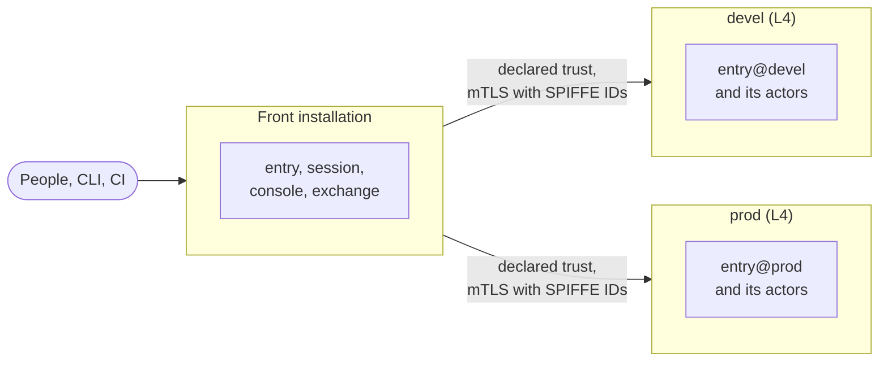

A **boundary** is the unit of keys and policy in sluis: what one compromised or misconfigured part cannot cross. Every address starts with the boundary. A boundary has its own key@ and wrapping key from level L1, its own issuer, its own SPIFFE trust domain, its own policy bundle and its own audit. The record is [ADR 0008](/decisions/0008-boundaries-and-tenants/); the issuers and tokens are [ADR 0017](/decisions/0017-identity-and-sign-in/).

## Kinds of boundary

| Kind | Holds | Holds an authority key |
|---|---|---|
| **Environment** | The machine plane of one environment (clusters, hosts, workloads, certificates, SSH and workload identity) and the identity plane of the companies that work in it, as tenants | Yes |
| **Customer** | The keys, issuer or failure domain of a party that needs its own, such as a regulated customer | Yes, its own |

A **company is a tenant** of an environment boundary, not a boundary. Its directory, chat workspace, code host and provider accounts, its upstream, people and operator delegation are kinds of that tenant. A party that needs authority keys is a customer boundary and never a tenant. Production never shares a key or a store with development. Customer boundaries belong to the CIAM layer ([0032](/decisions/0032-customer-identity-installations/)).

## The ladder

Each boundary declares a level, and each level includes the ones below it. A tenant is L0 and is not a boundary.

| Level | Adds |
|---|---|
| **L0 tenant** | Separation by the store's rules, a grant sealed for the tenant, and the tenant's own four data keys |
| **L1 keys** | Its own key@ and wrapping key (a KMS key, or a card of its own, such as a second card per board), so its own authority keys, intermediates and issuer. It uses the parent's store@, units and engine |
| **L2 process** | Its own store@ and its own units, with their own uid or role, on the parent's engine under its own address prefix |
| **L3 engine** | Its own engine (an rqlite cluster or a DynamoDB table), bucket and queue |
| **L4 runtime** | Its own runtime: its own cloud account, cluster or hosts, joined to the others by declared trust |

- **The level follows the need.** A boundary pays only for the level it declares.
- **L1 boundaries on a shared engine are separated by their own wrapping keys,** not by the engine.
- **Two independent checks hold at every level:** the store's rule with a grant sealed for the tenant, and key@'s grant check. A level adds separation under them, never instead of them ([ADR 0007](/decisions/0007-policy-and-sealed-grants/#two-independent-checks)).

## Tenants

A **tenant** is a scope inside a boundary with its own settings, clients, allowance and four data keys: `data`, `pseudonym`, `pairwise` and `evidence` ([Keys](/concepts/keys/#data-keys)). It is the second address dimension, used by durable and temp kinds only. By default a tenant has no authority key and no wrapping key (a tenant declared to keep its keys in a customer account has them there, [ADR 0006](/decisions/0006-keys-and-sealing/#where-a-tenants-keys-live)), it has an issuer host of its own, and it may exist in several boundaries, each holding its own copy with its own data keys.

Tenants of one boundary share its actors, its authority keys and its fate: a flaw in shared code reaches every tenant of the boundary. That is the accepted L0 risk, and a tenant that cannot accept it is **promoted** to a boundary of its own. Promotion moves the tenant's kinds to the new boundary and rewraps its data keys for the new boundary's wrapping key; the tenant keeps its name, its clients' names and its settings ([ADR 0008](/decisions/0008-boundaries-and-tenants/#promotion)).

A tenant's life is create, suspend and erase. Suspending is a tightening and takes effect at once. Erasing deletes the tenant's `data`, `pseudonym` and `pairwise` wraps, which is the crypto-shred, then its plain items; its `evidence` wrap goes when the evidence retention ends ([ADR 0008](/decisions/0008-boundaries-and-tenants/#tenant-lifecycle)).

## Example installations

- **A three-board installation** is one boundary. Its tenants are L0 scopes, its keys are wrapped for each board's card and for the recovery recipient, and its engine is one rqlite cluster over the boards.
- **An internal installation with kernel, devel, stage and prod boundaries** has four environment boundaries, each at L4, with its own cloud account or cluster, keys, store, issuer and audit. The companies that work there are tenants of every boundary, and their people sign in once at the front.
- **A customer installation with one boundary per regulated customer plus one shared customer boundary** has customer boundaries at L3: a regulated customer has an engine, a bucket and a queue of its own, and the shared boundary serves the other customers as tenants, each with its own data keys. A customer that outgrows the shared boundary is promoted.

L3 for a regulated customer is a cost choice, not a requirement: the public texts ask for separation, key control, a segregated restore and an exit, and the price of L3 is low ([ADR 0008](/decisions/0008-boundaries-and-tenants/#example-installations) has the texts and the pricing, read 2026-11-03).

## Installation-wide settings and scale

An installation is not a scope. Settings that are the same everywhere, such as the trust anchors and the front host, are one signed config document that infrastructure code writes into every boundary's config source; no boundary reads another's ([ADR 0008](/decisions/0008-boundaries-and-tenants/#installation-wide-settings)).

An installation is designed for about **5 to 10 customer boundaries** and **thousands of tenants** in them. Customer boundaries are few because each pays for keys, a yearly certification of its intermediates, an issuer host and its own units. A cohort that must be separate moves to an installation of its own. This is a design size, not a measured capacity ([ADR 0008](/decisions/0008-boundaries-and-tenants/#scale)).

## A federation of installations

One sluis, as people see it, is a **federation**: one front plus one installation for each L4 boundary, under one operator and joined by declared trust. People get one sign-in address, one console and one identity plane. Boundaries below L4 run inside the installation that hosts their parent.

- **Calls between boundaries use mutual TLS with SPIFFE IDs** ([Identity](/concepts/identity/#trust-domains)). The target decides again with its own policy and never takes the caller's decision as its own.
- **A sensitive boundary verifies the person's passkey assertion itself,** against its own challenge, so a compromised front cannot act there on a person's behalf.
- **Each installation runs its own `entry`.** The front never holds another boundary's keys.
- **What is shared:** the front, the console, the roots (held by [ritueel](https://ritueel.id)) and the operator.
- **Accepted risks:** a compromise of the roots; the operator who deploys sluis and the cluster administrators; a compromise of a boundary's `ca`, which reaches the workloads of every tenant in that boundary; a bug in a shared policy definition; data held outside sluis. See the [threat model](/security/threat-model/#accepted-risks).
- **A test installation is separate.** It serves no real user, trusts nothing of the federation, and lives outside the sluis host names.

## Issuers and tokens

Each environment boundary has its own issuer, and each tenant has an issuer host of its own, which a boundary serves. A tenant's issuer signs with the token-signing key of its location, and a move of the tenant keeps its host ([ADR 0017](/decisions/0017-identity-and-sign-in/#issuers)).

| Issuer | Address |
|---|---|
| The group issuer, at the front | `https://sluis.example.com` |
| An environment's issuer | `https://sluis.<env>.example.com`, one web origin per host, no path |

- **Discovery and keys are static documents** in a bucket of the boundary, so verification survives a compute outage. The key set is the exportable kind `SigningRing`, and it lists every active token key with its `x5c` chain.
- **A boundary has no sign-in of its own.** Its `entry@<boundary>` takes the group issuer as its upstream; a passkey tap is asked for only where that boundary's policy wants fresh multi-factor authentication.
- **The CLI signs in once** at the front, and then exchanges tokens silently at each boundary's own token endpoint. The front never sees a boundary's tokens.
- **One relying-party ID serves every issuer.** The boundary hosts are siblings of the group host, so the passkey's relying-party ID is the registrable parent (`example.com`), and every verifier checks a strict allow-list of web origins: the sluis hosts and their audit hosts, nothing else.
- **The audit front has a host of its own,** `sluis-audit.<env>.example.com` ([Audit](/concepts/audit/#the-audit-front)).
- **Step-up is per client and per boundary:** a request that needs more answers `insufficient_user_authentication` with `acr_values` ([RFC 9470](https://datatracker.ietf.org/doc/html/rfc9470)).

### Token claims

| Claim | Rule |
|---|---|
| `iss` | The issuer URL |
| `aud` | **Exactly one registered `client_id`**, never a URL. An RFC 8707 `resource=` selects a registered client and is never copied into `aud`. Between actors of two boundaries, `aud` is the target's SPIFFE ID |
| `sub` | The person's opaque random id for a tenant whose sector is `public`, and a pairwise value for any other sector ([Identity](/concepts/identity/#a-persons-subject)); for a JWT-SVID, the SPIFFE ID |
| `acr`, `amr`, `auth_time` | How and when the person signed in |
| `cnf` | Only when the audience declares a binding: `cnf.jkt` for DPoP, `cnf.x5t#S256` for mutual TLS ([ADR 0038](/decisions/0038-fapi-2-profile/#binding-is-declared-per-audience)). A bearer token has no `cnf` |
| grant names | Only that boundary's grant names, narrowed per audience |

Client ids are unique per issuer and readable. An AWS role is a client of its own, `aws:<account>:<role>`, and every relying party pins `iss` and `aud` ([ADR 0017](/decisions/0017-identity-and-sign-in/#audiences)). The claims and lifetimes are [ADR 0020](/decisions/0020-grant-vocabulary-and-token-claims/#the-claims-of-a-token).
