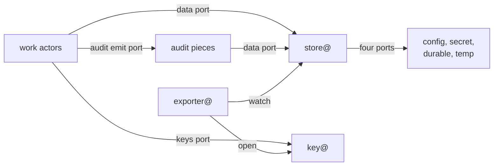
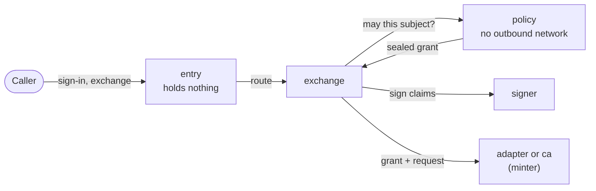

sluis is not one program. An **actor** is a program with one responsibility, and every actor belongs to one of four **families**: work, data, keys or audit. The family says what the actor may hold. Work actors hold nothing at rest; only the data, keys and audit families hold credentials, so an installation has a few credentials to protect, not one set per actor. The record is [ADR 0002](/decisions/0002-families-of-actors/).

What runs where, what each actor calls and which kinds it may touch is generated from the actor registry and the kind registry: see [Actors](/reference/actors/), [Kinds](/reference/kinds/) and [Rules](/reference/rules/). Components and their call graph are in [Components](/architecture/components/).

## The four families

| Family | Actors | What the family may hold |
|---|---|---|
| **Work** | `entry`, `session`, `console`, `exchange`, `policy`, `signer`, `ca`, `ssh-ca`, `quota`, and the adapters (`adapter-github`, `adapter-slack`, `adapter-upstream-oidc`) | **Nothing at rest.** No storage, key or audit credential |
| **Data** | `store@`, `exporter@` | The credentials of storage (store@) and of export destinations (exporter@) |
| **Keys** | `key@` | The card PIN on a board, the KMS permission on AWS |
| **Audit** | The emitter library, the audit transport, the writer, the witness, the indexer and the reader | The audit blob and index credentials, held by the writer, the witness, the indexer and the reader |

A port is never shared between two families. The audit family reads its own documents through the data port, like the actors of every other family, and keeps its blob, transport and index as ports of its own ([Audit](/concepts/audit/)).

## Work actors

| Actor | Responsibility |
|---|---|
| `entry` | Parses each request, validates it against closed parameter lists generated from the contracts, and routes it to the actor that owns the step. It is the only actor reachable from outside, and it sits behind the edge connector |
| `session` | Sign-in, session chains, the session cookie and the freshness of each person's authentication per boundary (step-up) |
| `console` | The operator API, as the browser's backend. It checks the operator's delegation and routes each write to the actor that owns the kind |
| `exchange` | Token exchange ([RFC 8693](https://datatracker.ietf.org/doc/html/rfc8693)), enrolment, the front of the signing API and the verifiers of proofs ([Identity](/concepts/identity/)) |
| `policy` | The decision point: a Cedar policy maps facts to grants, and `policy` asks key@ to seal them. It has no outbound network |
| `signer` | Signs tokens under a signing policy, and artifacts for a grant that `policy` sealed. It asks key@ to sign |
| `ca` | The X.509 certificate authority |
| `ssh-ca` | The SSH certificate authority, a separate actor because it is a different authority |
| `quota` | Counts the allowance of a tenant down and refuses at zero |
| `adapter-<vendor>` | The work actor of an integration. It returns facts or carries out effects that core authorised, never decides, and opens each tenant's connection credential at key@ for each call ([Integrations](/integrations/)) |

`signer`, `policy`, `ca` and `ssh-ca` run per [boundary](/concepts/boundaries/). The verifiers of proofs are not actors: they are verifiers inside `exchange`.

`entry`, which faces the internet, holds nothing and has no outbound network. It is written in a memory-safe language, parses only closed parameter lists, is fuzzed, loads no plugin and runs on a read-only file system. Where each actor listens, by runtime, is in [ADR 0003](/decisions/0003-units-transports-and-fusion/#listeners): on a board no actor has a TCP listener.

A copied authorization code is useless, because codes are bound by PKCE. Tokens are bearer tokens in the first working version; an audience that declares a binding, DPoP or mutual TLS, gets sender-constrained tokens ([ADR 0038](/decisions/0038-fapi-2-profile/#binding-is-declared-per-audience)).

### The console

The browser holds no token: its session is an HttpOnly cookie that `session` has key@ seal. `console` checks the operator's delegation and routes each write to the actor that owns the kind. The store refuses any other writer, and the console writes only two kinds itself, `Switch` and `LogLevelOverride` ([ADR 0002](/decisions/0002-families-of-actors/#the-console), [ADR 0027](/decisions/0027-the-console/#writes)).

### Why the signer and the policy are separate

In v1 the issuer is one function that serves sign-in, token exchange and minting, and touches 25 resources: too broad for least privilege. v2 splits it:

- `entry` parses and routes and holds nothing, so a bug in request parsing reaches no key, no secret and no stored value.
- `exchange` and `session` own the protocol steps and ask `policy` before anything is issued.
- `signer` signs only what its signing policy allows, so a compromised `entry` or `exchange` cannot ask it for an arbitrary token.
- `policy` decides. It has no outbound network and writes nothing, so it cannot be made to read or send anything. Its output is a **sealed grant**: key@ seals it, and the store, `ca`, `signer`, key@ and the minters open it.

To obtain a credential, an attacker needs a grant that `policy` sealed **and** a holder that accepts it; to forge a token, `signer` and its signing policy must agree ([ADR 0007](/decisions/0007-policy-and-sealed-grants/#sealed-grants)).

`policy` is written in Rust with the `cedar-policy` crate; each executable's language follows [ADR 0012](/decisions/0012-the-language-follows-the-executable/#per-actor-table).

## Credential holders

The holders are exactly four kinds of unit: store@ and exporter@ (data), key@ (keys), and the audit pieces that hold a credential (the writer, the witness, the indexer and the reader). No work actor is a holder.

| Holder | Credential at rest | What it does with it |
|---|---|---|
| `store@` | The credentials of its four storage ports: the config source, the secret source, the durable engine and the temp engine | Reads and writes items for callers whose rule allows it. It never seals or opens a value ([Data](/concepts/data/#the-store)) |
| `exporter@` | The credentials of its export destinations | Writes the exportable kinds to destinations outside sluis, and takes the backup ([Data](/concepts/data/#export)) |
| `key@` | The card PIN on a board, the KMS permission on AWS | Seals, opens, signs and makes keyed hashes ([Keys](/concepts/keys/)) |
| Audit writer, witness, indexer, reader | The write credential of the audit blob, the credential of the audit index | Every signature goes through key@ ([Audit](/concepts/audit/)) |

- **A holder never shares a unit with a work actor,** and key@ never shares one with `entry`.
- **On Lambda every function has a role.** Only the holders' roles reach storage, keys, export destinations or the audit blob; a work function's role lets it invoke other functions and send to the audit transport.
- **A holder's compromise is bounded by what it holds.** A flaw in store@ yields ciphertext, hashes, plain values and the values of secret sources, but no plaintext of a sealed value. A flaw in key@ yields keys, but not the data they protect, since the data is in store@ ([threat model](/security/threat-model/)).

## The foundation and the modules

The data and keys families, store@, exporter@ and key@, are the **foundation**: every installation runs them, and their binaries do not change with what runs above them. Identity (the work actors other than `quota`, the adapters included), audit and quota are **modules**. A module is a set of actors on top of the foundation, and it brings its own kinds and key purposes into the registries.

An installation runs the foundation and the modules it needs. It may run the foundation with the audit module only, to keep the audit trail of a product that does not use sluis for sign-in ([Audit](/concepts/audit/#audit-alone)). The foundation and the modules are a grouping, not a fifth family: each actor stays in one family ([ADR 0002](/decisions/0002-families-of-actors/#the-foundation-and-the-modules)).

## Ports of a work actor

A work actor has three ports in common, and the ports of its own job.

| Port | Goes to | Used for |
|---|---|---|
| **Data port** | store@ | Configuration, secrets and data, all as kinds through the one generic store service, with typed clients |
| **Keys port** | key@ | Seal, Open, Sign and Mac |
| **Audit emit port** | The audit transport | Every flow is audited, so every actor has it |
| Ports of its job | The edge, a vendor, the web | An HTTP listener (`entry` only), provider APIs (adapters), outbound fetch |

An actor has no configuration loader, no secret source and no storage driver of its own, and it never sees a driver. A holder has ports of its own downward: store@ has four, one per storage class; exporter@ has one per destination; key@ has one for its card or KMS. A driver sits behind each of them and is private to its owner ([ADR 0005](/decisions/0005-the-store/#drivers)). The ports are the same on every installation; what differs is the transport of each hop and the driver behind a holder's port.

## Naming

Every actor is named **`<actor>@<boundary>`**, and the name is generated from the actor registry. The [boundary](/concepts/boundaries/) is an environment such as `prod` or a customer boundary. The same name appears in every layer that enforces it, so a unit, a role, a socket and an audit field match without a lookup table:

| Layer | Example for `ca@prod` |
|---|---|
| systemd unit | `sluis-ca@prod.service` |
| Unix user | `sluis-ca-prod` |
| Socket | `/run/sluis/ca/prod.sock` |
| Lambda function and IAM role | `sluis-ca-prod` |
| Kubernetes pod and service account | `ca-prod` |
| Audit field | `actor=ca@prod` |
| SPIFFE ID | `spiffe://prod.example.com/sluis/ca` |

An adapter is named `adapter-<vendor>@<boundary>`, such as `adapter-github@prod`. One adapter runs for a vendor in a boundary, and connections tell the tenants apart ([ADR 0025](/decisions/0025-integrations/#adapters-and-connections)). In prose, `store@`, `key@` and `exporter@` mean the holder of the boundary under discussion.

## Units and transports

A **unit** is what an installation starts for one actor. A **transport** is how a call between two units travels. The steps and the checks are the same on every installation ([principle 19](/principles/#19-one-model-many-transports)); only the unit and the hop differ.

| Installation | The unit | The transport | The caller is known by |
|---|---|---|---|
| Boards, and the local installation | A systemd unit with its own Unix user (a container with a pinned uid locally) | A Unix socket | The peer uid |
| Lambda | A function, one per actor and one per holder | A Lambda invoke | The caller's IAM role |
| Kubernetes | A pod with its own service account, one per actor and per holder | In-cluster gRPC | A projected service-account token whose audience the callee checks, behind a NetworkPolicy; mutual TLS between callers is later work |

A holder's unit contains its drivers: separate binaries that the platform starts, and that only the owner can open. They are systemd units on boards, extensions on Lambda and native sidecar containers on Kubernetes. The call graph is declared once in the actor registry and enforced twice: by one interceptor in every process, and again by the transport (socket groups on boards, invoke policies on Lambda, network policies on Kubernetes). Where an actor runs is derived from the registry, and `sluis config check` refuses a combination it does not allow ([ADR 0003](/decisions/0003-units-transports-and-fusion/#units)).

Every contract is Protobuf served over ConnectRPC, even when caller and callee share a process, so moving a component into its own unit changes configuration and not code ([ADR 0002](/decisions/0002-families-of-actors/#contracts)).

### The fusion rule

On a small machine memory is tight, so an installation may **fuse** work actors into one unit. Fusion is an explicit choice, never the default:

> A holder never shares a unit with a work actor, key@ never shares one with `entry`, and `entry` never shares one with an actor that signs.

The store applies the union of the fused actors' rules to the unit, so fusion never grants what no member was allowed. `ca` and `ssh-ca` stay separate. Small work actors that hold nothing and have no listener, such as `quota`, may share a unit on a board ([Board capacity](/runtimes/bare-metal/#board-capacity) has the measurements). `sluis config check` refuses a configuration that breaks the rule, and the build runs the same check ([ADR 0003](/decisions/0003-units-transports-and-fusion/#fusion)).

:::note[Proposed]
Invokes between actor functions are fast enough on Lambda, so no in-process store exception is needed and no Lambda function links store@ into a work actor ([0003](/decisions/0003-units-transports-and-fusion/#fusion), measured in [#1179](https://github.com/truvity/sluis/issues/1179)).
:::

### Cells

A **cell** is one replica of each actor, scheduled together on one node: on Kubernetes by pod affinity, on a board the board itself. Services prefer the local cell, so a call to store@ or key@ stays on the node when a replica there is ready ([ADR 0003](/decisions/0003-units-transports-and-fusion/#cells)).

## Platform pieces

A platform piece is a program an installation runs that belongs to no family: the edge connector (`cloudflared` on boards, the pinned Lambda Web Adapter on Lambda, an edge relay container on Kubernetes), the host's card service, the engines (rqlite, DynamoDB) and the node agent `sluis-node`. The edge connector holds no key. The card is reached only through key@, and the engines only through store@'s drivers. `sluis-node` issues each unit a short-lived workload token and asks key@ to sign it ([Identity](/concepts/identity/#how-an-actor-reaches-a-cloud)). See [Runtimes](/runtimes/) for each runtime and the four tested installations.
