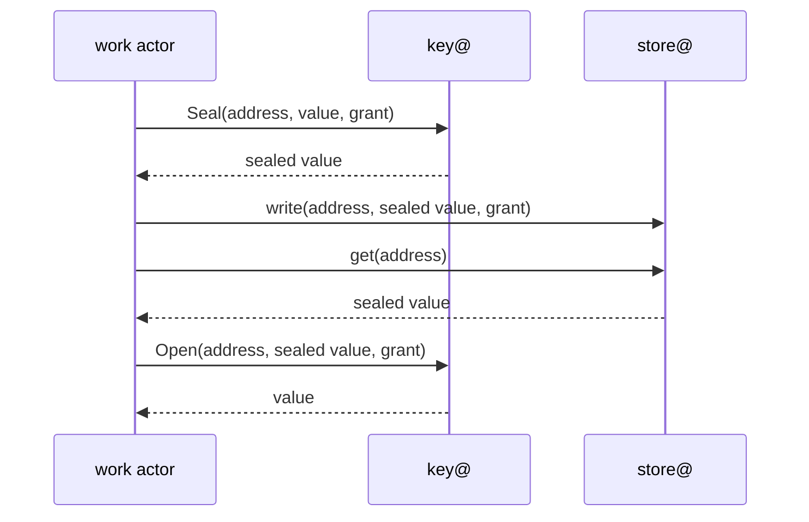

**key@** is the one holder of a boundary's keys. It holds the card PIN on a board or the KMS permission on AWS, and offers four operations: **Seal**, **Open**, **Sign** and **Mac** (a keyed hash). Every other actor asks it; none holds a key. Each [environment boundary](/concepts/boundaries/) has its own key@ and its own keys, so no key is shared between development, staging and production. This page says which store backs each key and how a caller reaches it. The rules behind it, the algorithms, when keys are shared, rotation and why keys sign in place, are [ADR 0006](/decisions/0006-keys-and-sealing/). The generated [Keys](/reference/keys/) page lists every purpose with its algorithm, its AWS key type, its card slot and the actor that asks for it. The threats are on the [threat model](/security/threat-model/).

## Key stores

The key store is the choice of key@'s driver, which is private to key@. There are three:

| Mode | Driver | Where it is used |
|---|---|---|
| **AWS KMS** | `aws-kms` | [lambda](/runtimes/#lambda), [kubernetes](/runtimes/#kubernetes) and other AWS installations |
| **YubiKey PIV** | `yubikey-piv` | [boards](/runtimes/#boards) and other installations on single-board computers: one card per board |
| **Software** | `software` | [local](/runtimes/#local), CI, and development |

The local installation uses software keys and needs no hardware. A dedicated development card is opt-in: only key@ reaches it, through the host's smart-card service. The floor is in code: the software driver refuses to start when the environment is `production`, and configuration chooses only among the modes the floor allows, so a development configuration loaded on the wrong board cannot make a software key a production authority key ([ADR 0006](/decisions/0006-keys-and-sealing/#floors-in-code)). On Kubernetes the keys are AWS KMS keys; the workload tokens a pod presents are the cluster's projected service-account tokens, which the cluster signs and sluis neither holds nor signs.

PKCS#11 drivers (YubiHSM 2, Nitrokey HSM 2), more drivers and post-quantum keys come later ([#1029](https://github.com/truvity/sluis/issues/1029)).

## Seal and open

**The store never seals or opens.** It keeps a sealed value as ciphertext and a compare-only value as a hash. To write, the actor asks key@ for `Seal(address, value, grant)` and writes the result; to read, it asks for `Open(address, sealed, grant)`. The plaintext exists only in the actor, for that call.

- **The value is sealed under the data key of its address's boundary, tenant and purpose,** with AES-256-GCM and the full address as authenticated data. A value copied to another row, kind, tenant or boundary does not open.
- **key@ checks three things on every Seal and Open:** the caller's identity, by the transport; the caller's rule for the purpose and operation, generated from the actor registry; and the grant, which must be sealed for the address's tenant, name the operation and not be expired.
- **Opens are batched,** so a request that needs a session cookie and a person's records pays one hop. On Lambda the hop was measured with the whole sign-in, which stays inside its budget ([0037](/decisions/0037-capacity-is-measured-before-it-is-promised/#the-warm-sign-in-on-lambda)).
- **Mac** makes a keyed hash with HMAC-SHA384 over a data key: link ids, pairwise subjects and the hashed index entries of sealed kinds under the boundary's `mac` key, and audit pseudonyms under a tenant's `pseudonym` key. There is no extra KMS key for hashing.

## Data keys

A data key is a software AES-256 key. key@ makes it, keeps it only wrapped, and opens it only in its own memory. It is never a KMS key, so a new tenant costs no KMS key and no key policy.

| Purpose | Scope | Protects |
|---|---|---|
| `data` | One per tenant | Personal and operational data of the tenant |
| `pseudonym` | One per tenant, rolled by epoch | Keyed hashes of the tenant: audit pseudonyms |
| `evidence` | One per tenant | Audit and usage evidence of the tenant |
| `grant` | One per boundary | Sealed grants |
| `cookie` | One per boundary | Session cookies |
| `mac` | One per boundary | Keyed hashes of link ids, upstream sessions and pairwise subjects |
| `data` | One per boundary, tenant `-` | The sealed kinds that have no tenant in their address |

The purposes never share a key, so a tenant's exit can delete its personal data and keep its evidence. A tenant that exists in several boundaries has separate data keys in each. A tenant has no authority key and no wrapping key: a party that needs one is a boundary ([ADR 0006](/decisions/0006-keys-and-sealing/#data-keys)).

### DataKeyWrap

Each wrapped copy of a data key is an ordinary durable kind, **`DataKeyWrap`**, with key@ as its one writer and the only actor that opens a wrap.

- **On AWS there is one wrap:** the ciphertext that `GenerateDataKey` returns under the boundary's symmetric KMS key, with the encryption context {boundary, tenant, purpose}.
- **On boards there is one wrap per recipient.** key@ generates the data key in software and wraps it by ECDH on P-384, HKDF-SHA384 and AES key wrap, for each board's card (its key-agreement key) and for the recovery recipient. Making a wrap needs only the recipient's public key; opening one needs the card.
- **A new card or board is a rewrap:** an existing key@ opens each data key, wraps it for the new public key and writes the new item. The data is not touched.
- **The recovery recipient** is an offline P-384 key under [ritueel](https://ritueel.id)'s custody, so that losing every card does not lose the data. No actor, not even key@, can open a wrap made for it; using it is a ceremony.
- **An ECDH on a board's card takes a median of 143 ms,** about 7 a second per card (measured on two boards' cards, 2026-11-03). The cache makes it a cost of a miss, not of a request.

### The cache

key@ caches opened data keys in memory, each entry with its own time to live, set in the key plan under a built-in maximum. A cached key opens and seals without a card operation or a KMS call. The time to live is also the **erasure delay**: on boards and on Kubernetes key@ watches `DataKeyWrap` and drops an entry when its wrap is deleted; on Lambda nothing is pushed, so a warm function keeps its entries until they expire.

### Erasing a tenant

A tenant's exit deletes its `data` and `pseudonym` wraps at once, every generation and every recipient. Every value sealed for the tenant stops opening: this is the **crypto-shred**. Its `evidence` wrap is deleted when the evidence retention ends, because evidence outlives personal data ([ADR 0006](/decisions/0006-keys-and-sealing/#erasing-a-tenant), [Audit](/concepts/audit/#tenants-encryption-and-erasure)).

## Sealed grants

Only `policy` may ask key@ to seal a **grant**, the decision that a request is allowed. The store, `ca`, `signer`, key@ and the minters open it. A grant names the tenant and what it allows, is reusable for about 60 seconds, and is never stored; a one-shot irreversible action leaves a hashed `SpentGrant` marker. On a board grants are sealed under the boundary's `grant` data key, not a card key, so a grant costs a memory operation and not an ECDH. A grant sealed in one boundary opens in no other ([ADR 0007](/decisions/0007-policy-and-sealed-grants/#sealed-grants)).

This is one of **two independent checks**: the store's rule with a grant sealed for the tenant, and key@'s grant check on every Seal and Open ([ADR 0007](/decisions/0007-policy-and-sealed-grants/#two-independent-checks)). The word *grant name* means something else: an entry of the grant vocabulary ([ADR 0020](/decisions/0020-grant-vocabulary-and-token-claims/#grant-names-and-the-vocabulary)).

## Algorithms

ES384 (ECDSA on P-384) is the default for everything sluis signs, including the checkpoints of the audit log and the issuance log. sluis supports the FAPI 2.0 set, ES256, PS256 and EdDSA, as the algorithms of that profile ([ADR 0038](/decisions/0038-fapi-2-profile/)). It has a short list of named exceptions, each with a key of its own that serves nothing else: cloud federation (ES256 for GCP, RS256 for Azure Entra), a per-audience RS256 key, NATS Ed25519 keys and the C2SP witness keys ([ADR 0006](/decisions/0006-keys-and-sealing/#named-exceptions)). Everything else stays within the FIPS-approved set, with no FIPS mode or certified build in 2.0 ([ADR 0006](/decisions/0006-keys-and-sealing/#algorithms)). Support depends on the driver: PS256 on a YubiKey takes about 2.3 seconds a signature, and Ed25519 in PIV needs firmware 5.7 or newer.

In Go, JOSE is `go-jose/v4` behind sluis's own `jose` package; Rust and TypeScript only verify ([Approved libraries](/reference/approved-libraries/#jose)). Tokens are standard JWS and JWT that any language verifies against the published key set.

## Key purposes

**There is one key per purpose and per algorithm.** An asymmetric key never serves two purposes, and a key that issues certificates never signs tokens. Several audiences of one purpose share its key. Two uses share a key only when their audience, lifetime, revocation coupling and callers are equal and the key store itself separates them ([ADR 0006](/decisions/0006-keys-and-sealing/#key-purposes)).

Purposes outside the baseline are **enabled on use**, each a dedicated key, and a purpose an installation does not enable has no key and no slot:

- the issuance-log key of `ca`;
- the release-signing key, in the release boundary only;
- the enrolment key of `exchange`, which hosts encrypt to (P-384 ECDH);
- the witness key, one per format;
- the backup archive key;
- the workload-issuer key of `sluis-node`, on boards only;
- each named exception.

Authority keys are born in their key store, sign in place and cannot be exported ([principle 1](/principles/#1-a-key-is-born-in-its-store-and-never-leaves-it)). There is no software signing for an authority key, and signing is content-aware: key@ signs a certificate only within its constraints, an SSH certificate body, a JWS signing input or an OpenPGP signature input, so a parser mistake refuses a signature.

## AWS KMS layout

A boundary on AWS needs **1 symmetric key and 5 P-384 keys** in KMS, with one trust domain and one audit writer instance. Each further trust domain, or each further audit writer instance, adds one P-384 key.

| Key | Spec | Purpose |
|---|---|---|
| Symmetric | `ENCRYPT_DECRYPT`, AES-256 | Wraps every data key of the boundary, each under its own encryption context |
| Token signing | `ECC_NIST_P384`, `SIGN_VERIFY` | Tokens and the key set, used by `signer` through key@ |
| X.509 intermediate | `ECC_NIST_P384`, `SIGN_VERIFY` | The CA key of each trust domain, for `ca` |
| SSH user CA, SSH host CA | `ECC_NIST_P384`, `SIGN_VERIFY` | One key each, for `ssh-ca` |
| Audit log | `ECC_NIST_P384`, `SIGN_VERIFY` | One per audit writer instance, for its audit and usage logs |
| Per tenant | None | A tenant's data keys are wrapped under the symmetric key |

The symmetric key's policy names key@'s role alone, and every signing key's policy names key@ only, because `kms:Sign` takes no encryption context. Every other actor reaches a key through key@, whose rules say who may ask for which purpose. A signing key that ritueel certifies has one more principal that cannot sign: a read-only role that ritueel's certifier assumes to read the key and its policy ([ADR 0024](/decisions/0024-root-custody-and-the-signing-api/#the-hand-off)). KMS rotates the symmetric key automatically. In production it is a multi-Region key plus a replica, because losing it loses every sealed value; signing keys are single-Region ([ADR 0010](/decisions/0010-backup-and-recovery/#residency)).

## Keys per board

Each board has a card of its own, a YubiKey in PIV mode with 24 slots and no symmetric keys. A card belongs to one boundary, and every key of the board is born on its card. A second card per board serves a further L1 boundary on the same engine. Data keys are not on the card: key@ wraps them for each card's key-agreement key. A lost board is replaced, not restored: a new key on a new card, a new certificate, and ritueel revokes the old one; the other boards rewrap every data key for the new card. The root cards are ritueel's and never sit in a board.

### The card slot map

A documented, versioned map says which slot serves which purpose: one slot per purpose and per algorithm, and a shared spare range. This is the default map, version 1.

| Slot | Purpose |
|---|---|
| `9c` | X.509 intermediate |
| `9a` | Token signing |
| `9d` | Key agreement (ECDH): unwraps data keys, the boundary's `grant` data key among them |
| `82` | `ssh-user` CA |
| `83` | `ssh-host` CA |
| `84` | Log key of an audit writer instance |
| `85` | OpenPGP release-signing subkey (release boundary only) |
| `86` | Workload issuer, for `sluis-node` (enabled on use) |
| `87` | PIN release key: signs the request of a locked board (PIN policy never, touch never) |
| `88` to `95` | Spare, fourteen slots shared by every purpose |
| `9e` | Not used: the card-authentication slot signs without a PIN by default |

A second purpose or algorithm takes a spare slot, named in the installation's key plan; the spare range also holds the new key of an event rotation while the old one finishes. `sluis config check`, `sluis key request` and board initialisation refuse a collision and an enabled purpose with no slot. The release subkey lives in a PIV slot like every other board key; the OpenPGP applet is not used ([ADR 0006](/decisions/0006-keys-and-sealing/#the-slot-plan)).

## The token-signing key

Tokens are signed directly by the key store: KMS or the card signs each token itself, and there is no derived, burst or short-lived online key. A YubiKey 5 Nano signs P-384 in about 147 ms, about 7 signatures a second per card and about 21 a second for three boards (measured 2026-10-31, firmware 5.8.0), against a v1 peak of 0.8 tokens a second.

The token-signing key is a key of its own, not the intermediate, so a key that signs tokens can never issue a certificate. The board's intermediate certifies it with a **non-CA certificate that allows digital signatures only**, under the token-signing profile of [ADR 0023](/decisions/0023-certificate-authorities/#leaf-profiles). Each entry of the published key set carries an `x5c` chain: the token certificate, the board's intermediate, then up to the root. A standard verifier ignores it and fetches the key over TLS; a verifier that wants to can check custody down to a root it trusts. The workload-issuer key of `sluis-node` is made the same way in its own slot, and sluis-node signs through key@ because key@ has exclusive access to the card ([ADR 0006](/decisions/0006-keys-and-sealing/#the-token-signing-key)).

## Exclusive card access, touch and PIN

key@ has the card to itself. Its card driver runs as a dedicated user, the card service accepts only that user, and no other software that talks to cards runs on the board. The reason was measured on 2026-10-31 on a YubiKey 5 Nano (firmware 5.8.0): the PIN state belongs to the powered card and not to a connection, so while it is unlocked any local process can sign; any client's default disconnect resets the card; and wrong PINs from any local user block it ([ADR 0006](/decisions/0006-keys-and-sealing/#exclusive-card-access)).

Board cards are touch never and PIN once, so a board signs unattended. A board starts locked, and key@ never stores the PIN in plaintext on disk:

- `sluis node unlock <node>` delivers the PIN over an authenticated channel;
- an unlocked peer releases the board's PIN through the store, sealed to a one-time key of the locked key@, which covers a reboot of one board and a rolling update; the locked key@ signs its request with a card slot that needs no PIN, and the peer verifies the signature and the slot's attestation first;
- after a full power loss one manual unlock is needed, and the first board then unlocks the others;
- a wrong PIN is never retried, because the card blocks after three attempts and then needs the PUK.

## Roots and certification

sluis holds **no root**. The roots, their ceremonies and every transition between root stores belong to [ritueel](https://ritueel.id); sluis holds intermediates and signs with them every day. The two exchange standard formats, fixed by ritueel's [hand-off contract, version 1](https://ritueel.id/reference/hand-off-contract/) and not repeated here ([ADR 0024](/decisions/0024-root-custody-and-the-signing-api/#the-hand-off)):

1. **Request.** `sluis key request` creates the key if it does not exist, on the board's card or in KMS, and writes a PKCS#10 request with a proof of where the key lives: the card's attestation chain, or the KMS key's full ARN, which ritueel reads through a read-only role. For an OpenPGP signing subkey it writes the public subkey and one back-signature for every active primary on the root list it holds, which key@ makes on the card.
2. **Certify.** At ritueel's ceremony a root checks the proof and signs. This is the only step that touches a root. The answer is one certificate, or the bound subkey; the root is not in it.
3. **Install.** `sluis key install` checks that the certificate verifies to an anchor of the CA bundle, that a root list, when sluis holds one, is at least as recent as the answer's trust sequence, and that the certificate matches the key and its request. key@ writes the chain as `KeyCertificate`. The root list is optional: any CA that signs a PKCS#10 request in the profile can certify sluis ([ADR 0024](/decisions/0024-root-custody-and-the-signing-api/#the-floor)).
4. **Watch.** `sluis key status` shows each key, its store and its expiry. An intermediate certificate or an OpenPGP subkey lasts about 13 months and is re-signed over the same key in month 12. With a card root that needs a person on ritueel's side once a year, and sluis warns 60, 30 and 14 days before the end; with a KMS root `ritueel renew` does it unattended under a declared policy.

Key material is replaced by the rule of [principle 3](/principles/#3-keys-are-shared-rotated-and-given-to-tenants-by-rule): on an event and, for a software key, no later than three years after it was made. A data key rotates by generation, before its AES-GCM usage limit. The log keys, the audit log key and the issuance-log key of `ca`, change only on compromise ([ADR 0006](/decisions/0006-keys-and-sealing/#rotation)). The tests get their root from a plain CA tool or, when it exists, from ritueel's software-root mode; sluis never generates a root.

Hosts pin the public keys (SPKI hashes) of the roots, verify the root list that ritueel signs when they hold one, and refuse a list with a lower trust sequence than the one they hold (`sluis trust sync`, [Identity](/concepts/identity/#trust-sync)). How roots are made, held and replaced is taught at [ritueel.id](https://ritueel.id).
