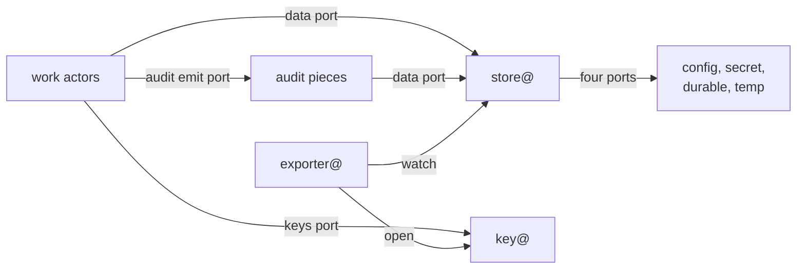

# 0002 — Actors form four families: work actors hold no credential at rest, and only the data, keys and audit families hold credentials

**Status:** Accepted
**Date:** 2026-11-03

Proposal: [issue #901](https://github.com/truvity/sluis/issues/901).

## Context

sluis v1 is one issuer function that serves sign-in, machine token exchange and downstream minting, and it touches 25 resources; least privilege cannot be expressed for something that broad. v1 later split its parts by credential holder (v1 ADR 0071, on `master`), kept the signer and the console inside the issuer (v1 ADR 0072), and serves its contracts as Protobuf over Connect (v1 ADR 0064). This record is the v2 successor of all three, for the method.

v2 is several processes, and every one of them needs data, keys and an audit trail. The design has to say which of them may hold a credential at rest, and how many such holders there are. If each process holds the credential of its own storage, its own key permission and its own audit path, then a flaw in the code that parses an internet request reaches long-lived credentials, and an installation has as many credentials to protect, rotate and review as it has actors. The credentials differ per backend, so the check that an actor may touch a value is also different per backend, and assurance changes with the platform.

This record reverses the stance that only the owner of the card stands between actors and what they use. Four kinds of holder stand between them: store@ for data, exporter@ for destinations outside sluis, key@ for keys, and the audit pieces. Every other actor holds nothing at rest. The credentials are few and are concentrated in units that do one job and run no request-parsing code. The rules over data are written once, in the kind registry ([0004](/decisions/0004-the-data-model/#kinds)), and the store applies them in the same way on every installation ([0005](/decisions/0005-the-store/#rules)). The cost is a hop to store@ for every data access and a hop to key@ for every seal and open, which [0003](/decisions/0003-units-transports-and-fusion/) and [0037](/decisions/0037-capacity-is-measured-before-it-is-promised/) keep in view.

## Decision

### The four families

- **Every actor belongs to exactly one family: work, data, keys or audit.** A port is never shared between two families. A family is a set of actors that share one kind of authority, and the family tells a reader what an actor may hold.
- **An actor is a program with one responsibility,** run as its own unit in each boundary it serves ([0003](/decisions/0003-units-transports-and-fusion/#units)). These are the actors:

  | Family | Actor | Responsibility |
  |---|---|---|
  | work | `entry` | Parses each request, validates it against closed parameter lists generated from the contracts, and routes it to the actor that owns the step. It sits behind the edge connector and is the only actor reachable from outside. |
  | work | `session` | Sign-in, sessions, the session cookie and the freshness of each person's authentication per boundary (step-up). It asks key@ to seal and open the cookie on every request. |
  | work | `console` | The operator API, as the browser's backend ([The console](/decisions/0002-families-of-actors/#the-console)). |
  | work | `exchange` | Token exchange (RFC 8693), enrolment, the front of the signing API, and the verifiers of proofs. |
  | work | `policy` | The decision point. A declared Cedar policy maps facts to grants, and `policy` asks key@ to seal them ([0007](/decisions/0007-policy-and-sealed-grants/#sealed-grants)). It has no outbound network. |
  | work | `signer` | Signs tokens under a signing policy, and artifacts for a grant that `policy` sealed ([0024](/decisions/0024-root-custody-and-the-signing-api/)). It asks key@ to sign and is not a pure signing oracle. |
  | work | `ca` | The X.509 certificate authority ([0023](/decisions/0023-certificate-authorities/)). |
  | work | `ssh-ca` | The SSH certificate authority, for user and host certificates ([0023](/decisions/0023-certificate-authorities/)). |
  | work | `quota` | Counts the allowance of a tenant down and refuses at zero ([0039](/decisions/0039-quota-allowance/)). |
  | work | `adapter-<vendor>` | The work actor of an integration, for example `adapter-github`, `adapter-slack` and `adapter-upstream-oidc` ([0025](/decisions/0025-integrations/)). |
  | data | `store@` | The only holder of storage credentials. It serves the one generic store service and has four ports downward, one per storage class ([0005](/decisions/0005-the-store/)). |
  | data | `exporter@` | Publishes the kinds marked exportable to destinations outside sluis ([0009](/decisions/0009-export/)). |
  | keys | `key@` | Holds the card PIN or the KMS permission of its boundary, and offers Seal, Open, Sign and Mac ([0006](/decisions/0006-keys-and-sealing/)). |
  | audit | emitter, transport, writer, witness, indexer, reader | The audit pieces ([0028](/decisions/0028-audit-pieces/)). |

- **Audit reads its configuration through the data port.** Its documents are config kinds (`AuditLog`, `AuditWitnesses` and `AuditCatalogue`) that store@ loads and verifies like every other config ([0005](/decisions/0005-the-store/#configuration-loading)), and the audit pieces are their readers, as the actors of any family are readers of the kinds they use. The blob, the transport and the index are audit's own ports, and the writer's state lives in the audit blob ([0029](/decisions/0029-the-audit-log/)).

### The foundation and the modules

- **The data and keys families are the foundation.** store@, exporter@ and key@ run in every installation, and their binaries do not change with what runs above them.
- **Identity, audit and quota are modules.** A module is a set of actors on top of the foundation, and it brings its own kinds and key purposes into the registries ([0004](/decisions/0004-the-data-model/#kinds), [0006](/decisions/0006-keys-and-sealing/#key-purposes)). The identity module is the work actors other than `quota` (the adapters included), the audit module is the audit pieces, and the quota module is `quota`.
- **An installation runs the foundation and the modules it needs.** It may run the foundation with the audit module only, to keep audit for a product that does not use sluis for sign-in; a product that adopts sluis for sign-in later adds the identity module, and nothing is migrated.
- **The foundation is a grouping, not a fifth family.** Each actor stays in one of the four families, which say what it may hold; the foundation and the modules say what an installation runs.

### Work actors

- **A work actor holds no storage, key or audit credential at rest.** It reaches data, keys and audit only through its ports ([Ports of a work actor](/decisions/0002-families-of-actors/#ports-of-a-work-actor)), so a flaw in a work actor yields what it is using at that moment and nothing it could replay later ([principle 16](/principles/#16-few-credential-holders)).
- **`entry` routes and does nothing else.** `session` serves sign-in and sessions, `exchange` token exchange and enrolment, `console` the operator API, and `signer` signing.
- **`signer` and `policy` are split.** The actor that signs does not decide, and the actor that decides cannot sign.
- **`ca` and `ssh-ca` are two actors.** An SSH CA is a different authority from an X.509 CA, with a different key, format and relying parties, so a flaw in one does not sign for the other. An installation does not fuse them, because that would undo the separation ([0003](/decisions/0003-units-transports-and-fusion/#fusion)).
- **`signer`, `policy`, `ca` and `ssh-ca` run per boundary** ([0008](/decisions/0008-boundaries-and-tenants/#boundaries)).
- **`entry` is hardened as the edge it is.** It is written in a memory-safe language ([0012](/decisions/0012-the-language-follows-the-executable/#per-actor-table)), is fuzzed against its closed parameter lists, loads no plugins and runs on a read-only file system. It has no outbound network. Its listener is in [0003](/decisions/0003-units-transports-and-fusion/#listeners).
- **An adapter is the work actor of an integration.** It returns facts or carries out effects that core authorised, never decides, and serves one vendor, opening each tenant's connection credential at key@ for each call ([0025](/decisions/0025-integrations/)).

### Credential holders

- **The credential holders are exactly four kinds of unit:** store@ and exporter@ (data), key@ (keys), and the audit pieces that hold a credential (the writer, the witness, the indexer and the reader). No work actor is one, and no other unit is one.

  | Holder | Credential at rest | What it does with it |
  |---|---|---|
  | `store@` | The credentials of its four storage ports: the config source, the secret source, the durable engine and the temp engine | Reads and writes items through its drivers for callers whose rule allows it |
  | `exporter@` | The credentials of its export destinations | Writes the exportable kinds to the destinations |
  | `key@` | The card PIN on boards, the KMS permission on AWS | Seals, opens, signs and makes keyed hashes |
  | audit writer, witness, indexer, reader | The write credential of the audit blob (the writer's log, the witness's cosignatures), the credential of the audit index | Every signature goes through key@; how each piece writes its blob and its index is audit's own matter ([0028](/decisions/0028-audit-pieces/), [0029](/decisions/0029-the-audit-log/)) |

- **A holder never shares a unit with a work actor,** and key@ never shares one with `entry` ([0003](/decisions/0003-units-transports-and-fusion/#fusion)). A holder's unit runs its own code and its own drivers and parses no unauthenticated input.
- **On Lambda every function has a role, and only the holders' roles reach storage, keys, export destinations or the audit blob.** The role of a work function lets it invoke other functions and send to the audit transport through its emit port, and nothing else.
- **Processes follow the owner of a credential, not the port.** There is a unit per holder, never a unit per port.
- **A holder's compromise is bounded by what it holds.** A flaw in store@ yields ciphertext, hashes, plain values and the values of secret sources, but no plaintext of a sealed value, because store@ never seals or opens ([0005](/decisions/0005-the-store/#secret-sources), [principle 18](/principles/#18-plaintext-lives-only-where-it-is-used-behind-two-independent-checks)). A flaw in key@ yields keys but not the data they protect, since the data is in store@ ([threat model](/security/threat-model/)).

### Ports of a work actor

- **A work actor has exactly three ports in common:** a **data port** to store@, a **keys port** to key@ and an **audit emit port**. It also has the ports of its own job: an HTTP listener (`entry` only), provider APIs (adapters) and outbound fetch.
- **The data port is the one generic store service, used through typed clients** ([0005](/decisions/0005-the-store/#the-store-api)). Configuration, secrets and data all reach an actor as kinds through it. An actor has no configuration loader, no secret source and no storage driver of its own, and it never sees a driver.
- **The keys port is Seal, Open, Sign and Mac at key@** ([0006](/decisions/0006-keys-and-sealing/#seal-and-open)). The actor registry says which key purposes and operations each actor may use.
- **The audit emit port sends an audit fact to the audit transport** ([0028](/decisions/0028-audit-pieces/)). Every flow is audited, so every actor has it.
- **A holder has ports of its own downward.** store@ has four, one per storage class; exporter@ has one per destination; key@ has one for its card or KMS. A driver sits behind each of them and is private to its owner ([0005](/decisions/0005-the-store/#drivers)).
- **The ports are the same on every installation.** What differs is the transport of each hop ([0003](/decisions/0003-units-transports-and-fusion/#transports)) and the driver behind a holder's port.

### Names

- **Every actor is named `<actor>@<boundary>`,** for example `ca@prod` or `store@prod`. The name is generated from the actor registry, and the same name appears in every layer that enforces it:

  | Layer | Example for `ca@prod` |
  |---|---|
  | systemd unit | `sluis-ca@prod.service` |
  | Unix user | `sluis-ca-prod` |
  | socket | `/run/sluis/ca/prod.sock` |
  | Lambda function and IAM role | `sluis-ca-prod` |
  | Kubernetes pod and service account | `ca-prod` |
  | audit field | `actor=ca@prod` |
  | first part of the id of a self-scoped kind | `ca` |
  | SPIFFE ID | `spiffe://prod.<td>/sluis/ca`, in the boundary's own trust domain |

- **An adapter is named `adapter-<vendor>@<boundary>`,** for example `adapter-github@prod`. It serves one vendor and opens each tenant's connection credential at key@ for each call, and [0025](/decisions/0025-integrations/) says how the instances of one vendor are told apart.
- **In prose, `store@`, `key@` and `exporter@` mean the holder of the boundary under discussion.** The audit pieces are named in [0028](/decisions/0028-audit-pieces/).
- **A rename is a change of the actor registry,** and the matching names in every layer follow from it.

### The console

- **The console is its own work actor,** the browser's backend. The session is an HttpOnly cookie that `session` has key@ seal ([0006](/decisions/0006-keys-and-sealing/#seal-and-open)); there are no tokens in the browser. The operator API is a different responsibility from `entry`'s, which stays the thin parser.
- **The console checks the operator's delegation and routes each write to the owning actor,** which validates it with its own logic. The store refuses any writer but the owner ([0004](/decisions/0004-the-data-model/#one-writer-per-kind)). Every operator change is authorised for a named person and audited under that name.
- **The console itself writes exactly two kinds, `Switch` and `LogLevelOverride`.** No actor has domain logic for either, so the store checks their schema, bounds and direction from the kind registry ([0027](/decisions/0027-the-console/#writes)).
- **The console's single-page application is a separate artifact,** served same-origin by each runtime's static host ([0013](/decisions/0013-release-train-packaging-and-distribution/#packaging-per-runtime)). Its pages follow the storage class and profile of what they show ([0027](/decisions/0027-the-console/)).

### Contracts

- **Every contract is Protobuf served over ConnectRPC, even when caller and callee share a process.** In-process calls use an in-memory transport, so moving a component into its own unit changes configuration, not code. The same contract travels over a Unix socket, a Lambda invoke or an in-cluster gRPC call ([0003](/decisions/0003-units-transports-and-fusion/#transports)).
- **The `proto/` directory is the source of every contract,** and a contract change is reviewed there first. Other descriptions, such as OpenAPI, are generated from it ([0004](/decisions/0004-the-data-model/#schemas-are-protobuf)).

### Three zoom levels

The design is described at three levels, and the output of each is the input of the next:

- **The black box:** what sluis does, for whom, and which resources each use case touches.
- **The components:** which actor owns each operation, through which contract and which of its ports, the call graph, and one writer per kind.
- **The units:** the actors and holders as units, their rules, their packaging, and the enforcement on each installation.

### Registries generate the enforcement

- **Two registries are the spine.** The kind registry holds the rules over kinds: which actor may get, list, create, update, delete or watch which kind, and the one writer of each ([0004](/decisions/0004-the-data-model/#kinds)). The actor registry names every actor, its family, language, placement, the actors it calls, its egress hosts and the key purposes it uses ([reference](/reference/actors/)).
- **Nothing that enforces least privilege is written by hand.** The registries generate, for every installation:
  - the store's rule table and the grant checks at key@;
  - the IAM and trust policies of the holders' roles and the invoke permissions between functions;
  - the KMS key policies, one holder per key;
  - the systemd units, sandbox drop-ins and per-uid egress rules, the Kubernetes service accounts and NetworkPolicies;
  - the call graph, default deny, enforced by one interceptor in every process and again by each transport: the socket groups and sandboxes on boards, the invoke resource policies on Lambda, the NetworkPolicies on Kubernetes ([0003](/decisions/0003-units-transports-and-fusion/#the-call-graph));
  - the backup list, the telemetry allowlist and the audit redaction, from the kinds' treatment and storage class.
- **A generated check refuses an installation that gives a work unit a credential,** or that puts a holder in a unit with a work actor. `sluis config check` runs it, and the build runs it again.
- **Enforcement is tested, not assumed.** The deny matrix is generated from the same data: for every pair of actors, X is denied Y's kinds, keys and sockets, and a test proves it. The blast-radius report of every actor is checked in, so a pull request shows what a change grants.

### Platform pieces

- **A platform piece is a program an installation runs that is not an actor of any family:** the edge connector, the host's card service, the engine processes, and the node agent `sluis-node`.
- **The edge connector is key-less.** It is `cloudflared` on boards, the pinned Lambda Web Adapter on Lambda and an edge relay container on Kubernetes ([0003](/decisions/0003-units-transports-and-fusion/#listeners)).
- **The card is reached only through key@.** The card service of the host talks to key@ alone ([0006](/decisions/0006-keys-and-sealing/#exclusive-card-access)).
- **The engines are reached only through store@'s drivers.** DynamoDB and rqlite are chosen per installation ([0005](/decisions/0005-the-store/#engines)).
- **`sluis-node` holds no key credential.** It issues each unit a short-lived workload token and asks key@ to sign it, with a key purpose of its own on boards ([0022](/decisions/0022-workload-identity-and-host-enrolment/), [0006](/decisions/0006-keys-and-sealing/#key-purposes)).

## Consequences

- A flaw in request parsing in `entry` reaches no key, no storage credential and no audit credential, and `entry` cannot send anything out. To obtain a credential an attacker needs a grant that `policy` sealed and a holder that accepts it.
- An installation has few credentials to protect, rotate and review: one set per holder, not one set per actor. A work actor needs no cloud role beyond invoke and emit, no storage user and no key permission.
- Every data access crosses store@ and every seal or open crosses key@. Each hop costs a call on every installation, and the cost is accepted for the isolation. The cost on boards is in [0037](/decisions/0037-capacity-is-measured-before-it-is-promised/); the cost on Lambda gates [0003](/decisions/0003-units-transports-and-fusion/).
- store@ and key@ are on the path of nearly every request. Their availability bounds the availability of the work actors, and their code is the code to review hardest.
- The rules over data are in one registry and one enforcement point, so a backend that cannot tell callers apart needs no special case, and a new engine changes a driver and no actor.
- One generated name per actor lets a unit, a role, a service account and an audit fact be matched without a lookup table.
- The generators are a large piece of work and a single point of failure: a wrong generator grants what the registries do not say. Each generator needs golden tests and the deny matrix, and review of the registries and the blast-radius report is where the design is held to account.
- A component can start inside another unit and move out later. The cost is a contract, and a generated client and server, for calls that would otherwise be a function call; every language in use needs a ConnectRPC kit over Unix sockets and a conformance suite.
- Splitting `ca` and `ssh-ca`, `signer` and `policy`, and the console from `entry` makes more units, which small boards pay for in memory. Routing operator writes to the owner keeps the console without write access to other actors' kinds; each owner needs validation and tests for the writes it accepts.

## Roads not taken

- **Each actor holds the credential of its own storage, through a driver of its own, and only the card has a mediator.** Credentials multiply with actors, a flaw in any actor yields a long-lived credential, and the check that an actor may touch a value differs per backend. Four holders and one registry give one check and few credentials.
- **One process everywhere.** A flaw in any part holds every credential the others use; v1 ADR 0071 already replaced it for that reason.
- **A broad `entry` that runs the OpenID Connect protocol, sessions, token exchange and the console API.** The actor that parses internet input would hold every session, enrolment and operator write, and a parsing flaw would reach them all.
- **The console as part of `entry`.** It would widen the one actor reachable from outside; fusing the two on a small board stays an installation choice ([0003](/decisions/0003-units-transports-and-fusion/#fusion)).
- **A console that writes every operator and tenant-admin kind.** It would lose the validation of the owner for clients, connections and links; the two kinds it writes have no owner with domain logic.
- **The signer inside `entry`, as in the v1 issuer.** The right to sign would sit beside the internet-facing listener, and a split deferred is a split that becomes a rewrite.
- **One `ca` actor with two key purposes for X.509 and SSH.** It saves a unit on a 2 GB board, but key@'s purpose check would be the only separation between two authorities with different formats and relying parties.
- **A decision point with network access.** An actor that can be made to read or exfiltrate anything is a target, and its grants could no longer be reviewed as a file.
- **A process per port.** A process that serves many owners holds many credentials, which defeats the split.
- **Audit loading its own documents with its own loader, outside the store.** It would put a second loader and a second verification of signed documents beside the store's. The independence is partial: the writer signs through key@, and key@ keeps its key wraps in the store, so audit already depends on the store.
- **Audit writing its records and its state through store@.** The records and the writer's state live in the audit blob with conditional writes, and the search index is audit's own; the store would become a second home for evidence.
- **`sluis-node` holding a signing key of its own.** key@ has exclusive access to the card, and a second holder of a key credential would open the card to a second program.
- **A manifest of permissions per actor as the spine.** The kind registry holds the rules over kinds and the actor registry holds calls, egress and key purposes, so a third file per actor would restate both and could drift from them.
- **Hand-written policies per runtime.** The IAM policy, key policy, unit and network rule of one actor would drift apart, and a reviewer could not see what a change grants without reading all of them.
- **Plain interfaces inside a process, contracts only between processes.** Moving a component into its own unit, the move least privilege wants, would become a rewrite.
- **Hand-written OpenAPI, or gRPC only.** OpenAPI drifts from the code the first time one is edited without the other (v1 ADR 0064), and gRPC alone is not reachable from a browser or a function gateway without the translation Connect already is.
- **Keep the word "role" for an actor.** It already means a user role in scopes and a cloud role in IAM, so a process called a role is ambiguous in every sentence about access.

## Follow-ups

None.
