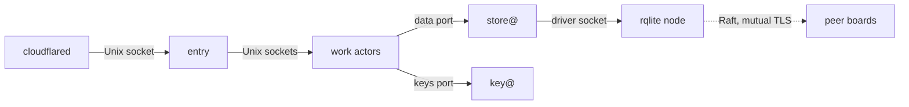

# 0003 — One model, many transports: a unit per actor, the same calls over sockets, invokes and pods, and fusion only by explicit choice

**Status:** Accepted
**Date:** 2026-11-03

Proposal: [issue #909](https://github.com/truvity/sluis/issues/909).

## Context

The actors and holders of [0002](/decisions/0002-families-of-actors/) are the same on every installation. What an installation chooses is how each actor is started and how a call travels from one to another: systemd units and Unix sockets on boards, Lambda functions and invokes on AWS, pods and in-cluster calls on Kubernetes. If a platform needed a different step, a different check or a different owner of a credential, a test on one installation would prove nothing about another, and each new platform would multiply the design.

Three forces shape the answer. A process that accepts a connection is a target, and the receiver of a TCP connection does not learn who called; a Unix socket tells the uid, an invoke tells the role, a service-account token tells the pod. A process that can start another process or load a plugin hands that power to anyone who compromises it. And small machines are small: a 2 GB board cannot always give every actor its own unit, so fusing work actors must be possible, but never in a way that gives a unit a credential or a right that no member was allowed.

Lambda has no process-to-process socket, so the unit per actor and per holder becomes a function per actor and per holder, and every store read and every key open becomes an invoke. Whether the invoke latency holds for that design was measured in a spike ([#1179](https://github.com/truvity/sluis/issues/1179)), and it holds: there is no in-process store, and no exception is needed. Measured on 2026-11-03, a whole warm sign-in takes about 0.40 s at p50 and 0.49 s at p99, and about 0.29 s and 0.36 s with concurrent reads.

## Decision

### Units

- **One unit per actor and per boundary.** The unit is the grain of identity, credentials, restart and network rules. Its name is the actor's name ([0002](/decisions/0002-families-of-actors/#names)).

  | Installation | The unit | Its identity |
  |---|---|---|
  | Boards, and the local installation | A systemd unit with its own Unix user; in the local installation, a container with a pinned uid | The peer uid on its socket |
  | Lambda | A function, one per actor and one per holder | The function's IAM role |
  | Kubernetes | A pod with its own service account, one per actor and per holder | The service-account token |

- **A holder's unit contains its drivers.** The drivers of store@, key@ and exporter@ are separate binaries that the platform starts and only the owner can open ([0005](/decisions/0005-the-store/#drivers)):
  - on boards, systemd units whose socket is open to the owner's uid only;
  - on Lambda, an extension in the holder's function;
  - on Kubernetes, a native sidecar container in the holder's pod, with its socket on an `emptyDir` that only the holder's container and the driver mount, and with the cloud token mounted only into the driver container.
- **Nobody execs a driver; the platform starts it.** An actor's unit may execute nothing but its own binary, so a compromised actor cannot start a shell, a helper or a driver.
- **Where an actor runs is derived from the actor registry.** The registry says per boundary or per front, how many instances, and on which runtimes ([0002](/decisions/0002-families-of-actors/#registries-generate-the-enforcement)). An installation names its runtime, its nodes, its engine and its fusion choices ([0011](/decisions/0011-runtimes-and-installations/#installations)), and `sluis config check` refuses a combination the registry does not allow. Every installation runs the same actors: the foundation, and the modules it needs ([0002](/decisions/0002-families-of-actors/#the-foundation-and-the-modules), [principle 11](/principles/#11-one-product-many-installations)).
- **A background job that must run once takes a lease.** A lease is a temp kind ([0005](/decisions/0005-the-store/#leases)). The audit writer is fenced by the write-once rule on its blob ([0029](/decisions/0029-the-audit-log/#the-write-once-fence)). On Lambda a reserved concurrency of 1 is an optimisation, not the guarantee.
- **Egress is denied by default per unit and generated from the registry:** nftables per uid on boards, a NetworkPolicy per pod on Kubernetes. A function in a VPC is limited by address, so a per-function list of host names needs a proxy or a firewall ([Serverless](/runtimes/serverless/)).
- **Each unit is hardened.** On boards: `ProtectSystem=strict`, `NoNewPrivileges=`, an empty `CapabilityBoundingSet=` and `SystemCallFilter=@system-service`; an actor whose registry row lists no egress host also gets `PrivateNetwork=yes` and `RestrictAddressFamilies=AF_UNIX`, among them `entry`, `policy` and `signer`. On Kubernetes: the `restricted` Pod Security level, no automatic service-account token, `shareProcessNamespace` off and no RBAC objects.

### Transports

- **A transport is how a call between two units travels on one installation.** Every call is a ConnectRPC contract ([0002](/decisions/0002-families-of-actors/#contracts)); only the hop differs:

  | Installation | Transport | The caller is known by | The callee checks |
  |---|---|---|---|
  | Boards, local | A Unix socket | The peer uid (`SO_PEERCRED`) | That the uid may use this socket, and the call graph |
  | Lambda | A Lambda invoke | The caller's role and alias | That its resource policy names the caller, and the call graph |
  | Kubernetes | In-cluster gRPC | A projected service-account token whose audience the callee checks, behind a NetworkPolicy per callee | That the token names a caller the call graph allows |

- **The steps and the checks are the same on every transport** ([principle 19](/principles/#19-one-model-many-transports)). A request passes through `entry`, its owning actor, and store@ and key@ for its data and keys, and meets the same two independent checks ([0007](/decisions/0007-policy-and-sealed-grants/#two-independent-checks)). A design that needs a different step on one platform is a design change for all of them.
- **The call graph is declared once and enforced twice** ([The call graph](/decisions/0003-units-transports-and-fusion/#the-call-graph)).
- **Calls to holders are the common case.** Every work actor calls store@ on its data port and key@ on its keys port, so a request crosses at least one hop to each. The budget of the hops is in [0037](/decisions/0037-capacity-is-measured-before-it-is-promised/).
- **On boards the mount and the socket's group are the first lock** ([The call graph](/decisions/0003-units-transports-and-fusion/#the-call-graph)). key@ serves each caller on a socket of its own, in a directory only that caller can open ([0006](/decisions/0006-keys-and-sealing/#exclusive-card-access)).
- **On Lambda the unit is a function and the hop is an invoke.** The latency of an invoke between actor functions, the per-request cost of opening session cookies at key@, and whether invokes are fast enough were measured in [#1179](https://github.com/truvity/sluis/issues/1179): on 2026-11-03, a whole warm sign-in takes about 0.40 s at p50 and 0.49 s at p99, and about 0.29 s and 0.36 s with concurrent reads. No function links store@ or its drivers into a work actor's process ([Fusion](/decisions/0003-units-transports-and-fusion/#fusion)).
- **On Kubernetes the unit is the pod.** The cloud token is mounted only into a driver container, and no container that holds a cloud token has a listener ([Listeners](/decisions/0003-units-transports-and-fusion/#listeners)).

### The call graph

Which actor may call which is predefined in code and logic, and each transport enforces it again.

- **The graph is declared in the actor registry and compiled into every binary.** The `calls` of each actor ([the registry](/reference/actors/)) are the only source. The generated client exists only for the callees an actor may call, so code for any other call does not compile, and one interceptor in every process refuses a caller that is not listed (default deny). This is the logic layer, and it is the same on every runtime.
- **Each transport enforces the same graph a second time,** generated from the registry:
  - **On boards** the callee's Unix socket is owned by the callee's uid with a group that holds only the uids of its allowed callers (mode `0660`), and each caller's systemd sandbox makes only its allowed sockets visible (`BindPaths=` and `InaccessiblePaths=`, with `RestrictAddressFamilies=AF_UNIX` and `PrivateNetwork=yes`);
  - **On Lambda** the callee function's resource policy grants `lambda:InvokeFunction` only to the roles of its allowed callers;
  - **On Kubernetes** a NetworkPolicy per callee admits ingress only from the pods of its allowed callers, and the interceptor checks the audience of the caller's projected service-account token.
- **The generated files are the registry's output, not hand-written** ([0002](/decisions/0002-families-of-actors/#registries-generate-the-enforcement)). The deny matrix tests every pair of actors against both layers.

### Listeners

- **`entry` is the only actor reachable from outside, and it authenticates every request itself.**
  - **On boards, `entry` listens on a Unix socket only.** Its unit runs with `PrivateNetwork=yes` and `RestrictAddressFamilies=AF_UNIX`, so it has no TCP listener and no outbound network. The edge connector, `cloudflared`, connects outbound only and forwards to a Unix-socket origin at `/run/sluis/entry/<boundary>.sock`.
  - **On Lambda, `entry` listens on `127.0.0.1` inside the function's sandbox.** The edge connector is the Lambda Web Adapter, pinned and vendored into sluis's own layer, so the loopback port's only client is a component sluis ships.
  - **On Kubernetes, `entry` stays socket-only.** A key-less edge relay container in `entry`'s pod listens on the pod address and forwards to its socket. A `cloudflared` sidecar is a supported mode.
- **No actor has a TCP listener on a board.** Every actor and every driver listens on a Unix socket under `/run/sluis/<actor>/`, one socket per boundary.
- **On Kubernetes an actor's pod accepts gRPC from its callers on the pod address,** admitted by a NetworkPolicy from the callers only and authenticated by token or certificate. A driver listens on its `emptyDir` socket only. A generated check fails the build when a container that holds a cloud token exposes a listener.
- **On Lambda only the `entry` function has a listener,** and every other function is reached by invoke only.

### Calls between nodes

- **On boards the only inbound and inter-node port is rqlite's Raft port,** with mutual TLS and certificates from ritueel's pre-configuration ([0005](/decisions/0005-the-store/#engines)), admitted by the firewall from the declared peers only. Any board serves any request, because every board holds the data and the temp data is replicated too ([0005](/decisions/0005-the-store/#engines)).
- **Witnesses meet through the audit blob,** not through a connection between boards ([0029](/decisions/0029-the-audit-log/)).
- **A locked board gets its PIN through the store,** so it too crosses only the Raft port: the locked key@ writes a request, an unlocked peer's key@ writes the PIN sealed to it ([0006](/decisions/0006-keys-and-sealing/#touch-and-pin)).
- **No actor is otherwise reachable from another node.** On a board a work actor asks the holders of its own node.
- **Calls between boundaries are federation,** and name SPIFFE IDs ([0008](/decisions/0008-boundaries-and-tenants/#federation-between-boundaries)).
- **The deny tests check that nothing else binds a TCP address,** apart from rqlite's client API on the loopback address, which only store@'s driver reaches ([0005](/decisions/0005-the-store/#engines)). Any further flow between nodes amends this record.

### Fusion

- **Fusion is an explicit installation choice,** made to fit a small machine: several work actors run in one unit. It is never the default.
- **A holder is never fused with a work actor,** and key@ is never fused with `entry`. A holder's unit runs only its own code and its drivers.
- **The store applies the union of the members' rules to a fused unit.** Fusing never grants something no member was allowed. The configuration check prints the union of every fused unit, so a reviewer sees what the unit can do.
- **`entry` is never fused with an actor that signs: `signer`, `ca` or `ssh-ca`.** A flaw in the one parser reachable from outside must not reach a signing right; token signing needs no grant ([0006](/decisions/0006-keys-and-sealing/#sign-and-mac)).
- **`ca` and `ssh-ca` stay separate units on every installation.** Fusing them would undo the separation of two authorities ([0002](/decisions/0002-families-of-actors/#work-actors)).
- **Small work actors that hold nothing and have no listener,** such as `quota`, may share a unit on a small board. So may `console` and `entry` when an installation chooses to, because `console` does not sign, at the price of widening the one unit reachable from outside.
- **There is no in-process store on Lambda.** A function that links store@ and its drivers into a work actor's process would fuse a holder with a work actor, and nothing is excepted: the spike showed that invokes are fast enough ([#1179](https://github.com/truvity/sluis/issues/1179); measured on 2026-11-03, a whole warm sign-in takes about 0.40 s at p50 and 0.49 s at p99, and about 0.29 s and 0.36 s with concurrent reads). An exception would be written as its own record, with the threat it accepts.
- **The rule is tested for every installation.** `sluis config check` refuses a unit that holds a holder and a work actor, and the build runs the same check ([0002](/decisions/0002-families-of-actors/#registries-generate-the-enforcement)).

### Cells

- **A cell is one replica of each actor, co-scheduled on one node.** On Kubernetes a pod affinity keeps the pods of a cell together, and cells are spread across nodes and zones by anti-affinity or topology spread. On a board the board is the cell: one unit of each actor.
- **Services prefer the local cell.** A Service uses `trafficDistribution: PreferClose`, so a call to store@ or key@ stays in its cell when a replica there is ready. Fewer hops leave the node.
- **Requests and limits are measured, not guessed.** The chart ships the values measured for each pod under load, and a PodDisruptionBudget keeps a cell's replicas up during a drain. Rolling updates never remove a replica before its replacement is ready.
- **The baseline of a cluster:** native sidecars, the `restricted` Pod Security level, projected service-account tokens and a CNI that enforces NetworkPolicy. Cilium is optional, for egress by host name ([0011](/decisions/0011-runtimes-and-installations/#kubernetes)).

## Consequences

- A test on boards proves the steps and checks of a request; the transport of each installation is tested on that installation. The four tested installations ([0011](/decisions/0011-runtimes-and-installations/#installations)) cover the three transports.
- A compromised actor cannot start a process, load a plugin or open a port to the world. From outside it can be reached only through the one authenticated public API and the named flows between nodes, so a node opens no inbound port for sluis beyond rqlite's Raft port.
- More units: every actor and every holder is its own user, function or pod, and every call is a hop. Small boards rely on explicit fusion to fit, and their memory is measured ([0037](/decisions/0037-capacity-is-measured-before-it-is-promised/)).
- On Lambda each hop to a holder is an invoke. The spike showed that this is fast enough ([#1179](https://github.com/truvity/sluis/issues/1179)), so the design needs no exception; one that is ever needed is a record of its own.
- On Kubernetes a pod per actor means more pods than a pod per replica with a container for each actor. Each actor has its own service account, NetworkPolicy and lifecycle, and cells keep most calls on one node.
- The bare-metal, serverless and Kubernetes edges differ (a Unix socket behind `cloudflared`, a loopback port, a relay container), and `entry`'s tests cover each listener.
- Units, roles, service accounts, sockets and network rules are generated from the registries, so they cannot drift from the call graph.
- A fused unit is a wider target than any of its members. The union is printed and reviewed, and the rule that a holder never joins it keeps the credentials out of it.

## Roads not taken

- **Placement decided per deployment, by hand.** The same rules would be repeated in every deployment and drift apart, and each new platform multiplies the decisions.
- **A different request path per platform.** An example is opening a sealed value in the store on Lambda to save a hop. The two independent checks and the rule that the store never opens a value would hold on some installations and not on others; the transport changes, the steps do not.
- **An in-process store on Lambda from the start.** It fuses a holder with a work actor and gives the work actor's process the storage credential; the spike showed it is not needed ([#1179](https://github.com/truvity/sluis/issues/1179)), and one that is ever needed is a record of its own.
- **One pod per replica with a container for each actor.** The containers of a pod share its network and egress rules, so every actor would share one allow-list, and a pod with several actors is fusion by default.
- **The actor starts its driver.** The actor would need the right to execute programs, so a compromised actor could run a shell; the platform already supervises services.
- **`entry` on a loopback TCP port on every runtime.** On boards `entry` would share the host's network namespace, so any local process could open the port; Lambda keeps loopback only because the adapter needs it and the sandbox runs sluis alone.
- **Mutual TLS between callers on Kubernetes as part of this graph.** The projected token whose audience the callee checks, behind a NetworkPolicy per callee, already enforces it; mutual TLS between callers is later work and changes no step of the graph.
- **TCP between actors on a board, with mutual TLS.** Any local process could connect, and the receiver would learn the caller only from a certificate, where a socket tells the uid and the directory limits who can open it.
- **Free fusion, with no rule.** A unit could quietly gain a credential next to a listener, or a right no member actor was allowed.
- **A process per port.** A process that serves many owners holds many credentials; units follow the owner of a credential.

## Follow-ups

- The Lambda latency spike (invoke latency between actor functions, the per-request cost of opening session cookies at key@, and whether an in-process store exception is needed) is done: [#1179](https://github.com/truvity/sluis/issues/1179). Measured on 2026-11-03, a whole warm sign-in takes about 0.40 s at p50 and 0.49 s at p99, and about 0.29 s and 0.36 s with concurrent reads; no exception is needed.
- The Helm chart for the parity milestone, with the measured requests and limits and the details of the edge relay: [#844](https://github.com/truvity/sluis/issues/844) and [#876](https://github.com/truvity/sluis/issues/876).
