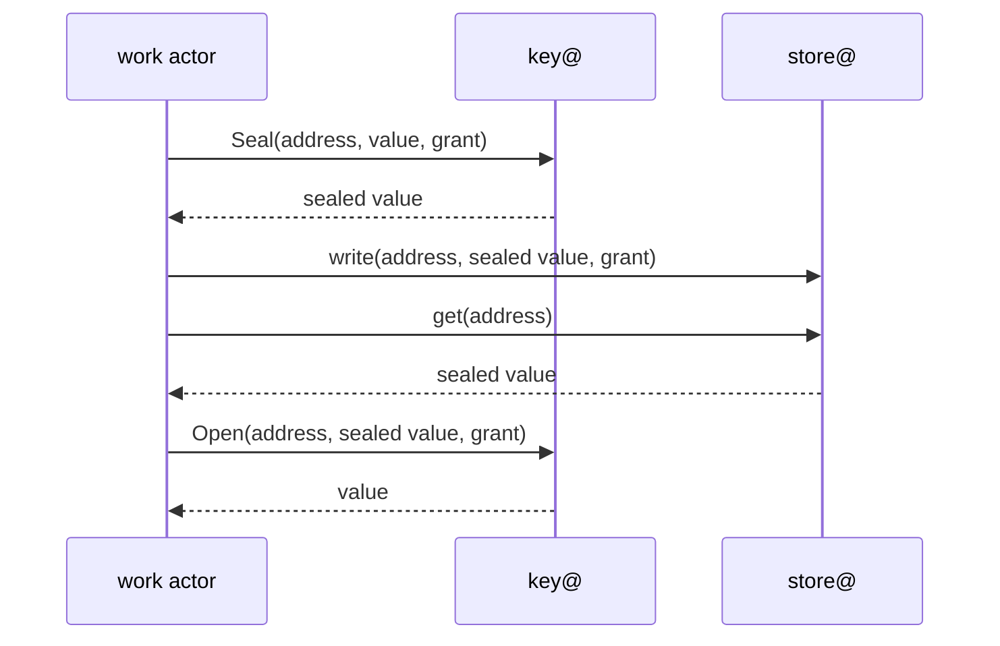
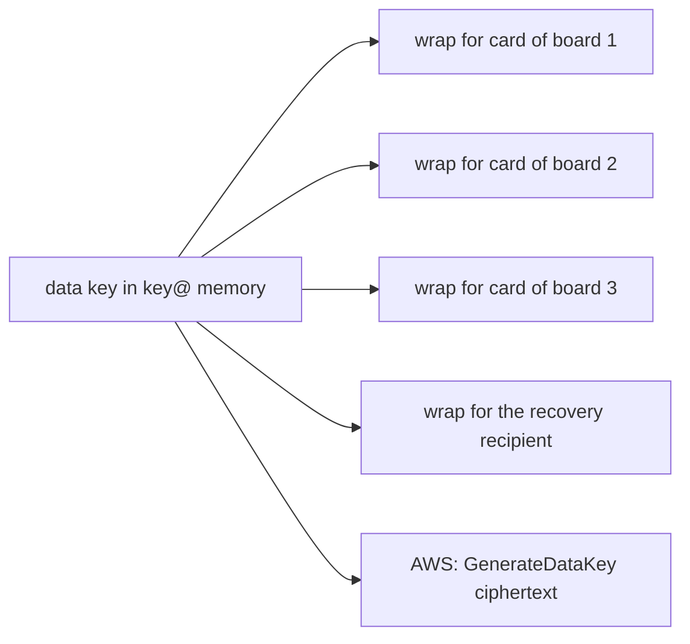

# 0006 — key@ holds a boundary's keys: it seals, opens and signs in place, with four data keys per tenant and one key per purpose and algorithm

**Status:** Accepted
**Date:** 2026-11-03

Proposal: [issue #909](https://github.com/truvity/sluis/issues/909).

## Context

Every token, certificate and signed log head that sluis makes is signed, and every secret it keeps is sealed. Three groups of readers constrain the algorithms: verifiers that do not belong to sluis (many OIDC libraries were written for RS256), standards that fix a set (the FAPI 2.0 Security Profile, section 5.4.1, names PS256, ES256 and EdDSA; checked 2026-10-29), and drivers (a cloud key service, a hardware key and a software key support different algorithms at very different speeds).

The keys are worth more than anything they sign. sluis holds the token-signing keys, the keys of its certificate authorities, the log key and the keys that protect every tenant's data, and it publishes a key for each workload identity it issues. The volume is low: a production installation of v1 saw about 25,000 tokens in 7 days, a peak of 0.8 a second, 95 % of them token exchange. Hardware fails, is lost and is stolen, and installations differ: AWS with a key service, small boards with a YubiKey in each board, a workstation with software keys for development.

The data model adds three demands. The store keeps sealed values as ciphertext and never opens one ([0005](/decisions/0005-the-store/#the-store-api)), so a plaintext exists only in the actor that uses it ([principle 18](/principles/#18-plaintext-lives-only-where-it-is-used-behind-two-independent-checks)), and someone has to hold the keys that seal and open: `key@`, the one holder of the keys family ([0002](/decisions/0002-families-of-actors/#credential-holders)), one per boundary from level L1 of the ladder ([0008](/decisions/0008-boundaries-and-tenants/#the-ladder)). A tenant has to be erasable by deleting a key, while the audit evidence of that tenant outlives its personal data. And a card does about seven ECDH operations a second, so a card cannot be asked once per value; a software data key, wrapped for the card and opened once per cache entry, can.

v1 ADR 0005 made ES384 the default, and v1 ADR 0009 added a per-audience RS256 exception with a separate key; this record keeps both. sluis holds no root: roots are [ritueel](https://ritueel.id)'s, and the hand-off is [0024](/decisions/0024-root-custody-and-the-signing-api/#the-hand-off). Who may ask `key@` for what is decided by the rules of [0007](/decisions/0007-policy-and-sealed-grants/#two-independent-checks).

## Decision

### Algorithms

- **EC P-384 with ES384 is the default** and what sluis chooses for itself, including the checkpoints of the audit log and of the issuance log (C2SP signed notes with P-384 keys). One curve means one key type in the key set, one verifier path and one wrapping scheme.
- **sluis supports the FAPI 2.0 set: PS256, ES256 and EdDSA (Ed25519).** ES384 stays the default.
- **Everything sluis signs, seals, wraps, hashes, derives or encrypts stays within the FIPS-approved set:** P-384 ECDSA and ECDH, AES-256-GCM, AES key wrap, HKDF-SHA384, HMAC-SHA384 (for `Mac` and for audit pseudonyms, [0029](/decisions/0029-the-audit-log/#pseudonyms)) and SHA-384, plus the named exceptions below. There is no FIPS mode and no certified build in 2.0: Go keeps the standard library's defaults (`GOFIPS140` and `fips140` unset), and Rust uses current crates and rustls with no FIPS pin. Keeping to the approved set means a FIPS build can be added later as a build option without changing a format or a stored value. The Rust build facts are in [0012](/decisions/0012-the-language-follows-the-executable/#per-actor-table).
- **AES-256-GCM takes its nonce from the cryptographic library**, never from the caller (in Rust, `RandomizedNonceKey` of `aws-lc-rs`).
- **TLS follows the libraries' defaults**, which may negotiate X25519 or ChaCha20-Poly1305. Nothing sluis stores or publishes depends on them.
- **The only source of randomness is the operating system's CSPRNG**, through Go's `crypto/rand` (tests use `testing/cryptotest.SetGlobalRandom`) or, in Rust, the generator of the cryptographic library. Nothing is mixed into it from a key service or a card. On AWS a data key is made by `GenerateDataKey` and used as it comes. `sluis doctor` checks the platform: kernel 5.18 or newer (a cloned virtual machine reseeds), a hardware generator present or deliberately absent, and the entropy pool initialised before the first key.
- **Driver support is checked per algorithm** when the installation is checked, not at the first token. PS256 on a YubiKey takes about 2.3 seconds per signature, so it suits a low-volume audience only; Ed25519 in PIV needs firmware 5.7 or newer.
- **Tokens are standard JWS and JWT**, verified with any language's standard libraries against the published key set. The algorithms sluis accepts from others, such as passkey assertions, are set with those features ([0017](/decisions/0017-identity-and-sign-in/#passkeys)). How a client or audience selects a non-default algorithm is client-profile configuration.

### Named exceptions

"No RSA" and "P-384 only" have exactly these exceptions. Each has its own key, which serves no other purpose, and each is a purpose that is enabled on use ([Key purposes](/decisions/0006-keys-and-sealing/#key-purposes)).

1. **FAPI 2.0:** PS256, ES256 and EdDSA, as above.
2. **Cloud federation:** a key that signs a workload token for a cloud uses the algorithm that cloud requires: ES384 for AWS, ES256 for GCP, RS256 (RSA-2048) for Azure Entra.
3. **Per-audience RS256:** for an audience configured to need RS256, sluis signs that audience's tokens with a separate RSA key, published beside the EC keys. The audience, not the caller, decides.
4. **NATS decentralized authentication.** NATS fixes Ed25519 for its operator, account and user keys (nkeys), and its JWTs are signed with them. sluis follows that:
   - **one Ed25519 key per purpose:** the operator identity, an operator signing key per environment, a scoped signing key per role and account, and the callout account's key. None of them serves another purpose;
   - **the keys live in the cloud key service or on the card, behind `key@`,** whose rule for them names only the minter of NATS credentials. A user's own nkey is generated by the workload and never leaves it;
   - **no xkey.** The X25519 key that NATS can use to seal callout requests is not used, because X25519 alone is not an approved algorithm under FIPS 140-3. TLS on the client port protects the request instead;
   - Ed25519 is approved (FIPS 186-5) and is in Go's FIPS 140-3 module, so this exception stays within the approved set.
5. **Formats that fix their own algorithm are followed:** the C2SP tlog-cosignature witness keys use Ed25519 or ML-DSA-44 as that specification requires ([0029](/decisions/0029-the-audit-log/#witnesses)); a witness key authorises nothing and serves no other purpose.

### Key purposes

A key is shared between two uses only when all of these are equal: **the audience** (who verifies or decrypts), **the required lifetime**, **revocation coupling** (one use would never be disabled without the other), **the callers** (the blast radius of a misuse), and **the key store itself separates the uses** (an encryption context under a key policy). If any one differs, the uses get separate keys.

- **There is one key per purpose and per algorithm.** An asymmetric key never serves two purposes, and a key that issues certificates never signs tokens. Several audiences of one purpose share its key: two audiences of the token purpose need one ES384 key, and an audience that needs RS256 gets a key of its own because the algorithm differs.
- **The signing purposes are separate keys:** the token-signing key; an X.509 intermediate for each trust domain; the SSH user CA and the SSH host CA; the log key of each audit log. Each is a P-384 key.
- **A boundary's one symmetric KMS key is shared by all its data keys,** each wrap under its own encryption context ([Keys per boundary on AWS](/decisions/0006-keys-and-sealing/#keys-per-boundary-on-aws)). Sharing is safe there because the context names the boundary, the tenant and the purpose, and the key policy lets only `key@` use the key.
- **A tenant has no authority key and no wrapping key of its own by default.** It has four data keys ([Data keys](/decisions/0006-keys-and-sealing/#data-keys)). A tenant that is declared to keep its keys in a customer account has wrapping keys and an issuer signing key in that account ([Where a tenant's keys live](/decisions/0006-keys-and-sealing/#where-a-tenants-keys-live)); any other party that needs authority keys of its own is a boundary ([0008](/decisions/0008-boundaries-and-tenants/#tenants)).
- **Boundaries never share keys.** Two boundaries on one engine are separated by wrapping keys of their own, for example a second card per board ([0008](/decisions/0008-boundaries-and-tenants/#the-ladder)).
- **Purposes outside the baseline are enabled on use,** each a dedicated key. A purpose an installation does not enable gets no key and no slot, and `sluis config check` refuses an enabled purpose with no key or slot and a collision of two purposes on one slot.

| Purpose enabled on use | Algorithm | Where | Asked by |
|---|---|---|---|
| Issuance log of `ca` | P-384 | Every boundary with `ca` | The audit writer, which signs the issuance log's checkpoints ([0029](/decisions/0029-the-audit-log/)) |
| Release signing | P-384 | The release boundary only | `signer` |
| Enrolment key of `exchange`, which hosts encrypt to ([0022](/decisions/0022-workload-identity-and-host-enrolment/#host-enrolment)) | P-384 (ECDH) | Every boundary with host enrolment | `exchange` |
| Witness key, one per format | As the format requires | A boundary that runs a witness | The witness, which signs its cosignatures through `key@` |
| Backup archive key | AES-256-GCM, wrapped by a dedicated KMS key on AWS and by ECDH P-384 on a board | Where an installation takes backups | `exporter@` wraps and the restore of `store@` opens ([0010](/decisions/0010-backup-and-recovery/#the-archive-key)) |
| Workload issuer of `sluis-node` | P-384 | Boards only | `sluis-node`, which signs through `key@` |
| PIN release key | P-384 | Boards only | The locked `key@`, which signs its `PinReleaseRequest` with it ([Touch and PIN](/decisions/0006-keys-and-sealing/#touch-and-pin)) |
| Each named exception: PS256, RS256, ES256, Ed25519 and the NATS nkeys | As named | Where the exception is configured | The actor that signs for it |

The generated [keys page](/reference/keys/) lists every purpose with its algorithm, its key type on AWS, its slot on a board and the actor that asks for it.

### Keys sign in place

- **An authority key is born in its key store, signs in place and cannot be exported** ([principle 1](/principles/#1-a-key-is-born-in-its-store-and-never-leaves-it)). The store signs each digest itself. There are no derived signing keys, no burst key and no short-lived online key certified by an intermediate. There is no software signing for an authority key.
- **Every key whose public half is trusted through the PKI chain is a hardware-held child key,** attested where the hardware can attest and certified through a root that ritueel holds: the CA intermediates and the OpenPGP signing subkeys. Hardware-held means a key service such as AWS KMS or a card such as a YubiKey. KMS cannot attest where a key was born, so for it the checks are the key's description, its policy, the record of its creation and a match between the public key and the request.
- **SSH CA keys are anchors, not a chain.** The `ssh-user` and `ssh-host` keys are held behind `key@`; hosts trust a list of SSH CA keys that ritueel publishes, signed by a root ([0023](/decisions/0023-certificate-authorities/#ssh)).
- **Ephemeral and symmetric keys are outside the rule:** session keys, ephemeral ECDH keys, data keys and derived keys are neither hardware-held nor certified. A data key is not an authority key: `key@` makes it, keeps it only wrapped, and opens it only in its own memory ([Data keys](/decisions/0006-keys-and-sealing/#data-keys)).
- **`key@` signs after it checks what it signs.** Signing is content-aware per purpose. The X.509 purpose signs only a TBSCertificate that parses and stays within its constraints, the SSH purposes only an OpenSSH certificate body, a token purpose only a JWS signing input, and the release-signing purpose only an OpenPGP signature input. A sign call therefore carries the content, not only its digest, and a mistake in a parser refuses a signature instead of signing the wrong thing. Every signature is rate-limited and is an audit fact.
- **`key@` writes `KeyCertificate`,** the chain the root custodian returned for a purpose, which `sluis key install` hands to it; `ca` writes `TrustBundle` ([0022](/decisions/0022-workload-identity-and-host-enrolment/#the-trust-bundle)).
- **CA serial numbers are random and 128 bits long.** No serial ledger is kept.
- **The first version supports three key stores:** YubiKey PIV, AWS KMS, and software keys for development and CI. PKCS#11 drivers for devices such as YubiHSM 2 and Nitrokey HSM 2, more drivers and post-quantum keys come later ([#1029](https://github.com/truvity/sluis/issues/1029)). The card and KMS driver is a separate binary private to `key@` ([0005](/decisions/0005-the-store/#drivers) states the rule for all drivers).

### Keys per boundary on AWS

A boundary needs **1 symmetric key and 5 P-384 keys** in KMS, with one trust domain and one audit writer instance. Each further trust domain or writer instance adds one P-384 key. The lambda and kubernetes installations use this layout alike ([0011](/decisions/0011-runtimes-and-installations/#installations)).

| Key | Type | Purpose |
|---|---|---|
| Symmetric | AES-256 | Wraps every data key of the boundary: the tenants' `data`, `pseudonym`, `pairwise` and `evidence` keys, and the boundary's `grant`, `cookie`, `mac` and `data` keys |
| Token signing | P-384 | ES384 tokens ([The token-signing key](/decisions/0006-keys-and-sealing/#the-token-signing-key)) |
| X.509 intermediate | P-384 | One per trust domain, for `ca` |
| SSH user CA | P-384 | `ssh-ca` |
| SSH host CA | P-384 | `ssh-ca` |
| Audit log | P-384 | One per writer instance, for its audit log and its usage log; a log key rotates only on compromise ([Rotation](/decisions/0006-keys-and-sealing/#rotation)) |

- **The symmetric key's policy names `key@`'s role alone.** `kms:Sign` takes no encryption context, so a P-384 key is protected by its key policy, which also names `key@` only. Every other actor reaches a key through `key@`, whose rules say who may ask for which purpose ([0007](/decisions/0007-policy-and-sealed-grants/#two-independent-checks)). On Lambda only the role of the `key@` function may reach KMS ([principle 16](/principles/#16-few-credential-holders)).
- **A data key is made with `GenerateDataKey` under the symmetric key,** with the encryption context {boundary, tenant, purpose}, and only the wrapped copy is stored ([DataKeyWrap](/decisions/0006-keys-and-sealing/#datakeywrap)). The tenant is `-` for the boundary's own purposes. The data key is not a KMS key, so a new tenant costs no KMS key and no key policy.
- **KMS automatic rotation** applies to the symmetric key.
- **The topology is a KMS intermediate per environment boundary,** certified through a root that ritueel holds.
- **The key that wraps a backup archive is not the symmetric key.** It is a dedicated KMS key, enabled on use, that may live in another account, and only the restore role may decrypt with it. `key@` calls `GenerateDataKey` under it for `exporter@`, and the archive is encrypted with AES-256-GCM under the key it returns ([0010](/decisions/0010-backup-and-recovery/#the-archive-key)). It adds a seventh KMS key where an installation takes backups and does not change the baseline of 1 + 5.

### Where a tenant's keys live

The design supports two locations, chosen per tenant by a declaration on its `Tenant` item. Which one a customer gets is a contract or legal choice made outside the design, and nothing in the design waits on it.

- **Operator-held is the default** ([REQ-KEYS-074](/requirements/keys/#REQ-KEYS-074)). The tenant's keys sit under the installation's own KMS keys, as in [Keys per boundary on AWS](/decisions/0006-keys-and-sealing/#keys-per-boundary-on-aws), and its issuer signs with the token-signing key of its boundary.
- **Customer account.** The KMS keys that wrap the tenant's `data`, `pseudonym`, `evidence` and `pairwise` keys, and the tenant's issuer signing key, live in an AWS account dedicated to that customer. The account can be registered in the operator's AWS organisation, or belong to the customer. `key@` uses those keys cross-account, through the key policy or a grant that covers exactly the operations it needs: Encrypt, Decrypt, GenerateDataKey, Sign and GetPublicKey, and no other ([REQ-KEYS-068](/requirements/keys/#REQ-KEYS-068)). sluis holds no long-lived credential for that account ([REQ-KEYS-069](/requirements/keys/#REQ-KEYS-069)).
- **Moving a tenant into a customer account re-wraps its keys** under the customer's KMS key during the move ceremony ([REQ-KEYS-070](/requirements/keys/#REQ-KEYS-070)). Its issuer host and its `pairwise` key stay the same, so its subjects survive the move ([0032](/decisions/0032-customer-identity-installations/#moving)).
- **Revocation fails closed, for that tenant only.** If the customer revokes or disables the grant, that tenant's sealing and signing stop and its calls answer `unavailable`; the other tenants are unaffected ([REQ-KEYS-071](/requirements/keys/#REQ-KEYS-071)). A data key that `key@` has already opened keeps working until its cache entry expires ([The cache](/decisions/0006-keys-and-sealing/#the-cache)). This is the customer's kill switch, so a lost grant is audited and alerted and never worked around ([REQ-SEC-032](/requirements/sec/#REQ-SEC-032), [REQ-SEC-033](/requirements/sec/#REQ-SEC-033)).
- **Crypto-shredding.** Deleting the customer's key shreds that tenant's data and evidence, which is the customer's retention lever ([0029](/decisions/0029-the-audit-log/#encryption-and-crypto-shredding)).
- **Scope.** This applies to installations on AWS, serverless and EKS. The three-board installation keeps its keys on the cards.

### Keys per board

- **Each board has a card of its own, and every key of the board is born on that card.** The same purposes as on AWS sit in separate card slots, one slot per purpose and per algorithm ([The slot plan](/decisions/0006-keys-and-sealing/#the-slot-plan)). A card belongs to one boundary.
- **The X.509 intermediate of a board is born on its card, attested, certified for about 13 months and re-signed every year over the same key.** The root is ritueel's. The token-signing key is a second key on the same card, certified by the board's intermediate ([The token-signing key](/decisions/0006-keys-and-sealing/#the-token-signing-key)).
- **Data keys are not on the card.** `key@` generates a data key in software and wraps it for the key-agreement key of each board's card, so any board opens it with its own card ([DataKeyWrap](/decisions/0006-keys-and-sealing/#datakeywrap)).
- **A lost or stolen board is replaced, not restored:** a new key on a new card, a new certificate, and ritueel revokes the old one. The card's PIN policy limits the exposure until then. Its wraps are deleted, and the other boards rewrap every data key for the new card.
- **Signing speed is set by the card.** A YubiKey 5 Nano signs P-384 in about 147 ms, about 7 signatures a second per card, and three boards give about 21 a second (measured 2026-10-31, firmware 5.8.0), against a measured peak of 0.8 tokens a second in v1.

### The slot plan

A documented, versioned map says which card slot serves which purpose: one slot per purpose and per algorithm, and a shared spare range. This is the default map, version 1. It covers PIV slots `9a`, `9c`, `9d`, `9e` and the retired slots `82` to `95`. Every board slot is generated with a PIN policy and a touch policy that the map states, and the attestation of the slot shows them.

| Slot | Purpose |
|---|---|
| `9c` | X.509 intermediate |
| `9a` | Token signing |
| `9d` | Key agreement (ECDH): unwraps data keys, the boundary's `grant` data key among them |
| `82` | `ssh-user` CA |
| `83` | `ssh-host` CA |
| `84` | Log key of an audit writer instance (a further project's writer instance takes a spare slot) |
| `85` | OpenPGP release-signing subkey (release boundary only) |
| `86` | Workload issuer, for `sluis-node` (enabled on use) |
| `87` | PIN release key: signs the `PinReleaseRequest` of a locked board; PIN policy never, touch never |
| `88` to `95` | Spare (fourteen slots, hex), shared by every purpose |
| `9e` | Not used: the card-authentication slot signs without a PIN by default |

- **Slot `9d` is the key-agreement slot, and it is the only one.** Grants do not use it directly: they are sealed under a boundary data key, so a grant costs a memory operation and not an ECDH on the card ([Seal and open](/decisions/0006-keys-and-sealing/#seal-and-open)).
- **A second purpose or a second algorithm takes a spare slot.** A further trust domain gets another X.509 intermediate, an exception such as PS256 gets its own key, and the purposes of [Key purposes](/decisions/0006-keys-and-sealing/#key-purposes) that are enabled on use each take one. The installation names the slot in its `KeyPlan`; the default map is built in.
- **The spare range holds the new key of an event rotation** while the old one finishes, and the older key-agreement key until every wrap is rewrapped.
- **The map records each slot's attestation,** the policies it shows included: PIN once and touch never for every slot but `87`, PIN never and touch never for `87`. The slot map of root cards is ritueel's. The keys page shows the map.
- **The release subkey lives in a PIV slot reached through `key@`,** which also makes the subkey's back-signature on the card. The OpenPGP applet is not used on a board.
- **A second card per board serves a further L1 boundary** on the same engine, so that the boundaries are separated by wrapping keys of their own ([0008](/decisions/0008-boundaries-and-tenants/#the-ladder)).

### Seal and open

**The store never seals or opens.** It keeps a sealed value as ciphertext and a compare-only value as a hash. A sealed value's plaintext exists only in the actor that uses it, for that call. Plain kinds are stored as they are, and values from secret sources pass through `store@` in memory ([0005](/decisions/0005-the-store/#secret-sources)).

- **To write, the actor asks `key@` for `Seal(address, value, grant)`, then writes the result.** The actor validates a sealed field before it seals it, because the store cannot read it.
- **To read, the actor asks for `Open(address, sealed, grant)`.** `key@` returns the plaintext to the caller only.
- **The value is sealed under the data key of the address's boundary, tenant and purpose** ([Data keys](/decisions/0006-keys-and-sealing/#data-keys)), with AES-256-GCM and the full address as authenticated data. A value copied to another row, kind, tenant or boundary does not open, and a value that has to move to another address is opened and sealed again. The byte layout of the envelope is on the store API page.
- **`key@` checks three things on every Seal and Open:** the caller's identity, by the transport ([0003](/decisions/0003-units-transports-and-fusion/#transports)); the caller's rule for the purpose and the operation, generated from the actor registry ([0002](/decisions/0002-families-of-actors/#registries-generate-the-enforcement)); and the grant, which must be sealed for the address's tenant, name the operation and not be expired ([0007](/decisions/0007-policy-and-sealed-grants/#two-independent-checks)). A refusal is an audit fact.
- **Opens are batched.** A call may carry many opens, so that a request that needs several values, such as a session cookie and a person's records, pays one hop. The per-request cost of opening session cookies at `key@` was measured in the Lambda latency spike ([#1179](https://github.com/truvity/sluis/issues/1179)): on 2026-11-03, a whole warm sign-in takes about 0.40 s at p50 and 0.49 s at p99, and about 0.29 s and 0.36 s with concurrent reads.
- **Session cookies are sealed and opened at `key@` on every request,** under the boundary's `cookie` data key. `session` never holds that key ([0018](/decisions/0018-sessions/)).

### Sign and Mac

- **`Sign(purpose, content, grant)` signs in place** with the key of the purpose ([Keys sign in place](/decisions/0006-keys-and-sealing/#keys-sign-in-place)). A purpose that carries an authorised effect, a mint or an artifact signature, needs the grant of [0007](/decisions/0007-policy-and-sealed-grants/#sealed-grants).
- **`Mac(purpose, input, grant)` makes a keyed hash with HMAC-SHA384** over a data key: `mac` (boundary) for link ids, upstream session ids and the hashed index entries of sealed kinds, `pseudonym` (tenant) for audit pseudonyms, or `pairwise` (tenant) for pairwise subjects. The caller names a label for each use, and `key@` binds the label into the input, so two uses never produce the same hash for the same input. The key never leaves `key@`.
- **There is no `LinkKey` kind and no extra KMS key for hashing.** A KMS `GenerateMac` key would need one key for each purpose and boundary because it takes no encryption context, and would make two mechanisms for one operation.
- **The `mac` key has no new generation in place.** Link ids and upstream session ids are made under it, so a new key would change them all; replacing it is a migration that makes them again ([0019](/decisions/0019-person-and-upstream-link/#the-records)).
- **A pairwise subject is `Mac(pairwise, the person's stable id)` over the tenant's `pairwise` key and is never rotated** ([0034](/decisions/0034-end-users-and-upstream-signals/#subjects-and-sectors)). The key moves with its tenant, re-wrapped and never replaced ([0032](/decisions/0032-customer-identity-installations/#moving)). A pseudonym epoch is a generation of the tenant's `pseudonym` key ([0029](/decisions/0029-the-audit-log/#pseudonyms)).

### Data keys

A data key is a software AES-256 key. `key@` makes it, keeps it only wrapped, and opens it only in its own memory.

| Purpose | Scope | Protects |
|---|---|---|
| `data` | One per tenant | Personal and operational data of the tenant |
| `pseudonym` | One per tenant, rolled by epoch | Keyed hashes of the tenant: audit pseudonyms |
| `pairwise` | One per tenant, never rotated | Pairwise subjects of the tenant |
| `evidence` | One per tenant | Audit and usage evidence of the tenant |
| `grant` | One per boundary | Sealed grants |
| `cookie` | One per boundary | Session cookies |
| `mac` | One per boundary | Keyed hashes of link ids, upstream sessions and the hashed index entries of sealed kinds |
| `data` | One per boundary, tenant `-` | The sealed kinds that have no tenant in their address |

- **Each tenant has four data keys, one per purpose, and each boundary has four: `grant`, `cookie`, `mac` and `data`.** The purposes never share a key, so a tenant's exit can delete the personal data and keep the evidence ([Erasing a tenant](/decisions/0006-keys-and-sealing/#erasing-a-tenant)). A tenant that exists in several boundaries has separate data keys in each.
- **A sealed kind is sealed under the `data` key of its address's tenant.** The directory kinds and the connections and apps made through a UI or API flow (`DirectoryUser`, `DirectoryGroup`, `DirectoryMembership`, `DirectoryConnection`, `MinterConnection`, `GitHubApp`, `SlackConnection`, `EntraConnection` and the desired state) belong to a tenant, the operator's own company included ([0008](/decisions/0008-boundaries-and-tenants/#tenants)), so a tenant's exit shreds them with the rest of its personal data. Config is never sealed and has no tenant.
- **A sealed kind that has no tenant in its address is sealed under the boundary's `data` key** (tenant `-`). In the registry that is `EnrolmentToken`, the key of a host's enrolment token, and `PendingEnrolment`, a host's request waiting for approval, and nothing else. The wrap has the same purpose name as the tenant's `data` key and a different address, so the two never meet.
- **A data key is not a KMS key.** On AWS it is made by `GenerateDataKey` under the boundary's one symmetric key; on boards `key@` generates it in software. Either way only the wrapped copy is stored, and the unwrapped key lives in `key@`'s memory ([The cache](/decisions/0006-keys-and-sealing/#the-cache)).
- **A generation counts a data key's rotations.** The envelope of every sealed value names the purpose and the generation that sealed it, so an older generation keeps opening what it sealed ([Rotation](/decisions/0006-keys-and-sealing/#rotation)).
- **Which actor may use which purpose is a rule of `key@`:** the rules say who may Seal, Open or Mac with each. The audit pieces use `pseudonym` and `evidence` through the same rules ([0029](/decisions/0029-the-audit-log/#encryption-and-crypto-shredding)).

### DataKeyWrap

`DataKeyWrap` is the durable kind that holds one data key wrapped for one recipient. `key@` is its only writer and the only actor that opens a wrap; the backup job of exporter@ copies the items as ciphertext ([0010](/decisions/0010-backup-and-recovery/#what-the-archive-holds)). It is scoped to the boundary and the tenant (`-` for the boundary's own purposes), and its id is `<purpose>/<generation>/<recipient>`. The value is already ciphertext, so the kind's treatment is plain, and it is backed up with the authoritative kinds ([0010](/decisions/0010-backup-and-recovery/#what-the-archive-holds)).

- **On AWS there is one wrap,** the ciphertext that `GenerateDataKey` returned under the encryption context {boundary, tenant, purpose}.
- **On boards there is one wrap per recipient:** each board's card (its key-agreement key, slot `9d`) and the recovery recipient ([The recovery recipient](/decisions/0006-keys-and-sealing/#the-recovery-recipient)). `key@` makes an ephemeral P-384 key, agrees a secret with the recipient's public key (ECDH), derives a wrapping key with HKDF-SHA384 and wraps the data key with AES key wrap. The wrap is bound to the wrap's own address. Making a wrap needs only the recipient's public key, so no card is touched; opening one needs the recipient's private key, which is the card's ECDH.
- **A new data key is written with conditional creates,** all its wraps in one atomic write. If two `key@` instances make a key at once, one wins and the other discards its key and reads the winner's.
- **A new card or board is a rewrap.** An existing `key@` opens each data key, wraps it for the new recipient's public key and writes the new item. The data is not touched. The recipients' public keys are in the `KeyPlan` config kind.
- **The wrap for a lost recipient is deleted.** A lost or stolen board's wraps are deleted and its card is revoked ([Keys per board](/decisions/0006-keys-and-sealing/#keys-per-board)).
- **Measured on two boards' cards on 2026-11-03:** an ECDH takes a median of 143 ms, about 7 a second per card. Cached afterwards ([The cache](/decisions/0006-keys-and-sealing/#the-cache)).

### The recovery recipient

- **The recovery recipient is an offline P-384 key held under ritueel's custody.** On boards every data key is also wrapped for it, so that the loss of all cards does not lose the data.
- **It opens every wrap and rewraps an archive for another installation** ([0010](/decisions/0010-backup-and-recovery/#restore)). Its public key is in the `KeyPlan`; its private key is never in sluis.
- **Using it is a ceremony,** not a run-time path. No actor, not even `key@`, can open a wrap for it.

### The cache

- **`key@` caches opened data keys in memory,** each entry with its own time to live. A cached key opens and seals without a card operation or a KMS call, so the card's seven operations a second serve cache misses and not requests.
- **The time to live is set in the `KeyPlan` under a built-in maximum.** A longer value is refused when the configuration loads.
- **The entry is also the erasure delay.** On boards and on Kubernetes `key@` watches `DataKeyWrap` and drops an entry when its wrap is deleted. On Lambda nothing is pushed: a warm `key@` function keeps its entries until they expire, so the time to live is the longest time a deleted tenant's data can still be opened ([Erasing a tenant](/decisions/0006-keys-and-sealing/#erasing-a-tenant)).
- **The cache holds data keys only.** It never holds an authority key or a wrapping key; those stay in their key store.
- **Memory holding a key is locked and is not written to disk or to a core file.**

### Erasing a tenant

- **A tenant's exit deletes its `data`, `pseudonym` and `pairwise` wraps at once,** every generation and every recipient, and `key@` drops the cached entries. Every value sealed for the tenant stops opening, because the wrap was the only route to the key. A backup holds the sealed values and the wraps as they were; a restore re-applies each erasure that audit records after the archive was taken ([0010](/decisions/0010-backup-and-recovery/#roll-forward)), and an archive's own copy of a wrap leaves with the archive's retention.
- **Its `evidence` wrap is deleted when the evidence retention ends.** Evidence never shares a key with personal data and outlives it: a bill can be disputed after the customer has left, and finance keeps usage for years. The retention is declared in audit's configuration, the `AuditLog` config kind ([0029](/decisions/0029-the-audit-log/#retention)).
- **The boundary's keys are not touched.** A tenant that leaves one boundary and stays in another keeps its keys in the other.
- **An erasure is an audit fact,** and the tenant lifecycle is in [0008](/decisions/0008-boundaries-and-tenants/#tenant-lifecycle).
- **On Lambda the erasure takes effect within the cache's time to live,** because warm functions hold the entry ([The cache](/decisions/0006-keys-and-sealing/#the-cache)).

### Rotation

- **The yearly cycle re-signs.** An X.509 intermediate gets a new certificate over the same key at the yearly ceremony; an OpenPGP subkey gets a new binding that extends its expiry. A renewal makes no new key.
- **Key material rotates by the rule of [principle 3](/principles/#3-keys-are-shared-rotated-and-given-to-tenants-by-rule).** A software key is replaced every three years, within the one to three years that NIST SP 800-57 gives for a signing key, which also keeps the rotation path exercised. A key on a card or in a cloud KMS is replaced on events, with a review of advisories at the yearly ceremony: an advisory affecting the device or firmware, deprecation of its algorithm, loss or end of life, and also a suspected compromise, a change of store and a change of custody. The rule for roots is ritueel's, and the principle links it.
- **Log keys are the one exception to the rule above: they rotate only on compromise.** This covers the log key of the audit writer and the issuance-log key. A log is one continuous history, and its signatures must verify for the life of the log.
- **The symmetric KMS key uses KMS automatic rotation.**
- **A data key rotates by generation, before its AES-GCM usage limit.** `key@` counts the seals under each data key and makes a new generation before the limit for random nonces (2^32 seals). A busy kind therefore rotates its key by count, and a new seal uses the newest generation while older ones keep opening what they sealed. A generation is retired when nothing sealed under it remains. A new generation is also made after an event that touches the wrapping key.
- **A rotation makes the new key first and retires the old one after.** On a card the new key goes into a free spare slot while the old one finishes; in KMS it is a new key under the same alias. A new intermediate is requested like the first one ([0024](/decisions/0024-root-custody-and-the-signing-api/#the-hand-off)).

### The token-signing key

- **Token-signing and workload-issuer keys are hardware-held, separate from the CA key and from each other, one of each per board.** `signer` uses the token-signing key and `sluis-node` the workload-issuer key, each in a slot of its own through `key@`; the two are never shared, because their callers and their blast radius differ. The board's own intermediate certifies each with a **non-CA certificate that allows digital signatures only**, issued on the board without a ceremony under the profile of [0023](/decisions/0023-certificate-authorities/), so a key that signs tokens cannot issue a certificate.
- **`sluis-node` signs its workload tokens through `key@`** (purpose `workload-issuer`, boards only), because `key@` has exclusive access to the card ([Exclusive card access](/decisions/0006-keys-and-sealing/#exclusive-card-access)). `sluis-node` holds no key credential.
- **Each key-set entry carries an `x5c` chain:** the token certificate, the board's intermediate, then up to the root. A standard client ignores it and fetches the key over TLS; a verifier that wants to can check custody down to a root it trusts. The chain is in the key set, not in each token.
- **The key set carries every active token key, and a next key only while an event rotation is in progress.**

### Touch and PIN

- **Board cards are touch never and PIN once,** except the `pin-release` slot, whose PIN policy is never. A board signs unattended, including the back-signature of its subkey. The policies are fixed at key generation and visible in the attestation.
- **A board starts locked.** `key@` does not have the PIN when it starts:
  - `sluis node unlock <node>` delivers the PIN over an authenticated channel: an SSH certificate from sluis's own CA, or the admin API;
  - a peer that is already unlocked releases the board's PIN through the store, sealed to a one-time key of the locked `key@`, so no flow is added between boards (below); this covers a reboot of one board and a rolling update;
  - after a full power loss one manual unlock is needed, and the first board then unlocks the others;
  - the PIN is never stored in plaintext on disk, and `key@` never retries a wrong PIN, because the card blocks after three attempts and then needs the PUK.
- **The PIN lives in `key@`'s locked memory** and reaches the card through `key@`'s own driver only.
- **A card keeps a firmware floor of 5.7.** A YubiKey of a board runs firmware 5.7 or newer, which fixes the EUCLEAK flaw and adds Ed25519 in PIV ([Algorithms](/decisions/0006-keys-and-sealing/#algorithms)); `key@` refuses a card whose attestation shows older firmware.
- **The release of a PIN goes through the store.** The locked `key@` writes a `PinReleaseRequest`: its node, an ephemeral P-384 public key made for this request, whose private half stays in its memory, and a signature over both made with the board's `pin-release` key.
  - **The `pin-release` key is the one card key that signs while the board is locked.** It sits in slot `87`, a slot whose PIN policy is never and whose touch policy is never, so no PIN is needed to sign. Its attestation is in the slot map, with the other slots' ([The slot plan](/decisions/0006-keys-and-sealing/#the-slot-plan)). It signs a request and nothing else, and no other purpose uses it.
  - **The unlocked peer checks the request before it answers.** It verifies the signature with the public key of the requesting board's slot `87` in the slot map, and verifies that the slot's attestation shows PIN never, touch never and a key born on the card. Only then does it seal the PIN to the one-time key. A request that fails either check is refused and is an audit fact, so a request written by anyone else, a compromised `store@` included, gets no PIN. An unlocked peer's `key@` watches the kind and answers with a `PinRelease` under the same id: the board's PIN, sealed to that public key (ECDH P-384, HKDF-SHA384, AES-256-GCM), which only the locked `key@` can open.
  - Both are temp kinds written by `key@` alone, with a default of 5 minutes and a maximum of 15. A request that expires is made again.
  - The PIN crosses only the Raft port, inside the store's replication, so the flow adds no listener and no inter-node port ([0003](/decisions/0003-units-transports-and-fusion/#calls-between-nodes)). The sealed PIN is ciphertext in an ordinary temp kind: the store sees nothing it could use, and no archive holds it.

### Exclusive card access

`key@` has exclusive access to its card. Its card driver runs as a dedicated user, the card service accepts only that user, and no other software that talks to cards runs on the board. Measured 2026-10-31 on a YubiKey 5 Nano: the PIN state belongs to the powered card and not to the connection, so while it is unlocked any local process can sign, any client's default disconnect resets the card, and wrong PINs from any local user block it. Exclusive access is a requirement of the board.

- **`key@` listens on Unix sockets only, one per caller,** each in a directory only its caller can open, and it checks the peer uid of every connection ([0003](/decisions/0003-units-transports-and-fusion/#transports)). On a board this check comes before `key@`'s own rules; on AWS the key policy and the transport's role check take its place.
- **On a board `key@` has no network, runs under seccomp and keeps the PIN in locked memory.** Its language is in the table of [0012](/decisions/0012-the-language-follows-the-executable/#per-actor-table).
- **Everything that signs on a board signs through `key@`.** No other process uses the card.

### Floors in code

- **The software driver of `key@` refuses to start when the boundary's environment is `production`.** It is allowed in development and staging, with a warning in staging. Configuration chooses only among the modes the floor allows, so a development configuration loaded on the wrong board cannot make a software key a production authority key.
- **The cache's time to live, the algorithms and the approved set have floors and maxima in code.** `KeyPlan` may shorten a limit and never lengthen it past the built-in maximum.

## Consequences

- **A seal or an open costs a hop to `key@`,** which the cache makes a memory operation after the first use of a data key. On Lambda the hop is an invoke; its cost for session cookies was measured in [#1179](https://github.com/truvity/sluis/issues/1179): on 2026-11-03, a whole warm sign-in takes about 0.40 s at p50 and 0.49 s at p99, and about 0.29 s and 0.36 s with concurrent reads.
- **`key@` is the one place where keys are used.** A flaw in a work actor yields what the actor is using now, not a key it could replay later. A compromised `key@` yields its cached data keys and the use of the cards or KMS, and not the stored data, which `store@` holds ([principle 16](/principles/#16-few-credential-holders)).
- **A tenant is erased by deleting three wraps,** and the evidence outlives it by a retention that audit declares. The evidence retention must be declared and at least as long as the longest duty, and the evidence key outlives the personal-data keys by that difference.
- **A tenant's directory and connections go with it.** The directory facts and the connections and apps a tenant made, such as its directory, its account at a provider that sluis mints for and its chat workspace, are sealed under its `data` key, so its exit shreds them with its other personal data; only `EnrolmentToken` is sealed under the boundary's `data` key.
- **The backup archive is encrypted under a key of its own,** in the approved set. Stock `age` and similar tools no longer open it, so the archive format has a reference page with test vectors. It adds a KMS key where an installation takes backups on AWS and none on a board.
- **Each tenant adds four wraps per recipient** (four per KMS key on AWS, and a card plus the recovery recipient per board on boards). A new board costs one rewrap pass over every data key.
- **KMS sees a request per cache miss,** not per sealed value, so the KMS request volume follows the number of active (tenant, purpose) pairs and the cache's time to live.
- **A signing key service is faster than a card.** A software key is for development and CI only.
- **A client that needs RS256 or PS256 is served** without moving the installation off ES384, at the cost of an RSA key to hold, rotate and publish for each exception and a larger token for that audience. PS256 on a card costs seconds per signature.
- **No FIPS mode means no FIPS claim:** v2.0 does not say it uses a validated module, and the standards register says so. The approved-set rule is kept by review: a new algorithm, a crate that brings its own primitive or a caller-supplied GCM nonce is a regression even when every test passes.
- **NATS keys add Ed25519** to the key types that the cloud key service and the card driver must offer. Each connection costs a few signatures, far below the key service's quotas at the volumes measured. Without the xkey, a callout request is protected by TLS only, so TLS on every client connection is a requirement, not an option.
- **No authority key can be exported, so a backup never holds one.** A restore on new hardware means new keys and new certificates; a backup holds sealed values and wrapped data keys ([0010](/decisions/0010-backup-and-recovery/#what-the-archive-holds)).
- **A card uses eight slots in the default map and keeps fifteen spare slots** (`87` to `95` in hex), shared by event rotations, older key-agreement keys and purposes outside the default map; `9e` stays empty.
- **A full power loss needs a person for one unlock.** A wrong PIN is never retried, so a bad unlock cannot lock the card.
- **`sluis config check` has to know the key modes, the floor, the slot plan and the purposes.** Tests need a virtual card or a software stand-in, and rehearsals on a real card.
- **Platforms with a weak generator are caught by `sluis doctor`,** not compensated for.

## Roads not taken

- **RSA as the default.** It taxes every relying party for the least capable one; the per-audience exception serves that verifier and costs the others nothing.
- **P-256 (ES256) as the default.** A 128-bit security level for a speed that low volume does not need; ES256 stays supported where required.
- **Ed25519 as the default.** Not every key mode offers it (PIV needs firmware 5.7 or newer) and fewer verifiers accept it than ES384.
- **FIPS mode and a certified build now, in Go or in both languages.** The cost lands on every build before any installation needs it, and a Go-only mode would be a half claim; the approved set keeps a later variant possible.
- **NATS keys under the format rule, without a named exception.** That rule is written for witness keys, which authorise nothing; NATS keys authorise access to accounts and subjects, so they get the scrutiny of a named exception with one key per purpose.
- **Keep the NATS xkey.** X25519 alone is not approved under FIPS 140-3, and NATS creates no xkey in its own FIPS mode; TLS on the client port carries the request.
- **Mix randomness from a key service or a card into the system's.** More code in the path that makes every key, for a failure that a startup check catches.
- **Derived signing keys, a burst key, or a short-lived online key certified by the intermediate.** Three boards sign about 21 signatures a second and a key service more, far above the load; a key in memory can be copied.
- **The intermediate signs the tokens itself.** One key would both issue certificates and sign every token, so a flaw in token handling would reach the CA.
- **A pair of slots per signing purpose, used in turn.** The yearly cycle re-signs the same key, so most pairs would stay empty for years; one shared spare range serves the rare event rotation.
- **Yearly rotation of key material.** A new key and a ceremony per board every year adds exposure and work and exercises the path no better than the rotation rule of principle 3.
- **A separate usage-log key or a signing key for grants.** Each adds keys, policies and slots for uses that share an audience and writer (usage) or have no outside verifier (grants).
- **`age` for the backup archive.** Stock tools read it, but X25519 and ChaCha20-Poly1305 are outside the approved set and the recovery recipient is P-384, so a second offline key would be needed.
- **The archive key made under the boundary's symmetric KMS key.** The restore role would become a second principal on the key that only `key@` may use, and the archive would be lost with the account.
- **A second flow between boards for the PIN release, or none at all.** A listener from `key@` to `key@` is a second inter-node port against [0003](/decisions/0003-units-transports-and-fusion/#calls-between-nodes); dropping the release needs a person at every reboot and rolling update, against [principle 7](/principles/#7-a-person-only-where-a-person-adds-safety).
- **A boundary-wide key for the directory and connection kinds.** An exit would not shred a tenant's directory, and `GitHubApp` of the operator would have no natural owner; a company, the operator's included, is a tenant.
- **A KMS key, or a card slot, for every tenant.** Keys and slots are few and each needs a policy; a software data key wrapped under the boundary's key gives the same erasure for no new key and no new policy. A tenant gets KMS keys of its own only when it is declared to keep them in a customer account.
- **One data key per tenant.** An exit would shred the evidence that has to outlive the personal data, so there are four, one per purpose.
- **Pairwise subjects under the tenant's `pseudonym` key.** That key rolls every epoch, so every subject would change at each roll.
- **Pairwise subjects under the boundary's `mac` key.** That key is shared by every tenant of the boundary, so it cannot move with one tenant without handing over the other tenants' subjects, and a promoted tenant would get new subjects.
- **A tenant's keys in a customer account for every tenant.** It costs an account, a key policy and a cross-account call path for each tenant, and most tenants need none of it; the operator-held location is the default.
- **A long-lived credential for a customer account.** It would be a secret that sluis holds and a customer cannot revoke by one act; a key policy or grant that the customer can withdraw is the kill switch.
- **Working around a revoked grant.** A fallback to operator-held keys would defeat the customer's control; the tenant's calls answer `unavailable` until the customer restores the grant.
- **Evidence under a boundary-wide key.** A tenant's evidence could never be shredded alone when its retention ends.
- **Grants sealed with the card's key-agreement key.** Every grant would cost an ECDH on the card, about 7 a second per card; a boundary data key is cached and costs a memory operation.
- **A KMS HMAC key for keyed hashes on AWS, and a data key on boards.** Two mechanisms for one operation, and `GenerateMac` takes no encryption context, so each purpose and boundary would need a key.
- **Keyed hashes as a `LinkKey` kind opened by `session`.** A plaintext MAC key in the memory of a work actor, against principle 18.
- **`session` holding the opened cookie key.** The same: a data key outside `key@`; it returns only as a named exception, and only on a measurement.
- **Software signing for authority keys.** A key in memory can be copied; the software driver is for development and CI and refuses production.
- **The PIN on disk, automatic PIN retries, or touch always on board cards.** A PIN on disk is open to anyone who reads the disk, three wrong attempts block the card, and touch would stop a board from signing unattended.
- **A key set with no `x5c`.** Custody could then be checked only in the audit log; standard clients ignore the member anyway.

## Follow-ups

- More card and KMS drivers (PKCS#11 for YubiHSM 2 and Nitrokey HSM 2) and post-quantum tokens and certificates: Later, [#1029](https://github.com/truvity/sluis/issues/1029).
