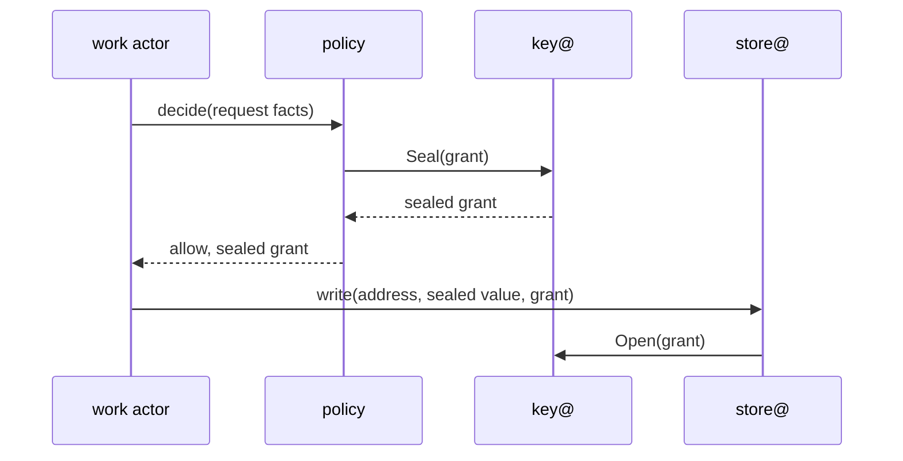

# 0007 — Policy is Cedar in a Rust actor over four layers, and every tenant-scoped write carries a grant that policy sealed

**Status:** Accepted
**Date:** 2026-11-03

Proposal: [issue #909](https://github.com/truvity/sluis/issues/909).

## Context

Every credential sluis mints, every sign-in it admits and every write to a tenant's data rests on one question: may this subject do this? In v1 the answer comes from a YAML policy document with grant names of the form `scope:thing:role` (v1 ADR 0010, on `master`), evaluated inside the issuer next to the request parser and the signing keys.

v2 separates the decision from everything else. `policy` is its own work actor ([0002](/decisions/0002-families-of-actors/#work-actors)). It reads reviewed policy, is given the facts of a request, and returns a decision, with a sealed grant when the answer is yes. Integrations return facts and never decide, and a minter acts only on a grant that `policy` made.

Forces: the actor decides whether a mint or a write is allowed, so it must be small, memory-safe and fail closed; the language needs a published grammar and a conformance corpus; a policy that does not fit its schema must be refused before it takes effect; the policy is a file for reviewers. Three needs are new. Operators want some changes, such as granting a standard set of rights or suspending someone, without a review. A tenant admin, or a product acting for its tenant, wants to change who may do what inside its own tenant, inside bounds that only a reviewer can widen. And a regulated customer's boundary must not run a policy that the customer has not agreed to.

The store and `key@` are two holders that must each be able to refuse a request on their own. For that they need proof that `policy` allowed it, which no work actor can forge and no outsider needs to verify ([0006](/decisions/0006-keys-and-sealing/#seal-and-open)).

## Decision

### Cedar in a Rust actor

- **Cedar is the policy language.** Policies are Cedar policies, checked against a Cedar schema. Cedar is in the [standards register](/standards/) with its pinned version.
- **The `policy` actor is written in Rust and uses the `cedar-policy` crate,** the reference implementation, to parse, validate and evaluate ([0012](/decisions/0012-the-language-follows-the-executable/#per-actor-table)).
- **`policy` decides from the effective policy set and the request.** It reads `EffectivePolicySet(boundary, tenant)` through the store and recompiles it when it changes ([0005](/decisions/0005-the-store/#watch-and-the-resume-point); on Lambda it re-reads with an ETag). The facts of a request, such as the person, the client and how the person signed in, arrive in the request. `policy` has no clock: the asking actor counts the age of an authentication.
- **`policy` writes no kind and has no outbound network.** Its ports are the ones every work actor has ([0002](/decisions/0002-families-of-actors/#ports-of-a-work-actor)): data, keys and audit emit. It uses the keys port for one thing, to have a grant sealed.
- **The validator runs at load and at every reload.** A policy that does not fit the schema is refused with an error naming the offending path. A set that fails validation is refused as a whole and the set in force stays ([0005](/decisions/0005-the-store/#a-failed-reload)); a cold start with a set that fails does not start.
- **Evaluation fails closed.** A request is denied unless a policy explicitly permits it, an explicit `forbid` wins over a `permit`, and an evaluation that cannot be completed is a denial.
- **Callers do not link Cedar.** Other actors reach `policy` through its ConnectRPC contract ([0002](/decisions/0002-families-of-actors/#contracts)); the language never appears in their code.
- **Grant names are declared in a vocabulary and narrowed per audience** ([0020](/decisions/0020-grant-vocabulary-and-token-claims/#grant-names-and-the-vocabulary)). A grant name is a named permission. A grant, in this record, is the sealed decision of [Sealed grants](/decisions/0007-policy-and-sealed-grants/#sealed-grants), and the two words are never used for each other.
- **Every decision is audited** with the ids of its determining policies and the digest of the policy set it used.

### Four layers

Policies are the one kind with all four layers ([0004](/decisions/0004-the-data-model/#layers-and-the-direction-rule)). `policy` compiles them into one Cedar set, in which a `forbid` anywhere wins, so the baseline holds whatever a higher layer adds.

| Layer | What it holds | Kind | Class | Written by |
|---|---|---|---|---|
| Built-in | Baseline policies, whose forbids are the floor, and predefined policies such as break-glass | (in code) | Built-in | A release |
| Config | Cedar policies and templates, the delegation policy, the console's operator roles, and a regulated party's own policy | `Policy`, `RegulatedPartyPolicy` | Config | The publishing pipeline |
| Operator | Links to predefined policies: a tightening one lasts, a loosening one expires | `PredefinedPolicyLink`, `PredefinedPolicyLinkTemporary` | Durable, temp | `exchange` |
| Tenant | Links of a template to the tenant's principals and resources | `PolicyLink` | Durable | `exchange` |

- **The combine rule is union with Cedar forbid-wins** ([0004](/decisions/0004-the-data-model/#layered-and-linked-kinds)). The store composes the layers into the effective set and returns, with each part, the version it came from, so a decision's audit record names the layer of every determining policy.
- **The direction rule is checked at write** ([0004](/decisions/0004-the-data-model/#layers-and-the-direction-rule)). A higher layer may add a `forbid` freely. A `permit` it adds must stay within what the layer below grants: a tenant's links stay inside a template, and an operator's loosening link expires. A run-time loosening carries an expiry ([principle 12](/principles/#12-a-loosening-is-temporary-a-tightening-is-durable)).
- **The console routes the writes of the operator and tenant layers to their owner,** `exchange`, which asks `policy` first whether the delegation policy permits the link ([0027](/decisions/0027-the-console/#writes)). The console writes neither kind itself.
- **Config is read-only to sluis.** Only the pipeline changes a `Policy` document, and the store verifies its signature before it parses it ([0005](/decisions/0005-the-store/#configuration-loading)).

### A regulated party's policy

- **A regulated customer's boundary has its own policy document,** the config kind `RegulatedPartyPolicy`, beside the publisher's `Policy`. The two layers are combined like every other config: union, forbid wins.
- **That document carries two signatures,** the publisher's and the regulated party's, as two JWS signatures on one signed document (the general JSON serialisation). `store@` verifies both before it parses the document, and refuses the document when either is missing or does not verify ([0005](/decisions/0005-the-store/#configuration-loading)). On a cold start it refuses to start; on a reload it keeps the set in force and raises an alarm.
- **Neither party can change the policy alone.** The publisher cannot put into a regulated boundary a rule that the customer has not signed, and the customer cannot put there a rule that the publisher's review has not passed. The format and the test vectors are on the [signed config page](/reference/signed-config/), which states the rule once.

### Sealed grants

A grant is the decision of `policy`, sealed by `key@` and carried by the actor that asked. It is read only by sluis, so no outside verifier needs a signature.

- **Only `policy` may have `key@` seal a grant.** `key@`'s rules say so ([0006](/decisions/0006-keys-and-sealing/#seal-and-open)). The grant is sealed with authenticated encryption under the boundary's `grant` data key ([0006](/decisions/0006-keys-and-sealing/#data-keys)): on AWS a data key made under the boundary's symmetric KMS key with the context {boundary, `-`, `grant`}, and on boards a boundary data key wrapped for each card, never a card key. A grant sealed in one boundary cannot be opened in another.
- **The store, `ca`, `signer`, `key@` and the minters open it,** each by asking `key@` to open a value of purpose `grant`. No other actor does. `policy` holds no signing key, and a grant is not signed.
- **A grant names the tenant and what it allows.** It carries its expiry. It is short-lived and reusable for about 60 seconds, so one decision covers the several writes, seals and opens of one request without a round trip to `policy` for each.
- **A grant is never stored.** It exists in flight and in the memory of the actor that carries it. Nothing durable holds one, so there is nothing to revoke: it simply expires.
- **A grant sealed for the address's tenant is required on every tenant-scoped write** ([0005](/decisions/0005-the-store/#rules)). A write to a boundary-scoped address is checked by the store's rule alone.
- **A one-shot irreversible action leaves a spent marker.** The actor that carries it out, such as `signer` for an artifact signature ([0024](/decisions/0024-root-custody-and-the-signing-api/#the-signing-api)) or a minter for a mint, writes the hash of the grant as a `SpentGrant`, a temp kind with a conditional create. A second use of the same grant finds the marker and is refused. The marker lives 2 minutes by default and 5 minutes at most, longer than a grant lives.
- **`SpentGrant` is a declared self-scoped kind** ([0004](/decisions/0004-the-data-model/#one-writer-per-kind)): its id starts with the name of the actor that writes it, and the store lets each actor write only ids under its own name.
- **Grant, grant name and the vocabulary are different things.** A grant is a sealed decision; a grant name is an entry of the vocabulary ([0020](/decisions/0020-grant-vocabulary-and-token-claims/)); in prose, "grant" alone means the sealed grant.

### Two independent checks

Two checks stand between any actor and a tenant's sealed value ([principle 15](/principles/#15-plaintext-lives-only-where-it-is-used-behind-two-independent-checks)). Each holds alone, so a flaw in one is caught by the other.

1. **The store's rule.** For each call the store checks the actor, the kind and the verb against the rules of the kind registry, which are generated, and on a tenant-scoped write it checks the grant ([0005](/decisions/0005-the-store/#rules)). The scope of the call comes from the actor's identity and the grant, never from a field the request supplies.
2. **`key@`'s grant check on every Seal and Open.** `key@` opens the grant, checks that it was sealed for the tenant of the address and allows the operation, and checks the caller's rule for the purpose ([0006](/decisions/0006-keys-and-sealing/#seal-and-open)).

- **The checks are independent in every way that matters.** They run in different holders with different credentials; the store never holds a key and `key@` never holds data; their inputs come from different registries, the kind registry and the actor registry.
- **A value is bound to its full address.** A sealed value moved to another row, kind, tenant or boundary no longer opens, so a flaw that lets an actor write where it should not does not let it read what it moved ([0006](/decisions/0006-keys-and-sealing/#seal-and-open)).
- **A compromised work actor has to defeat both checks** to reach another tenant's value, and a grant it carries is good only for the tenant and the operation it names, for about 60 seconds.
- **The ladder adds separation beyond these checks** at higher levels: a store, an engine or a runtime of its own ([0008](/decisions/0008-boundaries-and-tenants/#the-ladder)).

### Template links

- **Template-linked policies are the way a tenant changes its own policy.** Policy logic stays reviewed: Cedar templates, and a declared delegation policy that says who may link which template to which principals and resources, are config documents.
- **Within those bounds a tenant admin, or a product acting for its tenant, creates and removes links.** A link adds no logic a reviewer has not seen in the template. The `PolicyLink` is checked against the template, which must exist in config, when it is written.
- **A link inside a template is not a loosening.** A template is config's grant to the tenant layer, so a link within it is within the bound of the layer below and is durable, with no expiry. A tenant admin may link and unlink without a review.
- **Linking a predefined policy that grants beyond config, such as break-glass recovery, is a loosening.** It is written as a `PredefinedPolicyLinkTemporary`, which expires (1 hour by default, 24 hours at most), and `policy` recompiles when it does ([principle 12](/principles/#12-a-loosening-is-temporary-a-tightening-is-durable)). Break-glass itself is in [0017](/decisions/0017-identity-and-sign-in/).
- **A tightening takes effect at once and lasts.** Suspending a person ([0019](/decisions/0019-person-and-upstream-link/#states)), revoking a grant name, and linking a predefined policy that only forbids are durable: `PredefinedPolicyLink` holds the last.
- **The kind decides which write is a loosening.** The durable `PredefinedPolicyLink` accepts only a predefined policy that tightens, and only the temp kind accepts one that loosens, so the store's check at write is a check of the kind and the policy named.
- **The delegation policy is Cedar too.** A template with no delegation policy cannot be linked by anyone. A stolen operator or tenant-admin session is bounded by it.
- **The console's operator roles are declared** in the config policies ([0027](/decisions/0027-the-console/#roles)); the console checks delegation and routes the write.
- **The same pattern makes tenant settings that are not policy:** a tenant's client, a lifetime or a sign-in method is a durable kind of the tenant layer, written inside bounds that config declares ([0004](/decisions/0004-the-data-model/#profiles)).
- The Cedar schema of requests, entities and actions is on the [Policy](/reference/policy/) page, which fixes them for the first working version.

## Consequences

- **The decision is made by a small process that holds no key and no data of its own.** It cannot read or exfiltrate anything. Its failure modes are a wrong decision and a refusal to decide, and both are visible in the audit trail.
- **An operator can grant a standard set of rights, or suspend someone, from the console without a pull request,** and a tenant admin can link a template inside its tenant. The delegation policy bounds what a stolen session can link. The cost is a template and a delegation rule for each right granted this way.
- **Every request that writes tenant data costs one decision and one seal of a grant,** shared by the writes of the next 60 seconds. On Lambda the decision is an invoke ([0003](/decisions/0003-units-transports-and-fusion/#transports)).
- **A grant already issued outlives a tightening by at most about 60 seconds.** A stricter policy denies the next decision at once; a grant in flight lasts until it expires, and a one-shot action cannot be repeated because of its marker.
- **A regulated customer signs each change of its policy,** so a change of that policy needs the customer's signing key to be available.
- **The policy is a file with a grammar, a validator and a conformance corpus;** a test states a policy's behaviour as a request and an expected decision.
- **Rust sits in the smallest and most sensitive actor.** Its build, packaging and supply-chain review are shared with the other Rust executables of [0012](/decisions/0012-the-language-follows-the-executable/).
- **Cedar moves.** The language and the crate are pinned, and a change of version is a reviewed change that runs the conformance cases first.
- **The v1 YAML policy does not carry over unchanged.** Operators who migrate rewrite their grants in Cedar; the cutover tooling belongs to the parity milestone ([#1017](https://github.com/truvity/sluis/issues/1017)).

## Roads not taken

- **Keep a YAML policy document of our own.** Familiar from v1, but a grammar, validator and matching rules of our own with no published corpus to test against.
- **Cedar in Go, inside the core.** One language for the core, but the reference implementation and its validator are Rust, and a gap between a port and the reference is a gap in a decision engine.
- **Open Policy Agent with Rego.** Widely used, but a general query language that is hard to bound, without Cedar's schema check at load.
- **CEL with rules in our own format.** Safe to evaluate, but no policy sets, no defined `permit`/`forbid` combination and no schema validator for the whole set.
- **Rules written in the actor's code.** A policy change would be a release, and reviewers would read code, not policy.
- **Policy logic written from the console.** A writable policy API: a stolen operator session could widen any grant. Links of reviewed templates give the same convenience with the logic still in review.
- **A decision point that fetches its own facts, with state or network access.** It becomes a target and its decisions can no longer be reviewed as a file; it reads policy through the store and gets the facts in the request.
- **Signed grants.** A grant is read only by sluis, so a signature would add a signing key, a slot and a verifier path for no outside reader, and on a card a signature costs about 147 ms where a cached data key costs a memory operation.
- **Stored grants.** A table of grants needs revocation, a sweeper and a write for every decision; a grant that lives about 60 seconds needs none of these.
- **A spent marker for every grant.** A write for each decision, where only the irreversible actions need one.
- **A new grant for every call.** A round trip to `policy` and a seal for each write of one request.
- **One signature on a regulated party's policy.** The publisher alone could put a rule into the customer's boundary, or the customer alone could put there a rule that review has not passed.
- **Template links that always expire.** A tenant admin's everyday changes would lapse every day; only a link that grants beyond what config allows is a loosening.
- **The store checks policy itself.** The store would need Cedar and the policy set, and the second check would no longer be independent.

## Follow-ups

- Cutover and migration from v1, including policy: [#1017](https://github.com/truvity/sluis/issues/1017).
