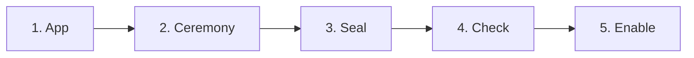
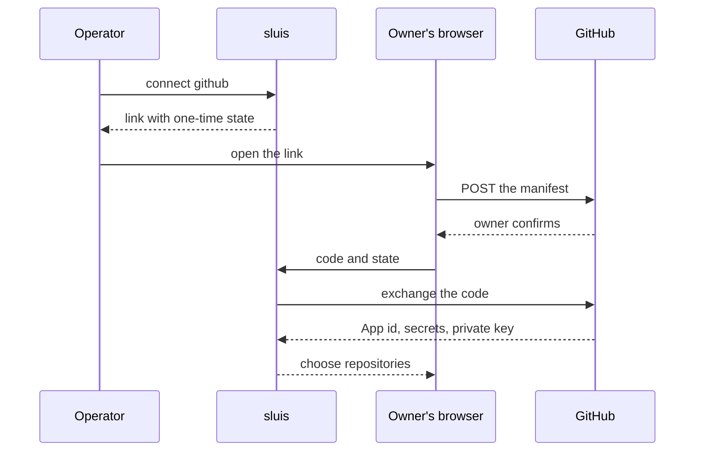

Every vendor has its own ceremony for handing over a credential. The ceremonies repeat, so this page describes each once: what the vendor offers, who does what, and where the credential ends up. The commands are [illustrative](/integrations/#examples-are-illustrative).

## Two paths: made by hand, or made in the UI

The path decides the storage class, not the vendor ([0004](/decisions/0004-the-data-model/#the-upstream-criterion)).

| What you make | Path | It is stored as | Example |
|---|---|---|---|
| A provider **app** that serves the whole installation | By hand or IaC, on the vendor's side, then a reviewed file | **Config**; its secret in a **secret source** | `SlackApp` and `SlackAppSecret`; `Upstream` and `UpstreamSecret`; `MinterBounds` |
| A **connection** of a tenant to a provider | The UI or the API, with a browser round trip where the vendor needs one | **Durable**, per tenant, credential **sealed** | `GitHubApp`, `SlackConnection`, `EntraConnection`, `DirectoryConnection`, `MinterConnection` |
| A **flow in progress** | The adapter that runs the flow | **Temp** | `SlackInstallState`, `GitHubManifestState`, `EntraConsentState` |

- **Who connects decides.** An app the operator makes is config. A tenant's own connection to its directory or its account is durable data entered through the UI or the API, never config the operator commits ([0004](/decisions/0004-the-data-model/#who-connects-decides)).
- **The operator's own company is a tenant,** so a connection the operator makes in the UI is durable too.
- **An IaC tool that calls the API makes durable data,** not config. Where a thing is written decides its class ([principle 17](/principles/#17-where-a-thing-is-written-decides-its-class)).

## The shape of every connection



1. **App.** Only for a vendor that needs an app of its own. The operator makes it on the vendor's side and commits its definition (ids, scopes, redirect URL, the hosts its adapter may reach) as config. Its secret goes to the secret source. GitHub, Cloudflare and a directory need no app definition.
2. **Ceremony.** A person with authority at the vendor (an organisation owner, a workspace owner, a Super Admin) approves, once. A person with the right role starts it in the console or through the API; the console starts the flow in the adapter and never holds the credential ([0027](/decisions/0027-the-console/#writes)). The approver at the vendor and the person who starts it are usually two people, so neither alone can connect.
3. **Seal.** The adapter that completes the flow receives what the vendor returns (a private key, a bot token, a client secret). It asks key@ to seal the credential with a grant for the tenant and writes the connection under an id that starts with its own name ([0025](/decisions/0025-integrations/#adapters-and-connections)). The credential is never printed, never written into configuration and never audited ([0004](/decisions/0004-the-data-model/#treatment)). Ids that come back from the vendor, such as an installation number, are pins, checked on every later observation.
4. **Check.** `sluis integrations check` runs the adapter's `Probe` and a dry run, and compares what was asked with what the vendor granted (drift) before anything acts.
5. **Enable.** Nothing acts until it is enabled: a reconciler stays in dry run until its target is enabled ([0026](/decisions/0026-reconcilers/#the-contract)), and a mint needs a grant from `policy`. A pass that no caller starts, such as a scheduled re-sync, asks `policy` for a grant for one tenant at a time.

Deleting a connection ends its credential, and a tenant that leaves takes its connections with it ([0008](/decisions/0008-boundaries-and-tenants/#tenant-lifecycle)). A vendor-side registration is removed by its owner at the vendor.

A reviewed file never holds a secret. The secret of an app is an item of a secret source, which only the adapter named in the registry reads ([0005](/decisions/0005-the-store/#secret-sources)).

| Task | Command shape |
|---|---|
| Connect an integration | `sluis integrations connect <name> …` |
| Check drift and run a dry pass | `sluis integrations check <name>` |
| Disconnect | `sluis integrations disconnect <name>` |
| Render vendor-side objects from the configuration | `sluis integrations render <name>` |

The console and the command line run the ceremony through the same `entry` API, and a vendor redirect reaches `entry`'s public URL, here `https://sluis.example.com`.

## GitHub App manifest flow

GitHub can create an App from a **manifest**, a JSON description of the App. An organisation owner sees a pre-filled page and presses one button; GitHub redirects to the URL the manifest names with a one-time code, and `adapter-github` exchanges the code for the App's credentials. Nobody copies a key. The App is a `GitHubApp` of the tenant that ran the flow.

```json
{
  "name": "acme-publisher",
  "url": "https://sluis.example.com",
  "redirect_url": "https://sluis.example.com/connect/github/callback",
  "public": false,
  "default_permissions": { "contents": "write", "pull_requests": "write" },
  "default_events": [],
  "hook_attributes": { "url": "https://sluis.example.com/hooks/github", "active": false }
}
```



1. Name the App: its organisation, a short id, its permissions (GitHub's names, at `read`, `write` or `admin`) and whether it receives events.
2. Start the connection in the console, or run `sluis integrations connect github --org acme --app publisher`. sluis gives a link and keeps the state of the flow as a `GitHubManifestState`.
3. An organisation owner opens the link and confirms. GitHub returns to sluis, which checks the state, exchanges the code (valid for one hour) and writes the `GitHubApp` with the private key and the secrets sealed.
4. The owner picks the repositories on GitHub's install page. GitHub returns with the installation id, and sluis confirms with GitHub where the App is installed and writes a `GitHubInstallation`.
5. `sluis integrations check github` shows no difference between asked and granted permissions.

- **The state is single-use, lives at most one hour (the life of GitHub's code) and is bound to the session of the person who started the flow,** so someone holding a link cannot complete a connection another person began.
- **GitHub has no API to change an App's permissions.** To fix drift, an owner edits the App on GitHub (or you disconnect and recreate it), and the installation accepts the permission request. `metadata: read` is always present and is never drift.
- **Webhooks** are one URL per App. sluis generates the secret and keeps it sealed; rotation is two steps, and the old secret is restored if the receiver does not accept the new one within minutes.
- **`workflows: write`** is needed to push under `.github/workflows`.

### Per organisation or per installation

A public App installed on many organisations has one key that reaches every installation and the same permissions everywhere. sluis therefore uses one private App per organisation and per job (organisation membership, a catalogue App for tokens, runner registration), so a key's reach is one organisation and one job's permissions never widen another's. The one public App is the *link App*, a `GitHubApp` of the operator's own tenant, which people authorise as themselves and which is installed nowhere; the link it makes is a `GitHubAccountLink`.

## Slack app manifests

Slack separates the app from the install, as sluis does. The **app** is made once for the installation; each tenant then **installs** it into its workspace.

Slack describes an App in a **manifest**, in YAML or JSON. There is no one-click redirect flow, but the manifest can be sent to Slack's API, or pasted into the *Create app from manifest* page.

```yaml
display_information:
  name: acme-sync
features:
  bot_user:
    display_name: acme-sync
oauth_config:
  redirect_urls:
    - https://sluis.example.com/connect/slack/callback
  scopes:
    bot: [users:read, users:read.email, channels:read, groups:read,
          channels:manage, groups:write, channels:join]
settings:
  org_deploy_enabled: false
  socket_mode_enabled: false
```

1. **Make the app, once.** In Slack, signed in to the owning workspace, generate an **App Configuration Token**. It expires in 12 hours; use it once to create the App and never store or log it. `sluis integrations render slack` builds the manifest from the `SlackApp` (config), so the scopes the file declares are the scopes the App asks for.
2. **Commit the app.** The app id, client id, scopes and redirect URL are the config kind `SlackApp`; the client secret goes to the secret source as `SlackAppSecret`.
3. **Install it, per tenant.** A person starts the install in the console. `adapter-slack` keeps the OAuth state as a `SlackInstallState` (10 minutes), a workspace owner approves, Slack redirects to sluis with a code, and the adapter writes a `SlackConnection` with the workspace id, the bot user, the granted scopes and the bot token sealed.
4. **The first workspace is pinned.** An install of the same connection into any other workspace is refused and its token revoked.
5. To add a scope, change the `SlackApp` in review, generate a fresh configuration token and reinstall; until then the connection shows *scopes missing*.

Disconnecting revokes the token and deletes the connection; the App's owner deletes the registration in Slack.

## Google Workspace

sluis needs two separate credentials from Google: an OAuth client for **sign-in**, and read access to **the directory**. They are two connections ([splitting by credential](/decisions/0025-integrations/#splitting-by-credential)).

### The sign-in client

In a Google Cloud project, create an OAuth client of type *Web application*, with the sign-in callback sluis prints (and, for admin consent, the connect callback) as redirect URIs. The consent screen asks for `openid`, `email` and `profile` only. For one organisation it can be *Internal*; for several tenants it must be *In production*, because in testing a second tenant gets an access error and refresh tokens expire after seven days.

- **The operator's client is an `Upstream`:** config, with its client secret in a secret source (`UpstreamSecret`).
- **A tenant's own identity provider is not connected to sluis.** In a customer installation it is configured in the broker, which is the one upstream ([0033](/decisions/0033-customer-connections/#which-upstreams-an-installation-has)).

### The directory: three methods

All three use the same four read-only scopes:

```text
https://www.googleapis.com/auth/admin.directory.user.readonly
https://www.googleapis.com/auth/admin.directory.group.readonly
https://www.googleapis.com/auth/admin.directory.group.member.readonly
https://www.googleapis.com/auth/admin.directory.domain.readonly
```

| | Workload Identity Federation with delegation | Service-account key with delegation | Admin consent |
|---|---|---|---|
| Fails when | The pool, provider or delegation changes | The key is deleted, or keys are forbidden by policy | The admin is suspended or loses the role |
| Rotation | None | New key, replace, delete the old | Reconnect |

Whichever method, the result is a `DirectoryConnection` of the tenant, written by `adapter-upstream-oidc`, with the credential that syncs the directory sealed. The adapter reads one page of users before it keeps the connection, so a wrong credential fails at once. Admin consent is a browser round trip; a key or a federation setup is entered through the UI or the API.

**Delegation** lets a service account act as a user of the tenant for the listed scopes. A Super Admin grants it in the Admin console (*API controls*, *Manage domain-wide delegation*) by the service account's numeric client id. The impersonated user should be a dedicated admin whose role can only read the directory.

**Keyless, with Workload Identity Federation**, for organisations that forbid service-account keys:

1. Create a service account with no key, and grant it domain-wide delegation for the four scopes.
2. Create a workload identity pool and an OIDC provider that trusts the boundary's workload issuer, mapping the token's subject to the directory role.
3. Let the pool principal impersonate the service account, and let the service account sign a delegation assertion for itself.
4. At run time the adapter exchanges its workload token for a federated identity, impersonates the service account, has it sign an assertion naming the dedicated admin, and exchanges that for a short-lived Directory API token.

No secret is stored. The connection holds only the names of the pool, the service account and the admin, still sealed because they identify a person. The workload token for GCP is signed with ES256, under the cloud-federation exception ([0006](/decisions/0006-keys-and-sealing/#named-exceptions)). The keyless method needs the GCP exchange ([#871](https://github.com/truvity/sluis/issues/871)); until it is built, an installation uses a key or admin consent.

Whatever the method, enable the Admin SDK API in the project first (otherwise the first read is refused after consent); the remaining steps are on [Google Workspace](/integrations/google-workspace/#setup).

## Cloudflare: the minting token

Cloudflare has no manifest or consent flow; a person creates the credential by hand, as a **minting token** and **prototype tokens**. The account is a `MinterConnection` of the tenant, and each thing it may mint is a `MinterTarget` ([0025](/decisions/0025-integrations/#credential-minters)).

1. Create an **account API token** whose only permission is to manage account API tokens (read and write). This is the minting credential. Give it an expiry and replace it on a schedule.
2. Enter it through the UI or the API, or from standard input on the command line so it never reaches a shell history: `sluis integrations connect cloudflare --account main`. The Cloudflare adapter checks that the token is valid and refuses one that holds more than token management, then seals it in the `MinterConnection`.
3. Create a **prototype token** for each kind of access (DNS write on one zone, bucket item write on one bucket) and then **disable** it by an update; creation ignores a disabled status.
4. Declare a target with the prototype's id, a lifetime and the permission groups the prototype may hold. The adapter writes the `MinterTarget`, and the store refuses one outside `MinterBounds`, the config kind that says which target types and which longest lifetimes the installation allows.

The minting credential can create any token the account owner could; the refusal list in the adapter is the guard ([Cloudflare](/integrations/cloud/#cloudflare)). Keep it out of ordinary secret stores and infrastructure-as-code inputs.

## AWS: OIDC provider and role trust

Accounts trust sluis as a web identity provider. Each account needs two kinds of object, both generated from the configuration that declares the roles, so trust cannot drift from the clients:

- an **IAM OIDC provider** for sluis's issuer URL (https, no port, no query), whose key set AWS fetches from the issuer's discovery;
- **one role per purpose**, whose trust policy allows `sts:AssumeRoleWithWebIdentity` for that provider with a condition on the audience sluis puts in the token for that role, and on `sub` when the role is for one workload.

```json
{
  "Effect": "Allow",
  "Principal": { "Federated": "arn:aws:iam::123456789012:oidc-provider/sluis.example.com" },
  "Action": "sts:AssumeRoleWithWebIdentity",
  "Condition": { "StringEquals": { "sluis.example.com:aud": "aws:acme-prod:deployer" } }
}
```

1. Declare the account and its roles as clients, with their `requires` groups.
2. Run `sluis integrations render aws --account acme-prod`; it writes the provider and the trust policies as a template.
3. Apply the template with your infrastructure tool.
4. Check with `aws sts get-caller-identity` on a profile that `sluis aws-config` wrote. A mismatched `aud` fails as access denied on the assume call.

For sluis's own actors the provider is the boundary's workload issuer ([Identity](/concepts/identity/)). AWS allows 100 providers per account and 100 EC keys in a key set. The reverse direction, AWS roles that prove themselves to sluis, is on [AWS](/integrations/cloud/#aws). AWS needs no connection: nothing of AWS is stored in sluis.

## Generic OIDC upstream

For any provider that publishes OpenID Connect discovery:

1. Register sluis as a client at the provider, with the callback sluis prints.
2. **For the operator's own upstream,** commit an `Upstream` (issuer, client id, subject claim) and put the client secret in the secret source as `UpstreamSecret`.
3. **Declare the e-mail domains** the upstream serves in the `Upstream`, then run `sluis integrations check oidc partner`.
4. Choose what the connection's claims are worth: map the allow-listed claims to facts; asserted groups and roles are never read ([0033](/decisions/0033-customer-connections/#claims-and-groups)).

The checks on every ID token are on [Generic OIDC and peer sluis](/integrations/oidc-upstream/).

## Credentials without a ceremony

Some vendors have no flow at all: the wiki and on-call tools on [More integrations](/integrations/more/) hand over a key or token that an administrator creates by hand. The pattern is then steps 3, 4 and 5: the credential comes in through the UI, the API, standard input or a protected file, the adapter checks it with a dry run, and it is sealed in the tenant's connection. A key that serves the whole installation stays in a secret source instead.
