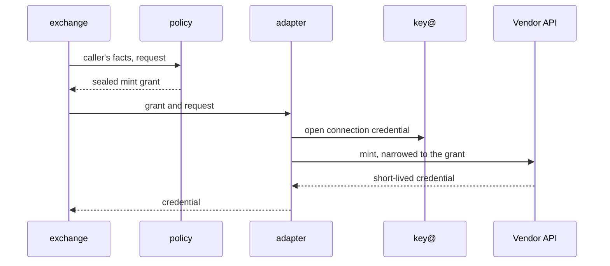

An **integration** connects sluis to something outside it: a sign-in provider, a directory, a cloud, a chat workspace. Each vendor is served by one **adapter**, a work actor named `adapter-<vendor>@<boundary>` ([0002](/decisions/0002-families-of-actors/#names)). An adapter holds no credential at rest. It reads a tenant's **connection** (its directory, its chat workspace, its code host, its account at a provider), asks key@ to open the sealed credential for each call, makes the call and keeps nothing ([0025](/decisions/0025-integrations/#adapters-and-connections)).

This page is the model and the index; the [setup patterns](/integrations/connecting/) describe the vendor ceremonies once.

## Six kinds of integration

Five kinds are contracts that an adapter implements, each a ConnectRPC service over one shared base contract. The sixth, the workload verifier, is a verifier driver of `exchange` that holds public material only ([0022](/decisions/0022-workload-identity-and-host-enrolment/#proofs-and-the-exchange)).

| Kind | It answers or does | Examples |
|---|---|---|
| `Upstream` | Sign-in with an upstream identity provider | A workspace identity provider, a generic OIDC provider |
| `FactsSource` | Supplies directory facts: users, groups, teams | A workspace directory, GitHub teams |
| `CredentialMinter` | Mints a downstream credential for a grant that `policy` sealed | GitHub installation tokens, Cloudflare API tokens |
| `Provisioner` | Reconciles an external system to a desired state that the directory adapter writes from `policy`'s answer | GitHub teams, Slack channels |
| `Notifier` | Sends a message | A chat app |
| `WorkloadVerifier` | Verifies a token a workload presents and returns what it proves | GitHub Actions, Kubernetes ServiceAccounts, AWS roles |

Every vendor-shaped value travels as an opaque reference or a namespaced attribute (for example a subject in namespace `github` with an id only the adapter understands). Core never parses what an adapter returns. Each adapter declares its attribute names and types, so a policy file is validated at load time without core knowing the vendor ([0025](/decisions/0025-integrations/#what-an-integration-may-return)).

## Facts or core-authorized effects, never decisions

> Integrations return facts, or carry out effects that core has already authorized. They never decide.

[0002](/decisions/0002-families-of-actors/#work-actors) states the rule; [0025](/decisions/0025-integrations/#the-rule) fixes the contract every adapter is built against: what an adapter may return, how core authorises an effect, and the split by credential.

- A **FactsSource** or **WorkloadVerifier** returns facts. Whether a fact entitles anyone to anything is `policy`'s question.
- A **CredentialMinter** carries out an effect. It receives a **mint grant that `policy` sealed**, opens it at key@ (which fails for a grant of another boundary or another tenant), and mints exactly what the grant says. It decides nothing about whether to mint ([0007](/decisions/0007-policy-and-sealed-grants/#sealed-grants)). What it returns goes to the caller and is recorded nowhere.
- A **Provisioner** pulls a desired state **addressed by its digest** and reconciles to it. It does not choose what the state should be ([0026](/decisions/0026-reconcilers/#the-contract)).
- **Work that no caller starts** has no grant to bring, such as a scheduled directory re-sync or a reconcile pass. The adapter asks `policy` for a grant for that pass, for one tenant at a time. The grant is short-lived like any other ([0025](/decisions/0025-integrations/#adapters-and-connections)).

Caps and rate limits live in core, in `policy` and `quota`, so an adapter never holds a rule about how much is too much.

## Apps and connections

An integration has two parts that are stored differently ([0004](/decisions/0004-the-data-model/#the-upstream-criterion)).

| Part | Class | Made by | Examples |
|---|---|---|---|
| **App definition** that serves the whole installation | Config, with its secret in a secret source | Hand or IaC, on the vendor's side and in a reviewed file | `Upstream` and `UpstreamSecret`; `SlackApp` and `SlackAppSecret`; `Integration` and `IntegrationSecret`; `MinterBounds` |
| **Connection** of one tenant to a provider | Durable, per tenant, credential sealed | The tenant or the operator, through the UI or the API | `DirectoryConnection`, `EntraConnection`, `GitHubApp`, `GitHubInstallation`, `SlackConnection`, `MinterConnection` |
| **Mint targets** of a tenant | Durable, Tenant-adjustable, inside the bounds of `MinterBounds` | The tenant admin, through the UI or the API | `MinterTarget` |
| **A flow in progress** | Temp | The adapter that runs the flow | `SlackInstallState`, `GitHubManifestState`, `EntraConsentState` |
| **Directory facts** read through a connection | Temp, sealed, 24 hours by default and 7 days at most | The adapter | `DirectoryUser`, `DirectoryGroup`, `DirectoryMembership` |

- **Who connects decides.** A tenant's own connection to a provider is never config committed by the operator, so a customer's change does not wait for review ([0004](/decisions/0004-the-data-model/#who-connects-decides)). The company that runs the installation is a tenant too, so its own connections are durable.
- **An IaC tool may create a connection by calling the API.** What it writes is durable data of the tenant, not config.
- **The adapter that completes a connect flow writes the connection,** under ids that start with its own name. A tenant has no sign-in connection: the upstreams are the operator's config ([0033](/decisions/0033-customer-connections/#which-upstreams-an-installation-has)).
- **An installation-wide credential stays in a secret source,** and only the adapter named in the registry reads it ([0005](/decisions/0005-the-store/#secret-sources)). The kinds are in the [kind registry](/reference/kinds/).

## Core calls adapters, never the reverse

`session` calls its upstream adapter, `exchange` its minters and notifiers, and `console` the adapters whose flows it starts or whose kinds it routes writes to. `entry` only routes a push notification. An adapter calls no work actor other than `policy`; a provisioner's desired state is data that it reads through its data port, written by the directory adapter from `policy`'s answer ([0026](/decisions/0026-reconcilers/#the-desired-state)).

Three invariants are tested, so the rule survives changes ([0025](/decisions/0025-integrations/#the-rule)).

## Client profiles

Many things that look like integrations call no external system: databases, SSH hosts, cert-manager, GitOps consoles, MCP servers. They are clients of sluis, and sluis calls nothing outside for them. Each is a **client profile**: configuration for how that client signs in and what it may ask for, with no process and no credential of its own, checked by `sluis config check` like the rest of the configuration ([0005](/decisions/0005-the-store/#configuration-loading)).

The AWS and Kubernetes pages sit between the two: the integration part is the workload verifier, and the rest is configuring the account or cluster to trust sluis.

## Isolation

- **An adapter reaches only the hosts it declares,** and the actor registry grants it no more key purposes than it needs. The limit is a per-uid egress rule on boards and a network policy on Kubernetes ([0003](/decisions/0003-units-transports-and-fusion/#units)).
- **One adapter serves every tenant of a vendor in a boundary,** and keeps no tenant's credential at rest. A flaw in it reaches the credential it is using at that moment, not the other tenants' connections ([0025](/decisions/0025-integrations/#splitting-by-credential)).
- **A credential is a connection.** Sign-in and the directory of one workspace are two credentials, so two connections that fail, rotate and leave on their own.
- On Kubernetes each adapter is a pod with its own egress policy ([0011](/decisions/0011-runtimes-and-installations/#kubernetes)); the other runtimes are on [Runtimes](/runtimes/).

## The integrations

Every page has the same parts: what it is for, the kinds it plays, what sluis asks the vendor for, what policy controls, what is audited, and setup. v1 behaviour and the parity issues are on the [v1 parity checklist](/features/).

The first working version has the `Integration` and `Upstream` contracts, served by `adapter-upstream-oidc`. The other contracts arrive with their first consumer at the parity milestone ([0025](/decisions/0025-integrations/#the-first-working-version)).

| Page | Kinds | The use cases it serves |
|---|---|---|
| [GitHub](/integrations/github/) | `WorkloadVerifier`, `FactsSource`, `CredentialMinter`, `Provisioner` | A CI job gets a token for one repository that lives minutes; teams follow the directory. |
| [Google Workspace](/integrations/google-workspace/) | `Upstream`, `FactsSource` | People sign in with the account they have; policy names directory groups. |
| [Generic OIDC and peer sluis](/integrations/oidc-upstream/) | `Upstream`; a peer adds `WorkloadVerifier` | A partner signs in with their own provider; another sluis vouches for its people. |
| [AWS and Cloudflare](/integrations/cloud/) | `WorkloadVerifier` (AWS), `CredentialMinter` (Cloudflare) | People and CI jobs assume roles without stored keys; a job gets a DNS token for one zone for an hour. |
| [Kubernetes API server](/integrations/kubernetes/) | `WorkloadVerifier`, plus clusters that trust sluis | `kubectl` with directory groups in RBAC; a ServiceAccount calls another cluster. |
| [PostgreSQL and SSH](/integrations/infrastructure-access/) | Client profiles on `ca` and `ssh-ca` | A database session or a host login with a short-lived certificate. |
| [Applications and gateways](/integrations/applications/) | Client profiles | Consoles, applications, gateways and MCP servers trust sluis; cert-manager gets certificates. |
| [More integrations](/integrations/more/) | `Provisioner`, `FactsSource`, `Notifier` | Chat channels, a team wiki and an on-call tool follow the directory. |

## Examples are illustrative

The commands of the first working version are on [Commands](/reference/cli/) and the keys of the bootstrap file on [Bootstrap file](/reference/bootstrap-file/); those pages are decided. A command or a configuration key on these pages that they do not list belongs to the parity milestone: it shows the shape, not a decided name, until it is designed ([#1097](https://github.com/truvity/sluis/issues/1097)).
