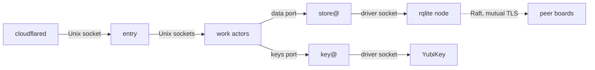

Bare-metal is the runtime where sluis owns its hosts: physical machines (single-board computers, servers), virtual machines (EC2 or any other provider) and local Docker on a workstation. Processes are long-running, the node has a persistent disk, actors and drivers talk over Unix sockets on the node, and systemd, or a container runtime for local Docker, starts everything ([what each runtime provides](/runtimes/#what-each-runtime-provides)).

The node count is an attribute of the installation, not of the runtime: bare-metal runs with one node or with N. The tested installations on bare-metal are [local](/runtimes/#local) and [boards](/runtimes/#boards). Which drivers fit bare-metal is on [Runtimes](/runtimes/#which-drivers-fit-which-runtime). The design is [0003](/decisions/0003-units-transports-and-fusion/); this page shows what it makes of a three-board installation.

## What runs where

- **One systemd unit and one uid per actor and per boundary.** Each [actor](/concepts/families/) instance, `actor@boundary`, is its own OS user and its own instance of a systemd template unit. The same holds for the holders store@, key@ and exporter@ ([0003](/decisions/0003-units-transports-and-fusion/#units)).
- **Drivers are systemd units too,** started by the platform beside their owner's unit. Nothing execs a driver, and an actor's unit may execute nothing but its own binary. Only the owner can open a driver's socket.
- **Templates and a generator.** The packages ship template units only: `sluis-<actor>@.service` and `sluis-<actor>@.socket`, with `User=sluis-<actor>-%i`, `RuntimeDirectory=sluis/<actor>/%i`, `LoadCredentialEncrypted=` per instance and `ListenStream=/run/sluis/<actor>/%i.sock`. A **systemd generator** shipped in the package reads the bootstrap files in `/etc/sluis/bootstrap.d/`, one for each boundary ([Where it lives](/reference/bootstrap-file/#where-it-lives)), and creates the instances and their `sysusers.d` entries, so a second [boundary](/concepts/boundaries/) on the same host is a second set of instances, not a second package.
- **The units are generated from the registries.** The actor registry gives the uid, the sockets, the callers and the egress of each unit, and the kind registry gives the rules ([0002](/decisions/0002-families-of-actors/#registries-generate-the-enforcement)). The packages, split by holder and module ([Packages](/distribution/packages/)), install under `/usr/libexec/sluis/{actors,drivers,node,vendor}/<short-name>`.
- **The node agent** (`sluis-node`) issues each unit a short-lived workload token and asks key@ to sign it. It holds no key credential ([0022](/decisions/0022-workload-identity-and-host-enrolment/)).
- **Adapters run only when the installation uses them.** Fusion of work actors is an explicit installation choice, and a holder is never fused with a work actor ([0003](/decisions/0003-units-transports-and-fusion/#fusion)).

## Sockets and the call graph

A board has no TCP listener of any actor. The call graph is declared once in the actor registry and enforced twice ([0003](/decisions/0003-units-transports-and-fusion/#the-call-graph)):

- **In logic.** The generated client exists only for the callees an actor may call, and one interceptor in every process refuses a caller that is not listed.
- **In the unit.** The callee's Unix socket is owned by the callee's uid, with a group that holds only the uids of its allowed callers (mode `0660`). Each caller's sandbox makes only its allowed sockets visible (`BindPaths=` and `InaccessiblePaths=`, with `RestrictAddressFamilies=AF_UNIX` and `PrivateNetwork=yes`). The callee reads the caller's uid with `SO_PEERCRED`.

- **`entry` listens on a Unix socket only,** at `/run/sluis/entry/<boundary>.sock`, and runs with `PrivateNetwork=yes`, seccomp and Landlock, so it has no network at all. `cloudflared` is the edge connector: it connects outbound only, forwards to that socket, holds no key and reaches no other socket. Each board runs its own, so the board opens no inbound port for sluis.
- **Every other actor and every driver listens on a Unix socket** under `/run/sluis/<actor>/`, one socket per boundary. key@ serves each caller on a socket of its own, in a directory only that caller can open ([0006](/decisions/0006-keys-and-sealing/#exclusive-card-access)).
- **The only inbound and inter-node port is rqlite's Raft port,** with mutual TLS, certificates from ritueel's pre-configuration, and a firewall rule that admits it from the declared peers only ([0003](/decisions/0003-units-transports-and-fusion/#calls-between-nodes)). rqlite's client API listens on the loopback address, and store@'s driver is its only client ([0005](/decisions/0005-the-store/#engines)). Witnesses meet through the audit blob, not through a connection between boards.
- **Egress is denied by default** and generated from the registry: nftables per uid. An actor whose registry row lists no outside host, `entry`, `policy` and `signer` among them, also gets `PrivateNetwork=yes`. Adapters reach their providers through the egress rules of their own uids.
- **Hardening per unit:** `ProtectSystem=strict`, `NoNewPrivileges=`, an empty `CapabilityBoundingSet=` and `SystemCallFilter=@system-service`.
- **The deny tests check the result.** They try every pair of actors against both layers, and they check that nothing else binds a TCP address apart from rqlite's client API on the loopback address.

## Deploy and prove on three boards

The hosts and the account are never in the repository: `SLUIS_BOARDS` and the SSH settings come from the environment. The flow is four recipes, run as `devbox run -- just <recipe>`:

1. `build-arm64` cross-compiles every executable (Go with cgo off, Rust through zig as static musl) into `dist/arm64/` and checks that each is a statically linked ARM aarch64 ELF. The executables that link a C library (`deploy/boards/native.list`: the card driver, which talks to `pcscd` through `libpcsclite`) are built natively by `build-arm64-native` in an Ubuntu 22.04 userland, with `docker buildx` and QEMU, into `dist/native/arm64/`; `build-arm64` copies them and checks that they are dynamically linked aarch64 ELF files ([0013](/decisions/0013-release-train-packaging-and-distribution/)). CI builds the same on a hosted arm64 runner. `boards-prepare` signs the boards' config with a publisher key made for them and makes the seed (the bootstrap file that pins the key, and the credentials) below `.cache/boards`, which is never committed.
2. `boards-deploy` copies the executables with their generated units, users and directories to every board, installs the seed under `/etc/sluis`, verifies, and starts the units in order. It is idempotent, and `SLUIS_BOARDS_DRY_RUN=1` stages the plan without touching a board.
3. `boards-smoke` runs the M1 spine on each board in turn, over SSH, under the uid of each actor, and prints the memory of the board. From the second board on it requires the first boards' `SigningRing` key and `DataKeyWrap` item, which shows the one shared store ([roadmap](/roadmap/#what-runs-today)).
4. `boards-undeploy` removes what `boards-deploy` added, as the board's manifest lists it, and keeps the engine, the data and the state of the units unless asked.

### The card driver

A board runs the card driver (`drivers/key/yubikey-piv`) in place of the software key driver when `boards-deploy` and `boards-smoke` run with `SLUIS_BOARDS_KEY_DRIVER=yubikey-piv`. The two serve the same socket, so a board runs one of them, and a deploy with `software` switches back.

- **The unit** `sluis-drv-key-yubikey-piv@.service` requires `pcscd.socket`, runs as its own uid under the hardening of every driver unit, and has a `RuntimeDirectory` of its own for the admin socket that takes the PIN. The key@ unit of this variant requires the card driver in place of the software one and joins its group; it is a whole unit and not a drop-in, because systemd 249 keeps a `Requires=` that a drop-in resets.
- **The card service is closed to everyone else.** A drop-in for `pcscd.socket` makes its socket mode `0660` for a group, `sluis-pcsc-<boundary>`, that only the card driver joins, so only that uid (and root) reaches the card ([0006](/decisions/0006-keys-and-sealing/#exclusive-card-access)). It is not the driver's own group: key@ joins that one to reach the key-store socket, and with it key@ could talk to the card while the driver restarts, when the card keeps its login. A generator test checks that no other unit gets the card service's group. The pcscd of Ubuntu 22.04 is built without polkit, and its stock socket is `0666`: there the socket group is the control. Where pcscd ships its polkit policy, the deploy also installs a polkit rule that admits the card driver's user alone.
- **The driver is bound to the board's card.** Its unit passes `--serial` from `/etc/sluis/yubikey-piv-<boundary>.env`, which the deploy writes from `SLUIS_BOARD_CARD_SERIALS` (`board=serial` pairs, required for every board of the run; no serial is in the repository). A unit without the file does not start, and a card with another serial is not adopted.
- **`pcscd` and `libccid`** are installed if they are missing. `boards-undeploy` takes the unit, the drop-in and the rule away and leaves the packages.
- **The board starts locked.** The driver has no PIN until `sluis node unlock NODE` delivers it on the admin socket, as root on the board ([the command](/reference/cli/#sluis-node-unlock)).

#### Switching a board to the card, or back

A new card is a new wrapping key and a new token key. Since D-24 a data key is wrapped only to the wrapping keys that the signed `KeyPlan` lists ([Who may receive a wrap](/decisions/0006-keys-and-sealing/#who-may-receive-a-wrap)), and only a node that still holds an old wrapping key can open a data key to wrap it for the new one. So a switch is a rewrap and goes **one board at a time**, with every other board still on the key it has. `boards.sh deploy` reads each board's key driver and refuses a run that switches more than one board, and refuses a switch while another board that switched has not been verified. `SLUIS_BOARDS_NO_DATA_KEYS=1` overrides the first rule for a first deploy where no actor has made a data key yet, and for nothing else: the deploy asks the rqlite node of each switching board, read only, and refuses if it holds a `DataKeyWrap` item.

When `SLUIS_BOARDS_KEY_DRIVER` is unset, a deploy keeps the key driver each board runs (a board with nothing deployed yet gets software), so only a run that names a different driver switches a board.

1. Deploy the card driver to that board alone (`SLUIS_BOARDS=<board> SLUIS_BOARDS_KEY_DRIVER=yubikey-piv SLUIS_BOARD_CARD_SERIALS=<board>=<serial> just boards-deploy`), then unlock it. Its key@ makes a new wrapping key and cannot open a data key yet; the other boards keep serving. The deploy marks the board as pending verification before it changes anything on it, with a file on the board itself (`/var/lib/sluis-state/<boundary>/switch-pending`, root, mode `0600`), and the mark stays whatever the deploy does: a card board starts locked, so the wait for its units can end non-zero with the new driver already enabled. A board whose key driver units are in a state the script does not know (neither enabled, masked, in error) is refused, never read as "nothing deployed".
2. `SLUIS_BOARDS=<board> SLUIS_BOARDS_RECIPIENTS_SWITCHED=1 just boards-recipients` reads the new id and replaces that board's previous id, and only that one, in the recipients file (the previous id is the one in `recipients.boards`, which every run of the recipe records; the recipe warns if it is no longer in the file). Without the variable the recipe refuses a file that would lose an id.
3. The maintainer's publisher key re-signs the `KeyPlan` (`just boards-prepare`), and `just boards-deploy` puts it on every board with `SLUIS_BOARDS_KEY_DRIVER` unset, so that each board keeps the driver it runs and no other board switches.
4. The other boards' key@ wrap the data keys for the new id. `SLUIS_BOARDS=<board> just boards-key-check` runs key@'s own check and fails until the board's key is listed and the wrap set is complete; a pass is the only thing that clears the mark. The guard reads the mark of every board a run names, so name every board of the fleet when in doubt.
5. Then the next board.

Going back to software is the same five steps with `SLUIS_BOARDS_KEY_DRIVER=software`. The board's software key stays in its state directory when the card is taken, so it comes back with the same id. The wraps for an id that left the `KeyPlan` stay in the store, unused until the id is listed again; nothing here deletes a wrap, and 0006 deletes those of a lost recipient by a procedure of its own. The signer pre-publishes the new token key of the board for 30 minutes before it signs ([the lead time](/decisions/0006-keys-and-sealing/#the-token-signing-key)), so `boards-smoke` right after the switch stops at the token step and says the earliest time at which the key is active (the signer makes it active at its next tick after that); run it again then.

### `openat2` under `RestrictSUIDSGID`

systemd's `RestrictSUIDSGID=yes` installs a seccomp filter that answers the `openat2` system call with `ENOSYS`. It does so on every systemd version tried (MEASURED 2026-11-04 on the boards' systemd 249, and again on systemd 259 with `systemd-run --user -p RestrictSUIDSGID=yes`). The drivers that open files below a root (`file`, `credential` and the `fs` blob) use `openat2` with `RESOLVE_BENEATH` and `RESOLVE_NO_SYMLINKS`, so on a unit with that line they fail.

- **The units keep the line** (`RestrictSUIDSGID=yes`). The drivers try `openat2` first and fall back only on `ENOSYS`; any other error is the answer.
- **The fallback keeps the guarantee.** It walks the path one component at a time with `O_NOFOLLOW`, refuses `..`, an empty component and an absolute path before any open, and refuses a symlink anywhere in the path. The `file` driver, which follows links below its directory for ConfigMap trees, keeps a stack of directory descriptors, refuses a link that leaves the root and stops at 40 links.
- **Both roads are tested,** each case with `openat2` answering `ENOSYS` and with it working.

## Supported distributions and the systemd floor

The systemd floor is 252. Ubuntu 26.04 LTS, Rocky Linux 10.x and Amazon Linux 2023 meet it, on amd64 and arm64, so the units use `LoadCredentialEncrypted=` where they need it ([Packages](/distribution/packages/#supported-platforms)). There are no build profiles: the packaging is the build. One cluster may mix distributions, because the package set is the same, at the price of a wider test surface.

A board image older than the floor is a declared exception until board images for the supported distributions exist ([#881](https://github.com/truvity/sluis/issues/881)). On such an image the generated units use plain `LoadCredential=`, protected by file mode and the dedicated state directory but not encrypted at rest; key material never is on disk, because it stays in the card. `sluis doctor` warns on the randomness checklist when the kernel is older than 5.18, which VM-clone reseeding needs.

## One node

A single node is one failure domain. Losing it stops sign-in until the node is rebuilt and its state restored.

- **Engine:** rqlite with one node, a cluster of one, or DynamoDB on an AWS VM. The local installation uses the same rqlite path.
- **Audit:** records go to a local spool, and the writer seals batches into the blob store and asks key@ to sign checkpoints. Records still in the spool when a node dies are lost, so keep the spool small and drained, and keep the blob store off the node if the audit trail has to outlive it.
- **Index:** `sqlite`. It lags the chain, and verification never trusts it or the store, so a damaged index cannot hide a missing record.
- **Recovery** needs no cloud and no Kubernetes ([Break-glass recovery](/security/break-glass/)).

## N nodes

With three nodes the installation survives the loss of one.

- **Engine:** one rqlite cluster over the boards for the boundary. Every board holds the data and the temp data is replicated too, so any board serves any request, and each board's store@ talks to the rqlite node on its own board ([0005](/decisions/0005-the-store/#engines)). A quorum is two of three; a board that is down is replaced or repaired without losing data.
- **Raft over mutual TLS.** The peer traffic uses the Raft port only, with a certificate per cluster, allowed only between the peers. No actor is called across nodes: a work actor asks the holders of its own node.
- **Audit:** a local spool on each board, and one log per board with its own writer and log key; the other boards are its peer witnesses, through the audit blob, so one compromised board cannot extend a log alone ([Audit](/concepts/audit/)). Readers merge the logs by time.
- **Identity:** the boundary's issuer issues workload tokens, and its key set holds one key per board card. Per-node issuers are optional, for a fleet whose nodes run different actors: there a cloud role trusts only the issuers of the nodes that run it ([0022](/decisions/0022-workload-identity-and-host-enrolment/)).
- Losing two boards of three stops writes, and sign-in with them, because sessions and grants need the store. Three boards usually share a site, a network and a power feed, so this is not a multi-site design.

## The card and its slots

A board's key mode is its YubiKey. key@ is the only process that talks to the card, with exclusive access, and every key of the board is born on it ([0006](/decisions/0006-keys-and-sealing/#keys-per-board)). The card runs firmware 5.7 or newer, the floor that fixes EUCLEAK ([0006](/decisions/0006-keys-and-sealing/#touch-and-pin)).

A documented, versioned map says which PIV slot serves which purpose, one slot per purpose and per algorithm ([0006](/decisions/0006-keys-and-sealing/#the-slot-plan)). The three slots of a board that carries sign-in:

| Slot | Purpose |
|---|---|
| `9c` | The board's X.509 intermediate, certified by ritueel's root |
| `9a` | Token signing |
| `9d` | Key agreement (ECDH): unwraps data keys, the boundary's `grant` data key among them |

The map goes on in slots `82` to `86` (the two SSH authorities, the audit log key, the release subkey in the release boundary, the workload issuer), `87` (the PIN release key, the one slot that needs no PIN) and `88` to `95`, which are spare; `9e` is not used. The generated [keys page](/reference/keys/) lists every purpose with its algorithm, its key type on AWS and its slot. Slot `9d` is the only key-agreement slot; grants do not use it directly, because they are sealed under a boundary data key and cost a memory operation, not an ECDH on the card.

### Touch, PIN and the locked board

- **Cards are touch never and PIN once,** so a board signs unattended.
- **A board starts locked.** key@ does not have the PIN when it starts. After a full power loss one person unlocks the first board (`sluis node unlock`, over an SSH certificate from sluis's own CA or the admin API), and that board then unlocks the others.
- **A peer releases the PIN through the store.** For a reboot of one board or a rolling update, the locked key@ writes a `PinReleaseRequest` with an ephemeral public key, signed by a key of its card whose slot needs no PIN. An unlocked peer's key@ watches the kind, verifies the signature and the slot's attestation, and answers with a `PinRelease`: the board's PIN, sealed to that key, which only the locked key@ can open. Both are temp kinds written by key@ alone, with a default of 5 minutes and a maximum of 15 ([0006](/decisions/0006-keys-and-sealing/#touch-and-pin)).
- **The PIN crosses only the Raft port,** inside the store's replication, so the flow adds no listener and no inter-node port. The sealed PIN is ciphertext in an ordinary temp kind, and no archive holds it.
- **key@ never retries a wrong PIN,** because the card blocks after three attempts and then needs the PUK. The PIN lives in key@'s locked memory and reaches the card through key@'s own driver only.

### Other key modes

- **AWS KMS** is the key mode on an AWS virtual machine ([0006](/decisions/0006-keys-and-sealing/#keys-per-boundary-on-aws)). The key policy of every key names key@'s role alone, so no other actor and no instance role reaches KMS.
- **Software key:** development only; the code refuses it in production ([0006](/decisions/0006-keys-and-sealing/#floors-in-code)).

## Board capacity

Measured on 2026-10-31 on one single-board computer (arm64, 4 cores, 2 GB RAM, eMMC, with a YubiKey 5 Nano on firmware 5.8.0), and again on 2026-11-02 on three identical boards on one gigabit switch with real replication between them (4 x Cortex-A55, 1978 MiB usable RAM, 32 GB eMMC, kernel 5.10.160). Each row says which. The language choice that follows from it is [0012](/decisions/0012-the-language-follows-the-executable/).

| Measure | Figure |
|---|---|
| Memory of a full board, as measured: 10 rqlite clusters, 30 actors, two `entry` instances, the card path, `cloudflared` and the board's other services | About 985 MiB with Go actors, about 680 MiB with Rust actors, of 1978 MiB usable, under a ceiling of 1380 MiB (a quarter of the RAM kept for page cache, 100 MiB for slab and bursts) |
| The same board with one rqlite cluster, as an installation has | MEASURED 2026-11-03, three boards, one rqlite cluster over the three, 30 Go stand-ins and `ca` and `ssh-ca` as two units: 1,056 MiB of proportional memory on a typical loaded board (53% of the board) and 1,155 MiB on the worst board measured (58%). No Rust actor was built, so the Rust figure is still the estimate of 0012 ([#1180](https://github.com/truvity/sluis/issues/1180), [0037](/decisions/0037-capacity-is-measured-before-it-is-promised/#board-capacity)) |
| The skeleton on a board | MEASURED 2026-11-04, three boards, the first working version (13 units on each board, one rqlite cluster over the three, the M1 spine passing): about 230 MiB used per board, of which about 110 MiB is the skeleton (the resident set of its processes, 103 to 119 MiB across the boards); the remainder was not broken down. About 1.7 GiB of the 1.9 GiB stays available |
| Go actor against Rust actor | MEASURED 2026-11-02, 30 actors under load, one language each: a Rust actor holds about 0.2 MiB of private memory and a Go actor 8.0 to 8.7 MiB, so Go costs 235 to 255 MiB more at 30 actors. The estimate of 2026-10-31 was about 300 MiB. Go does not give the memory back after the load |
| The mix of [0012](/decisions/0012-the-language-follows-the-executable/) next to the rqlite nodes, per board | MEASURED 2026-11-02, 25 Rust actors, 5 Go actors, 2 `entry`, a `session` stand-in and 10 rqlite nodes, light load: 160 to 200 MiB of PSS for the 43 processes, of which rqlite 98 to 134 MiB. The board's own services use about 160 MiB before anything starts, and `MemAvailable` never fell below 1559 of 1978 MiB |
| rqlite | About 9 MiB per cluster under write load, plus about 22 MiB of binary pages once per board |
| State writes | MEASURED 2026-11-02, three boards, 10 clusters of three nodes (one node of each on each board), Raft over plain TCP, the load generator on the boards: 400 commits a second for the installation were delivered in full with a p99 of 118 to 127 ms and 13 to 15 % of the CPU idle; saturated, about 600 a second with the CPU 95 % busy and the eMMC 29 % busy. The budget is not 400: that run used 10 clusters, and an installation has one. The budget is the saturation measured on 2026-11-03 with one rqlite cluster over the three boards, about 275 commits a second with the leader's CPU 85% busy ([0037, Board capacity](/decisions/0037-capacity-is-measured-before-it-is-promised/#board-capacity)). The CPU limits writes before the eMMC does. The single-board figure of 2026-10-31 (about 430 a second) had no replication and is not comparable |
| Latency of a replicated commit | MEASURED 2026-11-02: p50 21 to 41 ms and p99 62 to 123 ms at 7 and at 73 commits a second. Treat 20 to 40 ms as the cost of a replicated commit on this eMMC |
| Swap | MEASURED 2026-11-02: the board image runs a compressed swap (zram, 989 MiB). It was switched off for every memory figure above, so they are resident memory; account for it when sizing memory |
| Signing | About 147 ms per P-384 signature, about 7 a second per card, about 21 a second for three boards (MEASURED 2026-10-31) |
| Opening a data key | An ECDH on the card: median 143 ms, about 7 a second per card (MEASURED 2026-11-03 on two boards' cards). key@ caches the opened key, so a hit costs a memory operation and the hit rate decides how many requests a card supports ([0037](/decisions/0037-capacity-is-measured-before-it-is-promised/#measured-so-far)) |

Not measured: `cloudflared` with a live tunnel (29 MiB idle, MEASURED 2026-10-31; 60 MiB with an edge connection is an estimate, UNVERIFIED), the Go actors that were not loaded, and the real actors. The total stays under the ceiling with 50% added to the estimates. Go processes run under a `GOMEMLIMIT` at 2 to 3 times their steady private memory (24 to 32 MiB for rqlite, 24 MiB for an actor), with the default `GOGC`. The write figure was measured with the load generator on the same cores and with a replication round trip (about 1 ms between the boards), but without TLS on Raft, which the design uses and nobody has measured yet (UNVERIFIED), so the estimate below also reads it against a derated 200 commits a second.

A directory re-sync of 1,000, 10,000 and 100,000 users takes 2.5 s, 26 s and 260 s, and raises the p99 of a sign-in write about fivefold while it runs; a re-sync replaces items and does not clear first ([#1180](https://github.com/truvity/sluis/issues/1180), [0037](/decisions/0037-capacity-is-measured-before-it-is-promised/#board-capacity)).

**Writes the design needs** (estimated 2026-10-31 from the actor design, UNVERIFIED for the current layout). Each board is a voter in the cluster, so it applies every commit of the installation. The load of v1 is about 25,000 tokens in seven days, a peak of 0.8 tokens a second, 95% of them token exchanges; the signing ceiling of 21 tokens a second is the most three cards can sign. The commits per action are a reading of the flows, because the session and claims flows are not written yet.

| Commits from | Commits per action (assumed) | At 0.8 tokens/s | At 21 tokens/s |
|---|---|---|---|
| `exchange` | 1 replay marker per token exchange | 0.76 | 20.0 |
| `session` | 6 per sign-in (5% of tokens) | 0.24 | 6.3 |
| `quota`, where a rule enforces | 2 per admit: the `AdmitRecord` and the conditional update of the allowance ([0039](/decisions/0039-quota-allowance/#countdown-and-refusal)) | 1.6 | 42.0 |
| Audit `writer`, 3 logs | 1 per sealed batch, at most 0.2 a second per log ([0029](/decisions/0029-the-audit-log/#sealing)) | 0.6 | 0.6 |
| `witness`, 3 | 2 co-signatures per batch | 1.2 | 1.2 |
| `indexer` | 1 per sealed batch, with the cursor | 0.6 | 0.6 |
| Leases | 4 leases renewed every 5 s | 0.8 | 0.8 |
| `ca`, `ssh-ca`, reconcilers, `console` | A reserve: no rate is documented | 1.2 | 1.2 |
| **Total with `quota` enforcing** | | **7.0** | **72.7** |
| **Total without enforcement** | | **5.4** | **30.7** |

The three audit rows were counted as commits of the engine when the estimate was made. The writer and the witnesses keep their state in the audit blob and the index is an rqlite cluster of its own, so those rows overstate the load on store@'s engine and count towards the load of the board as a whole.

The design needs about 7 commits a second at the measured peak, 39 times below the budget of about 275 ([measured](/decisions/0037-capacity-is-measured-before-it-is-promised/#board-capacity); 29 times below the derated 200), and about 73 at the signing ceiling, 27% of the budget. The cards limit the installation before the store does, unless a hot quota allowance runs at the target of 100 admits a second, which alone takes about 200 commits a second ([0039](/decisions/0039-quota-allowance/#consistency-under-load)). Enforced `quota` is the largest writer, 23% of the total at the peak and 58% at the ceiling, so its load test matters most. The estimate reserves what is not yet known: the certificate rate, the size of directory passes, the lease time, the cost of a full-text commit and a slower follower. Re-measure when the actors exist.

## Virtual machines (EC2)

An EC2 instance or an Auto Scaling group is a possible bare-metal installation, with the same units as on a board and the packages from the dnf repository on Amazon Linux 2023. EC2 is not a delivery target and is not tested.

## Local Docker

Docker on a workstation is the development and CI form of bare-metal, one node: the [local](/runtimes/#local) installation ([0011](/decisions/0011-runtimes-and-installations/#the-local-installation)).

- It runs as **Docker Compose, one container per actor and per driver**, each as its actor's uid, so the call graph and the socket access lists are the ones the other installations enforce.
- Actors and drivers speak ConnectRPC over Unix sockets on shared volumes under `/run/sluis/<actor>/`.
- Keys are **software keys** by default. A dedicated development card is opt-in: only the key@ container reaches it, through the host's smart-card service, and key@ has the card to itself. The code refuses a software key in production.

## Identity and edge

- An actor's identity on a node is its uid, read through `SO_PEERCRED` on the Unix socket. On a cloud VM, calls to AWS use the actor's own IAM role, so CloudTrail names the actor and the instance.
- `cloudflared` is the edge connector on the boards installation, as described [above](#sockets-and-the-call-graph).
- **The console.** `entry` serves the console's single-page application from a directory on the node, same-origin with its API. The bundle is a separate artifact of the release ([Packages](/distribution/packages/)).

## Limits and residual risk

- The YubiKey is physical. Whoever holds the board and the card, and knows the PIN, can sign. Keep the board in a controlled place. The card's PIN policy limits the exposure of a lost board until it is replaced.
- eMMC wears under heavy writes. The spool and the data are small, and a blob store off the board keeps the audit chain.
- A root-level compromise of a node defeats host-asserted identities (uid, cgroup). On a cloud VM, KMS key policies and CloudTrail limit and record what the stolen identity can do.
- KMS is a regional service. A regional outage stops signing; there is no software fallback key, because the code refuses one in production.
- A burst beyond the signing rate of the cards queues ([Board capacity](#board-capacity)).
