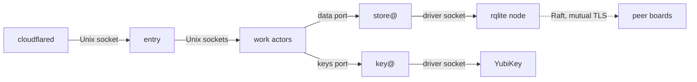

Bare-metal is the runtime where sluis owns its hosts: physical machines (single-board computers, servers), virtual machines (EC2 or any other provider) and local Docker on a workstation. Processes are long-running, the node has a persistent disk, actors and drivers talk over Unix sockets on the node, and systemd, or a container runtime for local Docker, starts everything ([what each runtime provides](/runtimes/#what-each-runtime-provides)).

The node count is an attribute of the installation, not of the runtime: bare-metal runs with one node or with N. The tested installations on bare-metal are [local](/runtimes/#local) and [boards](/runtimes/#boards). Which drivers fit bare-metal is on [Runtimes](/runtimes/#which-drivers-fit-which-runtime). The design is [0003](/decisions/0003-units-transports-and-fusion/); this page shows what it makes of a three-board installation.

## What runs where

- **One systemd unit and one uid per actor and per boundary.** Each [actor](/concepts/families/) instance, `actor@boundary`, is its own OS user and its own instance of a systemd template unit. The same holds for the holders store@, key@ and exporter@ ([0003](/decisions/0003-units-transports-and-fusion/#units)).
- **Drivers are systemd units too,** started by the platform beside their owner's unit. Nothing execs a driver, and an actor's unit may execute nothing but its own binary. Only the owner can open a driver's socket.
- **Templates and a generator.** The packages ship template units only: `sluis-<actor>@.service` and `sluis-<actor>@.socket`, with `User=sluis-<actor>-%i`, `RuntimeDirectory=sluis/<actor>/%i`, `LoadCredentialEncrypted=` per instance and `ListenStream=/run/sluis/<actor>/%i.sock`. A **systemd generator** shipped in the package reads the bootstrap files in `/etc/sluis/bootstrap.d/`, one for each boundary ([Where it lives](/reference/bootstrap-file/#where-it-lives)), and creates the instances and their `sysusers.d` entries, so a second [boundary](/concepts/boundaries/) on the same host is a second set of instances, not a second package.
- **The units are generated from the registries.** The actor registry gives the uid, the sockets, the callers and the egress of each unit, and the kind registry gives the rules ([0002](/decisions/0002-families-of-actors/#registries-generate-the-enforcement)). The packages, split by holder and module ([Packages](/distribution/packages/)), install under `/usr/libexec/sluis/{actors,drivers,node,vendor}/<short-name>`.
- **The node agent** (`sluis-node`) issues each unit a short-lived workload token and asks key@ to sign it. It holds no key credential ([0022](/decisions/0022-workload-identity-and-host-enrolment/)).
- **Adapters run only when the installation uses them.** Fusion of work actors is an explicit installation choice, and a holder is never fused with a work actor ([0003](/decisions/0003-units-transports-and-fusion/#fusion)).

## Sockets and the call graph

A board has no TCP listener of any actor. The call graph is declared once in the actor registry and enforced twice ([0003](/decisions/0003-units-transports-and-fusion/#the-call-graph)):

- **In logic.** The generated client exists only for the callees an actor may call, and one interceptor in every process refuses a caller that is not listed.
- **In the unit.** The callee's Unix socket is owned by the callee's uid, with a group that holds only the uids of its allowed callers (mode `0660`). Each caller's sandbox makes only its allowed sockets visible (`BindPaths=` and `InaccessiblePaths=`, with `RestrictAddressFamilies=AF_UNIX` and `PrivateNetwork=yes`). The callee reads the caller's uid with `SO_PEERCRED`.



- **`entry` listens on a Unix socket only,** at `/run/sluis/entry/<boundary>.sock`, and runs with `PrivateNetwork=yes`, seccomp and Landlock, so it has no network at all. `cloudflared` is the edge connector: it connects outbound only, forwards to that socket, holds no key and reaches no other socket. Each board runs its own, so the board opens no inbound port for sluis.
- **Every other actor and every driver listens on a Unix socket** under `/run/sluis/<actor>/`, one socket per boundary. key@ serves each caller on a socket of its own, in a directory only that caller can open ([0006](/decisions/0006-keys-and-sealing/#exclusive-card-access)). The directory's group is the caller's alone, `sluis-keyc-<ordinal>-<boundary>` (the caller's ordinal in the uid list), and only the caller's unit joins it.
- **The only inbound and inter-node port is rqlite's Raft port,** with mutual TLS, certificates from ritueel's pre-configuration, and a firewall rule that admits it from the declared peers only ([0003](/decisions/0003-units-transports-and-fusion/#calls-between-nodes)). rqlite's client API listens on the loopback address, and store@'s driver is its only client ([0005](/decisions/0005-the-store/#engines)). Witnesses meet through the audit blob, not through a connection between boards.
- **Egress is denied by default** and generated from the registry: nftables per uid. An actor whose registry row lists no outside host, `entry`, `policy` and `signer` among them, also gets `PrivateNetwork=yes`. Adapters reach their providers through the egress rules of their own uids.
- **Hardening per unit:** `ProtectSystem=strict`, `NoNewPrivileges=`, an empty `CapabilityBoundingSet=` and `SystemCallFilter=@system-service`.
- **The deny tests check the result.** They try every pair of actors against both layers, and they check that nothing else binds a TCP address apart from rqlite's client API on the loopback address.

## Deploy and prove on three boards

The hosts and the account are never in the repository: `SLUIS_BOARDS` and the SSH settings come from the environment. The flow is a set of recipes, run as `devbox run -- just <recipe>`:

1. `build-arm64` cross-compiles every executable (Go with cgo off, Rust through zig as static musl) into `dist/arm64/` and checks that each is a statically linked ARM aarch64 ELF. The executables that link a C library (`deploy/boards/native.list`: the card driver, which talks to `pcscd` through `libpcsclite`) are built natively by `build-arm64-native` in an Ubuntu 22.04 userland, with `docker buildx` and QEMU, into `dist/native/arm64/`; `build-arm64` copies them and checks that they are dynamically linked aarch64 ELF files ([0013](/decisions/0013-release-train-packaging-and-distribution/)). CI builds the same on a hosted arm64 runner. `boards-prepare` signs the boards' config with a publisher key made for them and makes the seed (the bootstrap file that pins the key, and the credentials) below `.cache/boards`, which is never committed.
2. `boards-rqlite` installs the engine on a board that does not have it ([rqlite on the boards](#rqlite-on-the-boards)). It comes before the first `boards-deploy`.
3. `boards-deploy` copies the executables with their generated units, users and directories to every board, installs the seed under `/etc/sluis`, verifies, and starts the units in order, then waits up to 60 s until every unit is `active (running)` and has not restarted for about 6 s ([the end of a deploy](#the-end-of-a-deploy)). It also stages `cli/sluis` as `/opt/sluis/bin/cli/sluis`, which `boards-unlock` runs. It is idempotent, and `SLUIS_BOARDS_DRY_RUN=1` stages the plan without touching a board. `SLUIS_BOARDS_PROFILE=m1` deploys the twelve executables of the M1 spine (store, key, policy, signer, writer and entry, the credential, file and rqlite drivers of store@, the key driver of the run and the two writer drivers), which are fourteen units, in place of every executable that was built; it is the same set as `SLUIS_BOARDS_ONLY` would name, and the two are not set together. A card board starts locked: `boards-unlock` gives it the PIN ([The card driver](#the-card-driver)), and the deploy of such a board ends `locked`, not failed ([the end of a deploy](#the-end-of-a-deploy)).
4. `boards-smoke` runs the M1 spine on each board in turn, over SSH, under the uid of each actor, and prints the memory of the board. From the second board on it requires the first boards' `SigningRing` key and `DataKeyWrap` item, which shows the one shared store ([roadmap](/roadmap/#what-runs-today)).
   Its step 3, the audit trail, plays the indexer under the indexer's uid: it asks `policy` for an `audit.index` grant, which the built-in permit gives the indexer alone, and opens the records of the run under it at key@, which checks the grant as for any caller. The `m1` profile deploys no indexer, so the smoke stands in for it, and it has no bypass: the grant is the indexer's own and key@ checks it as for any caller. A grant lives 60 seconds and the log of a board that has run for days holds thousands of records, so the step reads from the newest record in batches of 64, stops when it has the three records of its run, and asks `policy` for a new grant when the one it holds is half its life old or key@ refuses it as run out, as the indexer does ([REQ-AUDIT-184](/requirements/audit/#REQ-AUDIT-184)). Step 3 was fixed in [pull request #1529](https://github.com/truvity/sluis/pull/1529) (the new grant while it reads a long log); it was run on three boards on 2026-11-07, on logs of 68,551 to 122,717 entries: it found `policy.decide`, `signer.sign` and `key.sign` and verified the log on each, and key@ refused no grant with the reason `grant` (the attestation of [REQ-AUDIT-184](/requirements/audit/#REQ-AUDIT-184)).
5. `boards-avc` reads the SELinux denials of a board, and `boards-deploy` and `boards-smoke` run it at their end ([SELinux and the firewall](#selinux-and-the-firewall)).
6. `boards-undeploy` removes what `boards-deploy` added, as the board's manifest lists it. It stops and disables `rqlited`. The engine's package, its drop-in, its data and the state of the units stay unless `SLUIS_PURGE_STATE=1` asks for them to go, and rqlite is removed only on a board where `boards-rqlite` installed it. `boards-status` is read only and shows the units, rqlite's unit, whether its node is a ready voter and whether the rqlite firewall is present and kept.
7. `boards-firewall`, after the PIN release works and before any real PIN goes through the boards, restricts rqlite's Raft port to the boards and one administration host, and its client port to the administration host, one board at a time, with `boards-firewall-confirm` to keep it ([The rqlite firewall](#the-rqlite-firewall)).

**SSH.** Every ssh of the scripts and of the smoke program takes the extra arguments of `SLUIS_BOARD_SSH_OPTIONS`, split at white space, after its defaults (`BatchMode=yes`, `ConnectTimeout=10`, `ServerAliveInterval=5`, `ServerAliveCountMax=3`: a board behind a firewall that drops packets ends a session in about 15 seconds and not at the TCP timeout), and all of its value is read, newlines included. A reinstalled board has a new host key; point a run at a known-hosts file of its own and keep `~/.ssh/known_hosts` out of it:

```sh
export SLUIS_BOARD_SSH_OPTIONS="-o UserKnownHostsFile=$PWD/.cache/boards/known_hosts -o StrictHostKeyChecking=yes"
```

Seed that file with `ssh-keyscan` and compare the fingerprints with the console of the board, or use `-o StrictHostKeyChecking=accept-new` for the first run on a network you trust. `boards-unlock`, which sends the PIN of the card through the session, refuses `StrictHostKeyChecking=no` (also in quotes), `UserKnownHostsFile=/dev/null` and a `-t` in the options, and puts `-o StrictHostKeyChecking=yes` before them, so that neither `~/.ssh/config` nor `accept-new` can make the PIN connection trust a key it has not been shown. The host key of the board must therefore be known before the first unlock: connect once without the PIN (`SLUIS_BOARDS=<board> just boards-status`), with the same known-hosts file, and compare the fingerprint. That step needs the connection, not the exit status: `boards-status` exits 1 on a board that has no rqlite firewall yet (and while rqlite or a unit is down), so follow it with `|| true` or a new command, never `&&`. A path with a space in it is not supported.

#### What a board needs before the first deploy

The deploy installs no package of the card path (see [The card driver](#the-card-driver)); `boards-rqlite` is the only recipe that installs one. The scripts need `tar` on the board to unpack what they send, `nft` for the rqlite firewall, and `jq` on the workstation to read rqlite's answers (it is in devbox; `boards-rqlite` and `boards-status` refuse at once without it). `boards-deploy` refuses a board without `tar`, or without `/usr/sbin/nft`, before it sends anything, naming the fix (`apt-get install tar`, `dnf install tar`; `apt-get install nftables`, `dnf install nftables`). The firewall is the only user of `nft` today, and it used to find a missing `nft` only when it applied the rules, after the rest of the board was ready.

The boards have no `curl` and no `wget` and do have `python3` (MEASURED 2026-11-07, three boards), so a probe that is written for a board uses `python3` or bash's `/dev/tcp`, as the firewall check does.

| Board | Needs, besides `sudo` and key-only SSH |
|---|---|
| Ubuntu 26.04 | `nftables` (`apt-get install nftables`; version 1.1.6 on the boards, MEASURED 2026-11-07). The rest comes with the image of the boards (`tar`, `pcscd`, `libccid` and `polkitd`). `sudo` is the real sudo 1.9.17 at `/usr/bin/sudo`, not sudo-rs (MEASURED on the reinstalled boards), so `sudo -n` with the PIN on standard input behaves as the scripts assume. |
| Rocky 10 | `tar`, which the image of the boards lacks. `nftables` (`dnf install nftables`; version 1.1.5 on the board, MEASURED 2026-11-07). For the AVC check, `audit` (for `ausearch` and `auditctl`, with `auditd` running and enabled before the boot that is checked), and for work on the policy, `policycoreutils-python-utils` (for `semanage` and `audit2why`). The image lacks all three (MEASURED 2026-11-06 on Rocky 10.2). |

On all three boards the `nftables` package left `nftables.service` **disabled and inactive** (MEASURED 2026-11-07). That is as it should be: the firewall unit of `boards-firewall` loads its own table and needs the package for the `nft` command only. Do not enable the service for it; it would load the stock `/etc/nftables.conf`, whose first line is `flush ruleset` ([The rqlite firewall](#the-rqlite-firewall)).

### rqlite on the boards

The store drivers talk to the rqlite node of their own board, and rqlite is not one of the units that `boards-deploy` installs: `boards-rqlite` puts it on a board from rqlite's own release packages, and `rqlited.service` is the unit the drivers wait for (`After=rqlited.service`).

1. **The package is pinned by sha256 in the repository.** `deploy/boards/rqlite.pins` holds the digest of each package of the release in use (v10.6.6: a `.deb` for arm64 and amd64, an `.rpm` for aarch64 and x86_64). Upstream publishes no checksum file and no signature, so the pin is the whole trust. The recipe downloads the package on the workstation, refuses it if its digest differs (a cached file as well as a new download), and only then copies it to the board. The digests were computed by downloading the assets (MEASURED 2026-11-06) and match the digest GitHub shows for each asset. Moving to another release means new pins, set by a pull request that says how they were checked.
2. **The board's package manager installs it.** The recipe asks the board which one it has (`apt-get` with `dpkg`, or `dnf` with `rpm`) and its machine, then runs `apt-get install -y ./rqlite_<version>_<arch>.deb` or `dnf install -y ./rqlite-<version>-1.<arch>.rpm`. The package adds `/usr/bin/rqlited`, `rqlite` and `rqbench`, the system user and group `rqlite`, `/var/lib/rqlite` (mode 0750) and `rqlited.service` with its hardening; it does not enable the service.
3. **A drop-in sets the node, and no node can start a cluster of its own.** `/etc/systemd/system/rqlited.service.d/10-sluis.conf` resets `ExecStart=` and runs `rqlited -http-addr <board address>:4001 -raft-addr <board address>:4002 -bootstrap-expect N -join <Raft address of every board>,... /var/lib/rqlite/data`, where N is the number of boards in `SLUIS_BOARDS`, and the join list names all N boards, the board itself included (Raft addresses, `host:port`, not HTTP addresses). This is the shape rqlite documents for a cluster that comes up together, and it is chosen because the other one is unsafe. In rqlite 10.6.6 a node with no state and no `-join` forms a cluster of one (`cmd/rqlited/main.go`, `createCluster`). If the first node had no `-join`, a board that was wiped, reflashed or purged (`SLUIS_PURGE_STATE=1`) and then run through `boards-rqlite` would form a second cluster at the address of a member of the first, while the other two boards, still a quorum, elected a leader among themselves: two leaders for one membership, divergent logs and lost writes (a `DataKeyWrap` or a `SigningRing`). With `-bootstrap-expect` a node without state first tries to join a node that is in a cluster, and only when N nodes have announced themselves does one of them form the cluster, so a wiped board comes back into the cluster of the others and N fresh boards form one. A node that has state does not bootstrap again: on a restart it takes up its place in the cluster it was in (the earlier text of this page, that such a node ignores `-join`, was wrong: the join is attempted again, and an existing member is told it is one). A cluster of one board has neither flag. The script refuses a drop-in whose join list is not exactly the N boards with this one in it. There is no `-node-id`: rqlite then takes the Raft address as the node id, which is different on every board and does not move with a host name (a host name that is `localhost`, unset, or the same on two boards of one image would have made two nodes one, or one node two). To add a fourth board, run `boards-rqlite` with all four in `SLUIS_BOARDS`: every drop-in is written again and the running nodes restart onto it; the new board, having no state, joins the cluster that exists. The addresses are IPv4 addresses without leading zeros, which the board must own (`ip -o -4 addr`), because rqlite binds and advertises them and its peers dial them; the HTTP and the Raft port must differ (the flags are those of rqlited 10.6.6, read from `rqlited -h`). `SLUIS_RQLITE_BOOTSTRAP` is gone: no board is special.
4. **Labels first.** Where SELinux is on, `restorecon` runs over the package's files and the drop-in before the service starts, because an rqlite started in a directory with the wrong label can fail to execute or run in the wrong domain.
5. **It starts every node, then waits.** The nodes of a cluster of more than one wait for each other (for about two minutes, after which systemd starts a node again), so the recipe installs and starts all of them first, and only then polls `/status` and `/nodes` of each node (read on the board, which has no `curl`) until the store is ready and knows a leader and the node is a reachable voter of a cluster with one leader. The wait is a deadline of 120 seconds on the clock for each node. At the end it asks every node how many nodes `/nodes` holds and fails unless it is the number of boards: a node that sees fewer is in a cluster of its own. A node that is not a reachable voter is most often behind the firewall of the image, and the message says which ports (4001 and 4002) to open with `firewall-cmd` or `ufw`. The package manager and the board check the package against the pin once more (`sha256sum -c` on the board) before the install runs as root.

```sh
SLUIS_BOARDS="192.0.2.13 192.0.2.12 192.0.2.11" devbox run -- just boards-rqlite
```

`SLUIS_RQLITE_PORT_HTTP` and `SLUIS_RQLITE_PORT_RAFT` change the ports (4001 and 4002), and `SLUIS_BOARDS_DRY_RUN=1` prints the plan, with the pin of each package, without a download or an ssh. The recipe is idempotent: a second run installs nothing, writes the same drop-in and does not restart a running node. A package upgrade stops and disables the unit (the upstream package does it on every removal of the old version); the recipe enables and starts it again on the new binary, so the same recipe is the upgrade. A board that an earlier version of this recipe set up (its drop-in has `-node-id`) is refused: its Raft state does not fit the new flags, so run `boards-undeploy` with `SLUIS_PURGE_STATE=1` on every board and then `boards-rqlite`.

`boards-undeploy` touches rqlite only on a board where the drop-in is there, that is, where `boards-rqlite` installed it: another `rqlited.service` is left running. There it stops and disables `rqlited` and keeps the package, the data and the drop-in; with `SLUIS_PURGE_STATE=1` it removes the package, the data, the user and group and, last, the drop-in (so that a purge that stopped half way is found and finished by the next run), and it does not remove the node from the cluster's configuration on the others. `boards-status` shows the unit, the drop-in and the node's readiness.

**There is no TLS and no authentication on rqlite in this test installation.** The client port (4001) and the Raft port (4002) listen on the board's address, so anyone who can reach them can read and write the store, and burn the release requests of the PIN path. That is acceptable for a test with the factory PIN on a network the operator controls, and not for anything else. **Before any real PIN or key goes through these boards, a firewall rule must admit the Raft port from the other boards only, and the client port from nobody else than the board itself and one administration host** (`boards-firewall` writes it: [The rqlite firewall](#the-rqlite-firewall); the rest of the firewall is the image's: [SELinux and the firewall](#selinux-and-the-firewall)). That rule narrows who can reach the ports and nothing more: rqlite still has no TLS and no authentication, and the target design above, mutual TLS on the Raft port and the client API on the loopback address, replaces this.

### The rqlite firewall

**Verdict.** `boards-firewall` admits TCP 4002 (Raft) on a board from the loopback interface, from the boards of the installation (itself included) and from one administration host, and TCP 4001 (the client API) from the loopback interface and the administration host alone. It drops both ports from every other source. It touches no other port, no other table, no firewalld zone and no ufw rule. It does not add TLS or authentication: it narrows who can reach rqlite and does not make rqlite safe ([the paragraph above](#rqlite-on-the-boards)). Anyone who can use an admitted address, or forge one on the board's network segment, still reads and writes the store.

State: **applied on three boards, with the evidence below** (2026-11-07: two Ubuntu 26.04.1 boards and one Rocky 10.2 board with SELinux enforcing; [REQ-DEPLOY-046](/requirements/deploy/#REQ-DEPLOY-046)). Before that the recipes and their tests were built (MEASURED 2026-11-07 on a workstation: the generated rules pass `nft -c`, and real packets in a network namespace are admitted and dropped as the table says, nft 1.1.6 on kernel 7.0; the board scripts against fakes; a real three-node rqlite in namespaces, below).

**What the boards are, and what that makes of some sentences below.** rqlite listens on the board's address, not on the loopback address (the deploy gives the store drivers `http://<board address>:4001`), and a connection from the board to its own address arrives on the loopback interface, which is why the table admits that interface. On the boards **firewalld is not installed on the Rocky board, and ufw is inactive on the Ubuntu boards** (MEASURED 2026-11-07). So the sentences below about firewalld's and ufw's tables, zones and chains describe an image that the boards do not have: they are READ from the sources of firewalld and ufw, or from a workstation, and are marked "(image not on the boards)". They matter to an installation whose image enables either, and nothing on the boards confirms or refutes them.

| Source of a packet | To 4002 (Raft) | To 4001 (client API) |
|---|---|---|
| the loopback interface (the store drivers, the board's own probes) | admitted | admitted |
| another board in `SLUIS_BOARDS` | admitted | dropped |
| `SLUIS_FIREWALL_ADMIN_HOST`, if set | admitted | admitted |
| anyone else, IPv4 or IPv6 | dropped | dropped |

A drop is a timeout for the sender; at most six a minute are logged as `sluis-rqlite-drop`. Any other port is not looked at.

**The administration host is a setting, and empty means no access.** `SLUIS_FIREWALL_ADMIN_HOST` is the address that the boards see the machine that runs the recipes at. Left empty or unset, that machine is a stranger to the rules and reaches neither port; every plan, apply and check says so. The recipes reach the boards over ssh (port 22, which the rules never touch) and read rqlite on the board itself, so they need no access to 4001 or 4002 from the administration host; the setting is for an operator who wants to reach rqlite directly. Two cautions: an address that is the NAT or masquerade address of a network admits everyone behind it, so name the address of the one machine; and the rules are IPv4 only (the recipes and `rqlite.sh` take IPv4 addresses), so a peer or an administration host that reaches the board over IPv6 is dropped like a stranger.

`SLUIS_BOARDS` holds the peers, so it names all the boards on every run, and `SLUIS_FIREWALL_BOARDS` names the one board to change. `apply`, `confirm` and `reboot-check` refuse to run unless it names exactly one board, so a wrong assumption costs one board and not the quorum. `SLUIS_BOARDS` must list at least three boards; an installation that really has fewer says so with `SLUIS_FIREWALL_CLUSTER_SIZE=<n>`, equal to the number of boards listed (the local installation is one node and does not use these recipes).

#### What was measured on three boards

MEASURED 2026-11-07, one rollout, `main` at 00b65c674 with the recipes of 0b08100de: two boards on Ubuntu 26.04.1 and one on Rocky 10.2 with SELinux enforcing. The rules were applied, confirmed and kept on each, with the dead-man timer, one board at a time.

- **A stranger is dropped.** A host that is not admitted timed out on both ports on all three boards, and the table's drop counter rose while it tried (from 10 to 20 on each board), so it was this table that dropped it.
- **The peers and the administration host.** The other boards reach the Raft port (4002) and time out on the client port (4001), and the administration host reaches both ports, on each board. The cluster stayed whole.
- **Boot order.** `boards-firewall-reboot-check` on two boards: the rules were active at 17.9 s after boot and rqlite began to start at 29.3 s on one, and 15.3 s and 31.5 s on the other. The third board was not rebooted, because a warm reboot there is not allowed, so its boot order is not proven by a reboot.
- **SELinux.** On the Rocky board with SELinux enforcing there was no AVC, and the unit loaded under systemd (the confirm starts it that way).
- **Not proven.** `nftables.service` running and then restarted. The package left it disabled, and a `try-restart` of a disabled unit did nothing, and our table stayed. The `PartOf=` chain from `nftables.service` to the firewall unit therefore has its stand-in test only, not a restart of the real service on a board.

#### Why a table of its own, and why it cannot undo or be undone

| Option | Decision |
|---|---|
| A table of its own, `inet sluis_rqlite`, loaded with `nft` on both systems | Chosen. One mechanism for Ubuntu 26.04 and Rocky 10.2, nothing of the image's state is read or written, and removing it is deleting the table |
| firewalld on Rocky (a rich rule or a zone) and ufw on Ubuntu | Not chosen. Two mechanisms with two syntaxes and two kinds of state to merge with the image's, ufw may be off, and a `--permanent` change is a change to the image |
| Rules in `/etc/nftables.conf` or `nftables.service` | Not chosen. The stock file begins with `flush ruleset` and the service conflicts with firewalld on Rocky; it would replace the image's rules |
| A default deny on the input chain | Not chosen. It would need every port the board uses to be listed (ssh, DNS, NTP, the deploy's own paths) and any one missed is a board that cannot be reached |

An nftables base chain sees every packet of its hook, in order of priority. `drop` is final. `accept` ends only the chain it is in, and the packet goes on to the next base chain of the hook (firewalld says it in its own source: even when iptables accepts a packet it may be dropped later by firewalld's rules; READ 2026-11-07, `src/firewall/core/nftables.py`). So the table's `accept` rules open nothing that firewalld or ufw closes (an image the boards do not have: both sentences here are about it), and no `accept` in their tables can undo its `drop`. MEASURED 2026-11-07 in a network namespace: an `accept` of the two ports at an earlier priority in another table does not open them to a stranger, and a `policy drop` at a later priority in another table still closes them to a peer.

- **The chain has the policy accept and these rules:** `iifname "lo" accept`; an accept of the Raft port from `@raft` and of the client port from `@http`; and a rate-limited log and a counted `drop` of the two ports. Nothing else is in it, so SSH, DNS, NTP (`chronyd`), the deploy and every outbound connection never meet a rule of ours. A reply to a connection that this board opened has the port in its source port, not its destination port, so it is not matched either.
- **It opens nothing.** A board whose image already blocks 4001 and 4002 (image not on the boards: firewalld is not installed on the Rocky board; the `public` zone of firewalld admits `ssh`, `dhcpv6-client` and `cockpit` only) still blocks them, and the cluster does not form until the image admits the peers on 4002, as the hint of `boards-rqlite` says; the confirm then fails on the first proof. What the table changes is only who may reach the ports where the image lets everyone.
- **Priority is -10,** before firewalld's input chain (image not on the boards: firewalld is not installed, ufw is inactive; this is about an image that enables them) (priority 0 + 10, READ in the same file) and ufw's iptables chains (priority 0, UNVERIFIED which backend Ubuntu 26.04 uses), so a stranger's packet is dropped before the image's firewall sees it. The order does not change who is admitted. firewalld deletes and rebuilds only its own tables (`firewalld` and `firewalld_policy_drop`) and never flushes the ruleset, so a `firewall-cmd --reload` leaves the table alone.
- **`nftables.service` can flush it, so the unit follows it.** The unit of the nftables package on Ubuntu has `ExecStop=nft flush ruleset` and its configuration file begins with `flush ruleset` (READ 2026-11-07 on Ubuntu 26.04.1), so a restart of it, or a `try-restart` by the package's upgrade, removes every table, ours included, and the ports would stay open with nothing to say so. The firewall unit therefore has `PartOf=nftables.service` and `ReloadPropagatedFrom=nftables.service`, and is ordered after it. MEASURED 2026-11-07 with stand-in units under systemd 259 (Ubuntu 26.04): a restart or a `try-restart` of the parent stops the child, stops and starts the parent, then starts the child; a reload of the parent reloads the child after it; a `try-restart` of a parent that is not running leaves the child alone; `systemd-analyze verify` finds no ordering cycle with the real `nftables.service`. On Rocky 10 `nftables.service` is off as well (MEASURED 2026-11-07: the package left it disabled and inactive on all three boards, Rocky included), and its stop does not flush the whole ruleset (UNVERIFIED). The restart of the real service on a board was not tried (see above). A stop of `nftables.service` stops the firewall unit too, which removes our table; that is a person turning the firewall off.
- **The file replaces the table in one transaction.** It begins with `table`, `delete table`, then the table, so a reload has no moment without the table, and a file that nft refuses changes nothing.
- **The whole table is the thing that is kept, not its address list.** When the rules are confirmed the board saves the table as nft lists it (counters and white space taken out). `boards-status`, and the "unchanged" shortcut of the next apply, compare the loaded table with that copy and check that the hook, the loopback accept and the drop are in it. A deleted drop rule, a flushed chain, another priority or hook, or another address in a set makes the board `BROKEN` and the next apply load the rules again. (MEASURED 2026-11-07 with real nft: each of those changes makes the listing differ, and a reload does not.)

#### Does a board need 4001 from its peers? No: measured

ADR 0003 says the only inter-node port on the boards is Raft's, and the first version of this recipe admitted 4001 from the peers too. MEASURED 2026-11-07 (rqlite v10.6.6, linux/amd64, the release archive whose digest `Justfile` pins; Ubuntu 26.04.1, kernel 7.0, nft 1.1.6): three nodes, each in a network namespace of its own on a bridge, started with the flags of the boards (`-bootstrap-expect 3 -join` the three Raft addresses), with a table in each namespace that admits 4001 from the bridge host (standing for the administration host) and the loopback interface only, and 4002 from the three nodes and the bridge host.

- The peer-to-peer connect to 4001 timed out and to 4002 succeeded, as the table says. The cluster formed in about 2 s: three voters, one leader, `reachable: true` for each in `/nodes`.
- Through a follower's API, all of these returned HTTP 200 and the right rows: `/db/execute`, `/db/execute?queue`, `/db/request`, and `/db/query` at level `none`, `weak`, `strong` and `linearizable`. A follower forwards to the leader over the Raft port; it does not redirect to the leader's API address.
- With the leader stopped, a write through a surviving follower succeeded within 6 s, and the stopped node, started again, rejoined with three voters and served a read. The same run with nothing blocked gave the same answers.
- Not measured: the arm64 boards, a follower under load, and the paths for backup and restore.

So the boards admit 4001 from the loopback interface and the administration host only, and the confirm checks that another board's connect to 4001 times out.

#### How a board is not cut off

1. **The rules name no port but the two.** There is no default deny, so a mistake in the list of addresses can only close 4001 and 4002 (the cluster), never ssh. A configured rqlite port of 22, or of the port of ssh that the options of the run or the session use, is refused.
2. **Before it loads anything, the apply refuses** when the board has no `nft` (the message names the package), when the board does not own its address, when the rules would not admit the board's own address, when `nft -c` refuses the file, and when the board would send to a peer from an address that the rules do not admit (`ip route get`, because the peer would drop what such a board sends to its Raft port). It refuses on the workstation, before it sends the rules, when the board's own rqlite does not answer `/nodes`, or lists a node that the rules would drop: a run with fewer boards in `SLUIS_BOARDS` than the cluster has, or a board that joined after the list was written.
3. **Nothing is kept until it is proven.** The apply arms a dead-man timer first, checks that the timer really exists, and loads the rules second; the file that the unit loads at boot is written only at the confirm. If ssh is lost, the timer takes the rules back after `SLUIS_FIREWALL_CONFIRM_SECONDS` (300 by default, 60 to 3600) with no one's help; if the board reboots first, the rules are gone, because the unit is not enabled yet. The timer goes back to the last confirmed rules, or to none; if the confirmed file will not load, to none.
4. **The confirm proves before it keeps.** It checks that ssh works, that the board's rqlite is a ready voter and `/nodes` holds as many voters as there are boards, all reachable, with one leader, that each of the other boards reaches the Raft port of the board and times out on its client port, and that this workstation reaches both ports if an administration host is set. A single failure keeps nothing and leaves the timer running. It then tries the unit (start or reload, which is the path of a boot), checks that the table the unit loaded is the table that was applied, and only then enables the unit, saves the listing and stops the timer. If the unit cannot load it, or `systemctl enable` fails, the files are put back as they were and the timer stays armed.
5. **One board at a time,** enforced: see above.

#### Apply, confirm, remove, and the order of the first rollout

```sh
export SLUIS_BOARDS="192.0.2.11 192.0.2.12 192.0.2.13"   # all the boards, always
export SLUIS_FIREWALL_ADMIN_HOST=                          # empty at first: see the order below
SLUIS_BOARDS_DRY_RUN=1 devbox run -- just boards-firewall  # the exact rules, the unit and the commands; no ssh
SLUIS_FIREWALL_BOARDS=192.0.2.11 devbox run -- just boards-firewall
SLUIS_FIREWALL_BOARDS=192.0.2.11 devbox run -- just boards-firewall-confirm   # within the dead-man time
SLUIS_FIREWALL_BOARDS=192.0.2.11 devbox run -- just boards-firewall-remove    # to take it back at once
```

The recipes are idempotent. An apply of the rules that a board already keeps changes nothing, a confirm of kept rules says so, and a remove on a board without them succeeds. A changed apply over kept rules (a fourth board, a new administration host) is loaded as unconfirmed and, if nobody confirms it, the timer puts the kept rules back.

The order of the first rollout is the order of the proof. Start with a board whose serial console you can reach, such as one whose console is wired to another board, so the way back in is at hand ([Getting back in](#getting-back-in)); then the others, one at a time.

1. **Empty administration host first.** On the first board: `boards-firewall`, `boards-firewall-confirm`, `boards-firewall-check`. This workstation is a stranger to the rules, so the check proves the "closed" half with the machine you are on: both ports time out, and the table's drop counter rose while it tried. This is the one moment at which `boards-firewall-check` can prove it without a third host.
2. **Then the administration host.** Set `SLUIS_FIREWALL_ADMIN_HOST` and apply to the same board again (a changed apply over kept rules), then confirm, which now requires this workstation to reach both ports. From here on this workstation is admitted, so it can no longer be the stranger: `boards-firewall-check` needs `SLUIS_FIREWALL_OUTSIDE_HOST`, a host that is neither a board nor the administration host, and without one it fails with "not proven". It does not pass on the strength of step 1, and it is not asked to.
3. **The next board,** the same two steps, with the check of step 1 on it before the administration host is set.
4. **The reboot check on one board at the end,** or on each if you want the boot proven on both operating systems. With the administration host set and no outside host, `boards-firewall-reboot-check` does not need to clear the administration host: it proves the boot (the rules active before `rqlited` started, the whole table back, the drop rule and its counter present, the cluster whole), prints "NOT RUN" for the stranger half and ends "ok, but the stranger half was NOT run". It does not fail for the missing stranger, because the stranger half is `boards-firewall-check`'s, and was proven in step 1. A table that has lost its drop rule still fails it. With an outside host, or an empty administration host, it runs the stranger half too.

On the first rollout the reboot check refused to run with the administration host set and no third host, so the administration host had to be cleared for it and set again afterwards; that is no longer needed. A board whose warm reboot is not allowed is checked by `boards-firewall-check` alone.

`boards-status` compares the table with `SLUIS_BOARDS` and `SLUIS_FIREWALL_ADMIN_HOST`: between step 1 and step 2 run it with the setting that matches the rules on the board, or it fails by design.

#### After a reboot, and when the rules do not load

`sluis-rqlite-firewall.service` is a oneshot unit with `DefaultDependencies=no`, `Before=network-pre.target rqlited.service` and `After=` the units of nftables, firewalld and ufw, so that the rules are in place before the board's network comes up and before rqlite starts, and none of the others can flush them. `rqlited.service` is not changed and does not require the unit.

**If the rules fail to load at boot, the board fails open, loudly.** The unit fails with one line in the journal, `sluis-rqlite-firewall: FAILED to load <file>: the rqlite ports 4001 and 4002 are NOT restricted on this board (rqlited starts anyway)`, and `rqlited` starts. `boards-status` shows the board as broken or absent and fails. The reasons, against the sentence of [0003](/decisions/0003-units-transports-and-fusion/#calls-between-nodes), "a firewall rule that admits it from the declared peers only":

| | Fail open (chosen) | Fail closed |
|---|---|---|
| A missing or refused ruleset | The ports are exposed as they were before this change, and the log says so | rqlite does not start, the board's store drivers wait, and the whole installation depends on a file in `/etc` |
| A wrong list of peers | Cannot happen at boot: the file was proven by the confirm | The cluster loses a member, and nothing says why |
| What 0003 asks | Met whenever the rules load; when they do not, the rule is absent and visible | Met always, at the cost of a board that is down |

This is a stance for the test installation, recorded as an amendment to 0003 ([Fail open at boot](/decisions/0003-units-transports-and-fusion/#the-boot-failure-of-the-peer-only-firewall)) and **accepted by the owner on 2026-11-07** for the test installation. It is to be revisited before any real PIN or key goes through these boards. Fail closed is `Requires=` on this unit from a drop-in of `rqlited.service`, and a ruleset that is checked at every deploy.

**SELinux on Rocky 10 (MEASURED 2026-11-07 on one board, enforcing: no AVC, and the unit loaded under systemd; the rest of this paragraph is READ).** `nft` carries its own type in the policy of RHEL (`iptables_exec_t`), and a unit that runs it may be confined differently from the ssh session that applied the rules, so an apply that worked over ssh proves nothing about the boot. The confirm therefore starts the unit under systemd before it enables it. To check by hand: `sudo systemctl restart sluis-rqlite-firewall.service`, then `journalctl -u sluis-rqlite-firewall.service -b`, then `just boards-avc` (it reads `ausearch -m AVC,USER_AVC -ts boot`; install `audit` first, see [what a board needs](#what-a-board-needs-before-the-first-deploy)); a denial of `nft` or of `/etc/sluis/rqlite-firewall.nft` shows there. The ruleset sits in `/etc/sluis`, where the default label is `etc_t` (UNVERIFIED), and the apply and the confirm run `restorecon` over the files they write. The dead-man timer runs `nft` through `systemd-run`, which is a third path: read its journal (`journalctl -u sluis-rqlite-firewall-revert`) if a timer ever fails to take a change back.

#### The board check, and the reboot

- `boards-status` prints, per board, `rqlite firewall present and kept`, or fails for `ABSENT`, `UNCONFIRMED` (loaded, a dead-man timer armed) and `BROKEN` (the table, the kept rules and the unit disagree: a flush, a deleted rule, a changed hook, a stopped unit). It also fails if the addresses in the sets differ from `SLUIS_BOARDS` and `SLUIS_FIREWALL_ADMIN_HOST`. A pending file that a reboot or the timer left behind is not a state: the status notes it and shows what the board runs. **Its exit status is now 1 on a board without the rules.** Do not chain a command to `boards-status` with `&&` where only the connection matters, such as the first-contact host-key step above: the connection is what learns the host key, whatever the exit status.
- While a change waits for its confirm, `boards-status` shows in how many seconds the timer takes it back.
- `boards-firewall-check` is the board check of [REQ-DEPLOY-046](/requirements/deploy/#REQ-DEPLOY-046), read only: the rules are kept; the cluster is whole; each other board reaches the Raft port and times out on the client port, and the administration host reaches both; and a host that is not admitted does not (its connection times out; a refusal fails the check, because a refusal is not this table). A timeout alone cannot tell this table from another firewall that drops the port anyway, such as the `public` zone of firewalld, so the check also reads the table's drop counter before and after the stranger tries, and fails unless it rose. The host that is not admitted is `SLUIS_FIREWALL_OUTSIDE_HOST` (reached over ssh with the same user), or this workstation when `SLUIS_FIREWALL_ADMIN_HOST` is empty. With an administration host set and neither of the others, there is no stranger: the check says it is not proven and fails.
- `boards-firewall-reboot-check` (one board, `SLUIS_FIREWALL_BOARDS`) reboots it with `systemctl reboot`, waits for a new boot, and checks that the rules are back, that the unit was active before `rqlited` began to start (monotonic timestamps), that the cluster is whole, and then runs the check. When there is no stranger (the administration host is set and there is no outside host), it checks the whole table and that the drop rule and its counter are there, reports the stranger half as "NOT RUN", and does not fail for it; `boards-firewall-check` still does. A card board comes back locked: `boards-unlock` it after.

The requirement is `done`: both were run on the three boards ([what was measured](#what-was-measured-on-three-boards)) and the attestation is written. The stance of the unit at boot, fail open, was accepted by the owner on 2026-11-07.

#### Getting back in

The rules never touch port 22, so ssh should survive any mistake in them. If a board cannot be reached anyway, or the cluster is down and the rules are the suspect:

1. Wait for the dead-man time. An unconfirmed apply takes itself back.
2. Otherwise log in on the board's serial console (the UART of the board's debug header through a USB serial adapter, at the speed the image sets; or the board's console in the BMC, if the installation has one) as the SSH user, or as root.
3. Run `sudo nft delete table inet sluis_rqlite`. That ends the restriction at once and changes nothing else. To keep it off across a reboot: `sudo systemctl disable --now sluis-rqlite-firewall.service`, and `sudo systemctl stop sluis-rqlite-firewall-revert.timer` if a change is waiting.
4. If the unit itself keeps a board from booting, which nothing in it should do, add `systemd.mask=sluis-rqlite-firewall.service` to the kernel command line from the boot loader on the serial console. The unit orders nothing that the console login needs.
5. Back on a workstation, `just boards-firewall-remove` removes the unit, the files and the timer, and `just boards-status` shows the board as ABSENT.

The rules are not a way to be locked out of a board that is otherwise up: they are two ports on a table you delete with one command.

### Credentials are encrypted on the board

The units read their credentials with `LoadCredentialEncrypted=` (systemd 250 and later; the floor is 252). The seed carries each credential as a plain file in the stage, and `remote.sh` encrypts it on the board with `systemd-creds encrypt --with-key=host --name=<credential>` into `/etc/sluis/credentials/<boundary>/<owner>/`, mode 0400, by a rename, and the stage, with the plain files, is then removed. The key is the board's own host key, `/var/lib/systemd/credential.secret`, which `systemd-creds` makes on first use; there is no TPM dependency. That key sits on the same disk as the credentials, so the encryption protects a copy of `/etc` or of `/var/lib` taken alone (a backup, a snapshot, a file read through a bug) and not a stolen board.

systemd hands the unit's credentials directory (`$CREDENTIALS_DIRECTORY`, `/run/credentials/<unit>/`) to the service user itself only where the filesystem has no ACL support. Where it has (Ubuntu 26.04, systemd 259), the directory stays `root:root` `0550` and the files `root:root` `0440`, and a POSIX ACL grants the service user the read (MEASURED 2026-11-06, `dr-xr-x---+` and `-r--r-----+`). The credential driver accepts a directory and files owned by its own uid or by root, root only for the directory that `$CREDENTIALS_DIRECTORY` names once canonicalised, and refuses one that group or others can write, one open to others, and a group read unless the file carries an access ACL that the driver reads from the open file and finds to be what systemd makes: version 2, named-user entries for the service's own uid only, and no named-group entry that grants read. With an ACL the group bits are the ACL mask ([acl(5)](https://man7.org/linux/man-pages/man5/acl.5.html)), which caps the owning group and every named entry, so a clear group-write bit means that no entry can write; only the owner and root can set an ACL, and root is trusted on the host already ([REQ-DATA-112](/requirements/data/#REQ-DATA-112)).

A reflash makes a new host key, and a credential encrypted under the old key no longer opens. So the deploy encrypts every credential again on every run, never keeps the earlier file, and a board that was reflashed needs nothing but the next `boards-deploy`. A board whose systemd is older than 252, or that has no `systemd-creds`, is refused before any credential is written, with the version and the floor named.

### The card driver

A board runs the card driver (`drivers/key/yubikey-piv`) in place of the software key driver when `boards-deploy` and `boards-smoke` run with `SLUIS_BOARDS_KEY_DRIVER=yubikey-piv`. The two serve the same socket, so a board runs one of them, and a deploy with `software` switches back.

- **The unit** `sluis-drv-key-yubikey-piv@.service` requires `pcscd.socket`, runs as its own uid under the hardening of every driver unit, and has a `RuntimeDirectory` of its own for the admin socket that takes the PIN. The key@ unit of this variant requires the card driver in place of the software one and joins its group; it is a whole unit and not a drop-in, because a dependency cannot be removed in a drop-in on any systemd version (systemd.unit(5): "if you want to remove dependencies, you have to override the entire unit").
- **The card service is closed to everyone else, by two locks.** A drop-in for `pcscd.socket` makes its socket mode `0660` for a group, `sluis-pcsc-<boundary>`, that only the card driver joins, so only that uid (and root) reaches the card ([0006](/decisions/0006-keys-and-sealing/#exclusive-card-access)). Where pcscd runs as a user of its own (Ubuntu 26.04) its unit has `RuntimeDirectory=pcscd`, and systemd hands `/run/pcscd` and what is in it, the socket included, to that user when it starts the service and the directory is not already that user's (MEASURED 2026-11-04: after the first start the socket was `pcscd:pcscd` and the card driver was refused). So the deploy adds a tmpfiles entry, `d /run/pcscd 0755 <user> <group> -`, made from the `User=` of `pcscd.service`: the directory is the user's before the socket binds, at every boot and now, systemd leaves the socket alone, and its group stays the one the socket drop-in gave it. Nothing runs as root when pcscd starts (a first design repaired the group with a privileged `ExecStartPre`, which would have followed a link that a compromised pcscd planted in its own directory). A pcscd that runs as root gets no entry. It is not the driver's own group: key@ joins that one to reach the key-store socket, and with it key@ could talk to the card while the driver restarts, when the card keeps its login. A generator test checks that no other unit gets the card service's group. The second lock is polkit, where pcscd is built with it, and it differs by distribution:

  | | pcscd | polkit | What admits the card driver |
  |---|---|---|---|
  | Ubuntu 22.04 (the former boards; not supported) | 1.9.5, runs as root, built without polkit | 0.105, reads `.pkla` files only | the socket group alone; the stock socket is `0666` |
  | Ubuntu 26.04 | 2.4.1, runs as the user `pcscd`, `Requires=polkit.service` | polkitd 127, JavaScript `.rules` | the polkit rule, then the socket group |
  | Rocky 10 | 2.2.3, runs as root, no sandbox in its unit | polkit 125, JavaScript `.rules` | the polkit rule, then the socket group |

  A pcscd with polkit asks polkit about every client, and the policy (`org.debian.pcsc-lite.policy`: `access_pcsc` and `access_card` are `allow_active=yes` and `no` for everything else) refuses a system service, which has no active session. So on Ubuntu 26.04 and Rocky 10 the rule is not a second lock but what lets the card driver in: it admits root and the card driver's user and refuses every other user. The deploy installs it where the policy file exists (measured on the Ubuntu 22.04 boards, where it does not; read from the packages of 26.04 and Rocky 10 in the research of 2026-11-04). The CI jobs of the operating systems check both locks against a real pcscd (see "Supported operating systems"); a pcscd that runs as a non-root user and takes its socket from the drop-in's `SocketUser=root` is tested there on 26.04 (MEASURED 2026-11-04), and is not tested on a board or a card.
- **The driver is bound to the board's card.** Its unit passes `--serial` from `/etc/sluis/yubikey-piv-<boundary>.env`, which the deploy writes from `SLUIS_BOARD_CARD_SERIALS` (`board=serial` pairs, required for every board of the run; no serial is in the repository). A unit without the file does not start, and a card with another serial is not adopted.
- **The driver verifies a PIN release itself.** Its unit passes the boundary's bootstrap file (`--bootstrap /etc/sluis/bootstrap.d/<boundary>.yaml`, the file whose publisher keys key@ pins) and a state directory of its own (`--state-dir`, a `StateDirectory` of the unit, mode `0700`). The driver reads only the publisher keys of the file.
- **The deploy installs no package.** The board image carries the card service, its CCID driver and, where pcscd asks polkit, polkit; `remote.sh` checks them (`dpkg -s` on Debian and Ubuntu, `rpm -q` on RHEL and Rocky) and refuses, naming the packages of the board's family, before it writes a file (`pcscd` and `libccid`; `pcsc-lite` and `pcsc-lite-ccid`; `polkitd` or `polkit`). `boards-undeploy` takes the unit, the drop-in and the rule away and leaves the packages.
- **The board starts locked.** The driver has no PIN until `sluis node unlock NODE` delivers it on the admin socket, as root on the board ([the command](/reference/cli/#sluis-node-unlock)). `SLUIS_BOARDS=<board> just boards-unlock` does it from the workstation for one board, and then asks the driver again (`sluis node status`), prints `board <board>: unlocked`, names any unit that systemd gave up on, and waits for every unit again as the deploy does (`remote.sh settle`, up to 90 s, because a unit that waited comes up at its next restart): it fails if one still restarts, which systemd never calls `failed`. `just boards-status` prints one line for each board from the driver, `board <board>: locked` or `board <board>: unlocked`, and never reads a journal for it. It reads the PIN from standard input (a terminal is asked without echo; a script pipes the PIN in from where it is kept) and sends it to `sudo /opt/sluis/bin/cli/sluis node unlock <host> --boundary dev` on the board through the standard input of the ssh session. The PIN is never an argument of a command, an environment variable or a line of output. To keep it so: tracing is turned off before the PIN is read (`bash -x`, `SHELLOPTS=xtrace` and `BASH_XTRACEFD` would otherwise print the command that carries it); `set +a` keeps `SHELLOPTS=allexport` from exporting the variable the PIN is read into; the ssh that carries it has `-T` and `-o StrictHostKeyChecking=yes` before the options of the run (ssh keeps the first value it sees), so that no terminal is allocated (a terminal on the other end would echo the piped PIN back into this terminal and its scrollback) and no setting of `~/.ssh/config` weakens the host-key check; and `SLUIS_BOARD_SSH_OPTIONS` with `-t`, `StrictHostKeyChecking=no` or `UserKnownHostsFile=/dev/null` refuses the command, `accept-new` warns that it is ignored. `deploy/boards/boards-test.sh` checks, with a fake ssh, that the standard input of the ssh holds the PIN and a newline and nothing else, that the PIN is in no argument and no environment of any ssh and not in the output, and runs the terminal branch on a pty, plain, under `bash -x`, with `SHELLOPTS=xtrace` and with `BASH_XTRACEFD`. It does not run the real sudo, sshd and CLI: the first unlock of a board is done with the factory PIN of the card.

#### The card session and a restarted driver

A YubiKey stays PIN-verified for as long as it is powered and its session is not reset, whichever process verified it. A driver that ends does not log the card out by itself, so a driver that is started again meets a card that its predecessor left logged in. That state is wrong in two ways. The driver says locked while the card is open to anything that reaches pcscd on the board. And the card answers the empty `VERIFY` that reads the PIN counter with success, not with the counter, so the unlock was refused: `sluis node unlock` printed `refused: card` and the journal said `the PIN counter cannot be read` with `expected error code from empty pin` (reported from the boards, 2026-11-07, and not measured by this change: `systemctl restart sluis-drv-key-yubikey-piv@dev.service` without a restart of pcscd). A deploy did not meet it, because it restarts pcscd, which resets the card.

- **The driver resets the session at its start.** Before it reads anything from the card, the driver resets the card session with `SCardConnect` (exclusive) and `SCardDisconnect` with `SCARD_RESET_CARD`, a warm reset at the PC/SC layer, and reads the PIN counter to prove that the card is logged out. A card that is still verified, or cannot be reset, stops the start with `card.session: still_verified`, `reset_failed` or `held_elsewhere`, and systemd tries again. It does so on the way out too, when it exits cleanly (a stop or a signal it handles). A crash or a kill does not reach that code, which is why the reset at the start is the one that counts.
- **The reset is not the applet's reset.** The warm reset powers the card on again and selects the applet again, which ends the session's security state, the PIN verification. The keys, the PIN, the PUK, the management key and the retry counters are persistent data of the applet and are not touched by it, and no PIN is sent, so no attempt is burned. The driver never calls piv-go's `Reset`, which blocks the PIN and the PUK and wipes every key. The tests run the reset on a fake card only; the real card is checked on a board (below).
- **An unlock or a peer's release meets a verified card.** If the counter reads as already verified while the driver holds no PIN, the unlock and the release reset the session and read the counter again, and send the PIN only if that read succeeds. If it still cannot be read, or the reset fails, the answer is `refused: card`, the journal says why (`still PIN-verified after a reset`, or `another process holds the card`), and no PIN is sent. `sluis node status` does the same reset for a card that is verified while the driver says locked.
- **Another holder of the card.** The driver connects to the card exclusively (piv-go does, for as long as it runs), so a process that holds the card, a `pcsc_scan`, a stray `gpg` smart card daemon or a second driver, makes the driver unable to open it, or to reset it, and the driver fails closed with `held_elsewhere` and does not go on with a logged-in card it could not reset. Find the holder (`sudo ss -xp | grep pcscd` lists the processes connected to pcscd's socket), stop it, and the driver starts at its next try.
- **Checked on boards (MEASURED 2026-11-07, main at c1937896).** A plain `systemctl restart` of the driver with pcscd's process unchanged, on two boards, three times in all: the first counter reading was `locked: true` and `pinRetries: 3`, on a card that the earlier driver process had logged in; every unlock succeeded; the counter read 3 on every reading; and the journal held no `still_verified`, `reset_failed` or `held_elsewhere`. That run predates the journal line that each reset now writes (below), so it shows only by its result. The line was seen on 2026-11-07 on three boards (see "Each reset leaves a line in the journal" below).
- **How a board recovers if it is ever stuck.** First `sudo journalctl -u sluis-drv-key-yubikey-piv@dev.service -n 50`; the reason is there. If the card is held or will not reset, stop the holder, then `sudo systemctl restart sluis-drv-key-yubikey-piv@dev.service`. If that does not clear it, restart the card service, which resets the card: `sudo systemctl restart pcscd.socket pcscd.service`, then the driver, then `SLUIS_BOARDS=<board> just boards-unlock`. The last resort is to unplug the YubiKey and plug it in again, which powers it off. None of these changes a PIN, a key or a counter.
- **Each reset leaves a line in the journal.** The driver writes one line for every reset of the card session, with the place (`where=start`, `unlock`, `status` or `exit`), whether the card was logged in before it (`card=logged_in`, `logged_out` or `unknown` when the card could not be asked, which it does with an empty `VERIFY`, no PIN and no attempt) and whether the driver held the PIN (`driver_holds_pin`). A card that was found logged in while the driver held no PIN is a warning, `card session reset: the card was found PIN-verified and the driver held no PIN`: something else logged it in, or an earlier driver ended without a reset, and the line is the evidence. Any other reset is an information line, `card session reset`; so is the reset at exit of a card the driver itself logged in (`driver_holds_pin=true`). A reset that fails is an error line with the same place. `sudo journalctl -u sluis-drv-key-yubikey-piv@dev.service | grep 'card session reset'` lists them. MEASURED 2026-11-07 on three boards: after each deploy one line `where=start card=logged_out driver_holds_pin=false`; after a plain restart of the driver with pcscd's process unchanged, `where=exit card=logged_in driver_holds_pin=true` and then one `where=start card=logged_out`, with the PIN counter reading 3 on the locked card. A peer's PIN release that meets a logged-in card is `where=unlock`. No line holds a PIN or anything made from one (REQ-KEYS-235).
- **An unlocked driver is asked every 30 s, and says so quietly.** key@ cannot be told that its driver was locked again (a restart, a card that went away), so while the driver holds the PIN key@ asks it for a PIN release request every 30 s, and the driver refuses with the reason `unlocked`. That is the answer of a board that is well. It was a warning in the driver's journal every 30 s (MEASURED 2026-11-07, three boards, and it cluttered any check that the journal is quiet); it is a debug line now. The answer to key@ is the same, and there is no audit fact and no card operation. Every other refusal of the call is still a warning.
- **`sluis node status` prints the PIN counter.** Its first line is `node NODE: PIN attempts left: N`, from the same status call as the lock, which reads the counter with a `VERIFY` that carries no PIN and so never burns an attempt. While the driver holds the PIN the counter cannot be read without ending the login, and the line says `unknown while unlocked`. With one attempt left it says `PIN attempts left: 1, ONE MORE WRONG PIN BLOCKS THE CARD` (the PUK procedure is the owners'; `sluis node unlock` does not send a PIN then), and with none, that the card is blocked. The lock line, `node NODE is locked` or `node NODE is unlocked`, is still the last line and unchanged: `boards.sh` and `remote.sh` take the last line of the output (`tail -n 1`) and match it whole, so the counter line is ignored by them; `boards-test.sh` and `prereq-test.sh` have their fake CLI print the counter line before it (REQ-DEPLOY-045).

#### SELinux and the firewall

On a board with SELinux enforcing (Rocky 10) the deploy ends its file work with `restorecon -R` over `/opt/sluis` and `/etc/sluis` (root's), and `restorecon` on its own, without `-R`, on the state root and on each file and directory that the deploy's manifest lists elsewhere (the units, drop-ins, users, tmpfiles files, the polkit rule and the state directories the deploy made), so that every file has the label the policy gives its path. It never forces a label (`-F`), never walks a directory of the system, and never walks the state directories, which belong to the service users and could be swapped for a link during a walk; the services make their own files there with the default labels. It does nothing where SELinux is not enabled, and a failed `restorecon` is a warning.

- **The stance: sluis units run as `unconfined_service_t`.** The binaries below `/opt/sluis/bin` are `bin_t`, and the policy of RHEL and Rocky starts a `bin_t` program from systemd in `unconfined_service_t` (`init.te`: `unconfined_server_domtrans(init_t)`). The units work with the sockets (`var_run_t`), the state (`var_lib_t`), the credentials (`etc_t`) and the connection to pcscd (`pcscd_var_run_t`) without a rule of ours, and SELinux confines nothing of sluis: the isolation is the uids, the socket modes, the call-graph check and the systemd sandbox, as on Ubuntu. A policy module with a domain for each actor, its own socket types and only the allowed `connectto` pairs would be a third lock; it is later work and needs an SELinux-enforcing board or VM in CI. The same holds for AppArmor on Ubuntu, where the units run unconfined unless a profile names them. So the first version only promises compatibility: [REQ-DEPLOY-033](/requirements/deploy/#REQ-DEPLOY-033) wants sluis to run with no denial under the default policy of each family (SELinux enforcing on Rocky, AppArmor on Ubuntu), and the protection stays with the systemd hardening ([REQ-ISO-094](/requirements/iso/#REQ-ISO-094), [REQ-ISO-095](/requirements/iso/#REQ-ISO-095), [REQ-ISO-104](/requirements/iso/#REQ-ISO-104)). [REQ-DEPLOY-042](/requirements/deploy/#REQ-DEPLOY-042) is the later step: an SELinux module in the .rpm and an AppArmor profile in the .deb, so that only key@ reaches the card service and each actor reaches only its own sockets and state. Running sluis in containers as `container_t` is not how a bare-metal board works.
- **The check on a board: `boards-avc`.** `boards.sh avc` reads whether SELinux is enforcing from `/sys/fs/selinux/enforce` (the board needs neither `getenforce` nor `selinuxenabled`; `relabel` reads the same file), and on a board where it is enforcing runs `ausearch -m AVC,USER_AVC -ts boot` and prints the records. That `ausearch` can take minutes on a board (MEASURED 2026-11-07), so run it once and read the answer; do not put it in a loop. REQ-DEPLOY-033 says "no AVC denial", and the check fails on an enforced denial (`permissive=0`, or a record with no such field) that is about sluis or what it needs: a source or target type of `unconfined_service_t` (the domain the units run in), `pcscd_t` or `pcscd_var_run_t` (the card service and its socket); a `comm` that is the name of an executable of the deploy (the basenames in the board's manifest, cut to the 15 characters the kernel keeps), because a process shows the basename of its executable and not a path; or a `comm`, `exe`, `path` or `name` that holds `sluis` or `rqlite`. Other records are printed as warnings and do not fail the run, and a record with `permissive=1` is a warning too. Fields are matched, not the whole record, so a host name that holds `sluis` does not make every record ours. It fails closed when it cannot see: `ausearch` missing, or `auditd` not running with the kernel's audit enabled (`systemctl is-active auditd`, `auditctl -s` says `enabled 1`), because a denial from before `auditd` started is in the journal only, and "no matches" would then be a guess. On the Rocky 10 image, which has no `audit`, install and enable it and reboot once. `boards-deploy` runs the check after its units start and `boards-smoke` after the smoke; on Ubuntu it says that there is nothing to check, because no AppArmor check is written yet (a gap of REQ-DEPLOY-033). rqlite is installed before any relabel of `/opt/sluis`, so `boards-rqlite` runs `restorecon` over rqlite's own files (the binaries, the unit and its drop-in, and `/var/lib/rqlite` alone) before it starts the service.
- **Tested in a virtual machine, by hand.** The container jobs cannot see a label or an AVC denial. `deploy/boards/os-vm-test.sh` boots the Rocky 10.2 cloud image under KVM with SELinux enforcing, runs the deploy of the card variant through real ssh, and checks that the executables are `bin_t`, the units `systemd_unit_file_t`, the units' processes `unconfined_service_t` and pcscd `pcscd_t`, that a unit receives its credentials, that the card driver's unit reaches pcscd, and that `ausearch -m AVC,USER_AVC -ts boot` finds nothing (MEASURED 2026-11-04 on Rocky 10.2, kernel 6.12.0-211.16.1.el10_2.0.1, systemd 257: all hold, with the stand-in executables of the test). The workflow `nightly-selinux.yaml` is meant to run it on a hosted runner every night, and it has never run: GitHub starts a scheduled workflow only from the default branch, and the default branch is still the v1 line `master`, where the file does not exist. Until `main` is the default branch the job is a file that nothing starts, so the requirement stays planned and the test is run by hand on a workstation with `/dev/kvm`. It does not run on a pull request, and it does not run the sluis programs themselves or read a card.
- **The firewall is the image's.** sluis opens no port: every actor and driver listens on a Unix socket, and the inter-node ports are rqlite's, which is not sluis's unit (on the boards today both rqlite ports, with no TLS: see [rqlite on the boards](#rqlite-on-the-boards)). firewalld on Rocky 10 has a default zone (`public`) that admits `ssh`, `dhcpv6-client` and `cockpit` only, so the image of a Rocky board must admit rqlite's HTTP (4001) and Raft (4002) ports from the declared peers and no other address, as "Sockets and the call graph" above wants; `boards-deploy` does not touch the firewall; the one change sluis makes to it is the table of `boards-firewall`, which restricts the Raft port to the declared peers and the administration host, and the client port to the administration host ([The rqlite firewall](#the-rqlite-firewall)). The same holds for `ufw` on Ubuntu, if the image enables it. A future per-uid nftables egress table has to live beside firewalld's own `inet firewalld` table and beside `inet sluis_rqlite`, and must not be flushed by it.

#### Switching a board to the card, or back

A new card is a new wrapping key and a new token key. Since D-24 a data key is wrapped only to the wrapping keys that the signed `KeyPlan` lists ([Who may receive a wrap](/decisions/0006-keys-and-sealing/#who-may-receive-a-wrap)), and only a node that still holds an old wrapping key can open a data key to wrap it for the new one. So a switch is a rewrap and goes **one board at a time**, with every other board still on the key it has. `boards.sh deploy` reads each board's key driver and refuses a run that switches more than one board, and refuses a switch while another board that switched has not been verified. `SLUIS_BOARDS_NO_DATA_KEYS=1` overrides the first rule for a first deploy where no actor has made a data key yet, and for nothing else: the deploy asks the rqlite node of each switching board, read only, and refuses if it holds a `DataKeyWrap` item.

When `SLUIS_BOARDS_KEY_DRIVER` is unset, a deploy keeps the key driver each board runs (a board with nothing deployed yet gets software), so only a run that names a different driver switches a board.

1. Deploy the card driver to that board alone (`SLUIS_BOARDS=<board> SLUIS_BOARDS_KEY_DRIVER=yubikey-piv SLUIS_BOARD_CARD_SERIALS=<board>=<serial> just boards-deploy`), then unlock it. Its key@ makes a new wrapping key and cannot open a data key yet; the other boards keep serving. The deploy first runs the board's checks, which write nothing (what its image must carry, and that the pinned uids and gids are free or already sluis's own), then marks the board as pending verification before it changes anything on it, with a file on the board itself (`/var/lib/sluis-state/<boundary>/switch-pending`, root, mode `0600`), and the mark stays whatever the deploy does: a deploy that fails after the switch leaves the new driver enabled, and a card board that is only locked ends `locked` ([the end of a deploy](#the-end-of-a-deploy)). A board whose key driver units are in a state the script does not know (neither enabled, masked, in error) is refused, never read as "nothing deployed".
2. `SLUIS_BOARDS=<board> SLUIS_BOARDS_RECIPIENTS_SWITCHED=1 just boards-recipients` reads the new id and replaces that board's previous id, and only that one, in the recipients file (the previous id is the one in `recipients.boards`, which every run of the recipe records; the recipe warns if it is no longer in the file). Without the variable the recipe refuses a file that would lose an id.
3. The maintainer's publisher key re-signs the `KeyPlan` (`just boards-prepare`), and `just boards-deploy` puts it on every board with `SLUIS_BOARDS_KEY_DRIVER` unset, so that each board keeps the driver it runs and no other board switches. A deploy restarts the card driver, which locks the board, and the first board to get the new `KeyPlan` has no peer that can release it: unlock it by hand, then deploy the others ([the first board of a new KeyPlan](#the-first-board-of-a-new-keyplan)). Deploy one board at a time.
4. The other boards' key@ wrap the data keys for the new id. `SLUIS_BOARDS=<board> just boards-key-check` runs key@'s own check and fails until the board's key is listed and the wrap set is complete; a pass is the only thing that clears the mark. The guard reads the mark of every board a run names, so name every board of the fleet when in doubt.
5. Then the next board.

Going back to software is the same five steps with `SLUIS_BOARDS_KEY_DRIVER=software`. The board's software key stays in its state directory when the card is taken, so it comes back with the same id. The wraps for an id that left the `KeyPlan` stay in the store, unused until the id is listed again; nothing here deletes a wrap, and 0006 deletes those of a lost recipient by a procedure of its own. The signer pre-publishes the new token key of the board for 30 minutes before it signs ([the lead time](/decisions/0006-keys-and-sealing/#the-token-signing-key)), so `boards-smoke` right after the switch stops at the token step and says the earliest time at which the key is active (the signer makes it active at its next tick after that); run it again then.

A board that was reinstalled from scratch is a rebuild, not a switch: see [Rebuild one board](/runtimes/rebuild-a-board/).

### `openat2` under `RestrictSUIDSGID`

systemd's `RestrictSUIDSGID=yes` installs a seccomp filter that answers the `openat2` system call with `ENOSYS`. It does so on every systemd version tried (MEASURED 2026-11-04 on the boards' systemd 249, and again on systemd 259 with `systemd-run --user -p RestrictSUIDSGID=yes`). The drivers that open files below a root (`file`, `credential` and the `fs` blob) use `openat2` with `RESOLVE_BENEATH` and `RESOLVE_NO_SYMLINKS`, so on a unit with that line they fail.

- **The units keep the line** (`RestrictSUIDSGID=yes`). The drivers try `openat2` first and fall back only on `ENOSYS`; any other error is the answer.
- **The fallback keeps the guarantee.** It walks the path one component at a time with `O_NOFOLLOW`, refuses `..`, an empty component and an absolute path before any open, and refuses a symlink anywhere in the path. The `file` driver, which follows links below its directory for ConfigMap trees, keeps a stack of directory descriptors, refuses a link that leaves the root and stops at 40 links.
- **Both roads are tested,** each case with `openat2` answering `ENOSYS` and with it working.

## Supported operating systems

The packages and the boards run on the same three distributions ([Packages](/distribution/packages/#supported-platforms)). The systemd floor is 252, the version in Amazon Linux 2023, so the units use `LoadCredentialEncrypted=` and the deploy refuses a board below it. There are no build profiles: the packaging is the build. One cluster may mix distributions, because the package set is the same, at the price of a wider test surface.

| | Ubuntu 26.04 LTS | Rocky Linux 10.x | Amazon Linux 2023 |
|---|---|---|---|
| systemd | 259 | 257 | 252 |
| glibc | 2.43 | 2.39 | 2.34 |
| Kernel on the boards | the distribution's own | the Kmods SIG kernel 6.18 | not a board |
| Mandatory access control | AppArmor | SELinux, enforcing | SELinux, permissive by default |
| Firewall | `ufw`, off unless the image enables it | `firewalld`, zone `public` | none by default |
| pcscd | 2.4.1, runs as the user `pcscd`, `Requires=polkit.service` | 2.2.3, runs as root | not used |
| polkit | 127 | 125 | not used |
| Card packages | `pcscd`, `libccid`, `polkitd` | `pcsc-lite`, `pcsc-lite-ccid`, `polkit` | not used |
| The boards | yes | yes | no |
| Tested by CI | the deploy scripts in a systemd container (`os-container-test.sh`) | the same, in a Rocky 10 container; the virtual machine with SELinux enforcing (`os-vm-test.sh`) is run by hand ([SELinux and the firewall](#selinux-and-the-firewall)) | not by these jobs |

The kernel of every system is far above 5.18, which VM-clone reseeding needs (`sluis doctor` warns on the randomness checklist below it). The Rocky board runs the Kmods SIG kernel 6.18 in place of the stock kernel of the release, by the decision of 2026-11-04.

### What the jobs check, and what they do not

`deploy/boards/os-container-test.sh` starts a systemd container of the distribution and runs the real `boards.sh` against it, through a stand-in for ssh that runs the board's command in the container. The executables are stand-ins that sleep, so the units, users, drop-ins, credentials and the card service are real and the sluis programs are not, with one exception: the credential driver is the real program (a static build for the runner, `SLUIS_OS_CREDENTIAL_DRIVER`) wherever the system sets up credentials for a unit, so the credentials directory that systemd makes for its unit is the one the driver must accept. The Ubuntu 26.04 job makes the directory `root:root` with an ACL, as the boards do (MEASURED 2026-11-06, systemd 259.9), and the test failed before the driver accepted it. Each distribution is checked for:

- the refusal, naming the packages of the family, when the card packages are missing, before any file is written;
- the deploy of the card variant: `systemd-analyze verify`, start, and units that are active and stay so (the wait of [the end of a deploy](#the-end-of-a-deploy));
- the credentials: encrypted on the board, mode 0400, decrypted under the board's host key, and encrypted again by the next deploy after the host key was replaced (the reflash);
- the real credential driver in its unit, and `credential check` in a unit of the same user with the same three encrypted credentials: it opens the directory by the rules of `serve` and reads every file in it, printing no value;
- the two locks of the card service against a real `pcscd`: root and the card driver's user reach it, a user outside the socket's group does not, a member of the group that is not the card driver does not (the polkit rule), and without the rule even the card driver does not (MEASURED 2026-11-04 on Ubuntu 26.04 and Rocky 10.2, with `SCardEstablishContext` under each uid; there is no reader and no card).

`deploy/boards/prereq-test.sh` covers the same checks against fakes of `dpkg`, `rpm`, `systemctl` and `systemd-creds` on any machine.

What they do not check, and what is missing:

- **A card.** Nothing here reads a reader. `SCardConnect` and the `access_card` action need one; they are exercised on a board.
- **SELinux enforcing, in CI.** A container cannot show the labels or an AVC denial, so the check is the virtual machine above, which no CI job runs today and which is never a gate on a merge. It needs `/dev/kvm`, which the hosted Linux runners offer once a udev rule opens it; the workflow does that. Whether a hosted runner can boot the image is not proven, because the schedule has never fired: it needs the workflow on the default branch (a manual dispatch needs the same).
- **What a unit receives through `LoadCredentialEncrypted=` on some container hosts.** On a host where systemd in the container cannot set up the credentials directory at all (a plain `LoadCredential=` fails too), the test says so, keeps the stand-in for the credential driver and checks the decryption only. The credentials directory is also whatever the runner's filesystem gives: a host whose `/run` has no ACL support makes the directory the service user's own, which is the other case of the driver's rule and is covered by its unit tests.
- **The kernel 6.18 of the Rocky board and the boards' hardware.** The containers run on the runner's kernel.

### The end of a deploy

`systemd-analyze verify` runs before anything starts and only reads the unit files, so its `verify <unit>: ok` line says nothing about a run. After the start, `remote.sh` polls every unit of the plan for up to 60 s until each one is `active (running)` and its restart counter (`NRestarts`) has not changed for three polls in a row, which is about 6 s at the 2 s step (a unit that fails later than that, after it has run for longer, is not caught). A unit that restarts, or that is not active by then (a loop shows as `activating (auto-restart)` most of the time, and `active` for a moment in between, so one sample of `is-active` is not enough), is printed `unit <unit> FAILED` with the last ten lines of its journal since the units were started (an earlier deploy's lines count for nothing), and the board's deploy fails: `board <board>: deploy FAILED`, exit status 1.

The lock is asked of the card driver, not read from a journal. After the wait, `remote.sh` runs `sluis node status NODE --boundary dev` on the board, as root: a read-only call on the driver's admin socket that answers `node <node> is locked` or `node <node> is unlocked`, and reads, sends and prints no PIN ([the command](/reference/cli/#sluis-node-status)). A card board is locked after every deploy, because the deploy restarts the card driver and a restarted driver has no PIN, as well as at its first start. A restarted driver also logs the card out: it resets the card session as it starts, so "locked" is the state of the card and not only of the driver ([the card session](#the-card-session-and-a-restarted-driver)). While it is locked key@ stays up (`key@ ready`, then `locked: asked the peers for the PIN` about every 30 s) and the other units run; only an actor that signs or opens a key when it starts, the writer's first checkpoint, say, exits with `unavailable: driver` and restarts, from every 2 s to every 30 s, until the PIN is given. So the units alone cannot tell a locked board from an unlocked one, and `SLUIS-BOARD-STATE` is the last line of `remote.sh deploy`, with one of three outcomes:

| State | Means | `remote.sh` | `boards.sh` |
|---|---|---|---|
| `ok` | Every unit has settled and the driver says unlocked (a board with the software key driver has no PIN, and is `ok` when every unit has settled). | 0 | 0, `board <board>: deployed` |
| `locked` | The driver says locked, and each unit that has not settled is waiting for it: it is key@ or needs it (key@'s unit or the card driver's is in its `Requires`, `Wants`, `BindsTo` or `After`, or it is in the group of key@'s sockets, which is how an actor may call key@), and the last line it wrote that is not an info, debug or warning log is `unavailable: driver` or `failed_precondition: locked`, the words with which key@ refuses while the driver is locked. Often no unit is unsettled at all. | 10 | 0, `board <board>: deployed, LOCKED`, with the command that gives the PIN |
| `failed` | Everything else: a unit that has not settled and is not waiting for the lock (a fault of its own, however much it needs key@, a last line that is another error, or no line at all), a unit that is not tied to key@, a card driver that is not up, a unit that restarts while the driver is unlocked, and a lock state that cannot be read (no `/opt/sluis/bin/cli/sluis` on the board, no admin socket, an answer that is neither word). `ok` is never said for a lock that nobody looked at. | 1 | 1, `board <board>: deploy FAILED` |

Before the state line, `remote.sh` prints `SLUIS-BOARD-LOCK: locked`, `unlocked`, `none` or `unknown`. `boards.sh` reads the state line first and the status second: a status 10 without the line, or a 0 without any state line, is a failure. A run that has a failed board and a locked one exits 1. `prereq-test.sh`, `recipients-test.sh` and `boards-test.sh` test these cases against fakes of `systemctl`, `journalctl`, the CLI and ssh.

**A unit that waits for the PIN does not die.** The generated unit of an actor has `Restart=on-failure`, `RestartSec=2s`, `RestartSteps=5`, `RestartMaxDelaySec=30` and `StartLimitIntervalSec=0`: no start limit, and a delay between restarts that grows from 2 s to 30 s in five steps (systemd 254's; the deploy takes the two lines out of the installed unit on an older board, so `systemd-analyze verify` stays quiet and the restart is a flat 2 s there). A flat 2 s would write about 200 MB of journal a day for a unit that loops all night, and push out the lines an operator reads. The 30 s cap is below the 60 s of the deploy's wait, and a unit that waited comes up at its next restart after the unlock, within 30 s. With the earlier limit (40 starts in 120 s) a unit that waited for a locked driver for more than about 80 s was put out for good (`start-limit-hit`, state `failed`; the writer of a real board reached 40 restarts, measured 2026-11-06), nothing started it after the unlock, and it needed `systemctl reset-failed` and `start` by hand. Waiting is not a fault, and a board may stay locked for the night, so no count of starts is the right limit. The choice is the smallest that needs no operator step: it is one line of the generator for the actors, where the other two options each cost more. An actor that waits and retries inside its process would change every actor that signs or opens a key at its start, and it would hide a driver that is gone as well as one that is locked. `boards-unlock` resetting the failed units would be an operator step, and would not help a board that nobody unlocks for hours. A unit with a real fault is still reported: it never settles, so the deploy says `FAILED` with its journal, `boards-status` shows it as `activating` and fails, and the journal grows by one start every 30 s once the back-off is spent. A unit that loops never reaches `failed`, so a `failed`-units alert never fires for it: a restart-rate alert is needed (a follow-up, not built). A board that still runs the units of an earlier deploy has the old limit until its next deploy, and `boards-unlock` names a unit that systemd gave up on, with the two commands that bring it back.

**A board looks worse for its first minute after a boot.** At every boot the writer and key@ restart 1 to 4 times (MEASURED 2026-11-07, three boards). It is a matter of boot order and normal: the back-off above carries them through. Read `boards-status` again after the first minute before you call a restart a fault.

**"Every unit is up" is a point-in-time check.** The deploy waits up to 60 s until each unit is `active (running)` and has not restarted for about 6 s, and `SLUIS-BOARD-STATE: ok` says only that this held then. A unit that fails later, after the wait, is not seen by that line. On 2026-11-07 (MEASURED, three boards) the deploy of each board said `ok`, and the writer of two of them began to restart some hours later: `adopting entries a crash left beyond the last checkpoint`, then `serve: blob put: resource_exhausted: request body size exceeds limit 4194304`, then `Main process exited, code=exited, status=1/FAILURE`, again and again at the back-off of the unit. Read `boards-status` and the journal after a deploy, and again after a night: a unit in `activating (auto-restart)` is failing, whatever the deploy said, and a restart-rate alert, a follow-up that is not built, is what would say it without a person.

The cause was the writer's own state, which held every record id of 14 days in one object. The state of that board was 4,178,767 bytes, 15,537 below the 4 MiB the blob driver takes in a request (about 64,000 ids, which that board collected in 3.7 hours), so the next seal, and then the adoption of the entries the crash left, were refused. The writer now keeps only the newest ids in the state and the rest in segments ([the state and its segments](/decisions/0029-the-audit-log/#sealing), REQ-AUDIT-178). A board in the loop needs no hand action: the fixed writer reads the old state once, writes the segments, commits a small state and adopts the entries the crash left, in the order they were written; the checkpoint covers them and the unit stays up. MEASURED 2026-11-07 on the three boards, whose writers had restarted 254 to 330 times: each recovered with no hand action and adopted 257, 257 and 3 entries; the state fell from about 4.19 MB to 330 B to 20 KB at first and was still under 16 KB after reboots on the two boards that were measured; the checkpoints moved forward; `sluis audit verify` exited 0 on all three before and after the reboots; and no quarantine object appeared. Do not delete or move `state/writer-state`, the segments or the log: the entries beyond the last checkpoint are audit records. Once the fixed writer has committed, the state is of format 2 and an older writer refuses it, so a rollback of the binary after that first commit cannot start; roll forward.

**A damaged segment stops more than its hour.** A segment that the state names and that is missing, or is not the bytes it names, stops the writer with an error that names its path (REQ-AUDIT-179), and the writer does not take an id it cannot look up as new. The stop is wider than the hour of the segment: the batch that needed it is not acknowledged, so the transport delivers it again and every message behind it waits; and a missing small segment also fails the merge of its hour, which a start that adopts entries runs, so the unit does not come up either. It stays down, with the path in every error, until the object is back. Today the ways back are a copy of that object from a copy of the bucket, or the version history of the backend where it has one (R2 may; the `fs` driver keeps none, so on a board with `fs` only a copy made earlier helps). No tool rebuilds a segment from the log, although the entries carry their ids in the clear; an audited `rebuild-seen` is the follow-up.

**The writer's clock.** The writer applies the 14-day window and forgets ids only on a clock it trusts: the kernel answers and says the clock is synchronised, and the wall clock has not stepped against the clock that does not step. On a clock it does not trust it accepts and remembers: it refuses no message by its time, forgets nothing, and does not hold the batch, and the seal entry of each batch says `time_checks` `{"run": false, "why": ...}` with `unobserved`, `unsynchronised` or `stepped`. A spool backlog that was stamped by the right clock before a reboot is therefore sealed once, not parked, whatever the boot clock says. The journal says `the clock is not trusted` when that begins, again every 10 minutes with how long, and `the clock is trusted again`. A step that holds for 30 minutes on a synchronised clock is trusted again without a restart. The writer does not wait for time synchronisation before it seals, and the units are not ordered after it: `time-sync.target` is only an ordering point (`systemd-time-wait-sync.service` is what waits), and a board without a time source would then have no audit. A board that never gets a trusted clock forgets nothing and its state grows by about two references an hour at the top rate; the writer warns from 1.5 MiB of the 3 MiB it puts. Give the board a time source.

**What the three boards do at boot (MEASURED 2026-11-07, read only).** Each has an `rk808` RTC (`/dev/rtc0`), kept set by `rtcsync` in `chronyd` (the NTP source is the gateway, `makestep` on the first updates), and none has a saved clock file for `systemd-timesyncd`, which is not running. The kernel sets the system clock from the RTC at boot: one board's journal shows it set to a date in 2017 on an earlier boot (the RTC had lost its power), another's to the time of the last shutdown. So the writer sees either the time of the last shutdown or a date years back, until `chronyd` steps the clock a few seconds after the network is up; the kernel clock is unsynchronised until then. The seal entries of the three boards, read the same day, all said `"observed": false`. `@system-service` does not contain `adjtimex` (MEASURED 2026-11-07 on a workstation: the call returns EPERM under that filter and succeeds when `adjtimex` is added), and `ProtectClock=yes` denies the `@clock` group as well (documented by systemd, not tried on a board), so the writer could not see the kernel's answer. The writer's unit now allows `adjtimex` and has `ProtectClock=no`, and nothing else of the hardening changes (the capability set is empty, so the writer cannot set the clock). Until a board is deployed with this unit, its writer treats its clock as unobserved, accepts and remembers, and forgets nothing.

**After the unit change (MEASURED 2026-11-07, three boards).** Every seal entry that was read said `"observed": true` and `"time_checks": {"run": true}`, on all three boards and after reboots too, and no board logged an AppArmor or SELinux denial. Untested on real hardware: a boot clock that is wrong. The RTC held its time across the warm reboot, so the case did not happen, and a power loss was not tried. The RTC is only trusted across a warm reboot: a real power loss has been seen to leave one at a date years back (the 2017 date above).

#### Taking one board's sluis path down for a test

To test a board's unlock from its peers, or the peers with one board away, stop the board's key@ and its card driver, and start them again when the test is over:

```sh
sudo systemctl stop sluis-key@dev.service sluis-drv-key-yubikey-piv@dev.service
# ... the test ...
sudo systemctl start sluis-drv-key-yubikey-piv@dev.service sluis-key@dev.service
```

The driver comes back locked, as after any restart ([the card session](#the-card-session-and-a-restarted-driver)), so the board asks its peers for the PIN or waits for `just boards-unlock`. Take one board down at a time ([the first board of a new KeyPlan](#the-first-board-of-a-new-keyplan)).

#### The first board of a new KeyPlan

A locked board is released by a peer only if the peer's key@ finds the board in the `KeyPlan` it holds: in the slot map, with a wrapping key the recipients list, and not revoked. When the `KeyPlan` is re-signed with a key the old one does not list (a new or replaced card, a rebuilt board, a board added), every board still holds the old one, and the first board to get the new one is the only one that holds it. Its deploy restarts its card driver and locks it. Its peers refuse its request, because their `KeyPlan` does not list its keys yet (`PIN release request is refused`, why `unlisted`), so nobody can release it. It needs the PIN by hand, and the deploy ends `locked`, which is the expected outcome and not a fault.

After that board is unlocked, it holds the new `KeyPlan` and releases the boards that get it later. The next board is also locked by its own deploy, but its request is now verified against a `KeyPlan` that lists it, and the unlocked board answers.

The safest order, with a PIN by hand only for the first board:

1. Re-sign: `just boards-prepare`.
2. Deploy one board, name it in `SLUIS_BOARDS`, and leave the others alone.
3. It ends `locked`. Give the PIN: `SLUIS_BOARDS=<board> just boards-unlock`. It prints `board <board>: unlocked`.
4. Check with `just boards-status` that it says `unlocked`, and that the other boards are still serving.
5. Deploy the next board alone. It ends `locked`, and then unlocks from the first board with no operator step: while it is locked its key@ keeps asking its peers for the PIN (the line `locked: asked the peers for the PIN` appears about every 30 s on a real board, measured 2026-11-06), so it takes seconds to a minute. Check `boards-status`, and repeat for each board. If it stays locked, its peers do not hold the new `KeyPlan` or the board is not in it: unlock it by hand, and read the journal of key@ for a `PIN release` refusal.
6. Do not restart the card driver of a second board until the first one is unlocked, or two boards are locked together, and the PIN must come from a person again.

A deploy of the same `KeyPlan` (an upgrade of the binaries) locks each board the same way, and the peers that hold it release it, so there is no step for a person. Deploying all boards in one run is the quick way and also the way to lock all of them at once, so prefer one board at a time when the `KeyPlan` has changed.

### The cgo card driver and glibc

The card driver links `libpcsclite` and is built natively, in the pinned Ubuntu 22.04 userland (glibc 2.35), so it asks for no symbol newer than the build userland has. `native-build.sh` prints the newest symbol it asks for, and a Go test that the native job runs on the executables (`TestNativeExecutablesStayWithinTheGlibcFloor`) fails above `GLIBC_2.34` (MEASURED 2026-11-04: the newest symbol is `GLIBC_2.34`), which is the glibc of Amazon Linux 2023 and so below every supported system. A change that needs a newer symbol raises that line on purpose, and this page with it. `libpcsclite.so.1` comes from the distribution's own package (`libpcsclite1`, `pcsc-lite-libs`), so the card driver depends on nothing else. Every dependency of a board and of the packages, with the package names per family, is in the [runtime dependency matrix](/distribution/dependencies/).

### Ubuntu 22.04 boards are gone

The boards ran Ubuntu 22.04 (systemd 249, glibc 2.35, pcscd 1.9.5 without polkit) until 2026-11-06, which is below the systemd floor, and were a declared exception, not a supported platform ([#881](https://github.com/truvity/sluis/issues/881)). They were reinstalled that day: two with Ubuntu 26.04.1 (systemd 259) and one with Rocky 10.2 (systemd 257, the Kmods SIG kernel 6.18, SELinux enforcing), so every board is on a system of the table above. The deploy still refuses to write a credential below the floor, because the units read `LoadCredentialEncrypted=`, which systemd 249 does not know. The Ubuntu 22.04 row of the card table and the branch of the deploy for a pcscd without polkit stay for now, as the behaviour of an old image that someone may still run; they are not tested on a board. Key material is never affected, because it stays in the card.

## One node

A single node is one failure domain. Losing it stops sign-in until the node is rebuilt and its state restored.

- **Engine:** rqlite with one node, a cluster of one, or DynamoDB on an AWS VM. The local installation uses the same rqlite path.
- **Audit:** records go to a local spool, and the writer seals batches into the blob store and asks key@ to sign checkpoints. Records still in the spool when a node dies are lost, so keep the spool small and drained, and keep the blob store off the node if the audit trail has to outlive it.
- **Index:** `sqlite`. It lags the chain, and verification never trusts it or the store, so a damaged index cannot hide a missing record.
- **Recovery** needs no cloud and no Kubernetes ([Break-glass recovery](/security/break-glass/)).

## N nodes

With three nodes the installation survives the loss of one.

- **Engine:** one rqlite cluster over the boards for the boundary. Every board holds the data and the temp data is replicated too, so any board serves any request, and each board's store@ talks to the rqlite node on its own board ([0005](/decisions/0005-the-store/#engines)). A quorum is two of three; a board that is down is replaced or repaired without losing data.
- **Raft over mutual TLS.** The peer traffic uses the Raft port only, with a certificate per cluster, allowed only between the peers. No actor is called across nodes: a work actor asks the holders of its own node.
- **Audit:** a local spool on each board, and one log per board with its own writer and log key; the other boards are its peer witnesses, through the audit blob, so one compromised board cannot extend a log alone ([Audit](/concepts/audit/)). Readers merge the logs by time.
- **Identity:** the boundary's issuer issues workload tokens, and its key set holds one key per board card. Per-node issuers are optional, for a fleet whose nodes run different actors: there a cloud role trusts only the issuers of the nodes that run it ([0022](/decisions/0022-workload-identity-and-host-enrolment/)).
- Losing two boards of three stops writes, and sign-in with them, because sessions and grants need the store. Three boards usually share a site, a network and a power feed, so this is not a multi-site design.

## The card and its slots

A board's key mode is its YubiKey. key@ is the only process that talks to the card, with exclusive access, and every key of the board is born on it ([0006](/decisions/0006-keys-and-sealing/#keys-per-board)). The card runs firmware 5.7 or newer, the floor that fixes EUCLEAK ([0006](/decisions/0006-keys-and-sealing/#touch-and-pin)).

A documented, versioned map says which PIV slot serves which purpose, one slot per purpose and per algorithm ([0006](/decisions/0006-keys-and-sealing/#the-slot-plan)). The three slots of a board that carries sign-in:

| Slot | Purpose |
|---|---|
| `9c` | The board's X.509 intermediate, certified by ritueel's root |
| `9a` | Token signing |
| `9d` | Key agreement (ECDH): unwraps data keys, the boundary's `grant` data key among them |

The map goes on in slots `82` to `86` (the two SSH authorities, the audit log key, the release subkey in the release boundary, the workload issuer), `87` (the PIN release key, the one slot that needs no PIN) and `88` to `95`, which are spare; `9e` is not used. The generated [keys page](/reference/keys/) lists every purpose with its algorithm, its key type on AWS and its slot. Slot `9d` is the only key-agreement slot; grants do not use it directly, because they are sealed under a boundary data key and cost a memory operation, not an ECDH on the card.

### Touch, PIN and the locked board

- **Cards are touch never and PIN once,** so a board signs unattended.
- **A board starts locked.** key@ does not have the PIN when it starts. After a full power loss one person unlocks the first board (`sluis node unlock`, over an SSH certificate from sluis's own CA or the admin API), and that board then unlocks the others.
- **A peer releases the PIN through the store.** For a reboot of one board or a rolling update, the locked key@ writes a `PinReleaseRequest` with an ephemeral public key that its card driver made, signed by the board's slot `87` key, which needs no PIN. An unlocked peer's key@ checks that the board is listed in the `KeyPlan`'s slot map and recipients and not revoked, that the request is fresh, and the signature; its own card driver verifies the slot's attestation. The peer's driver then seals the PIN to that key, and the peer's key@ answers with a signed `PinRelease`, which the locked key@ verifies before its driver opens it. A boundary has one PIN. Both are temp kinds written by key@ alone, with a default of 5 minutes and a maximum of 15 ([0006](/decisions/0006-keys-and-sealing/#touch-and-pin)).
- **A board that waits for a peer, or cannot answer one, writes next to nothing.** key@ polls the two PIN kinds with a listing and never with a lookup of an id, because store@ audits every refusal ([0005](/decisions/0005-the-store/)) and a lookup of an answer that is not written yet, or of a key that is not revoked, is one. A pass that answered nothing and saw no new request doubles the wait, from 0.5 s up to 10 s, so a request that stays open costs one quick look when it arrives and then one pass every 10 s. While the board's own card driver is locked the longest wait is 2 s, because a person unlocks a board through the driver and key@ is not told: the first board of a cold start then answers its peers within 2 s of the unlock. That costs a refusal line in the driver's journal for each pass, and no audit record and no card operation. A request that arrives while a board is in the long wait is listed by the next pass: a peer release takes at most 10 s plus the work of the release, which is what an idle board always took. A board that has just been unlocked answers the requests that were left open at once. A board that is idle, locked or waiting for a peer writes at most 60 audit records an hour ([REQ-AUDIT-180](/requirements/audit/)); MEASURED 2026-11-07 on three boards, the PIN-release loops of key@ before the change wrote about 16,000 an hour on a board with an unanswered request, 99.9% of them refusals of lookups, and an hour of the same case on the fakes now writes none. The revocation listing that replaced the lookups is linearizable, as the lookups were ([REQ-KEYS-233](/requirements/keys/)). The idle writer is inside it too: it keeps the grant it was given for its life, so the record of its own policy decision is sealed once and the log goes quiet ([Board capacity](#board-capacity), [REQ-AUDIT-181](/requirements/audit/)); a board check of the hour is still to be attested.
- **The slot map comes from the boards.** `just boards-recipients` reads each board's slot map entry from its key@ check into `$SLUIS_BOARDS_STATE/slot-map`, beside the recipients, and `just boards-prepare` signs both into the `KeyPlan`. A board that is not in the signed slot map is never given its PIN by a peer.
- **The PIN crosses only the Raft port,** inside the store's replication, so the flow adds no listener and no inter-node port. The sealed PIN is ciphertext in an ordinary temp kind, and no archive holds it.
- **key@ never retries a wrong PIN,** because the card blocks after three attempts and then needs the PUK. The PIN lives in the locked memory of key@'s card driver and never leaves it: the driver seals it for a peer and opens a released one itself.

### Other key modes

- **AWS KMS** is the key mode on an AWS virtual machine ([0006](/decisions/0006-keys-and-sealing/#keys-per-boundary-on-aws)). The key policy of every key names key@'s role alone, so no other actor and no instance role reaches KMS.
- **Software key:** development only; the code refuses it in production ([0006](/decisions/0006-keys-and-sealing/#floors-in-code)).

### A mark that is ahead of the store

key@ keeps the highest `seq` it verified of the `KeyPlan` and of the `Boundary` in `keyplan.mark` and `boundary.mark`, in its state directory (`/var/lib/sluis-state/<boundary>/key`), and refuses a lower one ([Who may receive a wrap](/decisions/0006-keys-and-sealing/#who-may-receive-a-wrap)). After a restore of the store, or a reset of the `seq`, a mark can be ahead of every document the store serves, and key@ does not start: its error names the mark file, the `seq` it holds and step 5 of the document. Two ways out:

1. **Publish a document of that kind with a higher `seq`** (`just boards-prepare`, then `just boards-deploy`). This is the way to take: rollback protection stays on.
2. **Remove that mark on purpose,** on that board only, and restart key@. key@ then takes the newest validly signed document of that kind the store shows, and has no rollback protection for it until it verifies the next one. Do this only when you know the store serves the right document.

The card driver keeps a `keyplan.mark` of its own, in `/var/lib/sluis-state/<boundary>/drv-key-yubikey-piv`: it verifies the `KeyPlan` of a PIN release itself ([Touch and PIN](/decisions/0006-keys-and-sealing/#touch-and-pin)). A `KeyPlan` below that mark does not stop the driver; it refuses the PIN release with the reason `key_plan`, and key@ audits the refusal. The ways out are the same: a higher `seq`, or that mark removed on purpose and the driver restarted.

When the card refuses a released PIN, the driver writes `pin-release.refused` in the same directory, and while it is there makes no PIN release request and tries no released PIN, after a restart too. `sluis node unlock` removes it. If the file cannot be written the driver exits non-zero, and it does not start on a state directory it cannot write.

## Board capacity

Measured on 2026-10-31 on one single-board computer (arm64, 4 cores, 2 GB RAM, eMMC, with a YubiKey 5 Nano on firmware 5.8.0), and again on 2026-11-02 on three identical boards on one gigabit switch with real replication between them (4 x Cortex-A55, 1978 MiB usable RAM, 32 GB eMMC, kernel 5.10.160). Each row says which. The language choice that follows from it is [0012](/decisions/0012-the-language-follows-the-executable/).

| Measure | Figure |
|---|---|
| Memory of a full board, as measured: 10 rqlite clusters, 30 actors, two `entry` instances, the card path, `cloudflared` and the board's other services | About 985 MiB with Go actors, about 680 MiB with Rust actors, of 1978 MiB usable, under a ceiling of 1380 MiB (a quarter of the RAM kept for page cache, 100 MiB for slab and bursts) |
| The same board with one rqlite cluster, as an installation has | MEASURED 2026-11-03, three boards, one rqlite cluster over the three, 30 Go stand-ins and `ca` and `ssh-ca` as two units: 1,056 MiB of proportional memory on a typical loaded board (53% of the board) and 1,155 MiB on the worst board measured (58%). No Rust actor was built, so the Rust figure is still the estimate of 0012 ([#1180](https://github.com/truvity/sluis/issues/1180), [0037](/decisions/0037-capacity-is-measured-before-it-is-promised/#board-capacity)) |
| The skeleton on a board | MEASURED 2026-11-04, three boards, the first working version (13 units on each board, one rqlite cluster over the three, the M1 spine passing): about 230 MiB used per board, of which about 110 MiB is the skeleton (the resident set of its processes, 103 to 119 MiB across the boards); the remainder was not broken down. About 1.7 GiB of the 1.9 GiB stays available |
| Go actor against Rust actor | MEASURED 2026-11-02, 30 actors under load, one language each: a Rust actor holds about 0.2 MiB of private memory and a Go actor 8.0 to 8.7 MiB, so Go costs 235 to 255 MiB more at 30 actors. The estimate of 2026-10-31 was about 300 MiB. Go does not give the memory back after the load |
| The mix of [0012](/decisions/0012-the-language-follows-the-executable/) next to the rqlite nodes, per board | MEASURED 2026-11-02, 25 Rust actors, 5 Go actors, 2 `entry`, a `session` stand-in and 10 rqlite nodes, light load: 160 to 200 MiB of PSS for the 43 processes, of which rqlite 98 to 134 MiB. The board's own services use about 160 MiB before anything starts, and `MemAvailable` never fell below 1559 of 1978 MiB |
| rqlite | About 9 MiB per cluster under write load, plus about 22 MiB of binary pages once per board |
| State writes | MEASURED 2026-11-02, three boards, 10 clusters of three nodes (one node of each on each board), Raft over plain TCP, the load generator on the boards: 400 commits a second for the installation were delivered in full with a p99 of 118 to 127 ms and 13 to 15 % of the CPU idle; saturated, about 600 a second with the CPU 95 % busy and the eMMC 29 % busy. The budget is not 400: that run used 10 clusters, and an installation has one. The budget is the saturation measured on 2026-11-03 with one rqlite cluster over the three boards, about 275 commits a second with the leader's CPU 85% busy ([0037, Board capacity](/decisions/0037-capacity-is-measured-before-it-is-promised/#board-capacity)). The CPU limits writes before the eMMC does. The single-board figure of 2026-10-31 (about 430 a second) had no replication and is not comparable |
| Latency of a replicated commit | MEASURED 2026-11-02: p50 21 to 41 ms and p99 62 to 123 ms at 7 and at 73 commits a second. Treat 20 to 40 ms as the cost of a replicated commit on this eMMC |
| Swap | MEASURED 2026-11-02: the board image runs a compressed swap (zram, 989 MiB). It was switched off for every memory figure above, so they are resident memory; account for it when sizing memory |
| Audit records of an idle board | MEASURED 2026-11-07, three boards, no traffic, all unlocked, before the writer kept its grant: a board whose writer runs wrote 20 audit records a minute, 1,200 an hour (about 1 MB an hour of spool): a `policy.decide` for each grant the writer asked for, and a `store.refused` for each audit-log signature (the revocation check of key@, fixed by the PIN-release change), and 10 audit-log signatures a minute, 14,400 a day, and about 200,000 record ids in the 14-day window. A second reading the same day, also before the fix, was 23 entries and 11.5 checkpoints a minute per idle board. The writer's own records need a seal, a seal needs a grant, and a grant is a record: the loop did not end by itself. Now the writer keeps the grant for its life less 10 s (about 50 s), so the record of a decision is sealed under the grant that made it. On the fakes with policy's part played (SIMULATED, not measured on a board): from one record the writer seals twice (the record and the record of its decision) and signs two checkpoints, then 0 records and 0 signatures an hour while nothing arrives. The first record after the grant has expired costs one decision and one extra batch; a writer with a record in every 5 s window makes about 72 decisions an hour (about one a minute), not 720. A policy change reaches the writer's sealing within 50 s at most, inside the 60 s of [0007](/decisions/0007-policy-and-sealed-grants/#sealed-grants). A writer that cannot seal (key@ locked) opens its stream again after 1 s, 2 s, doubling to 30 s: about 124 tries in an hour, where it made up to 3,600, and it recovers within 30 s of the unlock. The spool bound is 256 MiB ([the spool](/decisions/0028-audit-pieces/)); the board check of an idle hour is [REQ-AUDIT-180](/requirements/audit/). **MEASURED 2026-11-07 with the fix, three boards, unlocked, no traffic: an idle hour added 0 records and 0 checkpoints in 60 minutes (7 samples, all identical), against 23 entries and 11.5 checkpoints a minute before the fix.** One smoke token on one board added 11 entries and 3 checkpoints, and the log was quiet again for the 5 minutes watched after it. A locked board, and a board waiting for a peer, were not watched on a board; their share is on the fakes. |
| The linearizable read of a revocation check | MEASURED 2026-11-07, three rqlite 10.6.6 nodes on one machine's loopback (a page of 200 rows, 5,000 queries each, on a follower and on the leader): a query at `linearizable` took 0.39 ms on average against 0.38 ms at `weak` on a follower (p50 0.36 against 0.33 ms), and 0.27 against 0.24 ms on the leader. Loopback has no network, and on a board the confirmation with a quorum adds a round to the other nodes. MEASURED 2026-11-07 on the three boards, directly against the rqlite node (an empty result, 900 queries each): the mean at `weak` was 4.3 to 6.5 ms and at `linearizable` 6.5 to 10.5 ms, so the confirmation round costs 2.2 to 4.0 ms a query. A `Sign` makes one such query for every 200 revocations, so one for any realistic set. Not measured: the same query through store@, and a `Sign` before and after |
| Signing | About 147 ms per P-384 signature, about 7 a second per card, about 21 a second for three boards (MEASURED 2026-10-31) |
| Opening a data key | An ECDH on the card: median 143 ms, about 7 a second per card (MEASURED 2026-11-03 on two boards' cards). key@ caches the opened key, so a hit costs a memory operation and the hit rate decides how many requests a card supports ([0037](/decisions/0037-capacity-is-measured-before-it-is-promised/#measured-so-far)) |

Not measured: `cloudflared` with a live tunnel (29 MiB idle, MEASURED 2026-10-31; 60 MiB with an edge connection is an estimate, UNVERIFIED), the Go actors that were not loaded, and the real actors. The total stays under the ceiling with 50% added to the estimates. Go processes run under a `GOMEMLIMIT` at 2 to 3 times their steady private memory (24 to 32 MiB for rqlite, 24 MiB for an actor), with the default `GOGC`. The write figure was measured with the load generator on the same cores and with a replication round trip (about 1 ms between the boards), but without TLS on Raft, which the design uses and nobody has measured yet (UNVERIFIED), so the estimate below also reads it against a derated 200 commits a second.

A directory re-sync of 1,000, 10,000 and 100,000 users takes 2.5 s, 26 s and 260 s, and raises the p99 of a sign-in write about fivefold while it runs; a re-sync replaces items and does not clear first ([#1180](https://github.com/truvity/sluis/issues/1180), [0037](/decisions/0037-capacity-is-measured-before-it-is-promised/#board-capacity)).

**Writes the design needs** (estimated 2026-10-31 from the actor design, UNVERIFIED for the current layout). Each board is a voter in the cluster, so it applies every commit of the installation. The load of v1 is about 25,000 tokens in seven days, a peak of 0.8 tokens a second, 95% of them token exchanges; the signing ceiling of 21 tokens a second is the most three cards can sign. The commits per action are a reading of the flows, because the session and claims flows are not written yet.

| Commits from | Commits per action (assumed) | At 0.8 tokens/s | At 21 tokens/s |
|---|---|---|---|
| `exchange` | 1 replay marker per token exchange | 0.76 | 20.0 |
| `session` | 6 per sign-in (5% of tokens) | 0.24 | 6.3 |
| `quota`, where a rule enforces | 2 per admit: the `AdmitRecord` and the conditional update of the allowance ([0039](/decisions/0039-quota-allowance/#countdown-and-refusal)) | 1.6 | 42.0 |
| Audit `writer`, 3 logs | 1 per sealed batch, at most 0.2 a second per log ([0029](/decisions/0029-the-audit-log/#sealing)) | 0.6 | 0.6 |
| `witness`, 3 | 2 co-signatures per batch | 1.2 | 1.2 |
| `indexer` | 1 per sealed batch, with the cursor | 0.6 | 0.6 |
| Leases | 4 leases renewed every 5 s | 0.8 | 0.8 |
| `ca`, `ssh-ca`, reconcilers, `console` | A reserve: no rate is documented | 1.2 | 1.2 |
| **Total with `quota` enforcing** | | **7.0** | **72.7** |
| **Total without enforcement** | | **5.4** | **30.7** |

The three audit rows were counted as commits of the engine when the estimate was made. The writer and the witnesses keep their state in the audit blob and the index is an rqlite cluster of its own, so those rows overstate the load on store@'s engine and count towards the load of the board as a whole.

The design needs about 7 commits a second at the measured peak, 39 times below the budget of about 275 ([measured](/decisions/0037-capacity-is-measured-before-it-is-promised/#board-capacity); 29 times below the derated 200), and about 73 at the signing ceiling, 27% of the budget. The cards limit the installation before the store does, unless a hot quota allowance runs at the target of 100 admits a second, which alone takes about 200 commits a second ([0039](/decisions/0039-quota-allowance/#consistency-under-load)). Enforced `quota` is the largest writer, 23% of the total at the peak and 58% at the ceiling, so its load test matters most. The estimate reserves what is not yet known: the certificate rate, the size of directory passes, the lease time, the cost of a full-text commit and a slower follower. Re-measure when the actors exist.

## Virtual machines (EC2)

An EC2 instance or an Auto Scaling group is a possible bare-metal installation, with the same units as on a board and the packages from the dnf repository on Amazon Linux 2023. EC2 is not a delivery target and is not tested.

## Local Docker

Docker on a workstation is the development and CI form of bare-metal, one node: the [local](/runtimes/#local) installation ([0011](/decisions/0011-runtimes-and-installations/#the-local-installation)).

- It runs as **Docker Compose, one container per actor and per driver**, each as its actor's uid, so the call graph and the socket access lists are the ones the other installations enforce.
- Actors and drivers speak ConnectRPC over Unix sockets on shared volumes under `/run/sluis/<actor>/`.
- Keys are **software keys** by default. A dedicated development card is opt-in: only the key@ container reaches it, through the host's smart-card service, and key@ has the card to itself. The code refuses a software key in production.

## Identity and edge

- An actor's identity on a node is its uid, read through `SO_PEERCRED` on the Unix socket. On a cloud VM, calls to AWS use the actor's own IAM role, so CloudTrail names the actor and the instance.
- `cloudflared` is the edge connector on the boards installation, as described [above](#sockets-and-the-call-graph).
- **The console.** `entry` serves the console's single-page application from a directory on the node, same-origin with its API. The bundle is a separate artifact of the release ([Packages](/distribution/packages/)).

## Limits and residual risk

- The YubiKey is physical. Whoever holds the board and the card, and knows the PIN, can sign. Keep the board in a controlled place. The card's PIN policy limits the exposure of a lost board until it is replaced.
- eMMC wears under heavy writes. The spool and the data are small, and a blob store off the board keeps the audit chain.
- A root-level compromise of a node defeats host-asserted identities (uid, cgroup). On a cloud VM, KMS key policies and CloudTrail limit and record what the stolen identity can do.
- KMS is a regional service. A regional outage stops signing; there is no software fallback key, because the code refuses one in production.
- A burst beyond the signing rate of the cards queues ([Board capacity](#board-capacity)).
