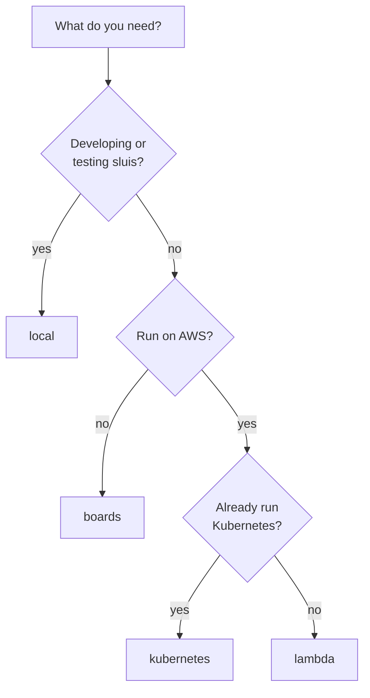
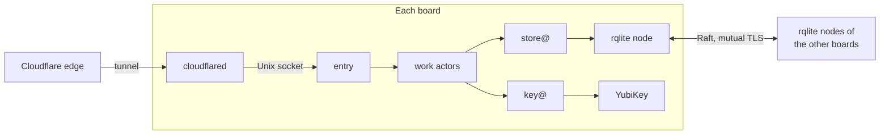

A **runtime** is the kind of place sluis runs: how processes are started and what they can rely on. There are three ([0011](/decisions/0011-runtimes-and-installations/#runtime-kinds)). The word "environment" keeps its usual meaning: development, staging or production.

- **[bare-metal](/runtimes/bare-metal/)** covers physical hosts, virtual machines such as EC2, and local Docker. systemd, or a container runtime for local Docker, starts the processes.
- **[serverless](/runtimes/serverless/)** covers AWS Lambda and similar platforms. The platform runs a function per event. Lambda's own term is written "Lambda runtime" in these pages, to keep the two apart.
- **[kubernetes](/runtimes/kubernetes/)** runs sluis as pods, supervised by the kubelet.

The runtime is not the node count and not the cloud account: both are attributes of an installation. Nor is it the [boundary](/concepts/boundaries/), the environment or customer that an installation keeps apart from the others.

Every runtime runs the same actors: the foundation (store@, key@ and exporter@) and the modules the installation needs ([0002](/decisions/0002-families-of-actors/#the-foundation-and-the-modules)). The actor registry says where each one runs. The runtime decides how an actor becomes a unit and how a call travels from one unit to the next ([0003](/decisions/0003-units-transports-and-fusion/#units)):

| | bare-metal | serverless | kubernetes |
|---|---|---|---|
| The unit | A systemd unit with its own uid | A function with its own role, one per actor and per holder | A pod with its own service account, one per actor and per holder |
| A call travels as | A Unix socket call | A Lambda invoke | In-cluster gRPC |
| The caller is known by | The peer uid | The caller's role and alias | A service-account token with one audience per callee |
| The call graph is enforced again by | The socket's group and the caller's sandbox | The callee's resource policy | A NetworkPolicy per callee |
| `entry` listens on | A Unix socket, behind `cloudflared` | `127.0.0.1` inside the sandbox, behind the Lambda Web Adapter | A Unix socket, behind a key-less edge relay container |
| A holder's drivers are | systemd units beside the holder | Extensions of the holder's function | Native sidecar containers in the holder's pod |
| Packaging | `.deb` and `.rpm` packages, and a tarball | A zip per executable | One OCI image per process, and one Helm chart |

The steps of a request and the checks on it are the same on all three ([principle 19](/principles/#19-one-model-many-transports)). Packaging is on [Packages](/distribution/packages/#packaging-per-runtime); there are no build profiles, and `dev` is not a build.

## What each runtime provides

| Capability | bare-metal | kubernetes | serverless |
|---|---|---|---|
| Long-running processes | Yes | Yes | No (runs per event) |
| Persistent local disk | Yes | Only with a per-pod volume | No |
| Same-host Unix sockets | Yes, on the node | Yes, within a pod | Yes, within one function (extensions) |
| Inbound connections between processes | Yes (between nodes, only the engine's Raft port) | Yes (Service) | No (only triggers or a gateway) |
| Hardware devices | Yes | Partly (a pod pinned to its node) | No |
| Nodes | 1 or N | 1 or N | Elastic (no node identity) |
| Supervisor | systemd, or a container runtime for local Docker | kubelet | The platform |

Serverless always comes with a provider, AWS Lambda today, so for serverless the provider is part of the runtime.

## Installations, nodes and dependencies

- **Nodes.** One, N, or elastic on serverless. A bare-metal installation with one node and one with three have the same runtime.
- **Dependency.** Something outside sluis that a [driver](/decisions/0005-the-store/#drivers) needs and declares: an AWS account, a Cloudflare account, a YubiKey, a NATS service.
- **Installation.** One concrete deployment: a runtime, a node count, the available dependencies, the engine behind store@, the key store behind key@ and its fusion choices ([0003](/decisions/0003-units-transports-and-fusion/#fusion)), for example "bare-metal, 3 nodes, AWS account".
- **Tested installation.** One of the four that the documentation, the tutorials and the test matrix use: local, boards, lambda and kubernetes. Any other combination is a possible installation, allowed by the rules but not tested.

"Installation" is not a configuration key. The [bootstrap file](/reference/bootstrap-file/) and the [signed config documents](/reference/signed-config/) are the installation's configuration, and the four tested installations ship as example bootstrap files.

`sluis config check` validates an installation against what its drivers declare: a driver that needs a long-running process is refused on serverless, a driver that needs exactly one node is refused on a cluster, and a driver whose dependency is missing is refused everywhere.

An actor that must run once at a time, such as the audit writer, is fenced by the write-once rule on its blob, and a background job takes a lease, which is a temp kind in store@'s engine ([0005](/decisions/0005-the-store/#leases)). There is no lock outside the store on any installation.

## Which drivers fit which runtime

This table is derived from what each driver requires and from [what each runtime provides](#what-each-runtime-provides), narrowed on Kubernetes by [0011](/decisions/0011-runtimes-and-installations/#kubernetes). A tick means the driver fits, a cross means `sluis config check` refuses it, and a note is the condition.

| Port | Driver | Bare-metal, 1 node | Bare-metal, cluster | Serverless | Kubernetes |
|---|---|---|---|---|---|
| key@ | `software` | not in production | not in production | ✗ | the `kubernetes-dev` preset only |
| | `yubikey-piv` | ✓ | ✓ | ✗ | ✗ |
| | `aws-kms` | ✓, with AWS credentials | ✓, with AWS credentials | ✓ | ✓ |
| store@: durable and temp | `rqlite` | ✓, one node | ✓ | ✗ | ✗ |
| | `dynamodb` | ✓, with AWS credentials | ✓, with AWS credentials | ✓ | ✓ |
| | in-memory | tests only | tests only | tests only | tests only |
| store@: config source | `file` | ✓ | ✓ | ✓, a layer or a package file | ✓, a mounted ConfigMap |
| | `appconfig` | with AWS credentials | with AWS credentials | ✓ | ✓ |
| store@: secret source | systemd credential | ✓ | ✓ | ✗ | ✗ |
| | AWS SSM | with AWS credentials | with AWS credentials | ✓ | ✓ |
| Audit blob | `fs` | ✓, no lock | ✗ | ✗ | ✗ |
| | `s3-compatible` | ✓ | ✓ | ✓ | ✓ |
| Audit transport | `direct` | ✓ | ✓ | ✗, its fallback spool needs a disk | needs a per-pod volume for its fallback spool |
| | `spool` | ✓ | ✓ | ✗ | ✗ |
| | `sqs` | ✓ | ✓ | ✓ | ✓ |
| | `nats-jetstream` | ✓ | ✓ | send only; the writer runs elsewhere | ✓ |
| Audit index | `sqlite` | ✓ | on one node | ✗ | needs a per-pod volume |
| | `rqlite` | ✓ | ✓ | ✗ | ✗ |
| | `postgres` | ✓ | ✓ | ✓, in the VPC | ✓ |
| Audit witness | none, `external` | ✓ | ✓ | ✓ | ✓ |
| | `peer` | ✗ | ✓ | ✗ | not independent in one cluster |

The audit rows are audit's own ports ([0028](/decisions/0028-audit-pieces/#transport)); the others are store@'s and key@'s ([0005](/decisions/0005-the-store/#drivers), [0006](/decisions/0006-keys-and-sealing/#keys-per-board)). A lease needs no row: it is a temp kind in the engine.

## Configuration sources

Every installation offers the `file` source driver: it needs nothing, and on Lambda a layer is a file and on Kubernetes a mounted ConfigMap is a file. An installation offers `appconfig` when it has AWS, because the driver needs AWS credentials. Of the four tested installations, lambda and kubernetes offer it, and local and boards do not: the boards have a Cloudflare account and no AWS. `sluis config check` refuses a source whose driver the installation does not offer, with the same check as for any other driver. A possible installation outside the table follows the same rule: it offers what its dependencies allow.

Which documents may come from which source is [0004](/decisions/0004-the-data-model/#storage-classes): config is read-only and signed, and store@ verifies each document before it parses it. The rules and the test vectors are on [Signed config](/reference/signed-config/).

## The four tested installations

The tested installations choose the default drivers of their runtime. Pick by the failure you have to survive and the key custody you accept; the order in which they are built is on the [Roadmap](/roadmap/).

| Installation | Runtime and nodes | key@ driver | store@: engine, config source, secret source | Audit blob | Audit transport |
|---|---|---|---|---|---|
| [local](#local) | bare-metal, 1 node | `software` (a development card is opt-in) | `rqlite` with one node; `file`; credential files | `fs` | `spool` or `direct` |
| [boards](#boards) | bare-metal, 3 nodes | `yubikey-piv`, one card per board | `rqlite`, one cluster over the three boards; `file`; systemd credentials | R2 through `s3-compatible` | `spool` |
| [lambda](#lambda) | serverless, elastic | `aws-kms` | `dynamodb`; `appconfig` or `file` from a layer; SSM | S3 through `s3-compatible` | `sqs` |
| [kubernetes](#kubernetes) | kubernetes, N nodes | `aws-kms` | `dynamodb`; a mounted ConfigMap or `appconfig`; SSM | S3 through `s3-compatible` | `nats-jetstream` (`sqs` possible) |

The key mode follows from the installation, not from a switch: KMS on lambda and kubernetes, a YubiKey on boards, software keys on local. The code carries the floor: the `software` driver of key@ refuses to start in production and warns in staging, and configuration picks only among the modes the floor allows ([0006](/decisions/0006-keys-and-sealing/#floors-in-code)).

An installation serves one [boundary](/concepts/boundaries/) at L4, or the front of a federation with the boundaries below L4 inside it. A test installation serves no real user, trusts nothing, and lives outside the sluis host names. An installation runs in one region of one cloud provider, or on one set of boards; a second region is a second installation ([0011](/decisions/0011-runtimes-and-installations/#installations)).

Anything else is a possible installation: start from the nearest tested one and change drivers within the rules.

**The reference installations** that the design is checked against are three: a three-board installation, which is the self-hosted one ([boards](#boards)); an internal installation for a company's own staff, on serverless ([lambda](#lambda)); and a customer installation on Kubernetes on AWS (EKS) ([kubernetes](#kubernetes)). The [local](#local) installation is for development and serves no real user ([0011](/decisions/0011-runtimes-and-installations/#installations)).

## local

Docker Compose on one workstation, one container per actor and per driver, for development, continuous integration and the integration tests ([0011](/decisions/0011-runtimes-and-installations/#the-local-installation)). It runs the release's published images, so a local run tests the images Kubernetes runs. It is not for production. Runtime: [bare-metal](/runtimes/bare-metal/#local-docker), one node. Its containers, host names, TLS and first start are on [The local installation](/runtimes/local/). The [tutorial](/tutorials/single-node-install/) walks through it.

- **Engine:** `rqlite` with one node, the engine of the boards with a cluster of one, so local exercises the replicated engine path.
- **Keys:** `software` by default, which refuses to start in production. A **development card** is opt-in: the key@ container, and only it, reaches a dedicated card through the host's smart-card service, and key@ has the card to itself ([0006](/decisions/0006-keys-and-sealing/#exclusive-card-access)). A card shared with other card software such as gpg is not a mode the installation sets up.
- **Sign-in:** through the generic OpenID Connect upstream against a real identity provider: Keycloak in a container on every pull request (with a one-time-password step, so `amr` carries `mfa`), and nightly against two free cloud tenants: Google Cloud Identity Free and Microsoft Entra ID Free. sluis holds no accounts, even in tests. Passkeys are tested with a browser's virtual authenticator and a software authenticator library.
- **Edge:** `entry`'s container has no network. A developer or a test harness reaches its Unix socket through the forwarder, a generic reverse proxy in the Compose project that ends TLS, mounts the socket and publishes a port on the loopback address.
- **Limits:** a software key can be read by anyone who can read its volume, so it guards development data only. One node proves behaviour, not availability, and local does not exercise the platform controls of the other installations: IAM and KMS key policies, systemd sandboxing, a replicated store, a compliance lock.

## boards

Three single-board computers (arm64, 2 GB RAM, eMMC), each with its own YubiKey, behind a Cloudflare tunnel to `sluis.example.com`. A board runs a systemd unit and a uid for each actor and each holder, and rqlite replicates the data over Raft. Runtime: [bare-metal](/runtimes/bare-metal/#n-nodes), three nodes. The units, the call graph and the card are on [Bare-metal](/runtimes/bare-metal/); the memory and write budget is in [Board capacity](/runtimes/bare-metal/#board-capacity).

- **Drivers:** `yubikey-piv` behind key@; `rqlite` behind store@, one cluster over the three boards with the data on eMMC and the temp data replicated too, so any board serves any request ([0005](/decisions/0005-the-store/#engines)); `file` for config and systemd credentials for secrets; the audit `spool` on each board; `s3-compatible` on R2, with credentials from the `cloud-cloudflare` driver. The audit index is an rqlite cluster of its own; its full-text search was tested on a three-node cluster on 2026-10-30 ([0028](/decisions/0028-audit-pieces/#search-and-the-index)).
- **Keys:** a board's keys are its own, born on its card. No key is shared between boards, so losing a board loses its keys, not the installation's. Data keys are wrapped for each board's card, so any board opens them ([0006](/decisions/0006-keys-and-sealing/#keys-per-board)). The slots are on [Bare-metal](/runtimes/bare-metal/#the-card-and-its-slots).
- **Audit:** one log per board, with its own writer, spool and log key; the other two boards are its peer witnesses, through the audit blob, so a checkpoint carries two boards' signatures ([0029](/decisions/0029-the-audit-log/#witnesses)). Readers merge the logs by time. The log is on R2, so it is off site from the start.
- **Identity and edge:** each board runs its own `cloudflared`, which forwards to `entry`'s Unix socket. The boundary's issuer issues workload tokens, with one key per board card in its key set ([0022](/decisions/0022-workload-identity-and-host-enrolment/)). The audit pieces have a front of their own, a second `entry` with its own tunnel route on `sluis-audit.example.com` ([0028](/decisions/0028-audit-pieces/#the-audit-front)).
- **Limits:** Raft tolerates the loss of one board of three. Physical access to a board with its card and PIN allows signing as that board; peer witnessing limits that for the audit logs but not for tokens. A Cloudflare account administrator can remove R2's lock (lock mode `removable`), so the logs get their tamper evidence from the witnesses. Every batch crosses the internet to R2, so an outage of the link or of R2 delays the logs.

## lambda

One Lambda function per actor and per holder behind API Gateway, with KMS keys, DynamoDB, an SQS queue to the audit writer and an S3 bucket with a compliance lock. A work function holds no credential; only the holders' roles reach storage, keys and the audit blob, and every hop between functions is an invoke. An invoke is fast enough for this layout, so no function links store@ into a work actor ([0003](/decisions/0003-units-transports-and-fusion/#fusion)); the figures of the warm sign-in are in [0037](/decisions/0037-capacity-is-measured-before-it-is-promised/#the-warm-sign-in-on-lambda). The writer runs with a reserved concurrency of 1, and correctness comes from the write-once fence on the bucket, not from the limit ([0029](/decisions/0029-the-audit-log/#the-write-once-fence)). The request path, the audit path and the limits are on [Serverless](/runtimes/serverless/). Runtime: serverless, elastic.

## kubernetes

A pod per actor and per holder on Amazon EKS, each with its own service account, installed from one Helm chart. A driver is a native sidecar container in its holder's pod, a key-less edge relay container in `entry`'s pod forwards to its socket, and the audit side may be a separate audit installation, from the chart's `audit-install` preset. Kubernetes in 2.0 means Kubernetes on AWS (EKS), with DynamoDB, AWS KMS and S3; a cluster without AWS is not in 2.0, and the direction for later is PostgreSQL via CNPG as the store engine. A holder's cloud role comes from web identity through the cluster's IAM OIDC provider, not from EKS Pod Identity. It is the customer installation: it runs the full conformance set (OpenID Connect, FAPI 2.0 and the customer-identity plans) as well as a smoke test on kind with the `kubernetes-dev` preset and integration tests on a development EKS cluster. The details are on [Kubernetes](/runtimes/kubernetes/). Runtime: kubernetes, N nodes.

## Other installations

These are possible installations: allowed by the rules, not tested.

- **One board.** The boards installation reduced to one node, with `rqlite` on one node and the blob on R2.
- **EC2.** One instance or an Auto Scaling group is a bare-metal installation on virtual machines ([Bare-metal](/runtimes/bare-metal/#virtual-machines-ec2)). EC2 is not a delivery target.

For each, `sluis config check` applies the same rules as for a tested installation. What the tests do not give is evidence that the combination keeps working from release to release.

## Pages in this section

- [Bare-metal](/runtimes/bare-metal/): physical hosts, virtual machines and local Docker, the units, the call graph, the card and the board capacity.
- [Serverless](/runtimes/serverless/): AWS Lambda, a function per actor and per holder.
- [Kubernetes](/runtimes/kubernetes/): a pod per actor, drivers as sidecars, one chart.
- [The local installation](/runtimes/local/): Compose, host names, TLS, the first start and sign-in.
