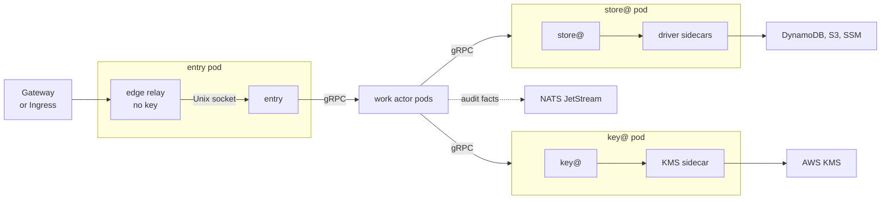

On the kubernetes runtime the kubelet supervises sluis, and each actor and each holder is a pod with its own service account. Calls between pods are in-cluster gRPC, authenticated by a projected service-account token with one audience per callee. The tested installation is [kubernetes](/runtimes/#kubernetes): Amazon EKS with AWS KMS keys, DynamoDB, the NATS JetStream audit transport and S3 blobs, installed from one Helm chart. It is the customer-identity installation, and the reference installation of the `nats-jetstream` driver ([0011](/decisions/0011-runtimes-and-installations/#kubernetes)). Which drivers fit Kubernetes is on [Runtimes](/runtimes/#which-drivers-fit-which-runtime).

**sluis writes no Kubernetes object,** except an exported Secret that exporter@ writes when an installation chooses the direct path ([0009](/decisions/0009-export/#destinations)). Cluster tools such as cert-manager, trust-manager and External Secrets stay its clients and pull what sluis serves and exports.

## Topology

The edge relay is the only container that a gateway reaches. It forwards to `entry`'s Unix socket, and `entry` calls the work actors over gRPC. Every work actor calls store@ for its data and key@ for its keys. The audit facts leave through the transport for a separate audit installation.

## What runs where

- **A pod per actor and per holder,** each with its own service account, named after the actor and the boundary (`ca-prod`) ([0003](/decisions/0003-units-transports-and-fusion/#units)). The pod is the unit of identity, credentials, restart and network rules. A unique user id is pinned to the same value as in the local installation's Compose file. The namespace runs at the `restricted` Pod Security level: non-root, no capabilities, no privilege escalation, the runtime default seccomp profile, no automatic service-account token and `shareProcessNamespace` off.
- **Drivers are native sidecars** in their holder's pod, started by the platform before the holder. A driver's socket is on an `emptyDir` that only the holder's container and the driver mount, and the cloud token is mounted only into the driver container ([0005](/decisions/0005-the-store/#drivers)). A driver is never a pod of its own, because its socket cannot leave the pod.
- **No container that holds a cloud token exposes a listener.** A generated check fails the build otherwise ([0003](/decisions/0003-units-transports-and-fusion/#listeners)).
- **Fusion is an explicit installation choice,** and a holder is never fused with a work actor ([0003](/decisions/0003-units-transports-and-fusion/#fusion)). One pod with a container for each actor is not offered: the containers of a pod share its network and egress rules, so a pod with several actors is fusion by default.
- **An adapter is a pod like any actor,** with its own egress NetworkPolicy listing only its vendor's hosts. The one exception is the pool of a customer boundary's customer connections, which runs a few replicas for all of them and reaches providers through an egress proxy ([0033](/decisions/0033-customer-connections/#a-pool-per-customer-boundary)).
- **No RBAC.** The chart renders no Role, RoleBinding, ClusterRole or ClusterRoleBinding: sluis needs no access to the Kubernetes API, not even for leases, which are a temp kind in the engine. The one exception is exporter@ on the direct path, whose cluster credential may write only the named Secrets in the named namespaces ([0009](/decisions/0009-export/#destinations)).

## The call graph

The call graph of the actor registry is enforced in the pod's code and again by the cluster ([0003](/decisions/0003-units-transports-and-fusion/#the-call-graph)):

- **A NetworkPolicy per callee** admits ingress only from the pods of its allowed callers. Egress is denied by default and generated from the registry, with DNS and the allowed endpoints opened.
- **A projected service-account token with one audience per callee.** The caller presents it, and the callee's interceptor checks the audience and the call graph, default deny. The token is mounted only into the container that calls.
- **The mount is the first lock inside a pod.** A callee's socket directory is its own volume, mounted only into the containers that may use it; the callee still reads the caller's uid with `SO_PEERCRED`.
- **Mutual TLS between callers is later work.** The token and the NetworkPolicy already enforce the graph; certificates between pods can be added as a further transport check without changing the graph ([0003](/decisions/0003-units-transports-and-fusion/#roads-not-taken)).

## Cells

- **A cell is one replica of each actor, co-scheduled on one node.** A pod affinity keeps the pods of a cell together, and cells are spread across nodes and zones by anti-affinity or topology spread ([0003](/decisions/0003-units-transports-and-fusion/#cells)).
- **Services prefer the local cell.** A Service uses `trafficDistribution: PreferClose`, so a call to store@ or key@ stays in its cell when a replica there is ready, and fewer hops leave the node.
- **A PodDisruptionBudget** keeps a cell's replicas up during a drain, and a rolling update never removes a replica before its replacement is ready.
- **Requests and limits are measured, not guessed.** The chart ships the values measured for each pod under load; a pod per actor and per holder is more pods than a fused layout, and the cells keep most calls on one node.

## Keys

- **AWS KMS only,** with the layout of every AWS installation ([0006](/decisions/0006-keys-and-sealing/#keys-per-boundary-on-aws)). The key policy of every key names key@'s role alone, so no other pod and no node reaches KMS. No card runs on Kubernetes: the key policy is the access list.
- **No software key in production.** Only the `kubernetes-dev` preset allows the `software` driver, on the terms of the local installation, for the smoke test on kind. A cluster with no key mode that the floor allows refuses to start ([0006](/decisions/0006-keys-and-sealing/#floors-in-code)).
- A cluster outside AWS is not supported in the first cut, because it would need a second key mode.

## Identity

- **A work pod has no cloud identity at all.** A projected service-account token, mounted only into a driver container, is exchanged there for a cloud role by `AssumeRoleWithWebIdentity`, the same code path as on a virtual machine; only the issuer of the token differs ([0022](/decisions/0022-workload-identity-and-host-enrolment/#proofs-and-the-exchange)).
- **The pod's default ServiceAccount token is not mounted.** Each holder's cloud role trusts the cluster's issuer, that holder's audience, and the installation's namespace and ServiceAccount. The infrastructure code generated from the registries registers the issuer and the roles.
- **EKS Pod Identity is not used for a holder's pod,** because its credentials reach every container of the pod. `sluis-node` serves as a fallback only.
- The workload tokens are signed by the cluster's key, not a sluis key, so the P-384 rule does not cover them. Pods must not reach the node's instance metadata service.

## Data and leases

- **DynamoDB only,** behind store@'s driver ([0005](/decisions/0005-the-store/#engines)): conditional writes, and a table per engine reachable by store@'s role only. A work actor reaches no table; it calls store@, whose rules say which actor may write which kind.
- **A lease is a temp kind** with a fencing token ([0005](/decisions/0005-the-store/#leases)). There is no Kubernetes Lease and no PostgreSQL or rqlite engine on Kubernetes.
- An actor that must run once at a time, such as the audit writer, is fenced by the write-once rule on its blob, and a background job takes a lease; neither needs a Kubernetes object.

## Audit

- **The audit side may be a separate audit installation** from the same chart's `audit-install` preset: the foundation with the audit module only, with the writer, the indexer, the reader and an optional witness, behind its own front ([0028](/decisions/0028-audit-pieces/#the-audit-front)): a slim `entry` on its own host with its own edge relay or `cloudflared` and its own gateway route.
- **Transport:** NATS JetStream. NATS accounts and permission templates on scoped signing keys let each producer publish only its own project's subjects ([0028](/decisions/0028-audit-pieces/#nats-jetstream)); the NATS credentials use the Ed25519 named exception ([0006](/decisions/0006-keys-and-sealing/#named-exceptions)). SQS and `direct` are supported but not the default; `direct` falls back to a local spool when the writer is down, which needs a per-pod volume. A request never waits for the writer or the index.
- **One writer at a time,** and every batch is created only if absent, so a second writer cannot fork the log ([0029](/decisions/0029-the-audit-log/#the-write-once-fence)). The writer signs checkpoints with the log key in KMS, through key@.
- **Index:** `postgres` in the `cnpg` mode, a CloudNativePG cluster in the same Kubernetes cluster; a database someone else runs is the `external` mode, a connection string only ([0028](/decisions/0028-audit-pieces/#provisioning-modes)). The reader can run in any pod that reaches the database.
- **Witness:** optional (`peer` or `external`). `sluis config check` warns when there is none.

## Edge

A gateway cannot route to a Unix socket in another pod, and the kubelet's HTTP and TCP probes connect to the pod address, so a container in the pod bridges to `entry`, in one of two modes:

- **Edge relay, the default.** A key-less container listens on the pod address and forwards to `entry`'s Unix socket in a shared volume. A Service targets its port, so any Gateway API implementation or Ingress controller can route to it. It is written in Rust, like `entry` ([0012](/decisions/0012-the-language-follows-the-executable/)).
- **`cloudflared`, supported.** A sidecar connects out to the Cloudflare edge and forwards to `entry`'s socket, and the pod accepts no inbound connection at all.

`entry` stays socket-only, with no TCP listener, and is probed with an `exec` probe ([0003](/decisions/0003-units-transports-and-fusion/#listeners)). The relay holds no key.

:::note[Proposed]
The relay serves a health endpoint for the gateway, passes the client address in `X-Forwarded-For` and strips that header unless the request comes from a configured trusted proxy, and can terminate TLS when the hop from the gateway must be encrypted. The relay's details are built with the chart: [#876](https://github.com/truvity/sluis/issues/876).
:::

The console's single-page application runs as its own Deployment and image, behind the same gateway route as `entry`, so the page and the console API are same-origin.

## Packaging and the baseline

- **One OCI image per process and one Helm chart,** `oci://ghcr.io/truvity/sluis/charts/sluis`, with every image pinned by digest and the chart's version equal to the release version ([0013](/decisions/0013-release-train-packaging-and-distribution/#packaging-per-runtime)). The same images run the [local](/runtimes/#local) installation.
- **One chart with presets** `install`, `audit-install`, `quota-install` and `kubernetes-dev`, and no subcharts, so a writer and a reader always come from one release. The cert-manager issuer has a chart of its own.
- **The values schema is generated from Protobuf,** so the chart, `sluis config check` and the process validate against one source ([0004](/decisions/0004-the-data-model/#schemas-are-protobuf)).
- **The baseline:** native sidecars, the `restricted` Pod Security level, projected service-account tokens and a CNI that enforces NetworkPolicy. Cilium is optional, for egress by host name. OpenShift and sandboxed runtimes such as gVisor and Kata are not in the first cut. A cluster must meet the baseline before the chart installs.

:::note[Proposed]
From the registries the chart renders one ServiceAccount per pod kind with the automatic token mount off; a NetworkPolicy per callee that admits only the pods of its allowed callers, and per pod an egress policy to DNS and the allowed endpoints; optionally a CiliumNetworkPolicy; and a PodDisruptionBudget, zone spread and rolling updates that never remove a replica before its replacement is ready. The chart layout and the measured requests and limits are built with the chart: [#876](https://github.com/truvity/sluis/issues/876), [#844](https://github.com/truvity/sluis/issues/844).
:::

## Testing

- **A smoke test on kind** installs the chart with the `kubernetes-dev` preset under the `restricted` level, with no cloud credentials. It confirms that `SO_PEERCRED` identifies the peer across the containers of one pod, then checks the socket reachability and NetworkPolicy deny matrices, the edge, the probes, a rolling upgrade, and that the render holds no RBAC objects.
- **Integration tests on a development EKS cluster** cover the cluster's issuer at AWS, the key policies and the IAM conditions on the table and the queue. They run on a short-lived runner inside the VPC against the cluster's private API endpoint; the cluster has no public endpoint ([#891](https://github.com/truvity/sluis/issues/891)).

## Limits and residual risk

- **Identity is as strong as the cluster.** A cluster administrator, a compromised node or a permissive admission policy can mint a token for any audience of a ServiceAccount, or open a shell in a container ([accepted risks](/security/threat-model/#accepted-risks)).
- All containers of a pod share its egress allow-list, which is why each adapter has a pod of its own and a holder's pod holds only the holder and its drivers.
- Separation between containers depends on unique uids, on no container changing its uid, and on `shareProcessNamespace` being off; `SO_PEERCRED` behaviour is confirmed on every container runtime that is claimed.
- A pod per actor and per holder costs memory and start-up time; both are measured, not assumed ([0037](/decisions/0037-capacity-is-measured-before-it-is-promised/)).
- Do not run the installation that signs people in to a cluster on that same cluster without [break-glass recovery](/security/break-glass/), which needs no Kubernetes.
