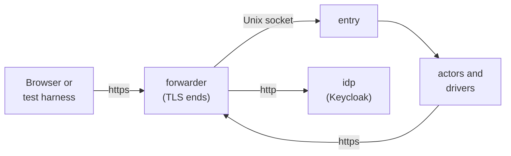

The [local installation](/runtimes/#local) is Docker Compose on one workstation, with software keys and an rqlite engine of one node, for development, continuous integration and the integration tests ([ADR 0011](/decisions/0011-runtimes-and-installations/#the-local-installation)). This page fixes what the Compose project holds, the host names it uses, how a browser comes to trust it, and what happens at the first start. Its bootstrap file is the example on the [bootstrap file](/reference/bootstrap-file/) page, and its configuration is a directory of signed config documents that store@ verifies against a publisher key pinned in that file, as on any installation ([ADR 0011](/decisions/0011-runtimes-and-installations/#the-local-installation)). Everything outside sluis's own containers, the forwarder, the identity provider and the setup, belongs to the **harness**: files that ship beside the bootstrap file, and no code of the product (a development installation differs by configuration only, [Principles](/principles/#what-sluis-is-and-is-not)).

## Topology



| Service | Image | What it is |
|---|---|---|
| The actors and drivers | The release's images | One container per actor and per driver, generated from the registries: the foundation (store@, key@ and exporter@) with their drivers, the work actors, the audit pieces `writer`, `indexer` and `reader`, `adapter-upstream-oidc`, and the drivers the bootstrap file names. `entry`'s container has no network |
| `rqlite` | The pinned rqlite release | The engine, one node, beside store@. Its client API is on the loopback address, and the driver's container shares rqlite's network namespace (`network_mode: service:rqlite`), so the driver is its only client ([ADR 0005](/decisions/0005-the-store/#engines), [ADR 0011](/decisions/0011-runtimes-and-installations/#the-local-installation)) |
| `forwarder` | Caddy, pinned by digest (v2.11.7, released 2026-10-03) | Ends TLS for every host of the project and forwards by `Host`: the sluis hosts to the socket of the `entry` that serves them, `idp.local.test` to `idp`, `app.local.test` to the harness's relying party. The only service that publishes a port, on the loopback address. Containers reach it by the host names too, as network aliases |
| `idp` | Keycloak 26.8.1 (released 2026-10-13), from a reviewed realm-import file | The upstream identity provider, on plain HTTP behind the forwarder. Users and groups are created per test through its admin API, and the realm sends `amr` ([Sign-in](#sign-in)). Dex v2.46.1 (2026-10-21) can run in its place, for an upstream that sends no `acr`, `amr` or `auth_time` |
| `setup` | The harness image, with the `ritueel` release and `sluis` | A one-shot service that does the [first start](#the-first-start) and exits. Every service that needs the keys or the trust files waits for it to complete |

- **The images' dependencies are in one matrix,** [Runtime dependencies](/distribution/dependencies/): a static executable on distroless static, rqlite on a glibc base, and for the opt-in development card a card driver image that is not built yet, with pcscd on the host.
- **The forwarder serves the key set that exporter@ publishes.** The directory driver of exporter@ writes `jwks` to a volume that the forwarder mounts read-only; for `/jwks` on the boundary's host the forwarder answers from that file with `Cache-Control: public, max-age=300` and `Access-Control-Allow-Origin: *` <!-- terms-allow: origin (the CORS header name) -->, and when the file is missing (before exporter@ has written it) the request goes on to `entry`, whose live key set is the fallback and leaves out revoked kids too ([ADR 0009](/decisions/0009-export/#publishing-public-material), [REQ-EXPORT-025](/requirements/export/#REQ-EXPORT-025)). The directory declares no public address, so the report says `written` and `signer` counts the lead time from the write. exporter@ reads its destinations from `tests/installations/local/exporter/destinations.json`, a file in the form of the `ExportDestination` message, until store@ serves that kind.
- **The forwarder is a generic reverse proxy, not a sluis component.** It is the local counterpart of Cloudflare's edge, of `cloudflared` and of the Gateway in front of the edge relay: public TLS ends at the edge, and the edge relay and `entry` stay key-less ([Deployment](/architecture/deployment/#listeners)). Nothing depends on it being Caddy: it is TLS in, HTTP over a Unix socket out, routed by `Host`. Caddy was picked for its short configuration; nginx would do the same.
- **The forwarder's certificate is not sluis's.** In production the edge holds a certificate that sluis did not issue. Locally it holds one from the harness's `edge` intermediate, certified by the same ritueel root as sluis's own intermediates ([TLS](#tls)).
- **The Compose file is generated from the registries,** like the systemd units, with the uids pinned ([ADR 0011](/decisions/0011-runtimes-and-installations/#consequences)). The harness services are written by hand beside it.

## Recipes

Run each as `devbox run -- just <recipe>`. The project needs Docker, and `SLUIS_UPSTREAM_TARGET` and `SLUIS_KEYCLOAK_SECRETS` in the environment; the repository names neither value.

| Recipe | What it does |
|---|---|
| `local-up` | Builds the executables and the images (or, with `SLUIS_LOCAL_IMAGES=release`, pulls those of a release, see [Images](#images)), makes the state of the run (harness CA, signed config, credentials) and starts the project; returns when every service that has a health check is healthy |
| `local-handoff`, `local-handoff-check` | The hand-off of the boundary's intermediate, which `local-up` ends with ([The first start](#the-first-start)): `sluis key request` against key@, a throwaway root certifies, `sluis key install`. `local-handoff` changes nothing once the intermediate is installed; `local-handoff-check` fails if a second run makes, issues or installs anything anew (it counts the audit records of the install of the intermediate only: `ca` has key@ keep the token certificate with a fact of the same action, for the purpose `token-signing`). The `smokes` job of CI runs the check |
| `local-smoke` | The M1 proof: a client under the uid of `exchange` asks `policy` for a `token.exchange` decision and `signer` for a token; the token is checked against `/jwks` through the forwarder, trusting only the harness CA; the records of the run are found in the audit log; `sluis audit verify` checks the log; `SigningRing` and `DataKeyWrap` are read through store@. The `smokes` job of CI runs it on every pull request |
| `local-keyset-check` | The key set that `/jwks` serves: every key carries an `x5c` chain of the token certificate, the intermediate and the root, and it verifies to the root of the hand-off. `local-up` runs it after the hand-off, with a wait, since `ca` makes the token certificate once the intermediate is installed |
| `local-person-smoke` | The M2 proof: `sluis login` signs a person in through the forwarder, `entry`, `session`, the upstream adapter and the identity provider, and `sluis token` exchanges the token for an audience. It then exchanges the same token as the confidential client `example-app`, which authenticates with its secret (HTTP Basic), after a wrong secret has been refused with `invalid_client`. It also checks that the ID token's `sub` and the exchanged token's `sub` are the same pairwise subject, asks for `prompt=none`, `max_age` and `prompt=login` of the identity provider (a silent code for a signed-in browser, `login_required` for one that is not, a form shown again for `login`), finds the audit record of every step and runs `sluis audit verify`. `session` seals the facts of the session chain under the tenant's `chain` key; `session` opens them again at a refresh and `exchange` opens them for a token exchange, and no other actor does either ([0006](/decisions/0006-keys-and-sealing/#data-keys)). The `smokes` job of CI runs it on every pull request |
| `local-passkey-smoke` | The browser proof of adding a passkey ([Sign-in](#sign-in)): a Chromium, headless, with a virtual authenticator of the DevTools protocol and the root of the run imported into the NSS database of a home of its own, driven by `tests/e2e/passkey/rig.mjs` (no npm package). It signs alice in once, then adds a device-bound and a synced passkey through `/passkeys/add`, the identity provider's forms and the registration page, and shows what the browser did: the script of the page runs under its Content-Security-Policy and the policy holds the hash of the script, a policy with a wrong hash stops the script, the cookie `__Host-sluis_ceremony` (`SameSite=Strict`) set after the cross-site redirect into `/callback` is stored and sent on the page's post and is not sent on a navigation from another site. It also shows the refusals: an authentication that is not from the request, an origin that is not in the list, a held person (placed by `spine hold`, a harness step under the uid of `session`, and lifted again), and checks the audit log for the reason of each. It deletes every passkey of the test tenant at the start and at the end, the ones it did not make as well (it says how many it found at the start), and lifts the hold it placed. About 4 minutes. It needs Chrome or Chromium and `certutil` (`libnss3-tools`); the `smokes` job of CI runs it |
| `local-conformance` | The OpenID Foundation conformance suite ([Conformance](/standards/conformance/#what-runs-today)): the suite in containers, its images pinned by digest, two public clients of the installation (`oidf-suite`, `oidf-suite-2`) signed in by alice's forms, each module judged against `tests/conformance/expected.yaml`, and the gate of requirement tests. It needs the identity provider of `local-idp` and the project of `local-up`. The first version runs the suite as a public client, which is not the certification profile. The `Conformance` workflow runs it on a push to `main` and on a pull request that touches the code the suite exercises |
| `local-deny` | The deny matrix ([ADR 0002](/decisions/0002-families-of-actors/)): for every caller and every socket, a probe as the caller's uid checks the call graph at the socket and at the guard. It starts a Compose project of its own and removes it, and leaves a `local-up` project alone. The matrix is the Go test `TestDenyMatrix`, and the `deny` job of CI runs it on every pull request, with a Keycloak container serving an empty realm as the upstream |
| `local-idle-check` | REQ-AUDIT-180 on the running project ([Idle](#idle)): waits 90 s, reads the audit log once, and fails over 3 records in the next 180 s (60 an hour, scaled), on a summary of folded refusals anywhere in the run, and when the run lacks the records it is told to expect (the control). About 5 minutes. The job `smokes` of CI runs it after the smokes |
| `local-down` | Stops the project and deletes its volumes and the state of the run |

- **The firewall.** A host firewall may let a container reach the upstream from some Docker subnets only. The Compose project of `local-up` has a free /24 of `10.99.0.0/16`, chosen from the project name (`SLUIS_LOCAL_SUBNET` overrides it), because the subnet Docker picks may be one the firewall drops; the deny matrix, which runs its own project, takes `SLUIS_DENY_SUBNET` (for example `10.99.0.0/24`) to put its network on a subnet the firewall allows.

## Images

`local-up` builds every executable and image from the checkout by default, which is what a change to the code is judged by. The installation also runs the images of a release, the published ones, and then builds nothing ([0013](/decisions/0013-release-train-packaging-and-distribution/#packaging-per-runtime)):

```sh
# Example
SLUIS_LOCAL_IMAGES=release SLUIS_LOCAL_VERSION=2.0.0-alpha.1 devbox run -- just local-up
```

- **The same services.** `deploy/local/compose.release.yaml`, generated beside `compose.yaml`, goes after it and gives each service of sluis the image of the release that holds its executable (`ghcr.io/truvity/sluis/actor-store`, `driver-store-rqlite`, and `vendor-rqlite` for the engine), drops its build, and runs the executable at its install path, `/usr/libexec/sluis/actors/<name>` or `/usr/libexec/sluis/drivers/<owner>/<name>`. The uids, groups, mounts and commands are those of `compose.yaml`.
- **By tag or by digest.** `SLUIS_LOCAL_VERSION` is the tag of the release, without the `v`. `SLUIS_RELEASE_IMAGES` names the `release-images.txt` of the release (a file or an `https` URL) and pins every image by its digest instead; that is the way to reproduce a release exactly. `SLUIS_IMAGE_PREFIX` moves the namespace, which is how a registry mirror or a throwaway registry is used. With the images the project also needs `SLUIS_RELEASE_CATALOGUE`, the `audit-catalogue.yaml` of the release (a file or an `https` URL): the harness signs it in place of the checkout's catalogue, which names release `0.0.0`, because the writer refuses the records of a release newer than its catalogue ([Releasing](/distribution/packages/#the-audit-catalogue-of-a-release)).
- **Proved when a change can affect the release.** The job `release` of CI builds the release as a tag would, pushes the images to a registry on the runner, starts this installation from them by digest, with nothing built, and runs both smokes against it; a push to `main` always runs it ([Releasing](/distribution/packages/#releasing)).

## Host names

| Host | Serves | Resolved to |
|---|---|---|
| `sluis.local.test` | The group issuer, the console and the front's API | `forwarder` |
| `sluis.dev.local.test` | The `dev` boundary's issuer | `forwarder` |
| `idp.local.test` | The upstream identity provider | `forwarder` |
| `app.local.test` | The example relying party the tests drive | `forwarder` |

The passkey relying-party ID is `local.test`, the registrable parent of every host, as in production ([ADR 0017](/decisions/0017-identity-and-sign-in/#passkeys)).

- **Why `.test`.** RFC 6761 reserves `.test` for testing: nobody can register a name under it, so the installation can never collide with a real one, and it lives outside the sluis host names as a test installation must ([ADR 0017](/decisions/0017-identity-and-sign-in/#issuers)). The RFC tells software not to treat `.test` as special and tells caching resolvers to answer it with an immediate negative ([RFC 6761, section 6.2](https://datatracker.ietf.org/doc/html/rfc6761#section-6.2), February 2013), so a name has to be mapped by the harness. That is a feature here: the mapping is the one place that says "this is a test".
- **Inside the project,** Compose gives `forwarder` the four names as network aliases, so the actors, Keycloak and the harness's clients reach each host by its name and cross the same TLS as a browser.
- **A test harness** points its browser at the published port with a name mapping, for Chromium `--host-resolver-rules="MAP *.local.test 127.0.0.1:<port>"`, so the URLs carry no port and the issuer stays `https://sluis.local.test`. A developer's own browser uses four lines of the hosts file for `127.0.0.1` and the project published on port 443.

### The dev domain: names for the nightly runs

The `.test` names above serve the runs that need no vendor. The nightly and pre-release runs sign in through the vendors' free test tenants ([Sign-in](#sign-in)), and a vendor must be given a redirect address that its own rules accept. Google requires that "Host TLDs (Top Level Domains) must belong to the public suffix list" and that "Hosts cannot be raw IP addresses" ([Google, Using OAuth 2.0 for web server applications](https://developers.google.com/identity/protocols/oauth2/web-server), READ 2026-11-02), and `test` is not a public suffix. Microsoft Entra requires `https`, with an exception for localhost only ([Microsoft, redirect URI best practices and limitations](https://learn.microsoft.com/en-us/entra/identity-platform/reply-url), READ 2026-11-02). So the redirect addresses registered at the tenants are names under a real domain, which the browser must reach.

**The rule** (decided by the maintainer on 2026-11-02):

- **The browser-facing names of the nightly runs are the hosts of the table above, under a configurable dev domain** instead of `local.test`: `sluis.<dev domain>`, `sluis.dev.<dev domain>` and `app.<dev domain>`. There is no `idp` host: the vendor's tenant is the identity provider.
- **The setting is `SLUIS_DEV_DOMAIN`,** an environment variable of the harness, named like the other `SLUIS_` settings of the repository (for example `SLUIS_TARGET`). Only the runs against a vendor's tenant read it. A pull-request run and a developer's local run do not: they keep the `.test` names.
- **The public default is a nip.io name: `127.0.0.1.nip.io`,** so the front host is `sluis.127.0.0.1.nip.io`. Anyone can register `https://sluis.127.0.0.1.nip.io/…` at their own Entra or Google tenant and reproduce the run, with no domain of their own.
- **The project's own CI sets `SLUIS_DEV_DOMAIN` through its CI configuration,** to a domain it controls. That domain is never written in this repository, its documents, its tests or its commit messages.

**What does not change.** The `.test` names, and the harness's `forwarder` that serves them in the pull-request runs, stay as they are. A browser and a container must see the same names: the issuer is a URL that both read, so the forwarder carries every host of the run as a network alias, whatever the domain. nip.io does not change that; a name that resolves to `127.0.0.1` points a container at itself, so inside the project the alias has to answer for it, as it does for `.test`. The leaf of the run is made for the names under the domain in use, and the name constraint of `edge` (the one that waits on ritueel, [below](#sign-in)) is the domain in use too.

**The limits of nip.io.**

- **It is a third-party DNS service with no guarantee.** It answers a name that has an address in it with that address: `www.192.168.0.1.nip.io` gives `192.168.0.1` (READ 2026-11-02, [nip.io](https://nip.io)). The page states no uptime guarantee or service terms. A nightly run that fails to resolve the name is a failure of the service, not of sluis, and a team that needs certainty sets `SLUIS_DEV_DOMAIN` to a domain it controls.
- **A resolver with DNS-rebinding protection can refuse the name,** because the answer is a loopback address. dnsmasq, which many routers and home gateways run, rejects "addresses from upstream nameservers which are in the private ranges" with `--stop-dns-rebind`, and `--rebind-localhost-ok` exempts "127.0.0.0/8 and ::1 from rebinding checks" ([dnsmasq manual](https://thekelleys.org.uk/dnsmasq/docs/dnsmasq-man.html), READ 2026-11-02). Unbound has no private addresses by default, and `private-domain` allows one domain "and all its subdomains" to contain them when `private-address` is set ([Unbound `unbound.conf`](https://unbound.docs.nlnetlabs.nl/en/latest/manpages/unbound.conf.html), READ 2026-11-02).
- **What to do when the name is refused,** in this order:
  1. In the test harness's browser, skip DNS: Chromium's `--host-resolver-rules="MAP *.127.0.0.1.nip.io 127.0.0.1:<port>"` maps the names as it maps `.test` above, and the resolver is never asked.
  2. For a developer's own browser, add the hosts to the hosts file, as for `.test`.
  3. Or allow the domain at the resolver: `rebind-domain-ok=/nip.io/` for dnsmasq, `private-domain: "nip.io"` for Unbound.
  4. Or set `SLUIS_DEV_DOMAIN` to a domain you control.

The vendor still needs the redirect address to be a name it accepts, so the registration at the tenant is made once with the dev domain in use; the browser never needs the vendor to resolve it.

### A virtual authenticator accepts `local.test`

The WebAuthn specification lets a page claim an RP ID that is "a registrable domain suffix of or is equal to the caller's origin's effective domain" ([Web Authentication Level 3](https://www.w3.org/TR/webauthn-3/), W3C Recommendation of 25 August 2026, read 2026-11-01). Chromium decides "registrable" with its list of registries and counts an unknown top-level domain as one: `OriginIsAllowedToClaimRelyingPartyId` calls `HostHasRegistryControlledDomain` with `INCLUDE_UNKNOWN_REGISTRIES`, and refuses a claimed ID no longer than the caller's registry ([`webauthn_security_utils.cc`](https://github.com/chromium/chromium/blob/main/components/webauthn/core/browser/webauthn_security_utils.cc), last changed 2026-10-12, read 2026-11-01). So `test` is a registry and `local.test` is registrable.

That was measured, not only read, on 2026-11-01: Chrome 156.0.8078.79, headless, with the virtual authenticator of the [DevTools protocol](https://chromedevtools.github.io/devtools-protocol/tot/WebAuthn/) (CTAP2, internal, resident keys, user verification on), against a TLS server whose chain ends in a root that was trusted in a throwaway profile. Each row is one registration followed by one assertion.

| Page | RP ID | Result |
|---|---|---|
| `https://sluis.local.test` | `local.test` | works |
| `https://sluis.dev.local.test` | `local.test` | works: the credential is the same for both hosts |
| `https://sluis.local.test` | `sluis.local.test` | works |
| `https://sluis.dev.local.test` | `sluis.local.test` | refused: not a registrable suffix of the page's host |
| `https://sluis.local.test` | `test` | refused: the registry itself |
| `https://sluis.local.test` | `other.test` | refused |
| `https://sluis.local.test` | `dev.local.test` | refused: not a suffix of the page's host |
| any of the above, root not trusted | | not a secure context: the certificate error stops the API before the RP ID is looked at |

The last row is why TLS matters here: WebAuthn is exposed only in secure contexts, "established without errors" (the same specification), so a browser that does not trust the chain cannot test a passkey at all. `--ignore-certificate-errors` is not a substitute; a real chain tests the real path, including the intermediate's name constraints.

## TLS

The chain a browser sees is `root` (ritueel's software test root), `edge` (an intermediate, name-constrained to `local.test` once ritueel checks DNS names; see the note before the limits) and a leaf for the four hosts.

1. **The root** is the software root that `ritueel new --test-root` and the first `ritueel apply` make in the setup. It is marked `TEST ONLY` in its name and in every product, and ritueel refuses to mix it with a real root ([Commands](https://ritueel.id/reference/cli/#the-first-versions-commands)). Its key is a file in a volume of the project, with no passphrase.
2. **`edge`** is the harness's own intermediate. The setup makes a P-384 key, a request and a proof for the hand-off with `openssl`, and ritueel certifies it as the delegation `edge`, the way it certifies `sluis-dev`, the intermediate of `sluis key request`. A software key is accepted by the hand-off contract when the policy says it is the development setting ([the contract](https://ritueel.id/reference/hand-off-contract/#software)).
3. **The leaf** is made by the setup with the `edge` key: `serverAuth`, DNS names for the four hosts, valid for seven days, made again at the next `up` when less than a day is left. The forwarder serves the leaf and `edge`.
4. **Trust is per run.** The root's certificate, from the CA bundle that ritueel builds, goes to:
   - the project's containers, as the system bundle of their images, read-only;
   - the test harness's browser, in a throwaway profile. Chromium on Linux reads an NSS database in `$HOME/.pki/nssdb`, so the harness gives the browser a home of its own with the root imported (the measurement above did this) and deletes it with the run;
   - a developer's own browser, in a separate profile made for the project. The system trust store of the machine is not touched.
5. **`down -v` deletes the root's key,** and the next `up` makes a new root. A browser profile that trusted the old one trusts nothing that exists any more.

### Roads not taken for TLS

- **mkcert.** It installs a root into the system, Firefox and Java trust stores of the developer's machine and keeps its key beside it; its own README says that file "gives complete power to intercept secure requests from your machine" ([mkcert](https://github.com/FiloSottile/mkcert), last release v1.4.4 of 2022-04-26). It would also be a second root beside ritueel's, so the local run would not test the chain that the other installations use (sluis makes no root, [ADR 0024](/decisions/0024-root-custody-and-the-signing-api/#sluis-holds-no-root)), and its certificates carry no name constraint. A test root that is trusted for a run, by a profile that is thrown away, does what mkcert does with none of that reach.
- **A certificate from sluis's `ca` for the forwarder.** Public TLS ends at the edge, and the certificate there is never the internal CA's in production; `ca`'s name constraints and leaf profiles are for the actors and hosts of the boundary ([ADR 0023](/decisions/0023-certificate-authorities/#leaf-profiles)). The forwarder is the edge.
- **Certificate errors switched off in the browser.** They would also switch off the secure context the passkey tests need to be honest about, and the name constraints.
- **Plain HTTP on `localhost`.** A browser treats `localhost` as a secure context, but an issuer must be an `https` URL and the relying-party ID would be `localhost` ([below](#roads-not-taken-for-names)).
- **A tunnel to a public name.** It needs an account and a network, and it would put the installation on a name that is not a test name.

### Roads not taken for names

- **`*.localhost`.** Browsers resolve it to the loopback address with no mapping, which is attractive. Measured on 2026-11-01 as above: `https://sluis.localhost` cannot claim the RP ID `localhost`, because a name with no registrable parent cannot be shared, so the two hosts of ADR 0017 would need two RP IDs, two passkeys and a different design from production. Only `https://sluis.dev.localhost` with RP ID `dev.localhost` worked, and then the front host could not share it.
- **`*.internal`.** ICANN reserved it for private use in 2024, and [ADR 0023](/decisions/0023-certificate-authorities/#the-intermediates-name-constraints) uses it for the private zones of real environments. A test installation must not look like one, and a developer's network may serve a real `.internal` zone.
- **`*.example` or a subdomain of a name sluis owns.** `.example` is reserved for documentation and `example.com` is not ours to resolve; a name under a real domain breaks "a test installation lives outside the sluis host names".

## The first start

`docker compose up` starts the project. The `setup` service runs these steps in order, and each step is skipped when its output already exists, so a second `up` changes nothing:

1. **Make the root.** `ritueel new --test-root`, then the first `ritueel apply --key-dir /ritueel/keys`, with the wanted files of the example directory, which declare two delegations: `sluis-dev` and `edge`. This makes the root key, the first trust set (the root list with its signature, and the CA bundle) and the key file. The file names below are those of ritueel's reference pages at commit `d9f9b66` (`root-list.json`, `root-list.jws`, `ca-bundle.pem`); they are not permanent.
2. **Publish the trust files.** The CA bundle goes into the `TrustAnchors` config document of the project, with the root list beside it, which is optional ([ADR 0024](/decisions/0024-root-custody-and-the-signing-api/#the-floor)). The same CA bundle is also the trust file the containers read.
3. **Sign the configuration.** The setup makes a publisher key of its own, writes its SPKI hash into the bootstrap file as the pin, and signs the config documents of the example directory with it, into `/etc/sluis/config/dev/`, the directory of the `file` driver ([Signed config](/reference/signed-config/#the-document)). store@ verifies every document against that pin before it parses it ([ADR 0005](/decisions/0005-the-store/#configuration-loading)), as it does on any installation. key@ reads the same pin from the bootstrap file, read-only, and verifies the `KeyPlan` against it itself ([ADR 0006](/decisions/0006-keys-and-sealing/#who-may-receive-a-wrap)).
4. **Ask for sluis's keys.** `sluis key request --boundary dev --trust-domain dev.example.org --dns-zone dev.example.org --out /requests` asks key@ for the key of the boundary's intermediate, which it made in the `software` store when it started, and writes `dev-x509-intermediate.csr.pem` and its proof ([Commands](/reference/cli/#the-key-commands)). The names are the boundary's trust domain and DNS zones.
5. **Have the intermediate certified.** `ritueel apply --plan-only --key-dir /ritueel/keys`, then `ritueel apply PLAN --confirm DIGEST`, the two runs of a script's ceremony, for the request `dev-x509-intermediate` of the delegation `sluis-dev` ([ritueel commands](https://ritueel.id/reference/cli/)). A test root asks no passphrase.
6. **Install the answer.** `sluis key install /ritueel/dir/answers --boundary dev --requests /requests --ca-bundle /ritueel/dir/trust/ca-bundle.pem` checks the certificate against the anchors (pass ritueel's signed root list with `--root-list /ritueel/dir/trust/root-list.json` and the pin of its root with `--root-pin`, the `x509_spki_sha256` of the root list's root key; `--root-list` is refused without a pin) and installs it through key@. The token certificate is then issued on the node by the new intermediate, and `signer` writes the key set, the kind `SigningRing`, which exporter@ publishes as a static document to its directory destination ([ADR 0009](/decisions/0009-export/#destinations)). The setup renders the discovery document from the boundary's config and publishes it beside the key set, the part that infrastructure code does in the other installations ([ADR 0017](/decisions/0017-identity-and-sign-in/#issuers), [ADR 0009](/decisions/0009-export/#what-is-exportable)).
7. **Make the edge.** The `edge` key, request and proof, certified in the same two runs, and then the leaf for the four hosts. The forwarder starts when `leaf.pem` exists.
8. **Check.** `sluis doctor --boundary dev` and `sluis key status --boundary dev` run as root and must exit 0 ([`doctor`](/reference/cli/#sluis-doctor), [the key commands](/reference/cli/#the-key-commands)), and the setup fetches `https://sluis.dev.local.test/.well-known/openid-configuration` and the key set through the forwarder, which proves the chain, the names and the static documents at once. It then exits 0.

:::caution[Waiting on ritueel]
**Steps 1, 2 (the root list), 5 and 6 run today with a stand-in.** ritueel's repository holds the hand-off contract and its test vectors and no program yet, so its software-root mode, which CI is meant to run, does not exist (checked 2026-11-07). `deploy/local/local.sh up` therefore ends with the hand-off, in this order, and `just local-handoff` runs it again:

1. `tools/harness/certifier init` makes a throwaway software root for the run, in `.cache/local/root`, and writes the CA bundle, the signed root list and the root's pin (`trust/root.pin`). Nothing of it is in the repository: the key is made at setup, in a file with mode 0600 that no container mounts, and `down` deletes it. The root says `TEST ONLY` in its subject, and its name constraints are critical: DNS names and URI hosts under `local.test`, mail addresses at `local.test`, and no IP address at all (both families excluded). A chain from it therefore verifies for no name outside `local.test` of any kind (tested with Go's verifier for each kind), and no verifier that trusts a production root trusts it. Its root list names a placeholder OpenPGP fingerprint of zeros, because it has no OpenPGP primary.
2. The real `sluis key request --boundary dev --trust-domain dev.local.test --dns-zone dev.local.test` runs against the real key@, as root, in a one-shot container with no network, so the request and its proof are made by the key the installation holds.
3. `tools/harness/certifier certify` answers the request: it runs the contract's checks 1 to 5 on it with the kit's own code (`kits/go/handoff`), accepts the software store only, checks that the request asks for the three extensions of an intermediate with critical name constraints, issues a certificate valid for 13 months with the requested extensions, and reads the answer back with the requester's checks before it keeps it. It is not ritueel: it has no `ritueel.yaml` and no ceremony. In this run it takes the software store only; a KMS key is always refused (`store-not-allowed`), and a card is accepted only for a board's run ([A board's intermediate](#a-boards-intermediate)).
4. The real `sluis key install` checks the answer against the CA bundle, the root list and the root's pin, and installs it through key@. A second start finds the request, the answer and the installed chain and changes nothing.

The KeyPlan source in the repository does not list `x509-intermediate`: `local.sh` adds the entry (slot 9c) to the copy it signs, because the boards sign a plan from the same source and the board run adds the key there deliberately. The root and its root list last a year at most; a run kept longer makes a new root at its next start, which leaves the installed intermediate under the old one, so `down` and start again.

**The CLI comes first.** The hand-off runs the `sluis` command-line tool, from `dist/local/bin/cli/sluis` or the file `SLUIS_LOCAL_CLI` names. A build puts it there. A run from the images of a release (`SLUIS_LOCAL_IMAGES=release`) builds nothing, so the tool is unpacked from the release archive before `local-up`, and `up` stops at the hand-off with a message naming the missing file otherwise. **The volumes and the state go together.** The request, the answer and the root are in `.cache/local`, the key they are for is in the project's key volume. If the volumes are made again and the state is kept, `up` says so and stops (the answer would be refused as `key-mismatch`); `just local-down` clears both.

A board takes the same flow with a card: see [A board's intermediate](#a-boards-intermediate).
:::

The services that need the keys start when `setup` completes (`service_completed_successfully`). A failure of any step stops the project at that step with the command's own exit code and message; nothing starts on a half-made root.

**What persists.** The volumes hold the ritueel directory, the key file, the trust files, the signed config, the software keys and the rqlite data. `docker compose down` keeps them, and the next `up` starts with the same issuers and keys. `down -v` removes them all, and the next `up` is a first start with a new root.

## A board's intermediate

The owner's decision of 2026-11-07 is that the boards get their intermediate from the same test certifier, extended to a card, with a throwaway root of its own; ritueel's real tooling comes later. The board run is separate and nothing here has been run on a board.

**What the certifier checks for a card.** It follows the contract's order. The store: a PIV card is allowed only when the run pins the maker's attestation root and bundle (`-attest-root`, `-attest-bundle`, `-attest-root-sha256`; the boards' recipe uses the files and the pin of the card driver, `drivers/key/yubikey-piv/internal/card/certs`), and a run that pins them takes cards only, so a software key is not certified under a serial list it escapes; a KMS key is refused. The evidence (`kits/go/handoff`, `CheckPIVEvidence`): both certificates parse; the token's certificate leads to a pinned root and is a CA with path length 0, with every certificate valid at the time of the check; **the issuer of the token's certificate is a PIV attestation intermediate**: under the real maker's root (held by its SHA-256, the card driver's pin) a name that begins `Yubico PIV Attestation `, as the driver matches it, and under another root, which only the made-up makers of the tests have, a name with `PIV Attestation` in it; the root has OpenPGP, FIDO, secure-domain and YubiHSM intermediates beside it, and a token signed by one of them is not a PIV attestation; the slot certificate is `YubiKey PIV Attestation <slot>` for a slot the contract names; the firmware, serial and policy extensions are present, and the PIN and touch policies are values the contract names. The real bundle has two levels (`Yubico Attestation Intermediate B 1` under the root, `Yubico PIV Attestation B2 1` under that) and the card's proof holds only two certificates, so every certificate of the bundle is a helper for building the path, never an anchor, and a root or an intermediate in the proof file is never an anchor either. The key match: the attested key is the request's. The policy: firmware 5.7.0 or newer, PIN once or always, the slot of the purpose (9c for `x509-intermediate`), the serial among those the run lists (`SLUIS_BOARD_CARD_SERIALS`), the one shape of request that key@ signs (`handoff.CheckInfo`: the three extensions, host names, every IP address excluded), and every permitted name inside the zones of the root; a name that is not a name is a refusal of that request and the rest of the batch goes on. Touch policy and form factor are read and printed, not enforced. A refusal is answered again by the next run, so a request refused for a serial the run did not list is certified once the serial is added; an issued answer is kept. The vectors of ritueel run through it with the contract's own, looser shape of request: the card vectors give the contract's outcome and code.

**Names.** The root of a run permits the zones it was made for and nothing else: DNS names and URI hosts inside them, mail only inside them, no IP address at all. A zone is a lower-case name under the reserved top-level domain `test`, so no real name is ever inside one. The local installation's root has `local.test`. The boards' root is made with `-zone boards.test`, and a board's request names `dev.boards.test` (the host `sluis.dev.boards.test` that `deploy/boards/prepare.sh` gives the boards' boundary) as its trust domain and DNS zone. To change them, make the root again with the new `-zone` values: the certifier makes a new root when the set of zones differs.

**Adding the key to a board's KeyPlan, deliberately.** The shared source `tests/installations/local/config/key-plan.yaml` does not list `x509-intermediate`, because key@ makes a key for every purpose its KeyPlan lists, and on a card board that is a key in slot 9c at the next start. The local run adds the entry to its own copy. For the boards, `SLUIS_BOARDS_X509_INTERMEDIATE=1 just boards-prepare` adds `x509-intermediate` (ES384, slot 9c) to the boards' plan; without the variable the plan is as before. Then `just boards-deploy` and the unlock of the board, as for any change of the plan.

**Where the root lives.** On the admin host only, in `$SLUIS_BOARDS_STATE/handoff/root/private` (mode 0600; a key with a wider mode stops the run), which the certifier alone reads. `deploy/boards/handoff.sh` trusts the repository's Yubico root under the driver's pin and nothing else: no variable of the environment names another maker, and its test reaches the certifier directly for a made-up one. It refuses to run on a host that has `/etc/sluis`, `/usr/libexec/sluis` or `/opt/sluis` (`SLUIS_BOARD_MARKERS` adds paths to those), checks the board name and the ssh user it prints commands for, and prints nothing when `SLUIS_BOARD_SSH_USER` is unset. What goes to a board is public: the CA bundle, the root list and its signature, the root's pin, and the board's own answer (a certificate and a result file). The certifier never runs on a board, and `key install` keeps the certificate in key@'s store, not on the card. A new root makes every earlier answer useless, so a board takes a new request.

**The steps of the board run.**

1. `SLUIS_BOARDS_X509_INTERMEDIATE=1 just boards-prepare`, then `just boards-deploy` and the unlock of the board. Check that key@ made the key (the board's `key@` log; `sluis key status` once it has landed).
2. `just boards-handoff-root`, once, on the admin host.
3. `just boards-handoff-plan <board>` prints the commands for the board: `sluis key request` as root on the board, the request and its proof brought to the admin host, `just boards-handoff-certify <board>` (with `SLUIS_BOARD_CARD_SERIALS` naming the serial of that board's test card), the answer and the public trust files taken to the board, and `sluis key install` with `--ca-bundle`, `--root-list` and `--root-pin`.
4. The card is the factory-default test one with its default PIN; no command here writes to the card.

**Not proven.** Everything on a card. In particular: no real Yubico attestation has been run through the check (the bundle's shape is tested with the repository's own certificates, the token and slot certificates with made-up ones); the contract's rule that the token's certificate is a CA with path length 0 is taken from ritueel's measurement, and no document of the maker found confirms it, so the first board run may refuse a good card at `evidence.attestation[1].basic constraints`, which is the intended failure and the rule then needs a look; the slot map in the KeyPlan changes when a purpose is added, and the order of `boards-recipients` and `boards-prepare` after the key is made has not been tried; and `key request` as root on a Rocky board with SELinux reaching key@'s admin socket is on the board run list.

## Sign-in

Tests sign in through the upstream identity provider, never through accounts in sluis ([ADR 0011](/decisions/0011-runtimes-and-installations/#the-local-installation)).

- **Every pull request: Keycloak,** from the reviewed realm-import file, `tests/installations/local/idp/realm.json`. `tests/installations/local/idp/start.sh` (`just local-idp`) imports it into a Keycloak container with secrets made for the run, and writes the secrets file that `SLUIS_KEYCLOAK_SECRETS` names; the `smokes` job of CI does so before `local-up`. The realm has the user `alice`, with a password and a one-time password. A test creates its users and groups through the admin API, and the harness drives the sign-in over HTTP with a client that follows the redirects, with no browser. The realm-import file makes every ID token carry `amr`, so the local multi-factor rule (`context.amr.contains("mfa")`) passes on every pull request ([REQ-TEST-010](/requirements/test/#REQ-TEST-010)):
  - **The mapper.** The client of the harness has the "Authentication Method Reference (AMR)" protocol mapper, which Keycloak has had since version 24 (READ 2026-11-02). Without it Keycloak sends no `amr`.
  - **The reference values.** In the browser flow, the password execution has the reference value `pwd`, the one-time-password execution has `otp`, and the step after it adds `mfa`. Each test user is created with a one-time-password credential, and the harness computes its code ([RFC 6238](https://www.rfc-editor.org/rfc/rfc6238)).
  - **The test users are bound by `sub`.** The upstream's subject claim is `sub`, the user's id in the realm, never the user name ([REQ-SUBJ-044](/requirements/subj/#REQ-SUBJ-044)). Keycloak makes the id when it imports the user, so the policy source names a test user as `{{sub:alice}}`: at `local-up` the harness reads each user's id through the admin API, as the realm's bootstrap administrator, and fills it in before it signs the `Policy` document; a placeholder left unfilled is not signed. The deny matrix, whose realm is empty and where nobody signs in, gives each user a random UUID that no account has.
  - **`default.reference.maxAge` is set on each execution.** Its default, 0, makes Keycloak add `amr` only when the token is minted in the same second as the authentication (Keycloak issue 54497, READ 2026-11-02), so a token minted a moment later has no `amr` and the test fails at random. The realm sets a value that outlasts a test run, and a test mints its token later than a second after the authentication to pin the trap.
- **Passkeys: a browser.** The test that registers a passkey runs in a Chromium that has a virtual authenticator and the root trusted as above, with the RP ID `local.test` (`local-passkey-smoke`); signing in with a passkey joins it when that flow is built. A software authenticator library drives the same flow without a browser ([ADR 0017](/decisions/0017-identity-and-sign-in/#passkeys)). What measuring it taught (Chrome 157, 2026-11-09):
  - **The root goes into the NSS database, or the page is not a secure context.** `certutil` makes `$HOME/.pki/nssdb` of a home that belongs to the browser. Without `certutil` the rig falls back to `--ignore-certificate-errors-spki-list` and says so; that does not test the chain.
  - **A policy changed with `Fetch.continueResponse` is not the policy the page runs under.** The page ran its script under the original policy. `Fetch.fulfillRequest` with the headers and the body it had does change it; the violation is read from a `securitypolicyviolation` listener that the protocol adds to the new document.
  - **A navigation started by the protocol has no initiator, so it is not cross-site.** A cross-site navigation, to show that a `Strict` cookie is not sent, is started by the page (`location.href = …`), and the cookie is then blocked as `SchemefulSameSiteStrict`: Chrome counts the scheme in a site, so `http://127.0.0.1` and `https://sluis.dev.local.test` are two sites whatever the name says.
  - **`Page.navigate` returns before the new page exists.** A wait for "a page of sluis" is answered by the old one; the rig waits for the loader id to be the frame's.
  - **The identity provider takes a one-time code once.** A second run within the same 30 seconds is refused, so the rig tries the steps that follow.
  - **`app.local.test` and the others are the same site as `sluis.dev.local.test`:** `test` is not on the public suffix list, so a post from one to the other carries a `Strict` cookie, which is how the rig shows a front host that is not in the list.
- **Optionally: Dex,** as an upstream that sends no `acr`, `amr` or `auth_time`, to prove that a missing value is treated as unknown ([Policy](/reference/policy/#context)).
- **Nightly and before a release:** the two free cloud tenants, outside this project, on the private runner group ([#891](https://github.com/truvity/sluis/issues/891)). They check the vendors' own `amr` values. Entra adds `amr` to the ID token only when the app registration lists it as an optional ID-token claim, so the nightly app registration does (a one-time-password sign-in then gives `totp` and `mfa`; READ 2026-11-02). The redirect addresses registered at the tenants are on the names of [the dev domain](#the-dev-domain-names-for-the-nightly-runs), not on `local.test`. Google adds `amr` and `auth_time` only when the request carries a `claims` parameter, which the generic upstream cannot send yet ([#1154](https://github.com/truvity/sluis/issues/1154)).

:::caution[Waiting on ritueel]
**DNS names in ritueel's policy.** ritueel's policy for a delegation limits the name constraints of an X.509 intermediate request to URI hosts today. The `edge` intermediate is constrained to a DNS subtree, `local.test`, and so is the DNS part of the constraints of `sluis-dev` ([ADR 0023](/decisions/0023-certificate-authorities/#the-intermediates-name-constraints)). Until ritueel's policy lists DNS subtrees and checks them, the constraint of the `edge` entry waits: ritueel cannot check it, so nothing it certifies for `edge` is constrained by its policy, and the constraint described on this page takes effect when ritueel has the change. The wait is on a change in ritueel, tracked in [truvity/ritueel#70](https://github.com/truvity/ritueel/issues/70). The change is planned for ritueel's M2 (maintainer decision R1 A, 2026-11-12): each board's intermediate then carries one permitted DNS subtree, the same internal zone on all three boards, and the boards keep the test certifier until then.
:::

## Idle

An installation with no traffic writes at most 60 audit records an hour ([REQ-AUDIT-180](/requirements/audit/#REQ-AUDIT-180)). Every service of the project has a health check that runs every 5 seconds, which is 720 runs an hour, and store@ and key@ audit every refusal ([0005](/decisions/0005-the-store/)), so a check that makes one call that is refused fills the log on its own. What follows:

- **A health check asks for nothing that is absent and for nothing that its callee would refuse.** It lists a kind (an empty page is no refusal) in place of reading an item that may not be there, and it makes no call whose answer is a refusal on purpose. exchange's check lists `SessionChain` by an index on a value no chain has. Before, it read a chain that does not exist and asked key@ to open an envelope that cannot open, a `store.refused` and a `key.refuse` every 5 seconds. MEASURED 2026-11-07 on an idle project, 16 minutes after the start-up settled: 709 `store.refused` an hour, 154 `key.refuse` an hour (720 an hour for the first 8 minutes of calls; key@'s limiter reports a caller's refusals of one reason as 10 facts a minute and one summary of the rest, caps them at 60 facts an hour, and counts what is left into one summary per hour, so after about 5.5 minutes the facts stop and a saturated key still writes about 61 an hour, and the limiter does not keep an idle installation under the bound: only the absence of the refusal does), and 142 `policy.decide` an hour, because the writer and the indexer asked policy for a grant again whenever there was a new record to seal, which there always was: 1,016 records an hour. After the change: none in 16 minutes, and 18 records at the start (the facts of the start, the hand-off and the first keys; three of them are `store.refused` for an item that is not there yet, see the last point). That exchange may open the chain key is proved where the rules are, in key@'s tests (REQ-KEYS-082).
- **`just local-idle-check` measures the whole project, and a window alone cannot.** It waits 90 seconds, reads the audit log once, and fails on three things: more than 3 records in the next 180 seconds (60 an hour, scaled); a summary record in the run that carries a `suppressed` number, which is a flood of refusals that key@'s limiter or the transport folded, whenever it happened (key@ stops the facts of a flood about 5.5 minutes after it began; in CI the window starts about 2 minutes after exchange does and would still see it, but a slower job, a re-run or a stack that has been up longer reads 0 in the window while a refusal every 5 seconds goes on, and the summaries of the first minutes are the only trace); and a run that lacks the records the caller expects (`key.start`, and after the smokes `signer.sign` and `key.certificate.install`), the control that a 0 does not mean that the front saw nothing. It names what wrote each record it counts. The boards have no periodic check (no unit and no timer runs `check`; it runs when an operator asks), so the board reading in the requirement did not include these checks and does not need them.
- **The check cannot prove that key@ is reachable.** The one call that exchange may make at key@ without an envelope or a grant is `PublicKey`, and the registry lets exchange call it for the purpose `enrolment` alone, which the KeyPlan of this installation does not list: key@ would refuse it (reason `purpose`) and audit the refusal. A rule added only so that a check could call key@ would widen exchange's reach for a probe, so there is none. `TestExchangeHasNoKeyCallThatARefusalFreeCheckCouldMake` fails when the registry gives exchange a `PublicKey` purpose that the installation plans, and the check can then call it. Until then, key@ being down shows at the first exchange, which fails closed (`unavailable`), and in key@'s own health check.
- **A start still reads three things that are not there yet,** once: signer reads the `SigningRing` before it makes the first key, and key@ reads the `DataKeyWrap` of the two data keys it makes first (`evidence`, `grant`). Each is one `store.refused` per start, not a recurring record, and they are not counted by the idle check, which starts 90 seconds later. They are the same pattern as the certificate that key@ no longer reads, and can be listed the same way.

## Limits

The limits of the installation are on [Runtimes](/runtimes/#local): a software key can be read by anyone who can read its volume, one node proves behaviour and not availability, and the platform controls of the other installations are not exercised. The test root is the extra limit of this page: its key is a file with no passphrase, so the trust a browser gives it lasts as long as the run and no longer.
