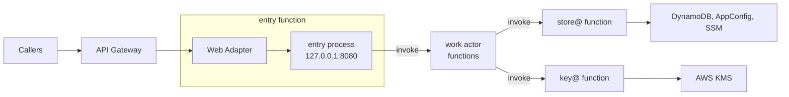
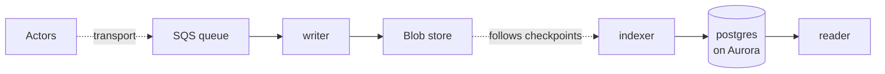

Serverless is the runtime where the platform runs a function per event: no long-running process, no persistent local disk, and no inbound connection between processes except a trigger or a gateway. Same-host Unix sockets work within one function, through extensions. The nodes are elastic and have no identity. Serverless always comes with a provider, so the provider is part of the runtime: AWS Lambda today. The tested installation is [lambda](/runtimes/#lambda), and which drivers fit serverless is on [Runtimes](/runtimes/#which-drivers-fit-which-runtime). Lambda's own term is written "Lambda runtime" on this page; "runtime" alone means serverless, bare-metal or kubernetes.

sluis runs as one Lambda function per [actor](/concepts/families/) and per holder: the unit of [0003](/decisions/0003-units-transports-and-fusion/#units) is a function with its own IAM role, and a hop between two units is a Lambda invoke.

## Topology

### Step 1: the request path

The Lambda Web Adapter connects to the `entry` process on `127.0.0.1:8080` inside the sandbox. Each arrow after it is a Lambda invoke: `entry` routes to the work actor that owns the step, and every work actor invokes store@ for its data and key@ for its keys. The audit writer is never invoked; records reach it through the queue.

### Step 2: the audit path

The indexer follows the log's checkpoints in the bucket and writes the `postgres` index on Aurora, and the reader serves queries from it behind the audit front's own `entry` ([0028](/decisions/0028-audit-pieces/)).

## What runs where

- **One function per actor and per holder, one zip per executable** ([0013](/decisions/0013-release-train-packaging-and-distribution/#packaging-per-runtime)). Each instance, `actor@boundary`, is its own Lambda function and IAM role, `sluis-<actor>-<boundary>`. Only `entry` takes requests from outside; every other function is invoke-only.
- **A work function carries no driver and holds no credential.** Its role lets it invoke other functions and send to the audit transport, and nothing else. Only the holders' roles reach storage, keys, export destinations or the audit blob ([0002](/decisions/0002-families-of-actors/#credential-holders)).
- **A holder's drivers are extensions of its function.** A driver is a platform-started service on a Unix socket; on Lambda the extension mechanism starts it, inside the sandbox. **One Rust extension** implements the AWS ports the holder needs: for store@ the AppConfig, SSM and DynamoDB ports, for key@ the KMS port.
- **Zip only.** A function is a zip archive, so layers and extensions combine; a container image is not used on Lambda. The handler is the same binary as in the `.deb`, renamed `bootstrap`. Zips are built for `arm64`, the default, and `x86_64`, and are named `sluis-<kind>-<name>_<version>_<arch>.zip`; they are published into the installation's own account, and there are no public layer ARNs. See [Packages](/distribution/packages/#packaging-per-runtime).
- **Lambda Web Adapter.** `entry` speaks HTTP, so the Lambda Web Adapter, pinned and vendored into sluis's own layer, translates Lambda events into HTTP requests. No other function uses it.
- **At most three sluis layers** (edge, drivers, configuration), so two of Lambda's five are left to the operator; there is no OpenTelemetry layer.
- **Configuration.** store@ loads signed config documents from a Lambda layer (`file`) or through the AWS AppConfig API (not the AppConfig agent layer), verifies each signature before it parses the document, and swaps the snapshot atomically ([0005](/decisions/0005-the-store/#configuration-loading)). Nothing is pushed on Lambda: the `appconfig` driver polls at the interval the service returns, at an invocation once the interval has passed, and a layer never changes under a running function ([0005](/decisions/0005-the-store/#the-snapshot)). A layer cannot change under a running function, so a config that must change without a deploy comes from AppConfig; the bootstrap file in the layer holds the only settings that need a restart, and a new layer is a new function version ([bootstrap file](/reference/bootstrap-file/), [signed config](/reference/signed-config/)).
- **Single instance.** An actor that must run once at a time, such as the audit writer, is fenced by create-if-absent on the blob, so a second instance cannot fork the log. The writer runs with a **reserved concurrency of 1 on a standard SQS queue**. An event source mapping starts at a concurrency of 2, so the limit throttles it and messages return to the queue. Correctness comes from the fence, not from the limit, and the cost of the throttling is measured on the lambda installation ([0011](/decisions/0011-runtimes-and-installations/#installations)).

## The call graph

The call graph of the actor registry is enforced in each function's code and again by Lambda ([0003](/decisions/0003-units-transports-and-fusion/#the-call-graph)):

- **An invoke resource policy per callee.** A function's resource policy grants `lambda:InvokeFunction` only to the roles of its allowed callers, so a function that is not on the graph cannot call it at all. The callee reads the caller's role and alias and applies the call graph, default deny.
- **Roles, functions, schedules and the invoke grants are generated from the registries** ([0002](/decisions/0002-families-of-actors/#registries-generate-the-enforcement)), so they cannot drift from the call graph.

### No in-process store

A function that linked store@ and its drivers into a work actor's process would fuse a holder with a work actor and give the work actor's role a storage credential. The design does not do it: no function links store@ or its drivers into a work actor's process, and a read or write is an invoke of store@'s function. The Lambda latency spike measured the invokes between actor functions and the opens of session cookies at key@ and found them fast enough, so no exception is needed ([0003](/decisions/0003-units-transports-and-fusion/#fusion), [#1179](https://github.com/truvity/sluis/issues/1179)). The figures of the warm sign-in, and the memory of the functions on its path, are in [0037](/decisions/0037-capacity-is-measured-before-it-is-promised/#the-warm-sign-in-on-lambda). Provisioned concurrency on `entry`, `signer` and the holders is the lever for cold starts meanwhile ([0013](/decisions/0013-release-train-packaging-and-distribution/#consequences)).

## Keys

- **KMS,** with the layout in [0006](/decisions/0006-keys-and-sealing/#keys-per-boundary-on-aws). The key policy of every KMS key names the role of the key@ function alone, so only key@'s role reaches KMS. Every other actor reaches a key through key@, whose rules say who may ask for which purpose. key@ caches opened data keys in memory, and on Lambda the cache's time to live is also the longest time a deleted tenant's data can still be opened ([0006](/decisions/0006-keys-and-sealing/#the-cache)).
- There is **no card on serverless**: the key policy and the invoke policy are the access list. There is no software key on Lambda.

## Data and audit

- **Engine:** DynamoDB, behind store@'s extension. Only store@'s role reaches the table; a work actor never does. Each engine has its own table. An engine serves a boundary at L3 or above, and a boundary below L3 is served under its address prefix by its parent's engine ([0005](/decisions/0005-the-store/#engines)); at L4 the table is in the boundary's own account. Every sealed value is ciphertext before it reaches the table, because store@ never seals or opens ([0005](/decisions/0005-the-store/)).
- **Audit transport:** an SQS queue, because a function's local disk does not outlive its sandbox. The writer consumes the queue, seals batches and writes them to the blob store (S3, create-if-absent), and signs checkpoints with the log key in KMS, through key@. Each project has its own queue, and its policy names only the project's sender roles, so a product cannot write into another project's log ([0028](/decisions/0028-audit-pieces/#transport)). The `direct` transport falls back to a local spool when the writer is down, so it needs a disk and is not available on serverless.
- **Witness:** optional (`peer` or `external`). `sluis config check` warns when there is none. A compliance lock on the S3 bucket prevents overwriting objects, but not a split view.
- **Index:** the default index of the lambda installation is `postgres` in the `aurora` mode ([0028](/decisions/0028-audit-pieces/#provisioning-modes)). The indexer and the reader reach it through RDS Proxy with IAM authentication, so short-lived functions do not exhaust its connections, and they run in the VPC. The `rds` and `external` modes are the other choices. The index is a rebuildable cache; the chain in the bucket is the record.

## Identity and edge

- The function's IAM role is its identity. The platform injects the credentials only into that function's sandbox. A function calls another by `lambda:InvokeFunction`.
- **Listener.** `entry`'s public API listens on TCP, bound to `127.0.0.1` inside the sandbox (`8080` in the example), and the Lambda Web Adapter connects to it. The sandbox holds only sluis's own processes, and the port is never reachable from outside it. No other function has a TCP listener; their drivers use Unix sockets ([0003](/decisions/0003-units-transports-and-fusion/#listeners)).
- **Edge.** API Gateway sits in front of the `entry` function.
- **The console.** The console's single-page application is served from the bucket behind the same API gateway, so the page and the console API in `entry` are same-origin.
- There is no node agent: the JWT for a cloud federation has to come from the `signer`.
- **Response streaming.** API Gateway REST APIs can stream Lambda responses since 2025-11-19. The public API stays unary Connect on Lambda until streaming is tested.

## Limits and residual risk

- Five layers and 250 MB unzipped, code, layers and extensions together, bound what a function can carry; link only the SDK packages an actor uses.
- Lambda has cold starts, and a request that crosses several functions chains them. The adapter and extensions add start-up work, and a larger zip starts slower. The hops were measured in [#1179](https://github.com/truvity/sluis/issues/1179), and the figures are in [0037](/decisions/0037-capacity-is-measured-before-it-is-promised/#the-warm-sign-in-on-lambda).
- Outside a VPC, egress is unrestricted. In a VPC, egress rules work by IP, not by name, so a per-function allow-list by host name needs a proxy or firewall.
- One zip and one IAM role per actor and per holder raise the number of artifacts and resources to keep in step; the generator derives them all from the registries.
- The vendored adapter is part of the supply chain. It is pinned to a version and rebuilt into sluis's layer with the rest of the release.
- Search over the audit trail puts an Aurora database, an RDS Proxy and a VPC path under the reader: every lambda installation pays for them by default ([0028](/decisions/0028-audit-pieces/)).
